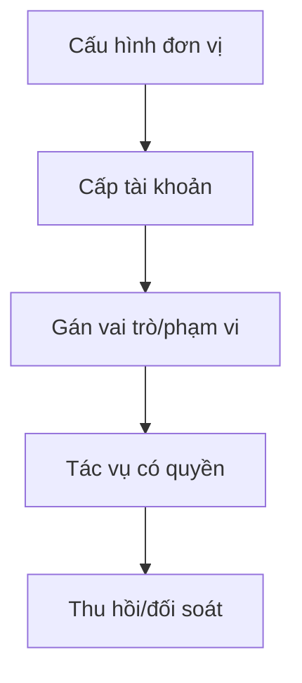

# M00 — KẾ HOẠCH TRIỂN KHAI CHI TIẾT DÀNH CHO TEAM AGENT

> **Module:** Quản trị hệ thống · **Baseline:** `dovandatym1-ship-it/pvh-demo` PR #12 @ `fa214999` · **Ngày:** 11/11/2026 · **Loại tài liệu:** PLAN / REVIEW REQUIRED, không phải xác nhận pháp lý hay code DONE.

## 0. Quy tắc sử dụng / bất biến của dự án

- 01 codebase dùng chung cho nhiều xã; tenant và quyền luôn suy từ phiên phía server. `main`, Phase 1–6, Supabase `Demo-pvh` không được tự merge/deploy/migrate/reset. Thiết kế mở rộng nhiều tenant cần ADR riêng vì schema hiện có ràng buộc singleton.
- **SOURCE** = đã nhìn thấy trong code/SQL nhánh tích hợp; **DESIGN** = trường/quy trình đề xuất cần BA-owner duyệt; **LIVE** = chỉ đánh khi có truy xuất cloud và chứng cứ checksum/DB, không tự suy từ migration file.
- UI luôn tiếng Việt; mã snake_case chỉ ở code/DB; không tạo văn bản quyết định pháp lý giả. Mọi biểu mẫu và quyền ký phải đối chiếu văn bản chuyên ngành đang hiệu lực trước implementation.
- Mỗi task chạy trên branch riêng từ SHA đã chốt, có owner file, commit, test receipt và PR audit; chỉ **Đỗ Văn Đạt** duyệt/merge. Không tự ý tăng phạm vi so với 128 OP nguồn và 5 chức năng M11 đã được đưa vào kiểm kê.
- Luồng **BA01 → DB01 → BE01 → FE01 → QA01 → INT01**. BA các OP có thể làm song song; DB migration được điều phối một owner/module để không xung đột timestamp, SQL và FK; FE chia component độc lập, không cùng sửa route/page khi chưa được lock.

## 1. Phạm vi, code hiện có và ranh giới

- **Mục tiêu module:** Quản trị hệ thống.
- **Tác nhân:** quản trị viên được ủy quyền; cán bộ quản trị tài khoản.
- **Màn hình hiện có:** `/quan-tri/tai-khoan` (trạng thái chức năng cần đối chiếu).
- **Bảng SQL ứng viên:** `public.org_units`, `public.profiles`, `public.memberships`, `public.membership_roles`, `public.roles`, `public.permissions`, `public.module_entitlements`, `public.audit_log`.
- **Số operation trong Function Map:** 12 (mã nguồn OP-Mxx).
- **Feature-level của spec hiện có:** M00-F01 — Cơ cấu tổ chức; M00-F02 — Quản lý vai trò; M00-F03 — Quản lý người dùng; M00-F04 — Nhật ký hệ thống; M00-F05 — Quản lý tích hợp; M00-F06 — Tham số hệ thống.

**Một số file code neo để agent tìm đúng nơi:**

- `src/features/m00-platform/components/accounts-console.tsx`
- `src/features/m00-platform/server/accounts.ts`
- `src/features/m00-platform/types/index.ts`

**Nguồn bắt buộc:** `docs/business/FUNCTION_MAP_PVH_v0.1.md`; `docs/plans/PVH_MASTER_INTEGRATION_2026-11-09/OP_FUNCTION_SCREEN_CODE_DB_CROSSWALK.csv`; `docs/specs/PVH_FULL_MODULE_SPEC_2026-11-09/M00.md`; SQL migration của PR #12. Không được coi `SOURCE_ONLY` là nghiệm thu runtime.

## 2. Flow E2E cấp module



Tổ chức/đơn vị → tài khoản → gán vai trò/phạm vi → hiệu lực → thu hồi/đối soát. Với lỗi/thiếu thẩm quyền, trả hồ sơ về bước phù hợp kèm lý do và sự kiện audit; không sửa hồi tố dữ liệu đã chốt.

**Ma trận hành vi mặc định cho từng màn:** Danh sách (server paging/count), tìm kiếm/lọc/sort, xem chi tiết, thêm/sửa/ẩn hoặc ngừng hiệu lực theo quyền, đính kèm/chứng cứ nếu có, tra cứu lịch sử, xuất có kiểm quyền. Tính năng không áp dụng như nhật ký bất biến hoặc dữ liệu nguồn read-only phải ghi rõ N/A; không ép CRUD xóa đối với dữ liệu pháp lý.

## 3. Trường chuẩn dùng chung (DESIGN, áp dụng khi phù hợp)

| Field | Kiểu PostgreSQL | Quy tắc | Hiển thị / bảo vệ |
|---|---|---|---|
| `id` | `uuid` | PK server-generated | Định danh; mã kỹ thuật ẩn khỏi UI |
| `tenant_id` | `uuid` | FK, lấy từ session/membership | Đơn vị cấp xã; mã kỹ thuật ẩn khỏi UI |
| `org_unit_id` | `uuid` | FK đơn vị, kiểm scope | Đơn vị quản lý; mã kỹ thuật ẩn khỏi UI |
| `status` | `text` | Enum versioned theo đối tượng | Trạng thái; mã kỹ thuật ẩn khỏi UI |
| `version` | `integer` | OCC, tăng sau ghi | Phiên bản; mã kỹ thuật ẩn khỏi UI |
| `created_at` | `timestamptz` | UTC server | Thời điểm tạo; mã kỹ thuật ẩn khỏi UI |
| `created_by` | `uuid` | auth.uid server | Người tạo; mã kỹ thuật ẩn khỏi UI |
| `updated_at` | `timestamptz` | UTC server | Thời điểm cập nhật; mã kỹ thuật ẩn khỏi UI |
| `updated_by` | `uuid` | auth.uid server | Người cập nhật; mã kỹ thuật ẩn khỏi UI |
| `source_ref` | `text` | Nguồn hồ sơ/giấy tờ/đầu mối | Tài liệu nguồn; mã kỹ thuật ẩn khỏi UI |
| `is_active` | `boolean` | Soft retire nếu có phụ thuộc | Còn hiệu lực; mã kỹ thuật ẩn khỏi UI |

### Hợp đồng dữ liệu toàn module

- Mỗi record phải có owner, purpose, effective period khi phù hợp, nguồn gốc, mức nhạy cảm và retention theo policy được duyệt. Không lấy `tenant_id`, `created_by` hoặc `role_code` từ body client để quyết quyền.
- Mọi bảng mới có PK/FK, unique theo scope/kỳ, CHECK cho số/ngày/enum, index trên filter/FK/tenant, RLS (kể cả `FORCE RLS` theo rủi ro), hạn chế `SECURITY DEFINER`, quyền EXECUTE được revoke/grant có chủ đích.
- Cấm bỏ qua `SELECT` policy cần thiết cho UPDATE; kiểm `USING` và `WITH CHECK`; không dùng claims user-editable. Audit immutable, event/outbox idempotency; file private Storage + signed download theo từng user.
- Quy tắc `NULL` ≠ `0` ≠ `N/A` ≠ chưa xác nhận; dashboard và báo cáo giữ lineage và thời điểm chốt; export không được lộ PII ngoài quyền.

## 4. Data Dictionary SOURCE của nhánh tích hợp (không đồng nghĩa đã có trên cloud)

### `public.tenants` — SOURCE trong nhánh tích hợp

| Cột | Kiểu trong SQL | Bắt buộc trong SQL | Ghi chú rà soát |
|---|---|---|---|
| `id` | `uuid` | Không hoặc theo constraint | Phải đối chiếu UI/API, RLS và migration history |
| `code` | `text` | Có | Phải đối chiếu UI/API, RLS và migration history |
| `name` | `text` | Có | Phải đối chiếu UI/API, RLS và migration history |
| `province` | `text` | Có | Phải đối chiếu UI/API, RLS và migration history |
| `officer_mode` | `text` | Có | Phải đối chiếu UI/API, RLS và migration history |
| `features` | `jsonb` | Có | Phải đối chiếu UI/API, RLS và migration history |
| `singleton` | `boolean` | Có | Phải đối chiếu UI/API, RLS và migration history |
| `created_at` | `timestamptz` | Có | Phải đối chiếu UI/API, RLS và migration history |

### `public.org_units` — SOURCE trong nhánh tích hợp

| Cột | Kiểu trong SQL | Bắt buộc trong SQL | Ghi chú rà soát |
|---|---|---|---|
| `id` | `uuid` | Có | Phải đối chiếu UI/API, RLS và migration history |
| `parent_id` | `uuid` | Có | Phải đối chiếu UI/API, RLS và migration history |
| `kind` | `text` | Có | Phải đối chiếu UI/API, RLS và migration history |

### `public.profiles` — SOURCE trong nhánh tích hợp

| Cột | Kiểu trong SQL | Bắt buộc trong SQL | Ghi chú rà soát |
|---|---|---|---|
| `id` | `uuid` | Không hoặc theo constraint | Phải đối chiếu UI/API, RLS và migration history |
| `tenant_id` | `uuid` | Có | Phải đối chiếu UI/API, RLS và migration history |
| `full_name` | `text` | Có | Phải đối chiếu UI/API, RLS và migration history |
| `email` | `text` | Không hoặc theo constraint | Phải đối chiếu UI/API, RLS và migration history |
| `can_view_pii` | `boolean` | Có | Phải đối chiếu UI/API, RLS và migration history |
| `version` | `integer` | Có | Phải đối chiếu UI/API, RLS và migration history |
| `created_at` | `timestamptz` | Có | Phải đối chiếu UI/API, RLS và migration history |

### `public.roles` — SOURCE trong nhánh tích hợp

| Cột | Kiểu trong SQL | Bắt buộc trong SQL | Ghi chú rà soát |
|---|---|---|---|
| `code` | `text` | Có | Phải đối chiếu UI/API, RLS và migration history |
| `role_code` | `text` | Không hoặc theo constraint | Phải đối chiếu UI/API, RLS và migration history |
| `permission_code` | `text` | Không hoặc theo constraint | Phải đối chiếu UI/API, RLS và migration history |

### `public.memberships` — SOURCE trong nhánh tích hợp

| Cột | Kiểu trong SQL | Bắt buộc trong SQL | Ghi chú rà soát |
|---|---|---|---|
| `id` | `uuid` | Có | Phải đối chiếu UI/API, RLS và migration history |
| `user_id` | `uuid` | Có | Phải đối chiếu UI/API, RLS và migration history |
| `roles` | `text[]` | Có | Phải đối chiếu UI/API, RLS và migration history |
| `scopes` | `jsonb` | Có | Phải đối chiếu UI/API, RLS và migration history |
| `org_unit_id` | `uuid` | Có | Phải đối chiếu UI/API, RLS và migration history |
| `is_active` | `boolean` | Có | Phải đối chiếu UI/API, RLS và migration history |
| `created_at` | `timestamptz` | Có | Phải đối chiếu UI/API, RLS và migration history |
| `created_by` | `uuid` | Không hoặc theo constraint | Phải đối chiếu UI/API, RLS và migration history |

### `public.membership_roles` — SOURCE trong nhánh tích hợp

| Cột | Kiểu trong SQL | Bắt buộc trong SQL | Ghi chú rà soát |
|---|---|---|---|
| `membership_id` | `uuid` | Không hoặc theo constraint | Phải đối chiếu UI/API, RLS và migration history |
| `role_code` | `text` | Không hoặc theo constraint | Phải đối chiếu UI/API, RLS và migration history |

### `public.module_entitlements` — SOURCE trong nhánh tích hợp

| Cột | Kiểu trong SQL | Bắt buộc trong SQL | Ghi chú rà soát |
|---|---|---|---|
| `tenant_id` | `uuid` | Có | Phải đối chiếu UI/API, RLS và migration history |
| `enabled` | `boolean` | Có | Phải đối chiếu UI/API, RLS và migration history |

### `public.audit_log` — SOURCE trong nhánh tích hợp

| Cột | Kiểu trong SQL | Bắt buộc trong SQL | Ghi chú rà soát |
|---|---|---|---|
| `id` | `uuid` | Có | Phải đối chiếu UI/API, RLS và migration history |
| `actor_id` | `uuid` | Có | Phải đối chiếu UI/API, RLS và migration history |
| `action` | `text` | Có | Phải đối chiếu UI/API, RLS và migration history |
| `payload` | `jsonb` | Có | Phải đối chiếu UI/API, RLS và migration history |

### `public.pvh_user_notifications` — SOURCE trong nhánh tích hợp

| Cột | Kiểu trong SQL | Bắt buộc trong SQL | Ghi chú rà soát |
|---|---|---|---|
| `id` | `uuid` | Không hoặc theo constraint | Phải đối chiếu UI/API, RLS và migration history |
| `tenant_id` | `uuid` | Có | Phải đối chiếu UI/API, RLS và migration history |
| `recipient_id` | `uuid` | Có | Phải đối chiếu UI/API, RLS và migration history |
| `source_type` | `text` | Có | Phải đối chiếu UI/API, RLS và migration history |
| `source_id` | `uuid` | Có | Phải đối chiếu UI/API, RLS và migration history |
| `event_code` | `text` | Có | Phải đối chiếu UI/API, RLS và migration history |
| `dedupe_key` | `text` | Có | Phải đối chiếu UI/API, RLS và migration history |
| `created_at` | `timestamptz` | Có | Phải đối chiếu UI/API, RLS và migration history |
| `read_at` | `timestamptz` | Không hoặc theo constraint | Phải đối chiếu UI/API, RLS và migration history |

### 4.1. Ánh xạ tên trường thiết kế ↔ cột đã có (không tạo cột trùng)

| Trường tại biểu mẫu/đặc tả | Cột chuẩn ứng viên trong SQL | Quy tắc |
|---|---|---|
| `unit_code` | `public.org_units.code` | Agent DB/BA phải kiểm tra semantics và không tạo thêm cột trước khi chốt mapping |
| `unit_name` | `public.org_units.name` | Agent DB/BA phải kiểm tra semantics và không tạo thêm cột trước khi chốt mapping |
| `unit_kind` | `public.org_units.kind` | Agent DB/BA phải kiểm tra semantics và không tạo thêm cột trước khi chốt mapping |
| `tenant_code` | `public.tenants.code` | Agent DB/BA phải kiểm tra semantics và không tạo thêm cột trước khi chốt mapping |
| `tenant_name` | `public.tenants.name` | Agent DB/BA phải kiểm tra semantics và không tạo thêm cột trước khi chốt mapping |
| `role_code` | `public.roles.code` | Agent DB/BA phải kiểm tra semantics và không tạo thêm cột trước khi chốt mapping |

## 5. WBS chi tiết cho từng operation/feature

Mỗi task dưới đây có mã duy nhất, phụ thuộc và DoD; nhóm BA/DB/BE/FE/QA/INT dùng làm work packages. Cột trường là cấu trúc đề xuất/đối chiếu source, **không phải danh sách pháp lý bắt buộc đã duyệt**.

### OP-M00-001 — Cơ cấu xã, thôn, đơn vị theo hiệu lực; tra địa bàn tại ngày phát sinh

- **Mức độ code:** Chưa tìm thấy hành vi tương ứng trong đối chiếu tĩnh.
- **Nhóm luồng:** `CONFIG` · **Source status:** `DISCOVERED` · **Screen Map:** `SCR-QT-01` · **Mức nhạy cảm nguồn:** `—`.
- **Nguồn yêu cầu:** BL-086; REQ-M00-01.
- **Code API/DB ứng viên (chỉ để rà soát):** NOT_FOUND_STATIC: no org-unit create/update/deactivate/history action or RPC / public.tenants; public.org_units(kind,code,name,parent_id,is_active); no effective dates or history table.
- **Đầu ra nghiệp vụ:** biên nhận có mã và phiên bản (nếu ghi), danh sách/chi tiết theo quyền, trạng thái, lịch sử, nguồn đối soát, thông báo và báo cáo chỉ khi có nguồn thật.

#### Luồng chính và các bước kiểm soát

1. Cán bộ mở nghiệp vụ **Cơ cấu xã, thôn, đơn vị theo hiệu lực; tra địa bàn tại ngày phát sinh**, chọn đúng xã/địa bàn và ghi `unit_code`, `unit_name`, `unit_kind`, `effective_from`; hệ thống dẫn chiếu nguồn và kỳ hiệu lực.
2. Server xác thực phiên, membership còn hiệu lực, permission cấp tác vụ, phạm vi bản ghi và mức nhạy cảm; tenant lấy từ server, không nhận từ form.
3. Kiểm tra schema, ràng buộc trường, mã nguồn, khóa trùng, phiên bản, liên kết FK và tình trạng đối tượng; lỗi trả từng trường bằng tiếng Việt.
4. Hệ thống so sánh mã/phiên bản/cây/hiệu lực với cấu hình hiện hữu; thay đổi không sửa hồi tố bản đã chốt.
5. Người quản trị lưu bản nháp cấu hình; khi cần quyền phát hành, chuyển người rà soát độc lập và xác nhận nguồn thẩm quyền.
6. Ghi thay đổi qua giao dịch có khóa phiên bản; lưu audit before/after, không xóa vật lý mục đã được tham chiếu.
7. Ghi sự kiện bất biến, actor/time/version, tạo thông báo nếu hợp đồng sự kiện quy định; cập nhật dashboard/report theo nguồn phát sinh có truy vết.
8. Người dùng thấy biên nhận/chi tiết, trạng thái và lỗi rõ ràng; hỗ trợ tra cứu, lọc, phân trang và truy xuất lịch sử theo quyền.

**Luồng ngoại lệ:** (E1) sai quyền/sai xã→403 và audit deny, không trả bản ghi; (E2) sai trường/thiếu nguồn→422 theo trường; (E3) trùng/đổi phiên bản→409 và refresh; (E4) nguồn ngoài không xác nhận→PENDING/UNAVAILABLE, không ghi “thành công”; (E5) hồ sơ chốt/đã tham chiếu→không xóa vật lý; (E6) thiếu chứng cứ→CHƯA ĐỦ THÔNG TIN, không tự kết luận không đủ điều kiện.

#### Trường đầu vào/đầu ra bắt buộc đặc tả

| Field snake_case | Nhãn tiếng Việt dự kiến | PostgreSQL | Bắt buộc (đề xuất) | Validation / business rule | Nhạy cảm | Nguồn |
|---|---|---|---|---|---|---|
| `id` | Định danh | `uuid` | Server | PK sinh trên server, không nhận ID tùy ý từ client khi tạo | Nội bộ | SOURCE (cùng tên cột trong module; cần xác minh entity) |
| `tenant_id` | Đơn vị cấp xã | `uuid` | Server | FK đúng tenant, tồn tại, còn hiệu lực, scope | Nội bộ | SOURCE (cùng tên cột trong module; cần xác minh entity) |
| `parent_id` | Đơn vị/mục cha | `uuid` | BA xác nhận bắt buộc | FK đúng tenant, tồn tại, còn hiệu lực, scope | Nội bộ | SOURCE (cùng tên cột trong module; cần xác minh entity) |
| `unit_code` | Mã đơn vị | `text` | BA xác nhận bắt buộc | Chuẩn hóa trim, giới hạn 1–80 ký tự, unique theo owner/kỳ nếu áp dụng | Nội bộ | DESIGN |
| `unit_name` | Tên đơn vị | `text` | BA xác nhận bắt buộc | Trim; giới hạn độ dài theo Data Dictionary; không nhận HTML/script | Nội bộ | DESIGN |
| `unit_kind` | Loại đơn vị | `text` | Theo loại hồ sơ | Trim; giới hạn độ dài theo Data Dictionary; không nhận HTML/script | Nội bộ | DESIGN |
| `effective_from` | Hiệu lực từ | `date` | Theo loại hồ sơ | ISO 8601; ngày bắt đầu ≤ ngày kết thúc khi có cặp | Nội bộ | DESIGN |
| `effective_to` | Hiệu lực đến | `date` | Theo loại hồ sơ | ISO 8601; ngày bắt đầu ≤ ngày kết thúc khi có cặp | Nội bộ | DESIGN |
| `source_ref` | Tài liệu nguồn | `text` | Theo loại hồ sơ | Trim; giới hạn độ dài theo Data Dictionary; không nhận HTML/script | Nội bộ | DESIGN |
| `status` | Trạng thái | `text` | Server | Enum versioned; cấm tự thêm trạng thái ở client | Nội bộ | DESIGN |
| `version` | Phiên bản | `integer` | Server | Số nguyên không âm trừ trường đã duyệt cho phép âm | Nội bộ | SOURCE (cùng tên cột trong module; cần xác minh entity) |
| `created_at` | Thời điểm tạo | `timestamptz` | Server | UTC trong DB, hiển thị giờ Việt Nam; ngày hợp lệ | Nội bộ | SOURCE (cùng tên cột trong module; cần xác minh entity) |
| `created_by` | Người tạo | `uuid` | Server | FK đúng tenant, tồn tại, còn hiệu lực, scope | Nội bộ | SOURCE (cùng tên cột trong module; cần xác minh entity) |

**Quy tắc giao diện:** ẩn mã kỹ thuật; form field-level errors; read-only nguồn ngoài; phân biệt bản nháp/kết quả đã xác nhận; modal xác nhận với lý do khi hủy/ẩn/chuyển; danh sách có tổng số thực và link chi tiết; export chỉ những cột được phép. **KPI:** chỉ bổ sung sau khi ghi rõ bảng+cột+trạng thái+điều kiện lọc+ngày dữ liệu+RLS+link drill-down.

#### Task giao cho agent (mỗi task là 1 work package có thể kiểm thử)

| Task ID | Agent | Đầu vào | Việc phải làm / đầu ra | Phụ thuộc | Definition of Done |
|---|---|---|---|---|---|
| M00-001-BA01 | BA nghiệp vụ | Function Map, quyền/pháp lý, mẫu nguồn | Đặc tả actor, biến thể, trường bắt buộc, trạng thái, ngoại lệ, ownership và rule register đã dẫn nguồn | — | Biên bản duyệt phạm vi OP-M00-001; không còn trường 'cần xác minh' chưa gán owner |
| M00-001-DB01 | DB/RLS | BA01 + schema thực/migration đang có | Migration cho entity/constraint/FK/index theo tenant; RLS và pgTAP; không sửa migration đã áp cloud | M00-001-BA01 | Replay clean trên staging; thử 2 ngữ cảnh xã theo ADR (không vượt ràng buộc singleton), 3 vai trò, scope deny, concurrency và rollback |
| M00-001-BE01 | Backend | BA01 + DB01 | Server Action/query/RPC/DTO tại `src/features/m00-platform/server/`; kiểm quyền server, idempotency, audit, error mapping | M00-001-DB01 | Unit+contract test: thành công, sai schema, sai tenant, thiếu quyền, stale version, retry không nhân đôi |
| M00-001-FE01 | Frontend | BA01 + hợp đồng API từ BE01 | Form tiếng Việt, danh sách/chi tiết, lọc/tìm/sort/page, CRUD có điều kiện tại `src/features/m00-platform/components/`; loading/empty/error/mobile | M00-001-BE01 | Browser 375/768/1440px; focus/keyboard; mỗi trường có nhãn, mô tả lỗi; không cho sửa khi không có quyền |
| M00-001-QA01 | QA/Automation | BA01 + DB01/BE01/FE01 | Bộ ca kiểm thử OP-M00-001: happy/negative/boundary/role/tenant/PII/export/audit; fixture và receipt SHA | M00-001-FE01 | Có test IDs gắn OP-M00-001, chạy đúng HEAD, không chỉ snapshot UI; fail case có log che dữ liệu |
| M00-001-INT01 | Tích hợp | QA01 + mã nguồn nhánh dự kiến | Liên kết M00 quyền/M01 việc/M09 chỉ tiêu/M10 nguồn nếu áp dụng; evidence route→action→DB→test; PR chỉ đổi phạm vi task | M00-001-QA01 | Không thiếu phép C/R/U/D áp dụng; không có false-success; reviewer Đỗ Văn Đạt ký nhận |

#### Acceptance scenarios

- **AC-OP-M00-001-01 (hợp lệ):** Given phiên có quyền và nguồn `parent_id` và `unit_code` hợp lệ; When thực hiện theo luồng CONFIG; Then lưu/tra cứu đúng kết quả, trả ID hoặc biên nhận, audit và version.
- **AC-OP-M00-001-02 (bị chặn):** Given sai địa bàn, không có permission hoặc dữ liệu thiếu; When gọi trực tiếp API/RPC; Then trả lỗi không rò dữ liệu và không tạo bản ghi/event thành công.
- **AC-OP-M00-001-03 (đồng thời/nguồn):** Given cập nhật trùng hoặc source/version cũ; When gửi lặp hoặc hai người chỉnh cùng bản ghi; Then idempotent/reject conflict, không ghi đè phiên bản mới.
- **AC-OP-M00-001-04 (giao diện):** Given vai trò chỉ xem; When mở bằng điện thoại hoặc đường dẫn trực tiếp; Then các tác vụ sửa/xuất không đúng quyền bị ẩn *và* server từ chối.

**Evidence tối thiểu:** commit SHA; đường dẫn file liên quan; migration history/checksum (nếu thay DB); link CI thực thi; pgTAP/RLS test ID; ảnh/trace 375/768/1440; dữ liệu test và người ký duyệt. Trạng thái OP chỉ được đổi `UNVERIFIED` → `STATIC_CHECKED` → `INTEGRATED_TESTED` → `OWNER_ACCEPTED` khi có biên nhận tương ứng.

### OP-M00-002 — Người dùng và phân công theo lĩnh vực/địa bàn/nhóm hồ sơ; danh sách việc chưa có người nhận khi thu hồi

- **Mức độ code:** Đã thấy điểm vào/code liên quan; chưa đủ điều kiện kết luận khép kín.
- **Nhóm luồng:** `CONFIG` · **Source status:** `DISCOVERED` · **Screen Map:** `SCR-QT-02` · **Mức nhạy cảm nguồn:** `—`.
- **Nguồn yêu cầu:** BL-089; REQ-M00-02; WF-11; DEM-ADD-02.
- **Code API/DB ứng viên (chỉ để rà soát):** inviteStaffAction → Auth invite + app.provision_membership; setStaffRoleAction → app.set_membership_role; revokeStaffAction → app.revoke_membership / auth.users; public.profiles; public.memberships; public.membership_roles; public.role_permissions; public.org_units; no pending-work recovery/list when membership is revoked.
- **Đầu ra nghiệp vụ:** biên nhận có mã và phiên bản (nếu ghi), danh sách/chi tiết theo quyền, trạng thái, lịch sử, nguồn đối soát, thông báo và báo cáo chỉ khi có nguồn thật.

#### Luồng chính và các bước kiểm soát

1. Cán bộ mở nghiệp vụ **Người dùng và phân công theo lĩnh vực/địa bàn/nhóm hồ sơ; danh sách việc chưa có người nhận khi thu hồi**, chọn đúng xã/địa bàn và ghi `role_code`, `scope_ids`, `valid_from`, `valid_to`; hệ thống dẫn chiếu nguồn và kỳ hiệu lực.
2. Server xác thực phiên, membership còn hiệu lực, permission cấp tác vụ, phạm vi bản ghi và mức nhạy cảm; tenant lấy từ server, không nhận từ form.
3. Kiểm tra schema, ràng buộc trường, mã nguồn, khóa trùng, phiên bản, liên kết FK và tình trạng đối tượng; lỗi trả từng trường bằng tiếng Việt.
4. Server lập truy vấn theo tenant, vai trò, địa bàn, thời điểm hiệu lực; lọc/đếm/phân trang tại CSDL.
5. Tính chỉ tiêu từ bản ghi nguồn thực với chính sách NULL, 0 và chưa báo cáo riêng; không đưa dữ liệu ngoài quyền lên client.
6. Hiển thị danh sách/chi tiết và nguồn gốc; xuất tệp chỉ khi có quyền, ghi lịch sử xuất và kiểm lại quyền từng dòng.
7. Ghi sự kiện bất biến, actor/time/version, tạo thông báo nếu hợp đồng sự kiện quy định; cập nhật dashboard/report theo nguồn phát sinh có truy vết.
8. Người dùng thấy biên nhận/chi tiết, trạng thái và lỗi rõ ràng; hỗ trợ tra cứu, lọc, phân trang và truy xuất lịch sử theo quyền.

**Luồng ngoại lệ:** (E1) sai quyền/sai xã→403 và audit deny, không trả bản ghi; (E2) sai trường/thiếu nguồn→422 theo trường; (E3) trùng/đổi phiên bản→409 và refresh; (E4) nguồn ngoài không xác nhận→PENDING/UNAVAILABLE, không ghi “thành công”; (E5) hồ sơ chốt/đã tham chiếu→không xóa vật lý; (E6) thiếu chứng cứ→CHƯA ĐỦ THÔNG TIN, không tự kết luận không đủ điều kiện.

#### Trường đầu vào/đầu ra bắt buộc đặc tả

| Field snake_case | Nhãn tiếng Việt dự kiến | PostgreSQL | Bắt buộc (đề xuất) | Validation / business rule | Nhạy cảm | Nguồn |
|---|---|---|---|---|---|---|
| `id` | Định danh | `uuid` | Server | PK sinh trên server, không nhận ID tùy ý từ client khi tạo | Nội bộ | SOURCE (cùng tên cột trong module; cần xác minh entity) |
| `tenant_id` | Đơn vị cấp xã | `uuid` | Server | FK đúng tenant, tồn tại, còn hiệu lực, scope | Nội bộ | SOURCE (cùng tên cột trong module; cần xác minh entity) |
| `user_id` | Người dùng | `uuid` | BA xác nhận bắt buộc | FK đúng tenant, tồn tại, còn hiệu lực, scope | Nội bộ | SOURCE (cùng tên cột trong module; cần xác minh entity) |
| `role_code` | Mã vai trò | `text` | BA xác nhận bắt buộc | Chuẩn hóa trim, giới hạn 1–80 ký tự, unique theo owner/kỳ nếu áp dụng | Nội bộ | SOURCE (cùng tên cột trong module; cần xác minh entity) |
| `org_unit_id` | Đơn vị quản lý | `uuid` | BA xác nhận bắt buộc | FK đúng tenant, tồn tại, còn hiệu lực, scope | Nội bộ | SOURCE (cùng tên cột trong module; cần xác minh entity) |
| `scope_ids` | Phạm vi phân công | `uuid[]` | Theo loại hồ sơ | Từng ID có quyền truy cập, không trùng, tối đa theo contract | Nội bộ | DESIGN |
| `valid_from` | Có hiệu lực từ | `timestamptz` | Theo loại hồ sơ | UTC, thời điểm hợp lệ và không lùi ngày trái quy tắc | Nội bộ | DESIGN |
| `valid_to` | Có hiệu lực đến | `timestamptz` | Theo loại hồ sơ | UTC, thời điểm hợp lệ và không lùi ngày trái quy tắc | Nội bộ | DESIGN |
| `reassignment_reason` | Lý do giao lại | `text` | Theo loại hồ sơ | Trim; giới hạn độ dài theo Data Dictionary; không nhận HTML/script | Nội bộ | DESIGN |
| `status` | Trạng thái | `text` | Server | Enum versioned; cấm tự thêm trạng thái ở client | Nội bộ | DESIGN |
| `version` | Phiên bản | `integer` | Server | Số nguyên không âm trừ trường đã duyệt cho phép âm | Nội bộ | SOURCE (cùng tên cột trong module; cần xác minh entity) |
| `created_at` | Thời điểm tạo | `timestamptz` | Server | UTC trong DB, hiển thị giờ Việt Nam; ngày hợp lệ | Nội bộ | SOURCE (cùng tên cột trong module; cần xác minh entity) |
| `created_by` | Người tạo | `uuid` | Server | FK đúng tenant, tồn tại, còn hiệu lực, scope | Nội bộ | SOURCE (cùng tên cột trong module; cần xác minh entity) |

**Quy tắc giao diện:** ẩn mã kỹ thuật; form field-level errors; read-only nguồn ngoài; phân biệt bản nháp/kết quả đã xác nhận; modal xác nhận với lý do khi hủy/ẩn/chuyển; danh sách có tổng số thực và link chi tiết; export chỉ những cột được phép. **KPI:** chỉ bổ sung sau khi ghi rõ bảng+cột+trạng thái+điều kiện lọc+ngày dữ liệu+RLS+link drill-down.

#### Task giao cho agent (mỗi task là 1 work package có thể kiểm thử)

| Task ID | Agent | Đầu vào | Việc phải làm / đầu ra | Phụ thuộc | Definition of Done |
|---|---|---|---|---|---|
| M00-002-BA01 | BA nghiệp vụ | Function Map, quyền/pháp lý, mẫu nguồn | Đặc tả actor, biến thể, trường bắt buộc, trạng thái, ngoại lệ, ownership và rule register đã dẫn nguồn | — | Biên bản duyệt phạm vi OP-M00-002; không còn trường 'cần xác minh' chưa gán owner |
| M00-002-DB01 | DB/RLS | BA01 + schema thực/migration đang có | Migration cho entity/constraint/FK/index theo tenant; RLS và pgTAP; không sửa migration đã áp cloud; tối ưu read-side count/filter | M00-002-BA01 | Replay clean trên staging; thử 2 ngữ cảnh xã theo ADR (không vượt ràng buộc singleton), 3 vai trò, scope deny, concurrency và rollback |
| M00-002-BE01 | Backend | BA01 + DB01 | Server Action/query/RPC/DTO tại `src/features/m00-platform/server/`; kiểm quyền server, idempotency, audit, error mapping; truy vấn chỉ đọc, không tự sinh tác vụ ghi | M00-002-DB01 | Unit+contract test: thành công, sai schema, sai tenant, thiếu quyền, stale version, retry không nhân đôi |
| M00-002-FE01 | Frontend | BA01 + hợp đồng API từ BE01 | Form tiếng Việt, danh sách/chi tiết, lọc/tìm/sort/page, CRUD có điều kiện tại `src/features/m00-platform/components/`; loading/empty/error/mobile; export kiểm lại quyền | M00-002-BE01 | Browser 375/768/1440px; focus/keyboard; mỗi trường có nhãn, mô tả lỗi; không cho sửa khi không có quyền |
| M00-002-QA01 | QA/Automation | BA01 + DB01/BE01/FE01 | Bộ ca kiểm thử OP-M00-002: happy/negative/boundary/role/tenant/PII/export/audit; fixture và receipt SHA | M00-002-FE01 | Có test IDs gắn OP-M00-002, chạy đúng HEAD, không chỉ snapshot UI; fail case có log che dữ liệu |
| M00-002-INT01 | Tích hợp | QA01 + mã nguồn nhánh dự kiến | Liên kết M00 quyền/M01 việc/M09 chỉ tiêu/M10 nguồn nếu áp dụng; evidence route→action→DB→test; PR chỉ đổi phạm vi task | M00-002-QA01 | Không thiếu phép C/R/U/D áp dụng; không có false-success; reviewer Đỗ Văn Đạt ký nhận |

#### Acceptance scenarios

- **AC-OP-M00-002-01 (hợp lệ):** Given phiên có quyền và nguồn `user_id` và `role_code` hợp lệ; When thực hiện theo luồng CONFIG; Then lưu/tra cứu đúng kết quả, trả ID hoặc biên nhận, audit và version.
- **AC-OP-M00-002-02 (bị chặn):** Given sai địa bàn, không có permission hoặc dữ liệu thiếu; When gọi trực tiếp API/RPC; Then trả lỗi không rò dữ liệu và không tạo bản ghi/event thành công.
- **AC-OP-M00-002-03 (đồng thời/nguồn):** Given cập nhật trùng hoặc source/version cũ; When gửi lặp hoặc hai người chỉnh cùng bản ghi; Then idempotent/reject conflict, không ghi đè phiên bản mới.
- **AC-OP-M00-002-04 (giao diện):** Given vai trò chỉ xem; When mở bằng điện thoại hoặc đường dẫn trực tiếp; Then các tác vụ sửa/xuất không đúng quyền bị ẩn *và* server từ chối.

**Evidence tối thiểu:** commit SHA; đường dẫn file liên quan; migration history/checksum (nếu thay DB); link CI thực thi; pgTAP/RLS test ID; ảnh/trace 375/768/1440; dữ liệu test và người ký duyệt. Trạng thái OP chỉ được đổi `UNVERIFIED` → `STATIC_CHECKED` → `INTEGRATED_TESTED` → `OWNER_ACCEPTED` khi có biên nhận tương ứng.

### OP-M00-003 — Ủy quyền có căn cứ, phạm vi, thời hạn; tự chặn khi hết hiệu lực

- **Mức độ code:** Chỉ thấy code/demo legacy, chưa dùng làm backend chuẩn.
- **Nhóm luồng:** `TRACK` · **Source status:** `DISCOVERED` · **Screen Map:** `SCR-QT-02` · **Mức nhạy cảm nguồn:** `—`.
- **Nguồn yêu cầu:** BL-012, BL-087; REQ-M00-03; WF-11; DEM-ADD-02.
- **Code API/DB ứng viên (chỉ để rà soát):** NOT_FOUND_STATIC: no delegation grant/revoke action or RPC / public.memberships.valid_from/valid_to applies to membership only; no delegated-authority entity/cause/scope/approval record.
- **Đầu ra nghiệp vụ:** biên nhận có mã và phiên bản (nếu ghi), danh sách/chi tiết theo quyền, trạng thái, lịch sử, nguồn đối soát, thông báo và báo cáo chỉ khi có nguồn thật.

#### Luồng chính và các bước kiểm soát

1. Cán bộ mở nghiệp vụ **Ủy quyền có căn cứ, phạm vi, thời hạn; tự chặn khi hết hiệu lực**, chọn đúng xã/địa bàn và ghi `authority_ref`, `scope_ids`, `revocation_reason`; hệ thống dẫn chiếu nguồn và kỳ hiệu lực.
2. Server xác thực phiên, membership còn hiệu lực, permission cấp tác vụ, phạm vi bản ghi và mức nhạy cảm; tenant lấy từ server, không nhận từ form.
3. Kiểm tra schema, ràng buộc trường, mã nguồn, khóa trùng, phiên bản, liên kết FK và tình trạng đối tượng; lỗi trả từng trường bằng tiếng Việt.
4. Tạo bản theo dõi/kế hoạch cùng người phụ trách, mốc thời gian và nguồn chỉ tiêu/kết quả.
5. Giao đầu việc liên quan M01 nếu có; cập nhật theo phiên bản và ghi lý do sửa dữ liệu đã được xác nhận.
6. Người xác nhận độc lập đối soát mục tiêu–thực tế–minh chứng; đóng kỳ khi đủ điều kiện hoặc nêu thiếu nguồn.
7. Ghi sự kiện bất biến, actor/time/version, tạo thông báo nếu hợp đồng sự kiện quy định; cập nhật dashboard/report theo nguồn phát sinh có truy vết.
8. Người dùng thấy biên nhận/chi tiết, trạng thái và lỗi rõ ràng; hỗ trợ tra cứu, lọc, phân trang và truy xuất lịch sử theo quyền.

**Luồng ngoại lệ:** (E1) sai quyền/sai xã→403 và audit deny, không trả bản ghi; (E2) sai trường/thiếu nguồn→422 theo trường; (E3) trùng/đổi phiên bản→409 và refresh; (E4) nguồn ngoài không xác nhận→PENDING/UNAVAILABLE, không ghi “thành công”; (E5) hồ sơ chốt/đã tham chiếu→không xóa vật lý; (E6) thiếu chứng cứ→CHƯA ĐỦ THÔNG TIN, không tự kết luận không đủ điều kiện.

#### Trường đầu vào/đầu ra bắt buộc đặc tả

| Field snake_case | Nhãn tiếng Việt dự kiến | PostgreSQL | Bắt buộc (đề xuất) | Validation / business rule | Nhạy cảm | Nguồn |
|---|---|---|---|---|---|---|
| `id` | Định danh | `uuid` | Server | PK sinh trên server, không nhận ID tùy ý từ client khi tạo | Nội bộ | SOURCE (cùng tên cột trong module; cần xác minh entity) |
| `tenant_id` | Đơn vị cấp xã | `uuid` | Server | FK đúng tenant, tồn tại, còn hiệu lực, scope | Nội bộ | SOURCE (cùng tên cột trong module; cần xác minh entity) |
| `delegator_id` | Người ủy quyền | `uuid` | BA xác nhận bắt buộc | FK đúng tenant, tồn tại, còn hiệu lực, scope | Nội bộ | DESIGN |
| `delegatee_id` | Người được ủy quyền | `uuid` | BA xác nhận bắt buộc | FK đúng tenant, tồn tại, còn hiệu lực, scope | Nội bộ | DESIGN |
| `authority_ref` | Văn bản xác định thẩm quyền | `text` | BA xác nhận bắt buộc | Trim; giới hạn độ dài theo Data Dictionary; không nhận HTML/script | Nội bộ | DESIGN |
| `scope_ids` | Phạm vi phân công | `uuid[]` | Theo loại hồ sơ | Từng ID có quyền truy cập, không trùng, tối đa theo contract | Nội bộ | DESIGN |
| `starts_at` | Thời điểm bắt đầu | `timestamptz` | Theo loại hồ sơ | UTC trong DB, hiển thị giờ Việt Nam; ngày hợp lệ | Nội bộ | DESIGN |
| `ends_at` | Thời điểm kết thúc | `timestamptz` | Theo loại hồ sơ | UTC trong DB, hiển thị giờ Việt Nam; ngày hợp lệ | Nội bộ | DESIGN |
| `revocation_reason` | Lý do thu hồi | `text` | Theo loại hồ sơ | Trim; giới hạn độ dài theo Data Dictionary; không nhận HTML/script | Nội bộ | DESIGN |
| `status` | Trạng thái | `text` | Server | Enum versioned; cấm tự thêm trạng thái ở client | Nội bộ | DESIGN |
| `version` | Phiên bản | `integer` | Server | Số nguyên không âm trừ trường đã duyệt cho phép âm | Nội bộ | SOURCE (cùng tên cột trong module; cần xác minh entity) |
| `created_at` | Thời điểm tạo | `timestamptz` | Server | UTC trong DB, hiển thị giờ Việt Nam; ngày hợp lệ | Nội bộ | SOURCE (cùng tên cột trong module; cần xác minh entity) |
| `created_by` | Người tạo | `uuid` | Server | FK đúng tenant, tồn tại, còn hiệu lực, scope | Nội bộ | SOURCE (cùng tên cột trong module; cần xác minh entity) |

**Quy tắc giao diện:** ẩn mã kỹ thuật; form field-level errors; read-only nguồn ngoài; phân biệt bản nháp/kết quả đã xác nhận; modal xác nhận với lý do khi hủy/ẩn/chuyển; danh sách có tổng số thực và link chi tiết; export chỉ những cột được phép. **KPI:** chỉ bổ sung sau khi ghi rõ bảng+cột+trạng thái+điều kiện lọc+ngày dữ liệu+RLS+link drill-down.

#### Task giao cho agent (mỗi task là 1 work package có thể kiểm thử)

| Task ID | Agent | Đầu vào | Việc phải làm / đầu ra | Phụ thuộc | Definition of Done |
|---|---|---|---|---|---|
| M00-003-BA01 | BA nghiệp vụ | Function Map, quyền/pháp lý, mẫu nguồn | Đặc tả actor, biến thể, trường bắt buộc, trạng thái, ngoại lệ, ownership và rule register đã dẫn nguồn | — | Biên bản duyệt phạm vi OP-M00-003; không còn trường 'cần xác minh' chưa gán owner |
| M00-003-DB01 | DB/RLS | BA01 + schema thực/migration đang có | Migration cho entity/constraint/FK/index theo tenant; RLS và pgTAP; không sửa migration đã áp cloud | M00-003-BA01 | Replay clean trên staging; thử 2 ngữ cảnh xã theo ADR (không vượt ràng buộc singleton), 3 vai trò, scope deny, concurrency và rollback |
| M00-003-BE01 | Backend | BA01 + DB01 | Server Action/query/RPC/DTO tại `src/features/m00-platform/server/`; kiểm quyền server, idempotency, audit, error mapping | M00-003-DB01 | Unit+contract test: thành công, sai schema, sai tenant, thiếu quyền, stale version, retry không nhân đôi |
| M00-003-FE01 | Frontend | BA01 + hợp đồng API từ BE01 | Form tiếng Việt, danh sách/chi tiết, lọc/tìm/sort/page, CRUD có điều kiện tại `src/features/m00-platform/components/`; loading/empty/error/mobile | M00-003-BE01 | Browser 375/768/1440px; focus/keyboard; mỗi trường có nhãn, mô tả lỗi; không cho sửa khi không có quyền |
| M00-003-QA01 | QA/Automation | BA01 + DB01/BE01/FE01 | Bộ ca kiểm thử OP-M00-003: happy/negative/boundary/role/tenant/PII/export/audit; fixture và receipt SHA | M00-003-FE01 | Có test IDs gắn OP-M00-003, chạy đúng HEAD, không chỉ snapshot UI; fail case có log che dữ liệu |
| M00-003-INT01 | Tích hợp | QA01 + mã nguồn nhánh dự kiến | Liên kết M00 quyền/M01 việc/M09 chỉ tiêu/M10 nguồn nếu áp dụng; evidence route→action→DB→test; PR chỉ đổi phạm vi task | M00-003-QA01 | Không thiếu phép C/R/U/D áp dụng; không có false-success; reviewer Đỗ Văn Đạt ký nhận |

#### Acceptance scenarios

- **AC-OP-M00-003-01 (hợp lệ):** Given phiên có quyền và nguồn `delegator_id` và `delegatee_id` hợp lệ; When thực hiện theo luồng TRACK; Then lưu/tra cứu đúng kết quả, trả ID hoặc biên nhận, audit và version.
- **AC-OP-M00-003-02 (bị chặn):** Given sai địa bàn, không có permission hoặc dữ liệu thiếu; When gọi trực tiếp API/RPC; Then trả lỗi không rò dữ liệu và không tạo bản ghi/event thành công.
- **AC-OP-M00-003-03 (đồng thời/nguồn):** Given cập nhật trùng hoặc source/version cũ; When gửi lặp hoặc hai người chỉnh cùng bản ghi; Then idempotent/reject conflict, không ghi đè phiên bản mới.
- **AC-OP-M00-003-04 (giao diện):** Given vai trò chỉ xem; When mở bằng điện thoại hoặc đường dẫn trực tiếp; Then các tác vụ sửa/xuất không đúng quyền bị ẩn *và* server từ chối.

**Evidence tối thiểu:** commit SHA; đường dẫn file liên quan; migration history/checksum (nếu thay DB); link CI thực thi; pgTAP/RLS test ID; ảnh/trace 375/768/1440; dữ liệu test và người ký duyệt. Trạng thái OP chỉ được đổi `UNVERIFIED` → `STATIC_CHECKED` → `INTEGRATED_TESTED` → `OWNER_ACCEPTED` khi có biên nhận tương ứng.

### OP-M00-004 — Loại nghiệp vụ/loại hồ sơ: chủ trì, checklist, bộ trạng thái, phiên bản, ngày áp dụng

- **Mức độ code:** Đã thấy điểm vào/code liên quan; chưa đủ điều kiện kết luận khép kín.
- **Nhóm luồng:** `CONFIG` · **Source status:** `DISCOVERED` · **Screen Map:** `SCR-QT-03` · **Mức nhạy cảm nguồn:** `—`.
- **Nguồn yêu cầu:** BL-090; REQ-M00-04.
- **Code API/DB ứng viên (chỉ để rà soát):** CreateWorkItemSchema.category → createWorkItemAction → app.create_work_item_v2; fixed app.work_item_transition_rules / public.work_items.category is text; public.work_item_transition_rules has workflow_version/rule_version 1; no effective-dated case-type configuration entity found.
- **Đầu ra nghiệp vụ:** biên nhận có mã và phiên bản (nếu ghi), danh sách/chi tiết theo quyền, trạng thái, lịch sử, nguồn đối soát, thông báo và báo cáo chỉ khi có nguồn thật.

#### Luồng chính và các bước kiểm soát

1. Cán bộ mở nghiệp vụ **Loại nghiệp vụ/loại hồ sơ: chủ trì, checklist, bộ trạng thái, phiên bản, ngày áp dụng**, chọn đúng xã/địa bàn và ghi `case_type_code`, `case_type_name`, `owner_role`, `checklist_version`; hệ thống dẫn chiếu nguồn và kỳ hiệu lực.
2. Server xác thực phiên, membership còn hiệu lực, permission cấp tác vụ, phạm vi bản ghi và mức nhạy cảm; tenant lấy từ server, không nhận từ form.
3. Kiểm tra schema, ràng buộc trường, mã nguồn, khóa trùng, phiên bản, liên kết FK và tình trạng đối tượng; lỗi trả từng trường bằng tiếng Việt.
4. Hệ thống so sánh mã/phiên bản/cây/hiệu lực với cấu hình hiện hữu; thay đổi không sửa hồi tố bản đã chốt.
5. Người quản trị lưu bản nháp cấu hình; khi cần quyền phát hành, chuyển người rà soát độc lập và xác nhận nguồn thẩm quyền.
6. Ghi thay đổi qua giao dịch có khóa phiên bản; lưu audit before/after, không xóa vật lý mục đã được tham chiếu.
7. Ghi sự kiện bất biến, actor/time/version, tạo thông báo nếu hợp đồng sự kiện quy định; cập nhật dashboard/report theo nguồn phát sinh có truy vết.
8. Người dùng thấy biên nhận/chi tiết, trạng thái và lỗi rõ ràng; hỗ trợ tra cứu, lọc, phân trang và truy xuất lịch sử theo quyền.

**Luồng ngoại lệ:** (E1) sai quyền/sai xã→403 và audit deny, không trả bản ghi; (E2) sai trường/thiếu nguồn→422 theo trường; (E3) trùng/đổi phiên bản→409 và refresh; (E4) nguồn ngoài không xác nhận→PENDING/UNAVAILABLE, không ghi “thành công”; (E5) hồ sơ chốt/đã tham chiếu→không xóa vật lý; (E6) thiếu chứng cứ→CHƯA ĐỦ THÔNG TIN, không tự kết luận không đủ điều kiện.

#### Trường đầu vào/đầu ra bắt buộc đặc tả

| Field snake_case | Nhãn tiếng Việt dự kiến | PostgreSQL | Bắt buộc (đề xuất) | Validation / business rule | Nhạy cảm | Nguồn |
|---|---|---|---|---|---|---|
| `id` | Định danh | `uuid` | Server | PK sinh trên server, không nhận ID tùy ý từ client khi tạo | Nội bộ | SOURCE (cùng tên cột trong module; cần xác minh entity) |
| `tenant_id` | Đơn vị cấp xã | `uuid` | Server | FK đúng tenant, tồn tại, còn hiệu lực, scope | Nội bộ | SOURCE (cùng tên cột trong module; cần xác minh entity) |
| `case_type_code` | Mã hồ sơ loại | `text` | BA xác nhận bắt buộc | Chuẩn hóa trim, giới hạn 1–80 ký tự, unique theo owner/kỳ nếu áp dụng | Nội bộ | DESIGN |
| `case_type_name` | Tên hồ sơ loại | `text` | BA xác nhận bắt buộc | Trim; giới hạn độ dài theo Data Dictionary; không nhận HTML/script | Nội bộ | DESIGN |
| `owner_role` | Vai trò chủ trì | `text` | BA xác nhận bắt buộc | Trim; giới hạn độ dài theo Data Dictionary; không nhận HTML/script | Nội bộ | DESIGN |
| `checklist_version` | Phiên bản bảng kiểm | `integer` | Theo loại hồ sơ | Số nguyên không âm trừ trường đã duyệt cho phép âm | Nội bộ | DESIGN |
| `workflow_version` | Phiên bản quy trình | `integer` | Theo loại hồ sơ | Số nguyên không âm trừ trường đã duyệt cho phép âm | Nội bộ | DESIGN |
| `effective_from` | Hiệu lực từ | `date` | Theo loại hồ sơ | ISO 8601; ngày bắt đầu ≤ ngày kết thúc khi có cặp | Nội bộ | DESIGN |
| `status` | Trạng thái | `text` | Server | Enum versioned; cấm tự thêm trạng thái ở client | Nội bộ | DESIGN |
| `version` | Phiên bản | `integer` | Server | Số nguyên không âm trừ trường đã duyệt cho phép âm | Nội bộ | SOURCE (cùng tên cột trong module; cần xác minh entity) |
| `created_at` | Thời điểm tạo | `timestamptz` | Server | UTC trong DB, hiển thị giờ Việt Nam; ngày hợp lệ | Nội bộ | SOURCE (cùng tên cột trong module; cần xác minh entity) |
| `created_by` | Người tạo | `uuid` | Server | FK đúng tenant, tồn tại, còn hiệu lực, scope | Nội bộ | SOURCE (cùng tên cột trong module; cần xác minh entity) |

**Quy tắc giao diện:** ẩn mã kỹ thuật; form field-level errors; read-only nguồn ngoài; phân biệt bản nháp/kết quả đã xác nhận; modal xác nhận với lý do khi hủy/ẩn/chuyển; danh sách có tổng số thực và link chi tiết; export chỉ những cột được phép. **KPI:** chỉ bổ sung sau khi ghi rõ bảng+cột+trạng thái+điều kiện lọc+ngày dữ liệu+RLS+link drill-down.

#### Task giao cho agent (mỗi task là 1 work package có thể kiểm thử)

| Task ID | Agent | Đầu vào | Việc phải làm / đầu ra | Phụ thuộc | Definition of Done |
|---|---|---|---|---|---|
| M00-004-BA01 | BA nghiệp vụ | Function Map, quyền/pháp lý, mẫu nguồn | Đặc tả actor, biến thể, trường bắt buộc, trạng thái, ngoại lệ, ownership và rule register đã dẫn nguồn | — | Biên bản duyệt phạm vi OP-M00-004; không còn trường 'cần xác minh' chưa gán owner |
| M00-004-DB01 | DB/RLS | BA01 + schema thực/migration đang có | Migration cho entity/constraint/FK/index theo tenant; RLS và pgTAP; không sửa migration đã áp cloud | M00-004-BA01 | Replay clean trên staging; thử 2 ngữ cảnh xã theo ADR (không vượt ràng buộc singleton), 3 vai trò, scope deny, concurrency và rollback |
| M00-004-BE01 | Backend | BA01 + DB01 | Server Action/query/RPC/DTO tại `src/features/m00-platform/server/`; kiểm quyền server, idempotency, audit, error mapping | M00-004-DB01 | Unit+contract test: thành công, sai schema, sai tenant, thiếu quyền, stale version, retry không nhân đôi |
| M00-004-FE01 | Frontend | BA01 + hợp đồng API từ BE01 | Form tiếng Việt, danh sách/chi tiết, lọc/tìm/sort/page, CRUD có điều kiện tại `src/features/m00-platform/components/`; loading/empty/error/mobile | M00-004-BE01 | Browser 375/768/1440px; focus/keyboard; mỗi trường có nhãn, mô tả lỗi; không cho sửa khi không có quyền |
| M00-004-QA01 | QA/Automation | BA01 + DB01/BE01/FE01 | Bộ ca kiểm thử OP-M00-004: happy/negative/boundary/role/tenant/PII/export/audit; fixture và receipt SHA | M00-004-FE01 | Có test IDs gắn OP-M00-004, chạy đúng HEAD, không chỉ snapshot UI; fail case có log che dữ liệu |
| M00-004-INT01 | Tích hợp | QA01 + mã nguồn nhánh dự kiến | Liên kết M00 quyền/M01 việc/M09 chỉ tiêu/M10 nguồn nếu áp dụng; evidence route→action→DB→test; PR chỉ đổi phạm vi task | M00-004-QA01 | Không thiếu phép C/R/U/D áp dụng; không có false-success; reviewer Đỗ Văn Đạt ký nhận |

#### Acceptance scenarios

- **AC-OP-M00-004-01 (hợp lệ):** Given phiên có quyền và nguồn `case_type_code` và `case_type_name` hợp lệ; When thực hiện theo luồng CONFIG; Then lưu/tra cứu đúng kết quả, trả ID hoặc biên nhận, audit và version.
- **AC-OP-M00-004-02 (bị chặn):** Given sai địa bàn, không có permission hoặc dữ liệu thiếu; When gọi trực tiếp API/RPC; Then trả lỗi không rò dữ liệu và không tạo bản ghi/event thành công.
- **AC-OP-M00-004-03 (đồng thời/nguồn):** Given cập nhật trùng hoặc source/version cũ; When gửi lặp hoặc hai người chỉnh cùng bản ghi; Then idempotent/reject conflict, không ghi đè phiên bản mới.
- **AC-OP-M00-004-04 (giao diện):** Given vai trò chỉ xem; When mở bằng điện thoại hoặc đường dẫn trực tiếp; Then các tác vụ sửa/xuất không đúng quyền bị ẩn *và* server từ chối.

**Evidence tối thiểu:** commit SHA; đường dẫn file liên quan; migration history/checksum (nếu thay DB); link CI thực thi; pgTAP/RLS test ID; ảnh/trace 375/768/1440; dữ liệu test và người ký duyệt. Trạng thái OP chỉ được đổi `UNVERIFIED` → `STATIC_CHECKED` → `INTEGRATED_TESTED` → `OWNER_ACCEPTED` khi có biên nhận tương ứng.

### OP-M00-005 — Gói quy tắc: soạn → soát → phát hành → ngừng; ghim phiên bản vào hồ sơ

- **Mức độ code:** Đã thấy điểm vào/code liên quan; chưa đủ điều kiện kết luận khép kín.
- **Nhóm luồng:** `CONFIG` · **Source status:** `DISCOVERED` · **Screen Map:** `SCR-QT-04` · **Mức nhạy cảm nguồn:** `—`.
- **Nguồn yêu cầu:** — (RA_SOAT §5); REQ-M00-04; DEM-ADD-03.
- **Code API/DB ứng viên (chỉ để rà soát):** M04 create_culture_rule_pack path only; no generic draft→review→publish→retire RPC found / public.culture_rule_packs stores M04-specific criteria/version/status; no shared ruleset lifecycle/approval history; M04 data is marked illustrative/unverified.
- **Đầu ra nghiệp vụ:** biên nhận có mã và phiên bản (nếu ghi), danh sách/chi tiết theo quyền, trạng thái, lịch sử, nguồn đối soát, thông báo và báo cáo chỉ khi có nguồn thật.

#### Luồng chính và các bước kiểm soát

1. Cán bộ mở nghiệp vụ **Gói quy tắc: soạn → soát → phát hành → ngừng; ghim phiên bản vào hồ sơ**, chọn đúng xã/địa bàn và ghi `rule_pack_code`, `rule_version`, `rule_status`, `authority_ref`; hệ thống dẫn chiếu nguồn và kỳ hiệu lực.
2. Server xác thực phiên, membership còn hiệu lực, permission cấp tác vụ, phạm vi bản ghi và mức nhạy cảm; tenant lấy từ server, không nhận từ form.
3. Kiểm tra schema, ràng buộc trường, mã nguồn, khóa trùng, phiên bản, liên kết FK và tình trạng đối tượng; lỗi trả từng trường bằng tiếng Việt.
4. Hệ thống so sánh mã/phiên bản/cây/hiệu lực với cấu hình hiện hữu; thay đổi không sửa hồi tố bản đã chốt.
5. Người quản trị lưu bản nháp cấu hình; khi cần quyền phát hành, chuyển người rà soát độc lập và xác nhận nguồn thẩm quyền.
6. Ghi thay đổi qua giao dịch có khóa phiên bản; lưu audit before/after, không xóa vật lý mục đã được tham chiếu.
7. Ghi sự kiện bất biến, actor/time/version, tạo thông báo nếu hợp đồng sự kiện quy định; cập nhật dashboard/report theo nguồn phát sinh có truy vết.
8. Người dùng thấy biên nhận/chi tiết, trạng thái và lỗi rõ ràng; hỗ trợ tra cứu, lọc, phân trang và truy xuất lịch sử theo quyền.

**Luồng ngoại lệ:** (E1) sai quyền/sai xã→403 và audit deny, không trả bản ghi; (E2) sai trường/thiếu nguồn→422 theo trường; (E3) trùng/đổi phiên bản→409 và refresh; (E4) nguồn ngoài không xác nhận→PENDING/UNAVAILABLE, không ghi “thành công”; (E5) hồ sơ chốt/đã tham chiếu→không xóa vật lý; (E6) thiếu chứng cứ→CHƯA ĐỦ THÔNG TIN, không tự kết luận không đủ điều kiện.

#### Trường đầu vào/đầu ra bắt buộc đặc tả

| Field snake_case | Nhãn tiếng Việt dự kiến | PostgreSQL | Bắt buộc (đề xuất) | Validation / business rule | Nhạy cảm | Nguồn |
|---|---|---|---|---|---|---|
| `id` | Định danh | `uuid` | Server | PK sinh trên server, không nhận ID tùy ý từ client khi tạo | Nội bộ | SOURCE (cùng tên cột trong module; cần xác minh entity) |
| `tenant_id` | Đơn vị cấp xã | `uuid` | Server | FK đúng tenant, tồn tại, còn hiệu lực, scope | Nội bộ | SOURCE (cùng tên cột trong module; cần xác minh entity) |
| `rule_pack_code` | Mã bộ tiêu chí/quy tắc | `text` | BA xác nhận bắt buộc | Chuẩn hóa trim, giới hạn 1–80 ký tự, unique theo owner/kỳ nếu áp dụng | Nội bộ | DESIGN |
| `rule_version` | Phiên bản quy tắc | `integer` | BA xác nhận bắt buộc | Số nguyên không âm trừ trường đã duyệt cho phép âm | Nội bộ | DESIGN |
| `rule_status` | Trạng thái quy tắc | `text` | BA xác nhận bắt buộc | Enum versioned; cấm tự thêm trạng thái ở client | Nội bộ | DESIGN |
| `authority_ref` | Văn bản xác định thẩm quyền | `text` | Theo loại hồ sơ | Trim; giới hạn độ dài theo Data Dictionary; không nhận HTML/script | Nội bộ | DESIGN |
| `effective_from` | Hiệu lực từ | `date` | Theo loại hồ sơ | ISO 8601; ngày bắt đầu ≤ ngày kết thúc khi có cặp | Nội bộ | DESIGN |
| `effective_to` | Hiệu lực đến | `date` | Theo loại hồ sơ | ISO 8601; ngày bắt đầu ≤ ngày kết thúc khi có cặp | Nội bộ | DESIGN |
| `criteria_json` | Bộ tiêu chí | `jsonb` | Theo loại hồ sơ | Schema Zod + giới hạn kích thước, cấm trường ngoài allowlist | Nội bộ | DESIGN |
| `status` | Trạng thái | `text` | Server | Enum versioned; cấm tự thêm trạng thái ở client | Nội bộ | DESIGN |
| `version` | Phiên bản | `integer` | Server | Số nguyên không âm trừ trường đã duyệt cho phép âm | Nội bộ | SOURCE (cùng tên cột trong module; cần xác minh entity) |
| `created_at` | Thời điểm tạo | `timestamptz` | Server | UTC trong DB, hiển thị giờ Việt Nam; ngày hợp lệ | Nội bộ | SOURCE (cùng tên cột trong module; cần xác minh entity) |
| `created_by` | Người tạo | `uuid` | Server | FK đúng tenant, tồn tại, còn hiệu lực, scope | Nội bộ | SOURCE (cùng tên cột trong module; cần xác minh entity) |

**Quy tắc giao diện:** ẩn mã kỹ thuật; form field-level errors; read-only nguồn ngoài; phân biệt bản nháp/kết quả đã xác nhận; modal xác nhận với lý do khi hủy/ẩn/chuyển; danh sách có tổng số thực và link chi tiết; export chỉ những cột được phép. **KPI:** chỉ bổ sung sau khi ghi rõ bảng+cột+trạng thái+điều kiện lọc+ngày dữ liệu+RLS+link drill-down.

#### Task giao cho agent (mỗi task là 1 work package có thể kiểm thử)

| Task ID | Agent | Đầu vào | Việc phải làm / đầu ra | Phụ thuộc | Definition of Done |
|---|---|---|---|---|---|
| M00-005-BA01 | BA nghiệp vụ | Function Map, quyền/pháp lý, mẫu nguồn | Đặc tả actor, biến thể, trường bắt buộc, trạng thái, ngoại lệ, ownership và rule register đã dẫn nguồn | — | Biên bản duyệt phạm vi OP-M00-005; không còn trường 'cần xác minh' chưa gán owner |
| M00-005-DB01 | DB/RLS | BA01 + schema thực/migration đang có | Migration cho entity/constraint/FK/index theo tenant; RLS và pgTAP; không sửa migration đã áp cloud | M00-005-BA01 | Replay clean trên staging; thử 2 ngữ cảnh xã theo ADR (không vượt ràng buộc singleton), 3 vai trò, scope deny, concurrency và rollback |
| M00-005-BE01 | Backend | BA01 + DB01 | Server Action/query/RPC/DTO tại `src/features/m00-platform/server/`; kiểm quyền server, idempotency, audit, error mapping | M00-005-DB01 | Unit+contract test: thành công, sai schema, sai tenant, thiếu quyền, stale version, retry không nhân đôi |
| M00-005-FE01 | Frontend | BA01 + hợp đồng API từ BE01 | Form tiếng Việt, danh sách/chi tiết, lọc/tìm/sort/page, CRUD có điều kiện tại `src/features/m00-platform/components/`; loading/empty/error/mobile | M00-005-BE01 | Browser 375/768/1440px; focus/keyboard; mỗi trường có nhãn, mô tả lỗi; không cho sửa khi không có quyền |
| M00-005-QA01 | QA/Automation | BA01 + DB01/BE01/FE01 | Bộ ca kiểm thử OP-M00-005: happy/negative/boundary/role/tenant/PII/export/audit; fixture và receipt SHA | M00-005-FE01 | Có test IDs gắn OP-M00-005, chạy đúng HEAD, không chỉ snapshot UI; fail case có log che dữ liệu |
| M00-005-INT01 | Tích hợp | QA01 + mã nguồn nhánh dự kiến | Liên kết M00 quyền/M01 việc/M09 chỉ tiêu/M10 nguồn nếu áp dụng; evidence route→action→DB→test; PR chỉ đổi phạm vi task | M00-005-QA01 | Không thiếu phép C/R/U/D áp dụng; không có false-success; reviewer Đỗ Văn Đạt ký nhận |

#### Acceptance scenarios

- **AC-OP-M00-005-01 (hợp lệ):** Given phiên có quyền và nguồn `rule_pack_code` và `rule_version` hợp lệ; When thực hiện theo luồng CONFIG; Then lưu/tra cứu đúng kết quả, trả ID hoặc biên nhận, audit và version.
- **AC-OP-M00-005-02 (bị chặn):** Given sai địa bàn, không có permission hoặc dữ liệu thiếu; When gọi trực tiếp API/RPC; Then trả lỗi không rò dữ liệu và không tạo bản ghi/event thành công.
- **AC-OP-M00-005-03 (đồng thời/nguồn):** Given cập nhật trùng hoặc source/version cũ; When gửi lặp hoặc hai người chỉnh cùng bản ghi; Then idempotent/reject conflict, không ghi đè phiên bản mới.
- **AC-OP-M00-005-04 (giao diện):** Given vai trò chỉ xem; When mở bằng điện thoại hoặc đường dẫn trực tiếp; Then các tác vụ sửa/xuất không đúng quyền bị ẩn *và* server từ chối.

**Evidence tối thiểu:** commit SHA; đường dẫn file liên quan; migration history/checksum (nếu thay DB); link CI thực thi; pgTAP/RLS test ID; ảnh/trace 375/768/1440; dữ liệu test và người ký duyệt. Trạng thái OP chỉ được đổi `UNVERIFIED` → `STATIC_CHECKED` → `INTEGRATED_TESTED` → `OWNER_ACCEPTED` khi có biên nhận tương ứng.

### OP-M00-006 — Danh mục dùng chung: lĩnh vực, loại cơ sở, loại đối tượng, loại tài liệu, lý do kết thúc

- **Mức độ code:** Đã thấy điểm vào/code liên quan; chưa đủ điều kiện kết luận khép kín.
- **Nhóm luồng:** `CONFIG` · **Source status:** `DISCOVERED` · **Screen Map:** `SCR-QT-05` · **Mức nhạy cảm nguồn:** `—`.
- **Nguồn yêu cầu:** BL-086; REQ-M00-05.
- **Code API/DB ứng viên (chỉ để rà soát):** createCatalogAction/updateCatalogAction/createCatalogValueAction/updateCatalogValueAction → app.create_pvh_catalog, app.update_pvh_catalog, app.create_pvh_catalog_value, app.update_pvh_catalog_value / public.pvh_catalogs; public.pvh_catalog_values (valid_from/to, version, hierarchy); public.pvh_catalog_events; initial approved catalog inventory/ownership not established.
- **Đầu ra nghiệp vụ:** biên nhận có mã và phiên bản (nếu ghi), danh sách/chi tiết theo quyền, trạng thái, lịch sử, nguồn đối soát, thông báo và báo cáo chỉ khi có nguồn thật.

#### Luồng chính và các bước kiểm soát

1. Cán bộ mở nghiệp vụ **Danh mục dùng chung: lĩnh vực, loại cơ sở, loại đối tượng, loại tài liệu, lý do kết thúc**, chọn đúng xã/địa bàn và ghi `catalog_code`, `value_code`, `value_label`, `valid_from`; hệ thống dẫn chiếu nguồn và kỳ hiệu lực.
2. Server xác thực phiên, membership còn hiệu lực, permission cấp tác vụ, phạm vi bản ghi và mức nhạy cảm; tenant lấy từ server, không nhận từ form.
3. Kiểm tra schema, ràng buộc trường, mã nguồn, khóa trùng, phiên bản, liên kết FK và tình trạng đối tượng; lỗi trả từng trường bằng tiếng Việt.
4. Hệ thống so sánh mã/phiên bản/cây/hiệu lực với cấu hình hiện hữu; thay đổi không sửa hồi tố bản đã chốt.
5. Người quản trị lưu bản nháp cấu hình; khi cần quyền phát hành, chuyển người rà soát độc lập và xác nhận nguồn thẩm quyền.
6. Ghi thay đổi qua giao dịch có khóa phiên bản; lưu audit before/after, không xóa vật lý mục đã được tham chiếu.
7. Ghi sự kiện bất biến, actor/time/version, tạo thông báo nếu hợp đồng sự kiện quy định; cập nhật dashboard/report theo nguồn phát sinh có truy vết.
8. Người dùng thấy biên nhận/chi tiết, trạng thái và lỗi rõ ràng; hỗ trợ tra cứu, lọc, phân trang và truy xuất lịch sử theo quyền.

**Luồng ngoại lệ:** (E1) sai quyền/sai xã→403 và audit deny, không trả bản ghi; (E2) sai trường/thiếu nguồn→422 theo trường; (E3) trùng/đổi phiên bản→409 và refresh; (E4) nguồn ngoài không xác nhận→PENDING/UNAVAILABLE, không ghi “thành công”; (E5) hồ sơ chốt/đã tham chiếu→không xóa vật lý; (E6) thiếu chứng cứ→CHƯA ĐỦ THÔNG TIN, không tự kết luận không đủ điều kiện.

#### Trường đầu vào/đầu ra bắt buộc đặc tả

| Field snake_case | Nhãn tiếng Việt dự kiến | PostgreSQL | Bắt buộc (đề xuất) | Validation / business rule | Nhạy cảm | Nguồn |
|---|---|---|---|---|---|---|
| `id` | Định danh | `uuid` | Server | PK sinh trên server, không nhận ID tùy ý từ client khi tạo | Nội bộ | SOURCE (cùng tên cột trong module; cần xác minh entity) |
| `tenant_id` | Đơn vị cấp xã | `uuid` | Server | FK đúng tenant, tồn tại, còn hiệu lực, scope | Nội bộ | SOURCE (cùng tên cột trong module; cần xác minh entity) |
| `catalog_code` | Mã danh mục | `text` | BA xác nhận bắt buộc | Chuẩn hóa trim, giới hạn 1–80 ký tự, unique theo owner/kỳ nếu áp dụng | Nội bộ | DESIGN |
| `value_code` | Mã giá trị | `text` | BA xác nhận bắt buộc | Chuẩn hóa trim, giới hạn 1–80 ký tự, unique theo owner/kỳ nếu áp dụng | Nội bộ | DESIGN |
| `value_label` | Tên giá trị | `text` | BA xác nhận bắt buộc | Trim; giới hạn độ dài theo Data Dictionary; không nhận HTML/script | Nội bộ | DESIGN |
| `parent_value_id` | Giá trị cha | `uuid` | Theo loại hồ sơ | FK đúng tenant, tồn tại, còn hiệu lực, scope | Nội bộ | DESIGN |
| `valid_from` | Có hiệu lực từ | `timestamptz` | Theo loại hồ sơ | UTC, thời điểm hợp lệ và không lùi ngày trái quy tắc | Nội bộ | DESIGN |
| `valid_to` | Có hiệu lực đến | `timestamptz` | Theo loại hồ sơ | UTC, thời điểm hợp lệ và không lùi ngày trái quy tắc | Nội bộ | DESIGN |
| `status` | Trạng thái | `text` | Server | Enum versioned; cấm tự thêm trạng thái ở client | Nội bộ | DESIGN |
| `version` | Phiên bản | `integer` | Server | Số nguyên không âm trừ trường đã duyệt cho phép âm | Nội bộ | SOURCE (cùng tên cột trong module; cần xác minh entity) |
| `created_at` | Thời điểm tạo | `timestamptz` | Server | UTC trong DB, hiển thị giờ Việt Nam; ngày hợp lệ | Nội bộ | SOURCE (cùng tên cột trong module; cần xác minh entity) |
| `created_by` | Người tạo | `uuid` | Server | FK đúng tenant, tồn tại, còn hiệu lực, scope | Nội bộ | SOURCE (cùng tên cột trong module; cần xác minh entity) |

**Quy tắc giao diện:** ẩn mã kỹ thuật; form field-level errors; read-only nguồn ngoài; phân biệt bản nháp/kết quả đã xác nhận; modal xác nhận với lý do khi hủy/ẩn/chuyển; danh sách có tổng số thực và link chi tiết; export chỉ những cột được phép. **KPI:** chỉ bổ sung sau khi ghi rõ bảng+cột+trạng thái+điều kiện lọc+ngày dữ liệu+RLS+link drill-down.

#### Task giao cho agent (mỗi task là 1 work package có thể kiểm thử)

| Task ID | Agent | Đầu vào | Việc phải làm / đầu ra | Phụ thuộc | Definition of Done |
|---|---|---|---|---|---|
| M00-006-BA01 | BA nghiệp vụ | Function Map, quyền/pháp lý, mẫu nguồn | Đặc tả actor, biến thể, trường bắt buộc, trạng thái, ngoại lệ, ownership và rule register đã dẫn nguồn | — | Biên bản duyệt phạm vi OP-M00-006; không còn trường 'cần xác minh' chưa gán owner |
| M00-006-DB01 | DB/RLS | BA01 + schema thực/migration đang có | Migration cho entity/constraint/FK/index theo tenant; RLS và pgTAP; không sửa migration đã áp cloud | M00-006-BA01 | Replay clean trên staging; thử 2 ngữ cảnh xã theo ADR (không vượt ràng buộc singleton), 3 vai trò, scope deny, concurrency và rollback |
| M00-006-BE01 | Backend | BA01 + DB01 | Server Action/query/RPC/DTO tại `src/features/m00-platform/server/`; kiểm quyền server, idempotency, audit, error mapping | M00-006-DB01 | Unit+contract test: thành công, sai schema, sai tenant, thiếu quyền, stale version, retry không nhân đôi |
| M00-006-FE01 | Frontend | BA01 + hợp đồng API từ BE01 | Form tiếng Việt, danh sách/chi tiết, lọc/tìm/sort/page, CRUD có điều kiện tại `src/features/m00-platform/components/`; loading/empty/error/mobile | M00-006-BE01 | Browser 375/768/1440px; focus/keyboard; mỗi trường có nhãn, mô tả lỗi; không cho sửa khi không có quyền |
| M00-006-QA01 | QA/Automation | BA01 + DB01/BE01/FE01 | Bộ ca kiểm thử OP-M00-006: happy/negative/boundary/role/tenant/PII/export/audit; fixture và receipt SHA | M00-006-FE01 | Có test IDs gắn OP-M00-006, chạy đúng HEAD, không chỉ snapshot UI; fail case có log che dữ liệu |
| M00-006-INT01 | Tích hợp | QA01 + mã nguồn nhánh dự kiến | Liên kết M00 quyền/M01 việc/M09 chỉ tiêu/M10 nguồn nếu áp dụng; evidence route→action→DB→test; PR chỉ đổi phạm vi task | M00-006-QA01 | Không thiếu phép C/R/U/D áp dụng; không có false-success; reviewer Đỗ Văn Đạt ký nhận |

#### Acceptance scenarios

- **AC-OP-M00-006-01 (hợp lệ):** Given phiên có quyền và nguồn `catalog_code` và `value_code` hợp lệ; When thực hiện theo luồng CONFIG; Then lưu/tra cứu đúng kết quả, trả ID hoặc biên nhận, audit và version.
- **AC-OP-M00-006-02 (bị chặn):** Given sai địa bàn, không có permission hoặc dữ liệu thiếu; When gọi trực tiếp API/RPC; Then trả lỗi không rò dữ liệu và không tạo bản ghi/event thành công.
- **AC-OP-M00-006-03 (đồng thời/nguồn):** Given cập nhật trùng hoặc source/version cũ; When gửi lặp hoặc hai người chỉnh cùng bản ghi; Then idempotent/reject conflict, không ghi đè phiên bản mới.
- **AC-OP-M00-006-04 (giao diện):** Given vai trò chỉ xem; When mở bằng điện thoại hoặc đường dẫn trực tiếp; Then các tác vụ sửa/xuất không đúng quyền bị ẩn *và* server từ chối.

**Evidence tối thiểu:** commit SHA; đường dẫn file liên quan; migration history/checksum (nếu thay DB); link CI thực thi; pgTAP/RLS test ID; ảnh/trace 375/768/1440; dữ liệu test và người ký duyệt. Trạng thái OP chỉ được đổi `UNVERIFIED` → `STATIC_CHECKED` → `INTEGRATED_TESTED` → `OWNER_ACCEPTED` khi có biên nhận tương ứng.

### OP-M00-007 — Mẫu thu thập/checklist theo phiên bản; hồ sơ cũ giữ mẫu đã dùng

- **Mức độ code:** Đã thấy điểm vào/code liên quan; chưa đủ điều kiện kết luận khép kín.
- **Nhóm luồng:** `CONFIG` · **Source status:** `DISCOVERED` · **Screen Map:** `SCR-QT-03` · **Mức nhạy cảm nguồn:** `—`.
- **Nguồn yêu cầu:** BL-090, BL-092; REQ-M00-07.
- **Code API/DB ứng viên (chỉ để rà soát):** M04 rule-pack create/campaign capture; M08 create_inspection_record accepts checklist_version text; no generic template/version resolver found / M04 submissions pin culture_rule_pack_id/version; M08 inspection_records.checklist_version is text; no generic form-template entity or historical template snapshot found.
- **Đầu ra nghiệp vụ:** biên nhận có mã và phiên bản (nếu ghi), danh sách/chi tiết theo quyền, trạng thái, lịch sử, nguồn đối soát, thông báo và báo cáo chỉ khi có nguồn thật.

#### Luồng chính và các bước kiểm soát

1. Cán bộ mở nghiệp vụ **Mẫu thu thập/checklist theo phiên bản; hồ sơ cũ giữ mẫu đã dùng**, chọn đúng xã/địa bàn và ghi `template_code`, `template_version`, `field_schema_json`, `checklist_json`; hệ thống dẫn chiếu nguồn và kỳ hiệu lực.
2. Server xác thực phiên, membership còn hiệu lực, permission cấp tác vụ, phạm vi bản ghi và mức nhạy cảm; tenant lấy từ server, không nhận từ form.
3. Kiểm tra schema, ràng buộc trường, mã nguồn, khóa trùng, phiên bản, liên kết FK và tình trạng đối tượng; lỗi trả từng trường bằng tiếng Việt.
4. Hệ thống so sánh mã/phiên bản/cây/hiệu lực với cấu hình hiện hữu; thay đổi không sửa hồi tố bản đã chốt.
5. Người quản trị lưu bản nháp cấu hình; khi cần quyền phát hành, chuyển người rà soát độc lập và xác nhận nguồn thẩm quyền.
6. Ghi thay đổi qua giao dịch có khóa phiên bản; lưu audit before/after, không xóa vật lý mục đã được tham chiếu.
7. Ghi sự kiện bất biến, actor/time/version, tạo thông báo nếu hợp đồng sự kiện quy định; cập nhật dashboard/report theo nguồn phát sinh có truy vết.
8. Người dùng thấy biên nhận/chi tiết, trạng thái và lỗi rõ ràng; hỗ trợ tra cứu, lọc, phân trang và truy xuất lịch sử theo quyền.

**Luồng ngoại lệ:** (E1) sai quyền/sai xã→403 và audit deny, không trả bản ghi; (E2) sai trường/thiếu nguồn→422 theo trường; (E3) trùng/đổi phiên bản→409 và refresh; (E4) nguồn ngoài không xác nhận→PENDING/UNAVAILABLE, không ghi “thành công”; (E5) hồ sơ chốt/đã tham chiếu→không xóa vật lý; (E6) thiếu chứng cứ→CHƯA ĐỦ THÔNG TIN, không tự kết luận không đủ điều kiện.

#### Trường đầu vào/đầu ra bắt buộc đặc tả

| Field snake_case | Nhãn tiếng Việt dự kiến | PostgreSQL | Bắt buộc (đề xuất) | Validation / business rule | Nhạy cảm | Nguồn |
|---|---|---|---|---|---|---|
| `id` | Định danh | `uuid` | Server | PK sinh trên server, không nhận ID tùy ý từ client khi tạo | Nội bộ | SOURCE (cùng tên cột trong module; cần xác minh entity) |
| `tenant_id` | Đơn vị cấp xã | `uuid` | Server | FK đúng tenant, tồn tại, còn hiệu lực, scope | Nội bộ | SOURCE (cùng tên cột trong module; cần xác minh entity) |
| `template_code` | Mã biểu mẫu | `text` | BA xác nhận bắt buộc | Chuẩn hóa trim, giới hạn 1–80 ký tự, unique theo owner/kỳ nếu áp dụng | Nội bộ | DESIGN |
| `template_version` | Phiên bản biểu mẫu | `integer` | BA xác nhận bắt buộc | Số nguyên không âm trừ trường đã duyệt cho phép âm | Nội bộ | DESIGN |
| `field_schema_json` | Cấu trúc trường biểu mẫu | `jsonb` | BA xác nhận bắt buộc | Schema Zod + giới hạn kích thước, cấm trường ngoài allowlist | Nội bộ | DESIGN |
| `checklist_json` | Bảng kiểm cấu trúc | `jsonb` | Theo loại hồ sơ | Schema Zod + giới hạn kích thước, cấm trường ngoài allowlist | Nội bộ | DESIGN |
| `effective_from` | Hiệu lực từ | `date` | Theo loại hồ sơ | ISO 8601; ngày bắt đầu ≤ ngày kết thúc khi có cặp | Nội bộ | DESIGN |
| `retired_at` | Thời điểm ngừng sử dụng | `timestamptz` | Theo loại hồ sơ | UTC trong DB, hiển thị giờ Việt Nam; ngày hợp lệ | Nội bộ | DESIGN |
| `status` | Trạng thái | `text` | Server | Enum versioned; cấm tự thêm trạng thái ở client | Nội bộ | DESIGN |
| `version` | Phiên bản | `integer` | Server | Số nguyên không âm trừ trường đã duyệt cho phép âm | Nội bộ | SOURCE (cùng tên cột trong module; cần xác minh entity) |
| `created_at` | Thời điểm tạo | `timestamptz` | Server | UTC trong DB, hiển thị giờ Việt Nam; ngày hợp lệ | Nội bộ | SOURCE (cùng tên cột trong module; cần xác minh entity) |
| `created_by` | Người tạo | `uuid` | Server | FK đúng tenant, tồn tại, còn hiệu lực, scope | Nội bộ | SOURCE (cùng tên cột trong module; cần xác minh entity) |

**Quy tắc giao diện:** ẩn mã kỹ thuật; form field-level errors; read-only nguồn ngoài; phân biệt bản nháp/kết quả đã xác nhận; modal xác nhận với lý do khi hủy/ẩn/chuyển; danh sách có tổng số thực và link chi tiết; export chỉ những cột được phép. **KPI:** chỉ bổ sung sau khi ghi rõ bảng+cột+trạng thái+điều kiện lọc+ngày dữ liệu+RLS+link drill-down.

#### Task giao cho agent (mỗi task là 1 work package có thể kiểm thử)

| Task ID | Agent | Đầu vào | Việc phải làm / đầu ra | Phụ thuộc | Definition of Done |
|---|---|---|---|---|---|
| M00-007-BA01 | BA nghiệp vụ | Function Map, quyền/pháp lý, mẫu nguồn | Đặc tả actor, biến thể, trường bắt buộc, trạng thái, ngoại lệ, ownership và rule register đã dẫn nguồn | — | Biên bản duyệt phạm vi OP-M00-007; không còn trường 'cần xác minh' chưa gán owner |
| M00-007-DB01 | DB/RLS | BA01 + schema thực/migration đang có | Migration cho entity/constraint/FK/index theo tenant; RLS và pgTAP; không sửa migration đã áp cloud | M00-007-BA01 | Replay clean trên staging; thử 2 ngữ cảnh xã theo ADR (không vượt ràng buộc singleton), 3 vai trò, scope deny, concurrency và rollback |
| M00-007-BE01 | Backend | BA01 + DB01 | Server Action/query/RPC/DTO tại `src/features/m00-platform/server/`; kiểm quyền server, idempotency, audit, error mapping | M00-007-DB01 | Unit+contract test: thành công, sai schema, sai tenant, thiếu quyền, stale version, retry không nhân đôi |
| M00-007-FE01 | Frontend | BA01 + hợp đồng API từ BE01 | Form tiếng Việt, danh sách/chi tiết, lọc/tìm/sort/page, CRUD có điều kiện tại `src/features/m00-platform/components/`; loading/empty/error/mobile | M00-007-BE01 | Browser 375/768/1440px; focus/keyboard; mỗi trường có nhãn, mô tả lỗi; không cho sửa khi không có quyền |
| M00-007-QA01 | QA/Automation | BA01 + DB01/BE01/FE01 | Bộ ca kiểm thử OP-M00-007: happy/negative/boundary/role/tenant/PII/export/audit; fixture và receipt SHA | M00-007-FE01 | Có test IDs gắn OP-M00-007, chạy đúng HEAD, không chỉ snapshot UI; fail case có log che dữ liệu |
| M00-007-INT01 | Tích hợp | QA01 + mã nguồn nhánh dự kiến | Liên kết M00 quyền/M01 việc/M09 chỉ tiêu/M10 nguồn nếu áp dụng; evidence route→action→DB→test; PR chỉ đổi phạm vi task | M00-007-QA01 | Không thiếu phép C/R/U/D áp dụng; không có false-success; reviewer Đỗ Văn Đạt ký nhận |

#### Acceptance scenarios

- **AC-OP-M00-007-01 (hợp lệ):** Given phiên có quyền và nguồn `template_code` và `template_version` hợp lệ; When thực hiện theo luồng CONFIG; Then lưu/tra cứu đúng kết quả, trả ID hoặc biên nhận, audit và version.
- **AC-OP-M00-007-02 (bị chặn):** Given sai địa bàn, không có permission hoặc dữ liệu thiếu; When gọi trực tiếp API/RPC; Then trả lỗi không rò dữ liệu và không tạo bản ghi/event thành công.
- **AC-OP-M00-007-03 (đồng thời/nguồn):** Given cập nhật trùng hoặc source/version cũ; When gửi lặp hoặc hai người chỉnh cùng bản ghi; Then idempotent/reject conflict, không ghi đè phiên bản mới.
- **AC-OP-M00-007-04 (giao diện):** Given vai trò chỉ xem; When mở bằng điện thoại hoặc đường dẫn trực tiếp; Then các tác vụ sửa/xuất không đúng quyền bị ẩn *và* server từ chối.

**Evidence tối thiểu:** commit SHA; đường dẫn file liên quan; migration history/checksum (nếu thay DB); link CI thực thi; pgTAP/RLS test ID; ảnh/trace 375/768/1440; dữ liệu test và người ký duyệt. Trạng thái OP chỉ được đổi `UNVERIFIED` → `STATIC_CHECKED` → `INTEGRATED_TESTED` → `OWNER_ACCEPTED` khi có biên nhận tương ứng.

### OP-M00-008 — Nhật ký tạo/sửa/chuyển/xem dữ liệu nhạy cảm/xuất

- **Mức độ code:** Chưa tìm thấy hành vi tương ứng trong đối chiếu tĩnh.
- **Nhóm luồng:** `QUERY` · **Source status:** `DISCOVERED` · **Screen Map:** `SCR-QT-08` · **Mức nhạy cảm nguồn:** `CAO`.
- **Nguồn yêu cầu:** BL-088; REQ-M00-06.
- **Code API/DB ứng viên (chỉ để rà soát):** Audited database RPCs append public.audit_log; getRecentAuditLogs helper is not called by app route/action found in static search / public.audit_log is tenant/actor/action/entity/payload scoped and immutable; no universal read-sensitive/export event capture or retention policy found.
- **Đầu ra nghiệp vụ:** biên nhận có mã và phiên bản (nếu ghi), danh sách/chi tiết theo quyền, trạng thái, lịch sử, nguồn đối soát, thông báo và báo cáo chỉ khi có nguồn thật.

#### Luồng chính và các bước kiểm soát

1. Cán bộ mở nghiệp vụ **Nhật ký tạo/sửa/chuyển/xem dữ liệu nhạy cảm/xuất**, chọn đúng xã/địa bàn và ghi `action_code`, `entity_type`, `field_mask`, `event_result`; hệ thống dẫn chiếu nguồn và kỳ hiệu lực.
2. Server xác thực phiên, membership còn hiệu lực, permission cấp tác vụ, phạm vi bản ghi và mức nhạy cảm; tenant lấy từ server, không nhận từ form.
3. Kiểm tra schema, ràng buộc trường, mã nguồn, khóa trùng, phiên bản, liên kết FK và tình trạng đối tượng; lỗi trả từng trường bằng tiếng Việt.
4. Tạo bản theo dõi/kế hoạch cùng người phụ trách, mốc thời gian và nguồn chỉ tiêu/kết quả.
5. Giao đầu việc liên quan M01 nếu có; cập nhật theo phiên bản và ghi lý do sửa dữ liệu đã được xác nhận.
6. Người xác nhận độc lập đối soát mục tiêu–thực tế–minh chứng; đóng kỳ khi đủ điều kiện hoặc nêu thiếu nguồn.
7. Ghi sự kiện bất biến, actor/time/version, tạo thông báo nếu hợp đồng sự kiện quy định; cập nhật dashboard/report theo nguồn phát sinh có truy vết.
8. Người dùng thấy biên nhận/chi tiết, trạng thái và lỗi rõ ràng; hỗ trợ tra cứu, lọc, phân trang và truy xuất lịch sử theo quyền.

**Luồng ngoại lệ:** (E1) sai quyền/sai xã→403 và audit deny, không trả bản ghi; (E2) sai trường/thiếu nguồn→422 theo trường; (E3) trùng/đổi phiên bản→409 và refresh; (E4) nguồn ngoài không xác nhận→PENDING/UNAVAILABLE, không ghi “thành công”; (E5) hồ sơ chốt/đã tham chiếu→không xóa vật lý; (E6) thiếu chứng cứ→CHƯA ĐỦ THÔNG TIN, không tự kết luận không đủ điều kiện.

#### Trường đầu vào/đầu ra bắt buộc đặc tả

| Field snake_case | Nhãn tiếng Việt dự kiến | PostgreSQL | Bắt buộc (đề xuất) | Validation / business rule | Nhạy cảm | Nguồn |
|---|---|---|---|---|---|---|
| `id` | Định danh | `uuid` | Server | PK sinh trên server, không nhận ID tùy ý từ client khi tạo | Nội bộ | SOURCE (cùng tên cột trong module; cần xác minh entity) |
| `tenant_id` | Đơn vị cấp xã | `uuid` | Server | FK đúng tenant, tồn tại, còn hiệu lực, scope | Nội bộ | SOURCE (cùng tên cột trong module; cần xác minh entity) |
| `actor_id` | Người thực hiện | `uuid` | BA xác nhận bắt buộc | FK đúng tenant, tồn tại, còn hiệu lực, scope | Nội bộ | SOURCE (cùng tên cột trong module; cần xác minh entity) |
| `action_code` | Mã thao tác | `text` | BA xác nhận bắt buộc | Chuẩn hóa trim, giới hạn 1–80 ký tự, unique theo owner/kỳ nếu áp dụng | Nội bộ | DESIGN |
| `entity_type` | Loại đối tượng dữ liệu | `text` | BA xác nhận bắt buộc | Trim; giới hạn độ dài theo Data Dictionary; không nhận HTML/script | Nội bộ | DESIGN |
| `entity_id` | Định danh đối tượng dữ liệu | `uuid` | Theo loại hồ sơ | FK đúng tenant, tồn tại, còn hiệu lực, scope | Nội bộ | DESIGN |
| `occurred_at` | Thời điểm phát sinh | `timestamptz` | Theo loại hồ sơ | UTC trong DB, hiển thị giờ Việt Nam; ngày hợp lệ | Nội bộ | DESIGN |
| `field_mask` | Trường che dữ liệu | `jsonb` | Theo loại hồ sơ | Schema Zod + giới hạn kích thước, cấm trường ngoài allowlist | Nội bộ | DESIGN |
| `event_result` | Kết quả sự kiện | `text` | Theo loại hồ sơ | Trim; giới hạn độ dài theo Data Dictionary; không nhận HTML/script | Nội bộ | DESIGN |
| `status` | Trạng thái | `text` | Server | Enum versioned; cấm tự thêm trạng thái ở client | Nội bộ | DESIGN |
| `version` | Phiên bản | `integer` | Server | Số nguyên không âm trừ trường đã duyệt cho phép âm | Nội bộ | SOURCE (cùng tên cột trong module; cần xác minh entity) |
| `created_at` | Thời điểm tạo | `timestamptz` | Server | UTC trong DB, hiển thị giờ Việt Nam; ngày hợp lệ | Nội bộ | SOURCE (cùng tên cột trong module; cần xác minh entity) |
| `created_by` | Người tạo | `uuid` | Server | FK đúng tenant, tồn tại, còn hiệu lực, scope | Nội bộ | SOURCE (cùng tên cột trong module; cần xác minh entity) |

**Quy tắc giao diện:** ẩn mã kỹ thuật; form field-level errors; read-only nguồn ngoài; phân biệt bản nháp/kết quả đã xác nhận; modal xác nhận với lý do khi hủy/ẩn/chuyển; danh sách có tổng số thực và link chi tiết; export chỉ những cột được phép. **KPI:** chỉ bổ sung sau khi ghi rõ bảng+cột+trạng thái+điều kiện lọc+ngày dữ liệu+RLS+link drill-down.

#### Task giao cho agent (mỗi task là 1 work package có thể kiểm thử)

| Task ID | Agent | Đầu vào | Việc phải làm / đầu ra | Phụ thuộc | Definition of Done |
|---|---|---|---|---|---|
| M00-008-BA01 | BA nghiệp vụ | Function Map, quyền/pháp lý, mẫu nguồn | Đặc tả actor, biến thể, trường bắt buộc, trạng thái, ngoại lệ, ownership và rule register đã dẫn nguồn | — | Biên bản duyệt phạm vi OP-M00-008; không còn trường 'cần xác minh' chưa gán owner |
| M00-008-DB01 | DB/RLS | BA01 + schema thực/migration đang có | Migration cho entity/constraint/FK/index theo tenant; RLS và pgTAP; không sửa migration đã áp cloud | M00-008-BA01 | Replay clean trên staging; thử 2 ngữ cảnh xã theo ADR (không vượt ràng buộc singleton), 3 vai trò, scope deny, concurrency và rollback |
| M00-008-BE01 | Backend | BA01 + DB01 | Server Action/query/RPC/DTO tại `src/features/m00-platform/server/`; kiểm quyền server, idempotency, audit, error mapping | M00-008-DB01 | Unit+contract test: thành công, sai schema, sai tenant, thiếu quyền, stale version, retry không nhân đôi |
| M00-008-FE01 | Frontend | BA01 + hợp đồng API từ BE01 | Form tiếng Việt, danh sách/chi tiết, lọc/tìm/sort/page, CRUD có điều kiện tại `src/features/m00-platform/components/`; loading/empty/error/mobile | M00-008-BE01 | Browser 375/768/1440px; focus/keyboard; mỗi trường có nhãn, mô tả lỗi; không cho sửa khi không có quyền |
| M00-008-QA01 | QA/Automation | BA01 + DB01/BE01/FE01 | Bộ ca kiểm thử OP-M00-008: happy/negative/boundary/role/tenant/PII/export/audit; fixture và receipt SHA | M00-008-FE01 | Có test IDs gắn OP-M00-008, chạy đúng HEAD, không chỉ snapshot UI; fail case có log che dữ liệu |
| M00-008-INT01 | Tích hợp | QA01 + mã nguồn nhánh dự kiến | Liên kết M00 quyền/M01 việc/M09 chỉ tiêu/M10 nguồn nếu áp dụng; evidence route→action→DB→test; PR chỉ đổi phạm vi task | M00-008-QA01 | Không thiếu phép C/R/U/D áp dụng; không có false-success; reviewer Đỗ Văn Đạt ký nhận |

#### Acceptance scenarios

- **AC-OP-M00-008-01 (hợp lệ):** Given phiên có quyền và nguồn `actor_id` và `action_code` hợp lệ; When thực hiện theo luồng QUERY; Then lưu/tra cứu đúng kết quả, trả ID hoặc biên nhận, audit và version.
- **AC-OP-M00-008-02 (bị chặn):** Given sai địa bàn, không có permission hoặc dữ liệu thiếu; When gọi trực tiếp API/RPC; Then trả lỗi không rò dữ liệu và không tạo bản ghi/event thành công.
- **AC-OP-M00-008-03 (đồng thời/nguồn):** Given cập nhật trùng hoặc source/version cũ; When gửi lặp hoặc hai người chỉnh cùng bản ghi; Then idempotent/reject conflict, không ghi đè phiên bản mới.
- **AC-OP-M00-008-04 (giao diện):** Given vai trò chỉ xem; When mở bằng điện thoại hoặc đường dẫn trực tiếp; Then các tác vụ sửa/xuất không đúng quyền bị ẩn *và* server từ chối.

**Evidence tối thiểu:** commit SHA; đường dẫn file liên quan; migration history/checksum (nếu thay DB); link CI thực thi; pgTAP/RLS test ID; ảnh/trace 375/768/1440; dữ liệu test và người ký duyệt. Trạng thái OP chỉ được đổi `UNVERIFIED` → `STATIC_CHECKED` → `INTEGRATED_TESTED` → `OWNER_ACCEPTED` khi có biên nhận tương ứng.

### OP-M00-009 — Khởi tạo xã từ mẫu; bật/tắt module, giữ đọc lịch sử

- **Mức độ code:** Đã thấy điểm vào/code liên quan; chưa đủ điều kiện kết luận khép kín.
- **Nhóm luồng:** `QUERY` · **Source status:** `DISCOVERED` · **Screen Map:** `SCR-QT-07` · **Mức nhạy cảm nguồn:** `—`.
- **Nguồn yêu cầu:** —; DEM-ADD-01; DEM-ADD-06.
- **Code API/DB ứng viên (chỉ để rà soát):** NOT_FOUND_STATIC: no tenant-from-template/module enable-disable action or RPC found / public.tenants.features and public.module_entitlements exist; seed enables M00/M01 and sets M02–M10 disabled; no tenant-bootstrap/entitlement-change event history found.
- **Đầu ra nghiệp vụ:** biên nhận có mã và phiên bản (nếu ghi), danh sách/chi tiết theo quyền, trạng thái, lịch sử, nguồn đối soát, thông báo và báo cáo chỉ khi có nguồn thật.

#### Luồng chính và các bước kiểm soát

1. Cán bộ mở nghiệp vụ **Khởi tạo xã từ mẫu; bật/tắt module, giữ đọc lịch sử**, chọn đúng xã/địa bàn và ghi `tenant_code`, `tenant_name`, `template_version`, `enabled_modules`; hệ thống dẫn chiếu nguồn và kỳ hiệu lực.
2. Server xác thực phiên, membership còn hiệu lực, permission cấp tác vụ, phạm vi bản ghi và mức nhạy cảm; tenant lấy từ server, không nhận từ form.
3. Kiểm tra schema, ràng buộc trường, mã nguồn, khóa trùng, phiên bản, liên kết FK và tình trạng đối tượng; lỗi trả từng trường bằng tiếng Việt.
4. Server lập truy vấn theo tenant, vai trò, địa bàn, thời điểm hiệu lực; lọc/đếm/phân trang tại CSDL.
5. Tính chỉ tiêu từ bản ghi nguồn thực với chính sách NULL, 0 và chưa báo cáo riêng; không đưa dữ liệu ngoài quyền lên client.
6. Hiển thị danh sách/chi tiết và nguồn gốc; xuất tệp chỉ khi có quyền, ghi lịch sử xuất và kiểm lại quyền từng dòng.
7. Ghi sự kiện bất biến, actor/time/version, tạo thông báo nếu hợp đồng sự kiện quy định; cập nhật dashboard/report theo nguồn phát sinh có truy vết.
8. Người dùng thấy biên nhận/chi tiết, trạng thái và lỗi rõ ràng; hỗ trợ tra cứu, lọc, phân trang và truy xuất lịch sử theo quyền.

**Luồng ngoại lệ:** (E1) sai quyền/sai xã→403 và audit deny, không trả bản ghi; (E2) sai trường/thiếu nguồn→422 theo trường; (E3) trùng/đổi phiên bản→409 và refresh; (E4) nguồn ngoài không xác nhận→PENDING/UNAVAILABLE, không ghi “thành công”; (E5) hồ sơ chốt/đã tham chiếu→không xóa vật lý; (E6) thiếu chứng cứ→CHƯA ĐỦ THÔNG TIN, không tự kết luận không đủ điều kiện.

#### Trường đầu vào/đầu ra bắt buộc đặc tả

| Field snake_case | Nhãn tiếng Việt dự kiến | PostgreSQL | Bắt buộc (đề xuất) | Validation / business rule | Nhạy cảm | Nguồn |
|---|---|---|---|---|---|---|
| `id` | Định danh | `uuid` | Server | PK sinh trên server, không nhận ID tùy ý từ client khi tạo | Nội bộ | SOURCE (cùng tên cột trong module; cần xác minh entity) |
| `tenant_id` | Đơn vị cấp xã | `uuid` | Server | FK đúng tenant, tồn tại, còn hiệu lực, scope | Nội bộ | SOURCE (cùng tên cột trong module; cần xác minh entity) |
| `tenant_code` | Mã xã | `text` | BA xác nhận bắt buộc | Chuẩn hóa trim, giới hạn 1–80 ký tự, unique theo owner/kỳ nếu áp dụng | Nội bộ | DESIGN |
| `tenant_name` | Tên xã | `text` | BA xác nhận bắt buộc | Trim; giới hạn độ dài theo Data Dictionary; không nhận HTML/script | Nội bộ | DESIGN |
| `template_version` | Phiên bản biểu mẫu | `integer` | BA xác nhận bắt buộc | Số nguyên không âm trừ trường đã duyệt cho phép âm | Nội bộ | DESIGN |
| `enabled_modules` | Bật phân hệ | `text[]` | Theo loại hồ sơ | Trim; giới hạn độ dài theo Data Dictionary; không nhận HTML/script | Nội bộ | DESIGN |
| `branding_json` | Nhận diện cấu trúc | `jsonb` | Theo loại hồ sơ | Schema Zod + giới hạn kích thước, cấm trường ngoài allowlist | Nội bộ | DESIGN |
| `provisioned_at` | Thời điểm khởi tạo | `timestamptz` | Theo loại hồ sơ | UTC trong DB, hiển thị giờ Việt Nam; ngày hợp lệ | Nội bộ | DESIGN |
| `status` | Trạng thái | `text` | Server | Enum versioned; cấm tự thêm trạng thái ở client | Nội bộ | DESIGN |
| `version` | Phiên bản | `integer` | Server | Số nguyên không âm trừ trường đã duyệt cho phép âm | Nội bộ | SOURCE (cùng tên cột trong module; cần xác minh entity) |
| `created_at` | Thời điểm tạo | `timestamptz` | Server | UTC trong DB, hiển thị giờ Việt Nam; ngày hợp lệ | Nội bộ | SOURCE (cùng tên cột trong module; cần xác minh entity) |
| `created_by` | Người tạo | `uuid` | Server | FK đúng tenant, tồn tại, còn hiệu lực, scope | Nội bộ | SOURCE (cùng tên cột trong module; cần xác minh entity) |

**Quy tắc giao diện:** ẩn mã kỹ thuật; form field-level errors; read-only nguồn ngoài; phân biệt bản nháp/kết quả đã xác nhận; modal xác nhận với lý do khi hủy/ẩn/chuyển; danh sách có tổng số thực và link chi tiết; export chỉ những cột được phép. **KPI:** chỉ bổ sung sau khi ghi rõ bảng+cột+trạng thái+điều kiện lọc+ngày dữ liệu+RLS+link drill-down.

#### Task giao cho agent (mỗi task là 1 work package có thể kiểm thử)

| Task ID | Agent | Đầu vào | Việc phải làm / đầu ra | Phụ thuộc | Definition of Done |
|---|---|---|---|---|---|
| M00-009-BA01 | BA nghiệp vụ | Function Map, quyền/pháp lý, mẫu nguồn | Đặc tả actor, biến thể, trường bắt buộc, trạng thái, ngoại lệ, ownership và rule register đã dẫn nguồn | — | Biên bản duyệt phạm vi OP-M00-009; không còn trường 'cần xác minh' chưa gán owner |
| M00-009-DB01 | DB/RLS | BA01 + schema thực/migration đang có | Migration cho entity/constraint/FK/index theo tenant; RLS và pgTAP; không sửa migration đã áp cloud; tối ưu read-side count/filter | M00-009-BA01 | Replay clean trên staging; thử 2 ngữ cảnh xã theo ADR (không vượt ràng buộc singleton), 3 vai trò, scope deny, concurrency và rollback |
| M00-009-BE01 | Backend | BA01 + DB01 | Server Action/query/RPC/DTO tại `src/features/m00-platform/server/`; kiểm quyền server, idempotency, audit, error mapping; truy vấn chỉ đọc, không tự sinh tác vụ ghi | M00-009-DB01 | Unit+contract test: thành công, sai schema, sai tenant, thiếu quyền, stale version, retry không nhân đôi |
| M00-009-FE01 | Frontend | BA01 + hợp đồng API từ BE01 | Form tiếng Việt, danh sách/chi tiết, lọc/tìm/sort/page, CRUD có điều kiện tại `src/features/m00-platform/components/`; loading/empty/error/mobile; export kiểm lại quyền | M00-009-BE01 | Browser 375/768/1440px; focus/keyboard; mỗi trường có nhãn, mô tả lỗi; không cho sửa khi không có quyền |
| M00-009-QA01 | QA/Automation | BA01 + DB01/BE01/FE01 | Bộ ca kiểm thử OP-M00-009: happy/negative/boundary/role/tenant/PII/export/audit; fixture và receipt SHA | M00-009-FE01 | Có test IDs gắn OP-M00-009, chạy đúng HEAD, không chỉ snapshot UI; fail case có log che dữ liệu |
| M00-009-INT01 | Tích hợp | QA01 + mã nguồn nhánh dự kiến | Liên kết M00 quyền/M01 việc/M09 chỉ tiêu/M10 nguồn nếu áp dụng; evidence route→action→DB→test; PR chỉ đổi phạm vi task | M00-009-QA01 | Không thiếu phép C/R/U/D áp dụng; không có false-success; reviewer Đỗ Văn Đạt ký nhận |

#### Acceptance scenarios

- **AC-OP-M00-009-01 (hợp lệ):** Given phiên có quyền và nguồn `tenant_code` và `tenant_name` hợp lệ; When thực hiện theo luồng QUERY; Then lưu/tra cứu đúng kết quả, trả ID hoặc biên nhận, audit và version.
- **AC-OP-M00-009-02 (bị chặn):** Given sai địa bàn, không có permission hoặc dữ liệu thiếu; When gọi trực tiếp API/RPC; Then trả lỗi không rò dữ liệu và không tạo bản ghi/event thành công.
- **AC-OP-M00-009-03 (đồng thời/nguồn):** Given cập nhật trùng hoặc source/version cũ; When gửi lặp hoặc hai người chỉnh cùng bản ghi; Then idempotent/reject conflict, không ghi đè phiên bản mới.
- **AC-OP-M00-009-04 (giao diện):** Given vai trò chỉ xem; When mở bằng điện thoại hoặc đường dẫn trực tiếp; Then các tác vụ sửa/xuất không đúng quyền bị ẩn *và* server từ chối.

**Evidence tối thiểu:** commit SHA; đường dẫn file liên quan; migration history/checksum (nếu thay DB); link CI thực thi; pgTAP/RLS test ID; ảnh/trace 375/768/1440; dữ liệu test và người ký duyệt. Trạng thái OP chỉ được đổi `UNVERIFIED` → `STATIC_CHECKED` → `INTEGRATED_TESTED` → `OWNER_ACCEPTED` khi có biên nhận tương ứng.

### OP-M00-010 — Chính sách thông báo/nhắc hạn: sự kiện, người nhận, kênh, đã xem, chống trùng

- **Mức độ code:** Đã thấy điểm vào/code liên quan; chưa đủ điều kiện kết luận khép kín.
- **Nhóm luồng:** `NOTICE` · **Source status:** `DISCOVERED` · **Screen Map:** `SCR-QT-06` · **Mức nhạy cảm nguồn:** `—`.
- **Nguồn yêu cầu:** — (RA_SOAT §5); — (đề xuất bổ sung).
- **Code API/DB ứng viên (chỉ để rà soát):** DB trigger public.pvh_emit_work_item_notification; markOwnNotificationReadAction and markAllOwnNotificationsReadAction; query getPersonalNotifications / public.pvh_user_notifications(event_code,recipient_id,dedupe_key,created_at,read_at); work-item events only; bulk mark-read exists; no user event preferences, scheduled due-date reminder or outbound delivery entity.
- **Đầu ra nghiệp vụ:** biên nhận có mã và phiên bản (nếu ghi), danh sách/chi tiết theo quyền, trạng thái, lịch sử, nguồn đối soát, thông báo và báo cáo chỉ khi có nguồn thật.

#### Luồng chính và các bước kiểm soát

1. Cán bộ mở nghiệp vụ **Chính sách thông báo/nhắc hạn: sự kiện, người nhận, kênh, đã xem, chống trùng**, chọn đúng xã/địa bàn và ghi `event_code`, `recipient_rule`, `channel`, `dedupe_key`; hệ thống dẫn chiếu nguồn và kỳ hiệu lực.
2. Server xác thực phiên, membership còn hiệu lực, permission cấp tác vụ, phạm vi bản ghi và mức nhạy cảm; tenant lấy từ server, không nhận từ form.
3. Kiểm tra schema, ràng buộc trường, mã nguồn, khóa trùng, phiên bản, liên kết FK và tình trạng đối tượng; lỗi trả từng trường bằng tiếng Việt.
4. Ghi nhận thông tin thông báo có ngày đến, người gửi, tài liệu nguồn, loại và mức ưu tiên.
5. Phân loại đúng thẩm quyền; nếu ngoài phạm vi chỉ ghi biên nhận/chuyển tiếp, tuyệt đối không kết luận đã chấp thuận.
6. Phát event cho người nhận theo policy và dedupe key; lưu thời điểm xem/biên nhận/đầu mối tiếp nhận.
7. Ghi sự kiện bất biến, actor/time/version, tạo thông báo nếu hợp đồng sự kiện quy định; cập nhật dashboard/report theo nguồn phát sinh có truy vết.
8. Người dùng thấy biên nhận/chi tiết, trạng thái và lỗi rõ ràng; hỗ trợ tra cứu, lọc, phân trang và truy xuất lịch sử theo quyền.

**Luồng ngoại lệ:** (E1) sai quyền/sai xã→403 và audit deny, không trả bản ghi; (E2) sai trường/thiếu nguồn→422 theo trường; (E3) trùng/đổi phiên bản→409 và refresh; (E4) nguồn ngoài không xác nhận→PENDING/UNAVAILABLE, không ghi “thành công”; (E5) hồ sơ chốt/đã tham chiếu→không xóa vật lý; (E6) thiếu chứng cứ→CHƯA ĐỦ THÔNG TIN, không tự kết luận không đủ điều kiện.

#### Trường đầu vào/đầu ra bắt buộc đặc tả

| Field snake_case | Nhãn tiếng Việt dự kiến | PostgreSQL | Bắt buộc (đề xuất) | Validation / business rule | Nhạy cảm | Nguồn |
|---|---|---|---|---|---|---|
| `id` | Định danh | `uuid` | Server | PK sinh trên server, không nhận ID tùy ý từ client khi tạo | Nội bộ | SOURCE (cùng tên cột trong module; cần xác minh entity) |
| `tenant_id` | Đơn vị cấp xã | `uuid` | Server | FK đúng tenant, tồn tại, còn hiệu lực, scope | Nội bộ | SOURCE (cùng tên cột trong module; cần xác minh entity) |
| `event_code` | Mã sự kiện | `text` | BA xác nhận bắt buộc | Chuẩn hóa trim, giới hạn 1–80 ký tự, unique theo owner/kỳ nếu áp dụng | Nội bộ | SOURCE (cùng tên cột trong module; cần xác minh entity) |
| `recipient_rule` | Người nhận quy tắc | `text` | BA xác nhận bắt buộc | Trim; giới hạn độ dài theo Data Dictionary; không nhận HTML/script | Nội bộ | DESIGN |
| `channel` | Kênh | `text` | BA xác nhận bắt buộc | Trim; giới hạn độ dài theo Data Dictionary; không nhận HTML/script | Nội bộ | DESIGN |
| `dedupe_key` | Chống trùng khóa | `text` | Theo loại hồ sơ | Trim; giới hạn độ dài theo Data Dictionary; không nhận HTML/script | Nội bộ | SOURCE (cùng tên cột trong module; cần xác minh entity) |
| `reminder_offset` | Nhắc việc khoảng trước hạn | `text` | Theo loại hồ sơ | Trim; giới hạn độ dài theo Data Dictionary; không nhận HTML/script | Nội bộ | DESIGN |
| `read_at` | Thời điểm xem | `timestamptz` | Theo loại hồ sơ | UTC trong DB, hiển thị giờ Việt Nam; ngày hợp lệ | Nội bộ | SOURCE (cùng tên cột trong module; cần xác minh entity) |
| `delivery_status` | Trạng thái gửi | `text` | Theo loại hồ sơ | Enum versioned; cấm tự thêm trạng thái ở client | Nội bộ | DESIGN |
| `status` | Trạng thái | `text` | Server | Enum versioned; cấm tự thêm trạng thái ở client | Nội bộ | DESIGN |
| `version` | Phiên bản | `integer` | Server | Số nguyên không âm trừ trường đã duyệt cho phép âm | Nội bộ | SOURCE (cùng tên cột trong module; cần xác minh entity) |
| `created_at` | Thời điểm tạo | `timestamptz` | Server | UTC trong DB, hiển thị giờ Việt Nam; ngày hợp lệ | Nội bộ | SOURCE (cùng tên cột trong module; cần xác minh entity) |
| `created_by` | Người tạo | `uuid` | Server | FK đúng tenant, tồn tại, còn hiệu lực, scope | Nội bộ | SOURCE (cùng tên cột trong module; cần xác minh entity) |

**Quy tắc giao diện:** ẩn mã kỹ thuật; form field-level errors; read-only nguồn ngoài; phân biệt bản nháp/kết quả đã xác nhận; modal xác nhận với lý do khi hủy/ẩn/chuyển; danh sách có tổng số thực và link chi tiết; export chỉ những cột được phép. **KPI:** chỉ bổ sung sau khi ghi rõ bảng+cột+trạng thái+điều kiện lọc+ngày dữ liệu+RLS+link drill-down.

#### Task giao cho agent (mỗi task là 1 work package có thể kiểm thử)

| Task ID | Agent | Đầu vào | Việc phải làm / đầu ra | Phụ thuộc | Definition of Done |
|---|---|---|---|---|---|
| M00-010-BA01 | BA nghiệp vụ | Function Map, quyền/pháp lý, mẫu nguồn | Đặc tả actor, biến thể, trường bắt buộc, trạng thái, ngoại lệ, ownership và rule register đã dẫn nguồn | — | Biên bản duyệt phạm vi OP-M00-010; không còn trường 'cần xác minh' chưa gán owner |
| M00-010-DB01 | DB/RLS | BA01 + schema thực/migration đang có | Migration cho entity/constraint/FK/index theo tenant; RLS và pgTAP; không sửa migration đã áp cloud | M00-010-BA01 | Replay clean trên staging; thử 2 ngữ cảnh xã theo ADR (không vượt ràng buộc singleton), 3 vai trò, scope deny, concurrency và rollback |
| M00-010-BE01 | Backend | BA01 + DB01 | Server Action/query/RPC/DTO tại `src/features/m00-platform/server/`; kiểm quyền server, idempotency, audit, error mapping | M00-010-DB01 | Unit+contract test: thành công, sai schema, sai tenant, thiếu quyền, stale version, retry không nhân đôi |
| M00-010-FE01 | Frontend | BA01 + hợp đồng API từ BE01 | Form tiếng Việt, danh sách/chi tiết, lọc/tìm/sort/page, CRUD có điều kiện tại `src/features/m00-platform/components/`; loading/empty/error/mobile | M00-010-BE01 | Browser 375/768/1440px; focus/keyboard; mỗi trường có nhãn, mô tả lỗi; không cho sửa khi không có quyền |
| M00-010-QA01 | QA/Automation | BA01 + DB01/BE01/FE01 | Bộ ca kiểm thử OP-M00-010: happy/negative/boundary/role/tenant/PII/export/audit; fixture và receipt SHA | M00-010-FE01 | Có test IDs gắn OP-M00-010, chạy đúng HEAD, không chỉ snapshot UI; fail case có log che dữ liệu |
| M00-010-INT01 | Tích hợp | QA01 + mã nguồn nhánh dự kiến | Liên kết M00 quyền/M01 việc/M09 chỉ tiêu/M10 nguồn nếu áp dụng; evidence route→action→DB→test; PR chỉ đổi phạm vi task | M00-010-QA01 | Không thiếu phép C/R/U/D áp dụng; không có false-success; reviewer Đỗ Văn Đạt ký nhận |

#### Acceptance scenarios

- **AC-OP-M00-010-01 (hợp lệ):** Given phiên có quyền và nguồn `event_code` và `recipient_rule` hợp lệ; When thực hiện theo luồng NOTICE; Then lưu/tra cứu đúng kết quả, trả ID hoặc biên nhận, audit và version.
- **AC-OP-M00-010-02 (bị chặn):** Given sai địa bàn, không có permission hoặc dữ liệu thiếu; When gọi trực tiếp API/RPC; Then trả lỗi không rò dữ liệu và không tạo bản ghi/event thành công.
- **AC-OP-M00-010-03 (đồng thời/nguồn):** Given cập nhật trùng hoặc source/version cũ; When gửi lặp hoặc hai người chỉnh cùng bản ghi; Then idempotent/reject conflict, không ghi đè phiên bản mới.
- **AC-OP-M00-010-04 (giao diện):** Given vai trò chỉ xem; When mở bằng điện thoại hoặc đường dẫn trực tiếp; Then các tác vụ sửa/xuất không đúng quyền bị ẩn *và* server từ chối.

**Evidence tối thiểu:** commit SHA; đường dẫn file liên quan; migration history/checksum (nếu thay DB); link CI thực thi; pgTAP/RLS test ID; ảnh/trace 375/768/1440; dữ liệu test và người ký duyệt. Trạng thái OP chỉ được đổi `UNVERIFIED` → `STATIC_CHECKED` → `INTEGRATED_TESTED` → `OWNER_ACCEPTED` khi có biên nhận tương ứng.

### OP-M00-011 — Đăng nhập, đa phiên, chọn xã/vai trò có hiệu lực

- **Mức độ code:** Đã thấy điểm vào/code liên quan; chưa đủ điều kiện kết luận khép kín.
- **Nhóm luồng:** `AUTH` · **Source status:** `DISCOVERED` · **Screen Map:** `SCR-AUTH-01` · **Mức nhạy cảm nguồn:** `—`.
- **Nguồn yêu cầu:** —; DEM-ADD-07; REQ-M10-06.
- **Code API/DB ứng viên (chỉ để rà soát):** loginWithCredentialsAction; requestPasswordResetAction; completePasswordRecoveryAction (PKCE code exchange); getRequestContext resolves active membership directly (no app tenant/role chooser) / Supabase Auth session; auth.users; profiles; memberships/roles/permissions; current deployment resolves one active commune membership and has no tenant/role chooser or multi-membership selection flow.
- **Đầu ra nghiệp vụ:** biên nhận có mã và phiên bản (nếu ghi), danh sách/chi tiết theo quyền, trạng thái, lịch sử, nguồn đối soát, thông báo và báo cáo chỉ khi có nguồn thật.

#### Luồng chính và các bước kiểm soát

1. Cán bộ mở nghiệp vụ **Đăng nhập, đa phiên, chọn xã/vai trò có hiệu lực**, chọn đúng xã/địa bàn và ghi `role_code`, `auth_result`; hệ thống dẫn chiếu nguồn và kỳ hiệu lực.
2. Server xác thực phiên, membership còn hiệu lực, permission cấp tác vụ, phạm vi bản ghi và mức nhạy cảm; tenant lấy từ server, không nhận từ form.
3. Kiểm tra schema, ràng buộc trường, mã nguồn, khóa trùng, phiên bản, liên kết FK và tình trạng đối tượng; lỗi trả từng trường bằng tiếng Việt.
4. Máy chủ xác minh thông tin xác thực, membership và phạm vi hiệu lực; không cho user metadata tự quyết quyền.
5. Ghi nhật ký đăng nhập/đổi mật khẩu/thu hồi phiên theo chính sách được duyệt; kiểm soát brute-force và thông báo lỗi không tiết lộ tài khoản.
6. Kiểm tra lại quyền tại route/action/RLS cho mỗi thao tác nhạy cảm, kể cả sau khi tài khoản đã bị thu hồi vai trò.
7. Ghi sự kiện bất biến, actor/time/version, tạo thông báo nếu hợp đồng sự kiện quy định; cập nhật dashboard/report theo nguồn phát sinh có truy vết.
8. Người dùng thấy biên nhận/chi tiết, trạng thái và lỗi rõ ràng; hỗ trợ tra cứu, lọc, phân trang và truy xuất lịch sử theo quyền.

**Luồng ngoại lệ:** (E1) sai quyền/sai xã→403 và audit deny, không trả bản ghi; (E2) sai trường/thiếu nguồn→422 theo trường; (E3) trùng/đổi phiên bản→409 và refresh; (E4) nguồn ngoài không xác nhận→PENDING/UNAVAILABLE, không ghi “thành công”; (E5) hồ sơ chốt/đã tham chiếu→không xóa vật lý; (E6) thiếu chứng cứ→CHƯA ĐỦ THÔNG TIN, không tự kết luận không đủ điều kiện.

#### Trường đầu vào/đầu ra bắt buộc đặc tả

| Field snake_case | Nhãn tiếng Việt dự kiến | PostgreSQL | Bắt buộc (đề xuất) | Validation / business rule | Nhạy cảm | Nguồn |
|---|---|---|---|---|---|---|
| `id` | Định danh | `uuid` | Server | PK sinh trên server, không nhận ID tùy ý từ client khi tạo | Nội bộ | SOURCE (cùng tên cột trong module; cần xác minh entity) |
| `tenant_id` | Đơn vị cấp xã | `uuid` | Server | FK đúng tenant, tồn tại, còn hiệu lực, scope | Nội bộ | SOURCE (cùng tên cột trong module; cần xác minh entity) |
| `user_id` | Người dùng | `uuid` | BA xác nhận bắt buộc | FK đúng tenant, tồn tại, còn hiệu lực, scope | Nội bộ | SOURCE (cùng tên cột trong module; cần xác minh entity) |
| `role_code` | Mã vai trò | `text` | BA xác nhận bắt buộc | Chuẩn hóa trim, giới hạn 1–80 ký tự, unique theo owner/kỳ nếu áp dụng | Nội bộ | SOURCE (cùng tên cột trong module; cần xác minh entity) |
| `session_id` | Định danh phiên | `uuid` | BA xác nhận bắt buộc | FK đúng tenant, tồn tại, còn hiệu lực, scope | Nội bộ | DESIGN |
| `login_at` | Thời điểm đăng nhập | `timestamptz` | Theo loại hồ sơ | UTC trong DB, hiển thị giờ Việt Nam; ngày hợp lệ | Nội bộ | DESIGN |
| `logout_at` | Thời điểm đăng xuất | `timestamptz` | Theo loại hồ sơ | UTC trong DB, hiển thị giờ Việt Nam; ngày hợp lệ | Nội bộ | DESIGN |
| `auth_result` | Kết quả xác thực | `text` | Theo loại hồ sơ | Trim; giới hạn độ dài theo Data Dictionary; không nhận HTML/script | Nội bộ | DESIGN |
| `status` | Trạng thái | `text` | Server | Enum versioned; cấm tự thêm trạng thái ở client | Nội bộ | DESIGN |
| `version` | Phiên bản | `integer` | Server | Số nguyên không âm trừ trường đã duyệt cho phép âm | Nội bộ | SOURCE (cùng tên cột trong module; cần xác minh entity) |
| `created_at` | Thời điểm tạo | `timestamptz` | Server | UTC trong DB, hiển thị giờ Việt Nam; ngày hợp lệ | Nội bộ | SOURCE (cùng tên cột trong module; cần xác minh entity) |
| `created_by` | Người tạo | `uuid` | Server | FK đúng tenant, tồn tại, còn hiệu lực, scope | Nội bộ | SOURCE (cùng tên cột trong module; cần xác minh entity) |

**Quy tắc giao diện:** ẩn mã kỹ thuật; form field-level errors; read-only nguồn ngoài; phân biệt bản nháp/kết quả đã xác nhận; modal xác nhận với lý do khi hủy/ẩn/chuyển; danh sách có tổng số thực và link chi tiết; export chỉ những cột được phép. **KPI:** chỉ bổ sung sau khi ghi rõ bảng+cột+trạng thái+điều kiện lọc+ngày dữ liệu+RLS+link drill-down.

#### Task giao cho agent (mỗi task là 1 work package có thể kiểm thử)

| Task ID | Agent | Đầu vào | Việc phải làm / đầu ra | Phụ thuộc | Definition of Done |
|---|---|---|---|---|---|
| M00-011-BA01 | BA nghiệp vụ | Function Map, quyền/pháp lý, mẫu nguồn | Đặc tả actor, biến thể, trường bắt buộc, trạng thái, ngoại lệ, ownership và rule register đã dẫn nguồn | — | Biên bản duyệt phạm vi OP-M00-011; không còn trường 'cần xác minh' chưa gán owner |
| M00-011-DB01 | DB/RLS | BA01 + schema thực/migration đang có | Migration cho entity/constraint/FK/index theo tenant; RLS và pgTAP; không sửa migration đã áp cloud | M00-011-BA01 | Replay clean trên staging; thử 2 ngữ cảnh xã theo ADR (không vượt ràng buộc singleton), 3 vai trò, scope deny, concurrency và rollback |
| M00-011-BE01 | Backend | BA01 + DB01 | Server Action/query/RPC/DTO tại `src/features/m00-platform/server/`; kiểm quyền server, idempotency, audit, error mapping | M00-011-DB01 | Unit+contract test: thành công, sai schema, sai tenant, thiếu quyền, stale version, retry không nhân đôi |
| M00-011-FE01 | Frontend | BA01 + hợp đồng API từ BE01 | Form tiếng Việt, danh sách/chi tiết, lọc/tìm/sort/page, CRUD có điều kiện tại `src/features/m00-platform/components/`; loading/empty/error/mobile | M00-011-BE01 | Browser 375/768/1440px; focus/keyboard; mỗi trường có nhãn, mô tả lỗi; không cho sửa khi không có quyền |
| M00-011-QA01 | QA/Automation | BA01 + DB01/BE01/FE01 | Bộ ca kiểm thử OP-M00-011: happy/negative/boundary/role/tenant/PII/export/audit; fixture và receipt SHA | M00-011-FE01 | Có test IDs gắn OP-M00-011, chạy đúng HEAD, không chỉ snapshot UI; fail case có log che dữ liệu |
| M00-011-INT01 | Tích hợp | QA01 + mã nguồn nhánh dự kiến | Liên kết M00 quyền/M01 việc/M09 chỉ tiêu/M10 nguồn nếu áp dụng; evidence route→action→DB→test; PR chỉ đổi phạm vi task | M00-011-QA01 | Không thiếu phép C/R/U/D áp dụng; không có false-success; reviewer Đỗ Văn Đạt ký nhận |

#### Acceptance scenarios

- **AC-OP-M00-011-01 (hợp lệ):** Given phiên có quyền và nguồn `user_id` và `tenant_id` hợp lệ; When thực hiện theo luồng AUTH; Then lưu/tra cứu đúng kết quả, trả ID hoặc biên nhận, audit và version.
- **AC-OP-M00-011-02 (bị chặn):** Given sai địa bàn, không có permission hoặc dữ liệu thiếu; When gọi trực tiếp API/RPC; Then trả lỗi không rò dữ liệu và không tạo bản ghi/event thành công.
- **AC-OP-M00-011-03 (đồng thời/nguồn):** Given cập nhật trùng hoặc source/version cũ; When gửi lặp hoặc hai người chỉnh cùng bản ghi; Then idempotent/reject conflict, không ghi đè phiên bản mới.
- **AC-OP-M00-011-04 (giao diện):** Given vai trò chỉ xem; When mở bằng điện thoại hoặc đường dẫn trực tiếp; Then các tác vụ sửa/xuất không đúng quyền bị ẩn *và* server từ chối.

**Evidence tối thiểu:** commit SHA; đường dẫn file liên quan; migration history/checksum (nếu thay DB); link CI thực thi; pgTAP/RLS test ID; ảnh/trace 375/768/1440; dữ liệu test và người ký duyệt. Trạng thái OP chỉ được đổi `UNVERIFIED` → `STATIC_CHECKED` → `INTEGRATED_TESTED` → `OWNER_ACCEPTED` khi có biên nhận tương ứng.

### OP-M00-012 — Seed và reset dữ liệu demo theo xã, giữ nhật ký reset

- **Mức độ code:** Đã thấy điểm vào/code liên quan; chưa đủ điều kiện kết luận khép kín.
- **Nhóm luồng:** `TRACK` · **Source status:** `DISCOVERED` · **Screen Map:** `SCR-DEMO-01` · **Mức nhạy cảm nguồn:** `—`.
- **Nguồn yêu cầu:** —; DEM-ADD-08.
- **Code API/DB ứng viên (chỉ để rà soát):** NOT_FOUND_STATIC: no per-commune demo seed/reset RPC or audited reset operation found / supabase/seed.sql provisions initial tenant/org unit/roles/entitlements only; no reset receipt, before/after snapshot, or reset audit entity.
- **Đầu ra nghiệp vụ:** biên nhận có mã và phiên bản (nếu ghi), danh sách/chi tiết theo quyền, trạng thái, lịch sử, nguồn đối soát, thông báo và báo cáo chỉ khi có nguồn thật.

#### Luồng chính và các bước kiểm soát

1. Cán bộ mở nghiệp vụ **Seed và reset dữ liệu demo theo xã, giữ nhật ký reset**, chọn đúng xã/địa bàn và ghi `seed_version`, `reset_scope`, `requested_by`, `approved_by`; hệ thống dẫn chiếu nguồn và kỳ hiệu lực.
2. Server xác thực phiên, membership còn hiệu lực, permission cấp tác vụ, phạm vi bản ghi và mức nhạy cảm; tenant lấy từ server, không nhận từ form.
3. Kiểm tra schema, ràng buộc trường, mã nguồn, khóa trùng, phiên bản, liên kết FK và tình trạng đối tượng; lỗi trả từng trường bằng tiếng Việt.
4. Tạo bản theo dõi/kế hoạch cùng người phụ trách, mốc thời gian và nguồn chỉ tiêu/kết quả.
5. Giao đầu việc liên quan M01 nếu có; cập nhật theo phiên bản và ghi lý do sửa dữ liệu đã được xác nhận.
6. Người xác nhận độc lập đối soát mục tiêu–thực tế–minh chứng; đóng kỳ khi đủ điều kiện hoặc nêu thiếu nguồn.
7. Ghi sự kiện bất biến, actor/time/version, tạo thông báo nếu hợp đồng sự kiện quy định; cập nhật dashboard/report theo nguồn phát sinh có truy vết.
8. Người dùng thấy biên nhận/chi tiết, trạng thái và lỗi rõ ràng; hỗ trợ tra cứu, lọc, phân trang và truy xuất lịch sử theo quyền.

**Luồng ngoại lệ:** (E1) sai quyền/sai xã→403 và audit deny, không trả bản ghi; (E2) sai trường/thiếu nguồn→422 theo trường; (E3) trùng/đổi phiên bản→409 và refresh; (E4) nguồn ngoài không xác nhận→PENDING/UNAVAILABLE, không ghi “thành công”; (E5) hồ sơ chốt/đã tham chiếu→không xóa vật lý; (E6) thiếu chứng cứ→CHƯA ĐỦ THÔNG TIN, không tự kết luận không đủ điều kiện.

#### Trường đầu vào/đầu ra bắt buộc đặc tả

| Field snake_case | Nhãn tiếng Việt dự kiến | PostgreSQL | Bắt buộc (đề xuất) | Validation / business rule | Nhạy cảm | Nguồn |
|---|---|---|---|---|---|---|
| `id` | Định danh | `uuid` | Server | PK sinh trên server, không nhận ID tùy ý từ client khi tạo | Nội bộ | SOURCE (cùng tên cột trong module; cần xác minh entity) |
| `tenant_id` | Đơn vị cấp xã | `uuid` | Server | FK đúng tenant, tồn tại, còn hiệu lực, scope | Nội bộ | SOURCE (cùng tên cột trong module; cần xác minh entity) |
| `seed_version` | Phiên bản dữ liệu mẫu | `integer` | BA xác nhận bắt buộc | Số nguyên không âm trừ trường đã duyệt cho phép âm | Nội bộ | DESIGN |
| `reset_scope` | Đặt lại phạm vi | `text` | BA xác nhận bắt buộc | Trim; giới hạn độ dài theo Data Dictionary; không nhận HTML/script | Nội bộ | DESIGN |
| `requested_by` | Đề nghị bởi | `uuid` | BA xác nhận bắt buộc | FK đúng tenant, tồn tại, còn hiệu lực, scope | Nội bộ | DESIGN |
| `approved_by` | Phê duyệt bởi | `uuid` | Theo loại hồ sơ | FK đúng tenant, tồn tại, còn hiệu lực, scope | Nội bộ | DESIGN |
| `reset_reason` | Lý do đặt lại | `text` | Theo loại hồ sơ | Trim; giới hạn độ dài theo Data Dictionary; không nhận HTML/script | Nội bộ | DESIGN |
| `backup_ref` | Tham chiếu bản sao lưu | `text` | Theo loại hồ sơ | Trim; giới hạn độ dài theo Data Dictionary; không nhận HTML/script | Nội bộ | DESIGN |
| `status` | Trạng thái | `text` | Server | Enum versioned; cấm tự thêm trạng thái ở client | Nội bộ | DESIGN |
| `version` | Phiên bản | `integer` | Server | Số nguyên không âm trừ trường đã duyệt cho phép âm | Nội bộ | SOURCE (cùng tên cột trong module; cần xác minh entity) |
| `created_at` | Thời điểm tạo | `timestamptz` | Server | UTC trong DB, hiển thị giờ Việt Nam; ngày hợp lệ | Nội bộ | SOURCE (cùng tên cột trong module; cần xác minh entity) |
| `created_by` | Người tạo | `uuid` | Server | FK đúng tenant, tồn tại, còn hiệu lực, scope | Nội bộ | SOURCE (cùng tên cột trong module; cần xác minh entity) |

**Quy tắc giao diện:** ẩn mã kỹ thuật; form field-level errors; read-only nguồn ngoài; phân biệt bản nháp/kết quả đã xác nhận; modal xác nhận với lý do khi hủy/ẩn/chuyển; danh sách có tổng số thực và link chi tiết; export chỉ những cột được phép. **KPI:** chỉ bổ sung sau khi ghi rõ bảng+cột+trạng thái+điều kiện lọc+ngày dữ liệu+RLS+link drill-down.

#### Task giao cho agent (mỗi task là 1 work package có thể kiểm thử)

| Task ID | Agent | Đầu vào | Việc phải làm / đầu ra | Phụ thuộc | Definition of Done |
|---|---|---|---|---|---|
| M00-012-BA01 | BA nghiệp vụ | Function Map, quyền/pháp lý, mẫu nguồn | Đặc tả actor, biến thể, trường bắt buộc, trạng thái, ngoại lệ, ownership và rule register đã dẫn nguồn | — | Biên bản duyệt phạm vi OP-M00-012; không còn trường 'cần xác minh' chưa gán owner |
| M00-012-DB01 | DB/RLS | BA01 + schema thực/migration đang có | Migration cho entity/constraint/FK/index theo tenant; RLS và pgTAP; không sửa migration đã áp cloud | M00-012-BA01 | Replay clean trên staging; thử 2 ngữ cảnh xã theo ADR (không vượt ràng buộc singleton), 3 vai trò, scope deny, concurrency và rollback |
| M00-012-BE01 | Backend | BA01 + DB01 | Server Action/query/RPC/DTO tại `src/features/m00-platform/server/`; kiểm quyền server, idempotency, audit, error mapping | M00-012-DB01 | Unit+contract test: thành công, sai schema, sai tenant, thiếu quyền, stale version, retry không nhân đôi |
| M00-012-FE01 | Frontend | BA01 + hợp đồng API từ BE01 | Form tiếng Việt, danh sách/chi tiết, lọc/tìm/sort/page, CRUD có điều kiện tại `src/features/m00-platform/components/`; loading/empty/error/mobile | M00-012-BE01 | Browser 375/768/1440px; focus/keyboard; mỗi trường có nhãn, mô tả lỗi; không cho sửa khi không có quyền |
| M00-012-QA01 | QA/Automation | BA01 + DB01/BE01/FE01 | Bộ ca kiểm thử OP-M00-012: happy/negative/boundary/role/tenant/PII/export/audit; fixture và receipt SHA | M00-012-FE01 | Có test IDs gắn OP-M00-012, chạy đúng HEAD, không chỉ snapshot UI; fail case có log che dữ liệu |
| M00-012-INT01 | Tích hợp | QA01 + mã nguồn nhánh dự kiến | Liên kết M00 quyền/M01 việc/M09 chỉ tiêu/M10 nguồn nếu áp dụng; evidence route→action→DB→test; PR chỉ đổi phạm vi task | M00-012-QA01 | Không thiếu phép C/R/U/D áp dụng; không có false-success; reviewer Đỗ Văn Đạt ký nhận |

#### Acceptance scenarios

- **AC-OP-M00-012-01 (hợp lệ):** Given phiên có quyền và nguồn `tenant_id` và `seed_version` hợp lệ; When thực hiện theo luồng TRACK; Then lưu/tra cứu đúng kết quả, trả ID hoặc biên nhận, audit và version.
- **AC-OP-M00-012-02 (bị chặn):** Given sai địa bàn, không có permission hoặc dữ liệu thiếu; When gọi trực tiếp API/RPC; Then trả lỗi không rò dữ liệu và không tạo bản ghi/event thành công.
- **AC-OP-M00-012-03 (đồng thời/nguồn):** Given cập nhật trùng hoặc source/version cũ; When gửi lặp hoặc hai người chỉnh cùng bản ghi; Then idempotent/reject conflict, không ghi đè phiên bản mới.
- **AC-OP-M00-012-04 (giao diện):** Given vai trò chỉ xem; When mở bằng điện thoại hoặc đường dẫn trực tiếp; Then các tác vụ sửa/xuất không đúng quyền bị ẩn *và* server từ chối.

**Evidence tối thiểu:** commit SHA; đường dẫn file liên quan; migration history/checksum (nếu thay DB); link CI thực thi; pgTAP/RLS test ID; ảnh/trace 375/768/1440; dữ liệu test và người ký duyệt. Trạng thái OP chỉ được đổi `UNVERIFIED` → `STATIC_CHECKED` → `INTEGRATED_TESTED` → `OWNER_ACCEPTED` khi có biên nhận tương ứng.

## 6. Kế hoạch giao team, file ownership và waves

| Wave | Agent chịu trách nhiệm | Phạm vi file bị khóa | Điều kiện mở wave kế tiếp |
|---|---|---|---|
| W0 — Baseline | BA lead + Architect | Tài liệu M00, decision ledger | OP/actor/nguồn pháp lý/field/version/điều kiện đã được Đạt duyệt |
| W1 — Schema | DB lead | `supabase/migrations/*m00*`, `supabase/tests/*` | Replay sạch, FK/tenant/permission/RLS negative + advisors |
| W2 — API | BE agents chia theo OP; không cùng sửa service file | `src/features/m00-platform/server/`, `schemas/`, `types/` | Route/action/DTO tách biệt, idempotency/authorization test pass |
| W3 — UI | FE agents chia form, table, modal và page owner | `src/features/m00-platform/components/`; 01 page owner `/quan-tri/tai-khoan` | CRUD/flow/empty/error/keyboard/mobile và nhãn Việt pass |
| W4 — End-to-end | QA + Security + Integration | `tests/`, `supabase/tests/`, docs receipts | Browser→API→DB/Storage, 3 vai trò, 2 ngữ cảnh xã theo ADR, 101+ record |
| W5 — Owner sign-off | Đỗ Văn Đạt | PR review, RTM, gate receipt | Không P0, không false success, không thiếu luồng đang trong MVP |

**Thứ tự module ưu tiên tổng thể:** M00 → M11 → M01 → M04 → M05 → M08 → M02 → M03 → M06 → M07 → M09 → M10. Các nghiệp vụ cùng module được làm BA song song; merge DB theo thứ tự FK trước rồi backend, UI, test. Khóa tránh xung đột: 1 agent sở hữu 1 file tại một thời điểm; branch không rebase/force-push nhánh phase gốc; PR nhỏ theo OP/feature.

## 7. Gate kiểm thử và chất lượng bắt buộc

- **G-BA:** mỗi OP có variant, căn cứ/thẩm quyền, 100% trường có nhãn VN/type/nullable/default/source/retention/PII/validation; chưa xác nhận phải có owner và blocker, không để TBD vô chủ.
- **G-DB:** clean replay local/staging; `supabase migration list` + checksum; pgTAP kiểm RLS deny/allow, index/FK, idempotency, concurrent update, cross-tenant, inactive membership; không đụng Demo-pvh production.
- **G-BE:** client không tự cấp quyền, actions fail-closed, không gửi raw PII đến dashboard, error mapping đồng nhất, audit đúng actor và source.
- **G-UI:** tất cả màn có điều hướng theo role, list/search/filter/page/detail/add/edit/archive/import/export theo tính chất; không có English labels; 375/768/1440px, WCAG cơ bản, loading/error/empty.
- **G-E2E:** ít nhất 1 happy + 4 negative + 1 concurrency + 1 retry + 1 import/export (nếu có) trên mỗi OP; đối chiếu response với hàng DB và quyền tải tệp.
- **G-OPERATE:** backup/restore staging, observability, phân loại sự kiện và tài liệu vận hành, kiểm hiệu năng query thực bằng EXPLAIN; chưa ghi nhận chỉ số “100%” nếu gate chưa đóng.

## 8. Các quyết định cần duyệt trước khi coding luật/DB mới

1. Thẩm quyền thực hiện và văn bản/mẫu theo loại hồ sơ: BA chỉ mô tả, không giả định xã có quyền ký/phê duyệt.
2. Entity owner: dùng chung M00/M11/M01 hay module chuyên ngành; không tạo nhiều bản sao người/cơ sở/trạng thái nguồn.
3. Tenant: 01 DB nhiều xã hay mỗi xã một project riêng; ràng buộc `singleton` của schema hiện hữu cần ADR trước khi nâng cấp.
4. Quy tắc công khai, che trường, dữ liệu trẻ em/y tế/tôn giáo khi áp dụng; thời gian lưu, quyền xuất và xóa dữ liệu.
5. Cut-off, biểu mẫu và nguồn xác nhận KPI/báo cáo; không có nguồn thì hiển thị “Chưa có dữ liệu”, không tính số 0 giả.

## 9. Hướng dẫn giao task trực tiếp cho agent

```text
Bạn là agent triển khai PVH M00. Nhận DUY NHẤT task <TASK_ID> từ tài liệu này.
1. Đọc baseline PR #12 @ fa214999, Function Map, spec module và phần M00 tương ứng.
2. Kiểm tra git status/branch mới; KHÔNG merge main, KHÔNG sửa Supabase Demo-pvh.
3. Liệt kê exact files bạn sẽ sở hữu; báo xung đột, điểm chưa duyệt trước khi code.
4. Thực hiện chỉ output/DoD của task và không tự mở rộng quyền/pháp lý/migration cloud.
5. Viết test dương/âm, chạy test cần thiết, đính kèm receipt (SHA, lệnh, log tóm tắt, bảng/route/field).
6. Mở PR Draft, cập nhật OP traceability; chuyển agent kế tiếp khi dependency PASS.
7. Không dùng '100% hoàn thiện' trước DB+E2E+UAT+Owner acceptance.
```

**Tài liệu tiêu chuẩn Supabase kiểm chứng tại thời điểm lập plan:** [RLS](https://supabase.com/docs/guides/database/postgres/row-level-security), [Database functions](https://supabase.com/docs/guides/database/functions), [CLI v3 breaking change](https://supabase.com/changelog/supabase-cli-v3). Trước khi thực thi migration, agent bắt buộc kiểm tra phiên bản CLI và tài liệu hiện hành.
