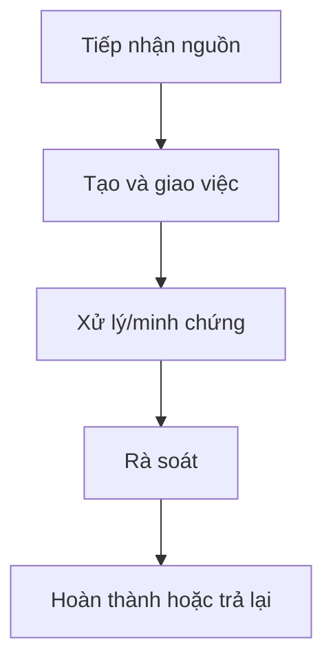

# M01 — KẾ HOẠCH TRIỂN KHAI CHI TIẾT DÀNH CHO TEAM AGENT

> **Module:** Quản lý công việc và hồ sơ · **Baseline:** `dovandatym1-ship-it/pvh-demo` PR #12 @ `fa214999` · **Ngày:** 11/11/2026 · **Loại tài liệu:** PLAN / REVIEW REQUIRED, không phải xác nhận pháp lý hay code DONE.

## 0. Quy tắc sử dụng / bất biến của dự án

- 01 codebase dùng chung cho nhiều xã; tenant và quyền luôn suy từ phiên phía server. `main`, Phase 1–6, Supabase `Demo-pvh` không được tự merge/deploy/migrate/reset. Thiết kế mở rộng nhiều tenant cần ADR riêng vì schema hiện có ràng buộc singleton.
- **SOURCE** = đã nhìn thấy trong code/SQL nhánh tích hợp; **DESIGN** = trường/quy trình đề xuất cần BA-owner duyệt; **LIVE** = chỉ đánh khi có truy xuất cloud và chứng cứ checksum/DB, không tự suy từ migration file.
- UI luôn tiếng Việt; mã snake_case chỉ ở code/DB; không tạo văn bản quyết định pháp lý giả. Mọi biểu mẫu và quyền ký phải đối chiếu văn bản chuyên ngành đang hiệu lực trước implementation.
- Mỗi task chạy trên branch riêng từ SHA đã chốt, có owner file, commit, test receipt và PR audit; chỉ **Đỗ Văn Đạt** duyệt/merge. Không tự ý tăng phạm vi so với 128 OP nguồn và 5 chức năng M11 đã được đưa vào kiểm kê.
- Luồng **BA01 → DB01 → BE01 → FE01 → QA01 → INT01**. BA các OP có thể làm song song; DB migration được điều phối một owner/module để không xung đột timestamp, SQL và FK; FE chia component độc lập, không cùng sửa route/page khi chưa được lock.

## 1. Phạm vi, code hiện có và ranh giới

- **Mục tiêu module:** Quản lý công việc và hồ sơ.
- **Tác nhân:** cán bộ tiếp nhận; cán bộ chủ trì; người phối hợp; người rà soát.
- **Màn hình hiện có:** `/cong-viec` (trạng thái chức năng cần đối chiếu).
- **Bảng SQL ứng viên:** `public.work_items`, `public.work_item_events`, `public.work_item_assignments`, `public.work_item_collaborators`, `public.evidence_files`, `public.work_item_inbox`.
- **Số operation trong Function Map:** 15 (mã nguồn OP-Mxx).
- **Feature-level của spec hiện có:** M01-F01 — Quản lý công việc; M01-F02 — Quản lý hồ sơ; M01-F03 — Quản lý kế hoạch; M01-F04 — Theo dõi và nhắc việc; M01-F05 — Tra cứu và tổng hợp.

**Một số file code neo để agent tìm đúng nơi:**

- `src/features/m01-core-work/components/assign-work-item-form.tsx`
- `src/features/m01-core-work/components/create-work-item-form.tsx`
- `src/features/m01-core-work/components/create-work-item-modal.tsx`
- `src/features/m01-core-work/components/evidence-uploader.tsx`
- `src/features/m01-core-work/components/mark-inbox-read-button.tsx`
- `src/features/m01-core-work/components/set-work-collaborators-form.tsx`
- `src/features/m01-core-work/components/transition-action-bar.tsx`
- `src/features/m01-core-work/components/update-work-item-details-form.tsx`
- `src/features/m01-core-work/components/work-item-table.tsx`
- `src/features/m01-core-work/schemas/index.ts`
- `src/features/m01-core-work/schemas/work-item.schema.ts`
- `src/features/m01-core-work/server/actions.ts`
- `src/features/m01-core-work/server/policy.ts`
- `src/features/m01-core-work/server/queries.ts`
- `src/features/m01-core-work/server/repository.ts`
- `src/features/m01-core-work/server/service.ts`

**Nguồn bắt buộc:** `docs/business/FUNCTION_MAP_PVH_v0.1.md`; `docs/plans/PVH_MASTER_INTEGRATION_2026-11-09/OP_FUNCTION_SCREEN_CODE_DB_CROSSWALK.csv`; `docs/specs/PVH_FULL_MODULE_SPEC_2026-11-09/M01.md`; SQL migration của PR #12. Không được coi `SOURCE_ONLY` là nghiệm thu runtime.

## 2. Flow E2E cấp module



Tiếp nhận → tạo việc → phân công → xử lý/minh chứng → rà soát → hoàn thành/trả lại. Với lỗi/thiếu thẩm quyền, trả hồ sơ về bước phù hợp kèm lý do và sự kiện audit; không sửa hồi tố dữ liệu đã chốt.

**Ma trận hành vi mặc định cho từng màn:** Danh sách (server paging/count), tìm kiếm/lọc/sort, xem chi tiết, thêm/sửa/ẩn hoặc ngừng hiệu lực theo quyền, đính kèm/chứng cứ nếu có, tra cứu lịch sử, xuất có kiểm quyền. Tính năng không áp dụng như nhật ký bất biến hoặc dữ liệu nguồn read-only phải ghi rõ N/A; không ép CRUD xóa đối với dữ liệu pháp lý.

## 3. Trường chuẩn dùng chung (DESIGN, áp dụng khi phù hợp)

| Field | Kiểu PostgreSQL | Quy tắc | Hiển thị / bảo vệ |
|---|---|---|---|
| `id` | `uuid` | PK server-generated | Định danh; mã kỹ thuật ẩn khỏi UI |
| `tenant_id` | `uuid` | FK, lấy từ session/membership | Đơn vị cấp xã; mã kỹ thuật ẩn khỏi UI |
| `org_unit_id` | `uuid` | FK đơn vị, kiểm scope | Đơn vị quản lý; mã kỹ thuật ẩn khỏi UI |
| `status` | `text` | Enum versioned theo đối tượng | Trạng thái; mã kỹ thuật ẩn khỏi UI |
| `version` | `integer` | OCC, tăng sau ghi | Phiên bản; mã kỹ thuật ẩn khỏi UI |
| `created_at` | `timestamptz` | UTC server | Thời điểm tạo; mã kỹ thuật ẩn khỏi UI |
| `created_by` | `uuid` | auth.uid server | Người tạo; mã kỹ thuật ẩn khỏi UI |
| `updated_at` | `timestamptz` | UTC server | Thời điểm cập nhật; mã kỹ thuật ẩn khỏi UI |
| `updated_by` | `uuid` | auth.uid server | Người cập nhật; mã kỹ thuật ẩn khỏi UI |
| `source_ref` | `text` | Nguồn hồ sơ/giấy tờ/đầu mối | Tài liệu nguồn; mã kỹ thuật ẩn khỏi UI |
| `is_active` | `boolean` | Soft retire nếu có phụ thuộc | Còn hiệu lực; mã kỹ thuật ẩn khỏi UI |

### Hợp đồng dữ liệu toàn module

- Mỗi record phải có owner, purpose, effective period khi phù hợp, nguồn gốc, mức nhạy cảm và retention theo policy được duyệt. Không lấy `tenant_id`, `created_by` hoặc `role_code` từ body client để quyết quyền.
- Mọi bảng mới có PK/FK, unique theo scope/kỳ, CHECK cho số/ngày/enum, index trên filter/FK/tenant, RLS (kể cả `FORCE RLS` theo rủi ro), hạn chế `SECURITY DEFINER`, quyền EXECUTE được revoke/grant có chủ đích.
- Cấm bỏ qua `SELECT` policy cần thiết cho UPDATE; kiểm `USING` và `WITH CHECK`; không dùng claims user-editable. Audit immutable, event/outbox idempotency; file private Storage + signed download theo từng user.
- Quy tắc `NULL` ≠ `0` ≠ `N/A` ≠ chưa xác nhận; dashboard và báo cáo giữ lineage và thời điểm chốt; export không được lộ PII ngoài quyền.

## 4. Data Dictionary SOURCE của nhánh tích hợp (không đồng nghĩa đã có trên cloud)

### `public.work_items` — SOURCE trong nhánh tích hợp

| Cột | Kiểu trong SQL | Bắt buộc trong SQL | Ghi chú rà soát |
|---|---|---|---|
| `id` | `uuid` | Có | Phải đối chiếu UI/API, RLS và migration history |
| `title` | `text` | Có | Phải đối chiếu UI/API, RLS và migration history |
| `category` | `text` | Có | Phải đối chiếu UI/API, RLS và migration history |
| `status` | `text` | Có | Phải đối chiếu UI/API, RLS và migration history |
| `assigned_to` | `uuid` | Không hoặc theo constraint | Phải đối chiếu UI/API, RLS và migration history |
| `version` | `integer` | Có | Phải đối chiếu UI/API, RLS và migration history |
| `request_hash` | `text` | Có | Phải đối chiếu UI/API, RLS và migration history |
| `created_by` | `uuid` | Có | Phải đối chiếu UI/API, RLS và migration history |

### `public.work_item_events` — SOURCE trong nhánh tích hợp

| Cột | Kiểu trong SQL | Bắt buộc trong SQL | Ghi chú rà soát |
|---|---|---|---|
| `id` | `uuid` | Có | Phải đối chiếu UI/API, RLS và migration history |
| `from_status` | `text` | Có | Phải đối chiếu UI/API, RLS và migration history |
| `reason` | `text` | Có | Phải đối chiếu UI/API, RLS và migration history |
| `created_at` | `timestamptz` | Có | Phải đối chiếu UI/API, RLS và migration history |

### `public.work_item_assignments` — SOURCE trong nhánh tích hợp

| Cột | Kiểu trong SQL | Bắt buộc trong SQL | Ghi chú rà soát |
|---|---|---|---|
| `id` | `uuid` | Không hoặc theo constraint | Phải đối chiếu UI/API, RLS và migration history |
| `tenant_id` | `uuid` | Có | Phải đối chiếu UI/API, RLS và migration history |
| `work_item_id` | `uuid` | Có | Phải đối chiếu UI/API, RLS và migration history |
| `previous_assignee` | `uuid` | Không hoặc theo constraint | Phải đối chiếu UI/API, RLS và migration history |
| `assignee` | `uuid` | Có | Phải đối chiếu UI/API, RLS và migration history |
| `actor_id` | `uuid` | Có | Phải đối chiếu UI/API, RLS và migration history |
| `reason` | `text` | Không hoặc theo constraint | Phải đối chiếu UI/API, RLS và migration history |
| `work_item_version` | `integer` | Có | Phải đối chiếu UI/API, RLS và migration history |
| `created_at` | `timestamptz` | Có | Phải đối chiếu UI/API, RLS và migration history |

### `public.work_item_collaborators` — SOURCE trong nhánh tích hợp

| Cột | Kiểu trong SQL | Bắt buộc trong SQL | Ghi chú rà soát |
|---|---|---|---|
| `tenant_id` | `uuid` | Có | Phải đối chiếu UI/API, RLS và migration history |
| `work_item_id` | `uuid` | Có | Phải đối chiếu UI/API, RLS và migration history |
| `user_id` | `uuid` | Có | Phải đối chiếu UI/API, RLS và migration history |
| `added_by` | `uuid` | Có | Phải đối chiếu UI/API, RLS và migration history |
| `created_at` | `timestamptz` | Có | Phải đối chiếu UI/API, RLS và migration history |

### `public.work_item_inbox` — SOURCE trong nhánh tích hợp

| Cột | Kiểu trong SQL | Bắt buộc trong SQL | Ghi chú rà soát |
|---|---|---|---|
| `id` | `uuid` | Không hoặc theo constraint | Phải đối chiếu UI/API, RLS và migration history |
| `tenant_id` | `uuid` | Có | Phải đối chiếu UI/API, RLS và migration history |
| `work_item_id` | `uuid` | Có | Phải đối chiếu UI/API, RLS và migration history |
| `recipient_id` | `uuid` | Có | Phải đối chiếu UI/API, RLS và migration history |
| `event_version` | `integer` | Có | Phải đối chiếu UI/API, RLS và migration history |
| `kind` | `text` | Có | Phải đối chiếu UI/API, RLS và migration history |
| `created_at` | `timestamptz` | Có | Phải đối chiếu UI/API, RLS và migration history |

### `public.work_item_inbox_reads` — SOURCE trong nhánh tích hợp

| Cột | Kiểu trong SQL | Bắt buộc trong SQL | Ghi chú rà soát |
|---|---|---|---|
| `inbox_id` | `uuid` | Không hoặc theo constraint | Phải đối chiếu UI/API, RLS và migration history |
| `tenant_id` | `uuid` | Có | Phải đối chiếu UI/API, RLS và migration history |
| `recipient_id` | `uuid` | Có | Phải đối chiếu UI/API, RLS và migration history |
| `read_at` | `timestamptz` | Có | Phải đối chiếu UI/API, RLS và migration history |

### `public.work_item_mutation_requests` — SOURCE trong nhánh tích hợp

| Cột | Kiểu trong SQL | Bắt buộc trong SQL | Ghi chú rà soát |
|---|---|---|---|
| `id` | `uuid` | Không hoặc theo constraint | Phải đối chiếu UI/API, RLS và migration history |
| `tenant_id` | `uuid` | Có | Phải đối chiếu UI/API, RLS và migration history |
| `actor_id` | `uuid` | Có | Phải đối chiếu UI/API, RLS và migration history |
| `idempotency_key` | `text` | Có | Phải đối chiếu UI/API, RLS và migration history |
| `request_hash` | `text` | Có | Phải đối chiếu UI/API, RLS và migration history |
| `response` | `jsonb` | Có | Phải đối chiếu UI/API, RLS và migration history |
| `created_at` | `timestamptz` | Có | Phải đối chiếu UI/API, RLS và migration history |

### `public.work_item_transition_rules` — SOURCE trong nhánh tích hợp

| Cột | Kiểu trong SQL | Bắt buộc trong SQL | Ghi chú rà soát |
|---|---|---|---|
| `rule_version` | `integer` | Có | Phải đối chiếu UI/API, RLS và migration history |
| `from_status` | `text` | Có | Phải đối chiếu UI/API, RLS và migration history |
| `to_status` | `text` | Có | Phải đối chiếu UI/API, RLS và migration history |
| `required_permission` | `text` | Có | Phải đối chiếu UI/API, RLS và migration history |
| `actor_scope` | `text` | Có | Phải đối chiếu UI/API, RLS và migration history |
| `requires_reason` | `boolean` | Có | Phải đối chiếu UI/API, RLS và migration history |
| `requires_evidence` | `boolean` | Có | Phải đối chiếu UI/API, RLS và migration history |

### `public.evidence_files` — SOURCE trong nhánh tích hợp

| Cột | Kiểu trong SQL | Bắt buộc trong SQL | Ghi chú rà soát |
|---|---|---|---|
| `id` | `uuid` | Có | Phải đối chiếu UI/API, RLS và migration history |
| `object_path` | `text` | Có | Phải đối chiếu UI/API, RLS và migration history |
| `uploaded_by` | `uuid` | Có | Phải đối chiếu UI/API, RLS và migration history |

### 4.1. Ánh xạ tên trường thiết kế ↔ cột đã có (không tạo cột trùng)

| Trường tại biểu mẫu/đặc tả | Cột chuẩn ứng viên trong SQL | Quy tắc |
|---|---|---|
| `assignee_id` | `public.work_items.assigned_to` | Agent DB/BA phải kiểm tra semantics và không tạo thêm cột trước khi chốt mapping |
| `source_ref` | `public.work_items.source_ref (migrate/verify)` | Agent DB/BA phải kiểm tra semantics và không tạo thêm cột trước khi chốt mapping |
| `work_item_id` | `public.work_items.id` | Agent DB/BA phải kiểm tra semantics và không tạo thêm cột trước khi chốt mapping |

## 5. WBS chi tiết cho từng operation/feature

Mỗi task dưới đây có mã duy nhất, phụ thuộc và DoD; nhóm BA/DB/BE/FE/QA/INT dùng làm work packages. Cột trường là cấu trúc đề xuất/đối chiếu source, **không phải danh sách pháp lý bắt buộc đã duyệt**.

### OP-M01-001 — Tiếp nhận việc từ giao trực tiếp/kế hoạch/văn bản/mã hồ sơ nguồn; chống tạo trùng

- **Mức độ code:** Đã thấy điểm vào/code liên quan; chưa đủ điều kiện kết luận khép kín.
- **Nhóm luồng:** `CASE` · **Source status:** `SPECIFYING` · **Screen Map:** `SCR-CV-01` · **Mức nhạy cảm nguồn:** `—`.
- **Nguồn yêu cầu:** BL-004, BL-011; REQ-M01-01; WF-01.
- **Code API/DB ứng viên (chỉ để rà soát):** createWorkItemAction → app.create_work_item_v2 / public.work_items (title, description, priority, category, assigned_to, due_date, hamlet_id, source_ref); app.create_work_item idempotency receipt (does not enforce unique source_ref).
- **Đầu ra nghiệp vụ:** biên nhận có mã và phiên bản (nếu ghi), danh sách/chi tiết theo quyền, trạng thái, lịch sử, nguồn đối soát, thông báo và báo cáo chỉ khi có nguồn thật.

#### Luồng chính và các bước kiểm soát

1. Cán bộ mở nghiệp vụ **Tiếp nhận việc từ giao trực tiếp/kế hoạch/văn bản/mã hồ sơ nguồn; chống tạo trùng**, chọn đúng xã/địa bàn và ghi `source_type`, `source_ref`, `title`, `category`; hệ thống dẫn chiếu nguồn và kỳ hiệu lực.
2. Server xác thực phiên, membership còn hiệu lực, permission cấp tác vụ, phạm vi bản ghi và mức nhạy cảm; tenant lấy từ server, không nhận từ form.
3. Kiểm tra schema, ràng buộc trường, mã nguồn, khóa trùng, phiên bản, liên kết FK và tình trạng đối tượng; lỗi trả từng trường bằng tiếng Việt.
4. Tạo hồ sơ tiếp nhận có mã, nguồn và phiên bản biểu mẫu; kiểm trùng chủ thể/kỳ trước khi cấp biên nhận.
5. Cán bộ có quyền bổ sung minh chứng, lưu nháp; người rà soát khác người nhập kiểm điều kiện/chủ thể và ghi lý do yêu cầu bổ sung.
6. Nếu vượt thẩm quyền, tạo phiếu chuyển/đề xuất và chờ mã quyết định nguồn; không tự sinh kết quả pháp lý hoặc coi bản demo là quyết định.
7. Ghi sự kiện bất biến, actor/time/version, tạo thông báo nếu hợp đồng sự kiện quy định; cập nhật dashboard/report theo nguồn phát sinh có truy vết.
8. Người dùng thấy biên nhận/chi tiết, trạng thái và lỗi rõ ràng; hỗ trợ tra cứu, lọc, phân trang và truy xuất lịch sử theo quyền.

**Luồng ngoại lệ:** (E1) sai quyền/sai xã→403 và audit deny, không trả bản ghi; (E2) sai trường/thiếu nguồn→422 theo trường; (E3) trùng/đổi phiên bản→409 và refresh; (E4) nguồn ngoài không xác nhận→PENDING/UNAVAILABLE, không ghi “thành công”; (E5) hồ sơ chốt/đã tham chiếu→không xóa vật lý; (E6) thiếu chứng cứ→CHƯA ĐỦ THÔNG TIN, không tự kết luận không đủ điều kiện.

#### Trường đầu vào/đầu ra bắt buộc đặc tả

| Field snake_case | Nhãn tiếng Việt dự kiến | PostgreSQL | Bắt buộc (đề xuất) | Validation / business rule | Nhạy cảm | Nguồn |
|---|---|---|---|---|---|---|
| `id` | Định danh | `uuid` | Server | PK sinh trên server, không nhận ID tùy ý từ client khi tạo | Nội bộ | SOURCE (cùng tên cột trong module; cần xác minh entity) |
| `tenant_id` | Đơn vị cấp xã | `uuid` | Server | FK đúng tenant, tồn tại, còn hiệu lực, scope | Nội bộ | SOURCE (cùng tên cột trong module; cần xác minh entity) |
| `source_type` | Loại nguồn | `text` | BA xác nhận bắt buộc | Trim; giới hạn độ dài theo Data Dictionary; không nhận HTML/script | Nội bộ | DESIGN |
| `source_ref` | Tài liệu nguồn | `text` | BA xác nhận bắt buộc | Trim; giới hạn độ dài theo Data Dictionary; không nhận HTML/script | Nội bộ | DESIGN |
| `source_record_id` | Định danh nguồn bản ghi | `text` | BA xác nhận bắt buộc | Kiểm schema, định dạng và nguồn theo hợp đồng dữ liệu | Nội bộ | DESIGN |
| `title` | Tiêu đề | `text` | Theo loại hồ sơ | Trim; giới hạn độ dài theo Data Dictionary; không nhận HTML/script | Nội bộ | SOURCE (cùng tên cột trong module; cần xác minh entity) |
| `category` | Diện/nhóm | `text` | Theo loại hồ sơ | Trim; giới hạn độ dài theo Data Dictionary; không nhận HTML/script | Nội bộ | SOURCE (cùng tên cột trong module; cần xác minh entity) |
| `received_at` | Thời điểm tiếp nhận | `timestamptz` | Theo loại hồ sơ | UTC trong DB, hiển thị giờ Việt Nam; ngày hợp lệ | Nội bộ | DESIGN |
| `duplicate_key` | Trùng khóa | `text` | Theo loại hồ sơ | Trim; giới hạn độ dài theo Data Dictionary; không nhận HTML/script | Nội bộ | DESIGN |
| `status` | Trạng thái | `text` | Server | Enum versioned; cấm tự thêm trạng thái ở client | Nội bộ | SOURCE (cùng tên cột trong module; cần xác minh entity) |
| `version` | Phiên bản | `integer` | Server | Số nguyên không âm trừ trường đã duyệt cho phép âm | Nội bộ | SOURCE (cùng tên cột trong module; cần xác minh entity) |
| `created_at` | Thời điểm tạo | `timestamptz` | Server | UTC trong DB, hiển thị giờ Việt Nam; ngày hợp lệ | Nội bộ | SOURCE (cùng tên cột trong module; cần xác minh entity) |
| `created_by` | Người tạo | `uuid` | Server | FK đúng tenant, tồn tại, còn hiệu lực, scope | Nội bộ | SOURCE (cùng tên cột trong module; cần xác minh entity) |

**Quy tắc giao diện:** ẩn mã kỹ thuật; form field-level errors; read-only nguồn ngoài; phân biệt bản nháp/kết quả đã xác nhận; modal xác nhận với lý do khi hủy/ẩn/chuyển; danh sách có tổng số thực và link chi tiết; export chỉ những cột được phép. **KPI:** chỉ bổ sung sau khi ghi rõ bảng+cột+trạng thái+điều kiện lọc+ngày dữ liệu+RLS+link drill-down.

#### Task giao cho agent (mỗi task là 1 work package có thể kiểm thử)

| Task ID | Agent | Đầu vào | Việc phải làm / đầu ra | Phụ thuộc | Definition of Done |
|---|---|---|---|---|---|
| M01-001-BA01 | BA nghiệp vụ | Function Map, quyền/pháp lý, mẫu nguồn | Đặc tả actor, biến thể, trường bắt buộc, trạng thái, ngoại lệ, ownership và rule register đã dẫn nguồn | — | Biên bản duyệt phạm vi OP-M01-001; không còn trường 'cần xác minh' chưa gán owner |
| M01-001-DB01 | DB/RLS | BA01 + schema thực/migration đang có | Migration cho entity/constraint/FK/index theo tenant; RLS và pgTAP; không sửa migration đã áp cloud | M01-001-BA01 | Replay clean trên staging; thử 2 ngữ cảnh xã theo ADR (không vượt ràng buộc singleton), 3 vai trò, scope deny, concurrency và rollback |
| M01-001-BE01 | Backend | BA01 + DB01 | Server Action/query/RPC/DTO tại `src/features/m01-core-work/server/`; kiểm quyền server, idempotency, audit, error mapping | M01-001-DB01 | Unit+contract test: thành công, sai schema, sai tenant, thiếu quyền, stale version, retry không nhân đôi |
| M01-001-FE01 | Frontend | BA01 + hợp đồng API từ BE01 | Form tiếng Việt, danh sách/chi tiết, lọc/tìm/sort/page, CRUD có điều kiện tại `src/features/m01-core-work/components/`; loading/empty/error/mobile | M01-001-BE01 | Browser 375/768/1440px; focus/keyboard; mỗi trường có nhãn, mô tả lỗi; không cho sửa khi không có quyền |
| M01-001-QA01 | QA/Automation | BA01 + DB01/BE01/FE01 | Bộ ca kiểm thử OP-M01-001: happy/negative/boundary/role/tenant/PII/export/audit; fixture và receipt SHA | M01-001-FE01 | Có test IDs gắn OP-M01-001, chạy đúng HEAD, không chỉ snapshot UI; fail case có log che dữ liệu |
| M01-001-INT01 | Tích hợp | QA01 + mã nguồn nhánh dự kiến | Liên kết M00 quyền/M01 việc/M09 chỉ tiêu/M10 nguồn nếu áp dụng; evidence route→action→DB→test; PR chỉ đổi phạm vi task | M01-001-QA01 | Không thiếu phép C/R/U/D áp dụng; không có false-success; reviewer Đỗ Văn Đạt ký nhận |

#### Acceptance scenarios

- **AC-OP-M01-001-01 (hợp lệ):** Given phiên có quyền và nguồn `source_type` và `source_ref` hợp lệ; When thực hiện theo luồng CASE; Then lưu/tra cứu đúng kết quả, trả ID hoặc biên nhận, audit và version.
- **AC-OP-M01-001-02 (bị chặn):** Given sai địa bàn, không có permission hoặc dữ liệu thiếu; When gọi trực tiếp API/RPC; Then trả lỗi không rò dữ liệu và không tạo bản ghi/event thành công.
- **AC-OP-M01-001-03 (đồng thời/nguồn):** Given cập nhật trùng hoặc source/version cũ; When gửi lặp hoặc hai người chỉnh cùng bản ghi; Then idempotent/reject conflict, không ghi đè phiên bản mới.
- **AC-OP-M01-001-04 (giao diện):** Given vai trò chỉ xem; When mở bằng điện thoại hoặc đường dẫn trực tiếp; Then các tác vụ sửa/xuất không đúng quyền bị ẩn *và* server từ chối.

**Evidence tối thiểu:** commit SHA; đường dẫn file liên quan; migration history/checksum (nếu thay DB); link CI thực thi; pgTAP/RLS test ID; ảnh/trace 375/768/1440; dữ liệu test và người ký duyệt. Trạng thái OP chỉ được đổi `UNVERIFIED` → `STATIC_CHECKED` → `INTEGRATED_TESTED` → `OWNER_ACCEPTED` khi có biên nhận tương ứng.

### OP-M01-002 — Phân loại và mở hồ sơ theo loại nghiệp vụ, lĩnh vực, mã nhiệm vụ

- **Mức độ code:** Đã thấy điểm vào/code liên quan; chưa đủ điều kiện kết luận khép kín.
- **Nhóm luồng:** `CONFIG` · **Source status:** `DISCOVERED` · **Screen Map:** `SCR-CV-02` · **Mức nhạy cảm nguồn:** `—`.
- **Nguồn yêu cầu:** BL-006, BL-090; REQ-M01-02.
- **Code API/DB ứng viên (chỉ để rà soát):** CreateWorkItemSchema.category → createWorkItemAction → app.create_work_item_v2 / public.work_items.category (free-text string; no approved domain/category catalog mapping found).
- **Đầu ra nghiệp vụ:** biên nhận có mã và phiên bản (nếu ghi), danh sách/chi tiết theo quyền, trạng thái, lịch sử, nguồn đối soát, thông báo và báo cáo chỉ khi có nguồn thật.

#### Luồng chính và các bước kiểm soát

1. Cán bộ mở nghiệp vụ **Phân loại và mở hồ sơ theo loại nghiệp vụ, lĩnh vực, mã nhiệm vụ**, chọn đúng xã/địa bàn và ghi `case_code`, `case_type`, `domain_code`, `workflow_version`; hệ thống dẫn chiếu nguồn và kỳ hiệu lực.
2. Server xác thực phiên, membership còn hiệu lực, permission cấp tác vụ, phạm vi bản ghi và mức nhạy cảm; tenant lấy từ server, không nhận từ form.
3. Kiểm tra schema, ràng buộc trường, mã nguồn, khóa trùng, phiên bản, liên kết FK và tình trạng đối tượng; lỗi trả từng trường bằng tiếng Việt.
4. Hệ thống so sánh mã/phiên bản/cây/hiệu lực với cấu hình hiện hữu; thay đổi không sửa hồi tố bản đã chốt.
5. Người quản trị lưu bản nháp cấu hình; khi cần quyền phát hành, chuyển người rà soát độc lập và xác nhận nguồn thẩm quyền.
6. Ghi thay đổi qua giao dịch có khóa phiên bản; lưu audit before/after, không xóa vật lý mục đã được tham chiếu.
7. Ghi sự kiện bất biến, actor/time/version, tạo thông báo nếu hợp đồng sự kiện quy định; cập nhật dashboard/report theo nguồn phát sinh có truy vết.
8. Người dùng thấy biên nhận/chi tiết, trạng thái và lỗi rõ ràng; hỗ trợ tra cứu, lọc, phân trang và truy xuất lịch sử theo quyền.

**Luồng ngoại lệ:** (E1) sai quyền/sai xã→403 và audit deny, không trả bản ghi; (E2) sai trường/thiếu nguồn→422 theo trường; (E3) trùng/đổi phiên bản→409 và refresh; (E4) nguồn ngoài không xác nhận→PENDING/UNAVAILABLE, không ghi “thành công”; (E5) hồ sơ chốt/đã tham chiếu→không xóa vật lý; (E6) thiếu chứng cứ→CHƯA ĐỦ THÔNG TIN, không tự kết luận không đủ điều kiện.

#### Trường đầu vào/đầu ra bắt buộc đặc tả

| Field snake_case | Nhãn tiếng Việt dự kiến | PostgreSQL | Bắt buộc (đề xuất) | Validation / business rule | Nhạy cảm | Nguồn |
|---|---|---|---|---|---|---|
| `id` | Định danh | `uuid` | Server | PK sinh trên server, không nhận ID tùy ý từ client khi tạo | Nội bộ | SOURCE (cùng tên cột trong module; cần xác minh entity) |
| `tenant_id` | Đơn vị cấp xã | `uuid` | Server | FK đúng tenant, tồn tại, còn hiệu lực, scope | Nội bộ | SOURCE (cùng tên cột trong module; cần xác minh entity) |
| `case_code` | Mã hồ sơ | `text` | BA xác nhận bắt buộc | Chuẩn hóa trim, giới hạn 1–80 ký tự, unique theo owner/kỳ nếu áp dụng | Nội bộ | DESIGN |
| `case_type` | Loại hồ sơ | `text` | BA xác nhận bắt buộc | Trim; giới hạn độ dài theo Data Dictionary; không nhận HTML/script | Nội bộ | DESIGN |
| `domain_code` | Mã lĩnh vực | `text` | BA xác nhận bắt buộc | Chuẩn hóa trim, giới hạn 1–80 ký tự, unique theo owner/kỳ nếu áp dụng | Nội bộ | DESIGN |
| `subject_id` | Định danh chủ thể | `uuid` | Theo loại hồ sơ | FK đúng tenant, tồn tại, còn hiệu lực, scope | Hạn chế | DESIGN |
| `opened_at` | Thời điểm mở | `timestamptz` | Theo loại hồ sơ | UTC trong DB, hiển thị giờ Việt Nam; ngày hợp lệ | Nội bộ | DESIGN |
| `owner_unit_id` | Định danh chủ quản đơn vị | `uuid` | Theo loại hồ sơ | FK đúng tenant, tồn tại, còn hiệu lực, scope | Nội bộ | DESIGN |
| `workflow_version` | Phiên bản quy trình | `integer` | Theo loại hồ sơ | Số nguyên không âm trừ trường đã duyệt cho phép âm | Nội bộ | DESIGN |
| `status` | Trạng thái | `text` | Server | Enum versioned; cấm tự thêm trạng thái ở client | Nội bộ | SOURCE (cùng tên cột trong module; cần xác minh entity) |
| `version` | Phiên bản | `integer` | Server | Số nguyên không âm trừ trường đã duyệt cho phép âm | Nội bộ | SOURCE (cùng tên cột trong module; cần xác minh entity) |
| `created_at` | Thời điểm tạo | `timestamptz` | Server | UTC trong DB, hiển thị giờ Việt Nam; ngày hợp lệ | Nội bộ | SOURCE (cùng tên cột trong module; cần xác minh entity) |
| `created_by` | Người tạo | `uuid` | Server | FK đúng tenant, tồn tại, còn hiệu lực, scope | Nội bộ | SOURCE (cùng tên cột trong module; cần xác minh entity) |

**Quy tắc giao diện:** ẩn mã kỹ thuật; form field-level errors; read-only nguồn ngoài; phân biệt bản nháp/kết quả đã xác nhận; modal xác nhận với lý do khi hủy/ẩn/chuyển; danh sách có tổng số thực và link chi tiết; export chỉ những cột được phép. **KPI:** chỉ bổ sung sau khi ghi rõ bảng+cột+trạng thái+điều kiện lọc+ngày dữ liệu+RLS+link drill-down.

#### Task giao cho agent (mỗi task là 1 work package có thể kiểm thử)

| Task ID | Agent | Đầu vào | Việc phải làm / đầu ra | Phụ thuộc | Definition of Done |
|---|---|---|---|---|---|
| M01-002-BA01 | BA nghiệp vụ | Function Map, quyền/pháp lý, mẫu nguồn | Đặc tả actor, biến thể, trường bắt buộc, trạng thái, ngoại lệ, ownership và rule register đã dẫn nguồn | — | Biên bản duyệt phạm vi OP-M01-002; không còn trường 'cần xác minh' chưa gán owner |
| M01-002-DB01 | DB/RLS | BA01 + schema thực/migration đang có | Migration cho entity/constraint/FK/index theo tenant; RLS và pgTAP; không sửa migration đã áp cloud | M01-002-BA01 | Replay clean trên staging; thử 2 ngữ cảnh xã theo ADR (không vượt ràng buộc singleton), 3 vai trò, scope deny, concurrency và rollback |
| M01-002-BE01 | Backend | BA01 + DB01 | Server Action/query/RPC/DTO tại `src/features/m01-core-work/server/`; kiểm quyền server, idempotency, audit, error mapping | M01-002-DB01 | Unit+contract test: thành công, sai schema, sai tenant, thiếu quyền, stale version, retry không nhân đôi |
| M01-002-FE01 | Frontend | BA01 + hợp đồng API từ BE01 | Form tiếng Việt, danh sách/chi tiết, lọc/tìm/sort/page, CRUD có điều kiện tại `src/features/m01-core-work/components/`; loading/empty/error/mobile | M01-002-BE01 | Browser 375/768/1440px; focus/keyboard; mỗi trường có nhãn, mô tả lỗi; không cho sửa khi không có quyền |
| M01-002-QA01 | QA/Automation | BA01 + DB01/BE01/FE01 | Bộ ca kiểm thử OP-M01-002: happy/negative/boundary/role/tenant/PII/export/audit; fixture và receipt SHA | M01-002-FE01 | Có test IDs gắn OP-M01-002, chạy đúng HEAD, không chỉ snapshot UI; fail case có log che dữ liệu |
| M01-002-INT01 | Tích hợp | QA01 + mã nguồn nhánh dự kiến | Liên kết M00 quyền/M01 việc/M09 chỉ tiêu/M10 nguồn nếu áp dụng; evidence route→action→DB→test; PR chỉ đổi phạm vi task | M01-002-QA01 | Không thiếu phép C/R/U/D áp dụng; không có false-success; reviewer Đỗ Văn Đạt ký nhận |

#### Acceptance scenarios

- **AC-OP-M01-002-01 (hợp lệ):** Given phiên có quyền và nguồn `case_code` và `case_type` hợp lệ; When thực hiện theo luồng CONFIG; Then lưu/tra cứu đúng kết quả, trả ID hoặc biên nhận, audit và version.
- **AC-OP-M01-002-02 (bị chặn):** Given sai địa bàn, không có permission hoặc dữ liệu thiếu; When gọi trực tiếp API/RPC; Then trả lỗi không rò dữ liệu và không tạo bản ghi/event thành công.
- **AC-OP-M01-002-03 (đồng thời/nguồn):** Given cập nhật trùng hoặc source/version cũ; When gửi lặp hoặc hai người chỉnh cùng bản ghi; Then idempotent/reject conflict, không ghi đè phiên bản mới.
- **AC-OP-M01-002-04 (giao diện):** Given vai trò chỉ xem; When mở bằng điện thoại hoặc đường dẫn trực tiếp; Then các tác vụ sửa/xuất không đúng quyền bị ẩn *và* server từ chối.

**Evidence tối thiểu:** commit SHA; đường dẫn file liên quan; migration history/checksum (nếu thay DB); link CI thực thi; pgTAP/RLS test ID; ảnh/trace 375/768/1440; dữ liệu test và người ký duyệt. Trạng thái OP chỉ được đổi `UNVERIFIED` → `STATIC_CHECKED` → `INTEGRATED_TESTED` → `OWNER_ACCEPTED` khi có biên nhận tương ứng.

### OP-M01-003 — Giao chủ trì/phối hợp, đầu việc, hạn nội bộ; phân công lại có lý do

- **Mức độ code:** Đã thấy điểm vào/code liên quan; chưa đủ điều kiện kết luận khép kín.
- **Nhóm luồng:** `TRACK` · **Source status:** `SPECIFYING` · **Screen Map:** `SCR-CV-01` · **Mức nhạy cảm nguồn:** `—`.
- **Nguồn yêu cầu:** BL-004, BL-089; REQ-M01-06; DEM-ADD-04; WF-11.
- **Code API/DB ứng viên (chỉ để rà soát):** assignWorkItemAction → app.assign_work_item; updateWorkItemDetailsAction → app.update_work_item_details; setWorkCollaboratorsAction → app.set_work_collaborators / public.work_items; public.work_item_assignments; public.work_item_collaborators; public.work_item_events; public.work_item_mutation_requests; public.audit_log.
- **Đầu ra nghiệp vụ:** biên nhận có mã và phiên bản (nếu ghi), danh sách/chi tiết theo quyền, trạng thái, lịch sử, nguồn đối soát, thông báo và báo cáo chỉ khi có nguồn thật.

#### Luồng chính và các bước kiểm soát

1. Cán bộ mở nghiệp vụ **Giao chủ trì/phối hợp, đầu việc, hạn nội bộ; phân công lại có lý do**, chọn đúng xã/địa bàn và ghi `collaborator_ids`, `due_date`, `priority`, `reassignment_reason`; hệ thống dẫn chiếu nguồn và kỳ hiệu lực.
2. Server xác thực phiên, membership còn hiệu lực, permission cấp tác vụ, phạm vi bản ghi và mức nhạy cảm; tenant lấy từ server, không nhận từ form.
3. Kiểm tra schema, ràng buộc trường, mã nguồn, khóa trùng, phiên bản, liên kết FK và tình trạng đối tượng; lỗi trả từng trường bằng tiếng Việt.
4. Tạo bản theo dõi/kế hoạch cùng người phụ trách, mốc thời gian và nguồn chỉ tiêu/kết quả.
5. Giao đầu việc liên quan M01 nếu có; cập nhật theo phiên bản và ghi lý do sửa dữ liệu đã được xác nhận.
6. Người xác nhận độc lập đối soát mục tiêu–thực tế–minh chứng; đóng kỳ khi đủ điều kiện hoặc nêu thiếu nguồn.
7. Ghi sự kiện bất biến, actor/time/version, tạo thông báo nếu hợp đồng sự kiện quy định; cập nhật dashboard/report theo nguồn phát sinh có truy vết.
8. Người dùng thấy biên nhận/chi tiết, trạng thái và lỗi rõ ràng; hỗ trợ tra cứu, lọc, phân trang và truy xuất lịch sử theo quyền.

**Luồng ngoại lệ:** (E1) sai quyền/sai xã→403 và audit deny, không trả bản ghi; (E2) sai trường/thiếu nguồn→422 theo trường; (E3) trùng/đổi phiên bản→409 và refresh; (E4) nguồn ngoài không xác nhận→PENDING/UNAVAILABLE, không ghi “thành công”; (E5) hồ sơ chốt/đã tham chiếu→không xóa vật lý; (E6) thiếu chứng cứ→CHƯA ĐỦ THÔNG TIN, không tự kết luận không đủ điều kiện.

#### Trường đầu vào/đầu ra bắt buộc đặc tả

| Field snake_case | Nhãn tiếng Việt dự kiến | PostgreSQL | Bắt buộc (đề xuất) | Validation / business rule | Nhạy cảm | Nguồn |
|---|---|---|---|---|---|---|
| `id` | Định danh | `uuid` | Server | PK sinh trên server, không nhận ID tùy ý từ client khi tạo | Nội bộ | SOURCE (cùng tên cột trong module; cần xác minh entity) |
| `tenant_id` | Đơn vị cấp xã | `uuid` | Server | FK đúng tenant, tồn tại, còn hiệu lực, scope | Nội bộ | SOURCE (cùng tên cột trong module; cần xác minh entity) |
| `work_item_id` | Định danh công việc mục | `uuid` | BA xác nhận bắt buộc | FK đúng tenant, tồn tại, còn hiệu lực, scope | Nội bộ | SOURCE (cùng tên cột trong module; cần xác minh entity) |
| `assignee_id` | Người được giao | `uuid` | BA xác nhận bắt buộc | FK đúng tenant, tồn tại, còn hiệu lực, scope | Nội bộ | DESIGN |
| `collaborator_ids` | Người phối hợp danh sách định danh | `uuid[]` | BA xác nhận bắt buộc | Từng ID có quyền truy cập, không trùng, tối đa theo contract | Nội bộ | DESIGN |
| `due_date` | Hạn xử lý | `date` | Theo loại hồ sơ | ISO 8601; ngày bắt đầu ≤ ngày kết thúc khi có cặp | Nội bộ | DESIGN |
| `priority` | Mức ưu tiên | `text` | Theo loại hồ sơ | Trim; giới hạn độ dài theo Data Dictionary; không nhận HTML/script | Nội bộ | DESIGN |
| `reassignment_reason` | Lý do giao lại | `text` | Theo loại hồ sơ | Trim; giới hạn độ dài theo Data Dictionary; không nhận HTML/script | Nội bộ | DESIGN |
| `assigned_at` | Thời điểm được giao | `timestamptz` | Theo loại hồ sơ | UTC trong DB, hiển thị giờ Việt Nam; ngày hợp lệ | Nội bộ | DESIGN |
| `status` | Trạng thái | `text` | Server | Enum versioned; cấm tự thêm trạng thái ở client | Nội bộ | SOURCE (cùng tên cột trong module; cần xác minh entity) |
| `version` | Phiên bản | `integer` | Server | Số nguyên không âm trừ trường đã duyệt cho phép âm | Nội bộ | SOURCE (cùng tên cột trong module; cần xác minh entity) |
| `created_at` | Thời điểm tạo | `timestamptz` | Server | UTC trong DB, hiển thị giờ Việt Nam; ngày hợp lệ | Nội bộ | SOURCE (cùng tên cột trong module; cần xác minh entity) |
| `created_by` | Người tạo | `uuid` | Server | FK đúng tenant, tồn tại, còn hiệu lực, scope | Nội bộ | SOURCE (cùng tên cột trong module; cần xác minh entity) |

**Quy tắc giao diện:** ẩn mã kỹ thuật; form field-level errors; read-only nguồn ngoài; phân biệt bản nháp/kết quả đã xác nhận; modal xác nhận với lý do khi hủy/ẩn/chuyển; danh sách có tổng số thực và link chi tiết; export chỉ những cột được phép. **KPI:** chỉ bổ sung sau khi ghi rõ bảng+cột+trạng thái+điều kiện lọc+ngày dữ liệu+RLS+link drill-down.

#### Task giao cho agent (mỗi task là 1 work package có thể kiểm thử)

| Task ID | Agent | Đầu vào | Việc phải làm / đầu ra | Phụ thuộc | Definition of Done |
|---|---|---|---|---|---|
| M01-003-BA01 | BA nghiệp vụ | Function Map, quyền/pháp lý, mẫu nguồn | Đặc tả actor, biến thể, trường bắt buộc, trạng thái, ngoại lệ, ownership và rule register đã dẫn nguồn | — | Biên bản duyệt phạm vi OP-M01-003; không còn trường 'cần xác minh' chưa gán owner |
| M01-003-DB01 | DB/RLS | BA01 + schema thực/migration đang có | Migration cho entity/constraint/FK/index theo tenant; RLS và pgTAP; không sửa migration đã áp cloud | M01-003-BA01 | Replay clean trên staging; thử 2 ngữ cảnh xã theo ADR (không vượt ràng buộc singleton), 3 vai trò, scope deny, concurrency và rollback |
| M01-003-BE01 | Backend | BA01 + DB01 | Server Action/query/RPC/DTO tại `src/features/m01-core-work/server/`; kiểm quyền server, idempotency, audit, error mapping | M01-003-DB01 | Unit+contract test: thành công, sai schema, sai tenant, thiếu quyền, stale version, retry không nhân đôi |
| M01-003-FE01 | Frontend | BA01 + hợp đồng API từ BE01 | Form tiếng Việt, danh sách/chi tiết, lọc/tìm/sort/page, CRUD có điều kiện tại `src/features/m01-core-work/components/`; loading/empty/error/mobile | M01-003-BE01 | Browser 375/768/1440px; focus/keyboard; mỗi trường có nhãn, mô tả lỗi; không cho sửa khi không có quyền |
| M01-003-QA01 | QA/Automation | BA01 + DB01/BE01/FE01 | Bộ ca kiểm thử OP-M01-003: happy/negative/boundary/role/tenant/PII/export/audit; fixture và receipt SHA | M01-003-FE01 | Có test IDs gắn OP-M01-003, chạy đúng HEAD, không chỉ snapshot UI; fail case có log che dữ liệu |
| M01-003-INT01 | Tích hợp | QA01 + mã nguồn nhánh dự kiến | Liên kết M00 quyền/M01 việc/M09 chỉ tiêu/M10 nguồn nếu áp dụng; evidence route→action→DB→test; PR chỉ đổi phạm vi task | M01-003-QA01 | Không thiếu phép C/R/U/D áp dụng; không có false-success; reviewer Đỗ Văn Đạt ký nhận |

#### Acceptance scenarios

- **AC-OP-M01-003-01 (hợp lệ):** Given phiên có quyền và nguồn `work_item_id` và `assignee_id` hợp lệ; When thực hiện theo luồng TRACK; Then lưu/tra cứu đúng kết quả, trả ID hoặc biên nhận, audit và version.
- **AC-OP-M01-003-02 (bị chặn):** Given sai địa bàn, không có permission hoặc dữ liệu thiếu; When gọi trực tiếp API/RPC; Then trả lỗi không rò dữ liệu và không tạo bản ghi/event thành công.
- **AC-OP-M01-003-03 (đồng thời/nguồn):** Given cập nhật trùng hoặc source/version cũ; When gửi lặp hoặc hai người chỉnh cùng bản ghi; Then idempotent/reject conflict, không ghi đè phiên bản mới.
- **AC-OP-M01-003-04 (giao diện):** Given vai trò chỉ xem; When mở bằng điện thoại hoặc đường dẫn trực tiếp; Then các tác vụ sửa/xuất không đúng quyền bị ẩn *và* server từ chối.

**Evidence tối thiểu:** commit SHA; đường dẫn file liên quan; migration history/checksum (nếu thay DB); link CI thực thi; pgTAP/RLS test ID; ảnh/trace 375/768/1440; dữ liệu test và người ký duyệt. Trạng thái OP chỉ được đổi `UNVERIFIED` → `STATIC_CHECKED` → `INTEGRATED_TESTED` → `OWNER_ACCEPTED` khi có biên nhận tương ứng.

### OP-M01-004 — Cập nhật tiến độ, làm lại, trao đổi; cảnh báo chưa xử lý/quá hạn

- **Mức độ code:** Đã thấy điểm vào/code liên quan; chưa đủ điều kiện kết luận khép kín.
- **Nhóm luồng:** `CASE` · **Source status:** `SPECIFYING` · **Screen Map:** `SCR-CV-01` · **Mức nhạy cảm nguồn:** `—`.
- **Nguồn yêu cầu:** BL-004; REQ-M01-07.
- **Code API/DB ứng viên (chỉ để rà soát):** transitionWorkItemAction → app.transition_work_item; API transition route delegates to action / public.work_items; public.work_item_transition_rules; public.work_item_events; public.work_item_inbox; public.audit_log.
- **Đầu ra nghiệp vụ:** biên nhận có mã và phiên bản (nếu ghi), danh sách/chi tiết theo quyền, trạng thái, lịch sử, nguồn đối soát, thông báo và báo cáo chỉ khi có nguồn thật.

#### Luồng chính và các bước kiểm soát

1. Cán bộ mở nghiệp vụ **Cập nhật tiến độ, làm lại, trao đổi; cảnh báo chưa xử lý/quá hạn**, chọn đúng xã/địa bàn và ghi `progress_percent`, `work_note`, `overdue_flag`; hệ thống dẫn chiếu nguồn và kỳ hiệu lực.
2. Server xác thực phiên, membership còn hiệu lực, permission cấp tác vụ, phạm vi bản ghi và mức nhạy cảm; tenant lấy từ server, không nhận từ form.
3. Kiểm tra schema, ràng buộc trường, mã nguồn, khóa trùng, phiên bản, liên kết FK và tình trạng đối tượng; lỗi trả từng trường bằng tiếng Việt.
4. Tạo hồ sơ tiếp nhận có mã, nguồn và phiên bản biểu mẫu; kiểm trùng chủ thể/kỳ trước khi cấp biên nhận.
5. Cán bộ có quyền bổ sung minh chứng, lưu nháp; người rà soát khác người nhập kiểm điều kiện/chủ thể và ghi lý do yêu cầu bổ sung.
6. Nếu vượt thẩm quyền, tạo phiếu chuyển/đề xuất và chờ mã quyết định nguồn; không tự sinh kết quả pháp lý hoặc coi bản demo là quyết định.
7. Ghi sự kiện bất biến, actor/time/version, tạo thông báo nếu hợp đồng sự kiện quy định; cập nhật dashboard/report theo nguồn phát sinh có truy vết.
8. Người dùng thấy biên nhận/chi tiết, trạng thái và lỗi rõ ràng; hỗ trợ tra cứu, lọc, phân trang và truy xuất lịch sử theo quyền.

**Luồng ngoại lệ:** (E1) sai quyền/sai xã→403 và audit deny, không trả bản ghi; (E2) sai trường/thiếu nguồn→422 theo trường; (E3) trùng/đổi phiên bản→409 và refresh; (E4) nguồn ngoài không xác nhận→PENDING/UNAVAILABLE, không ghi “thành công”; (E5) hồ sơ chốt/đã tham chiếu→không xóa vật lý; (E6) thiếu chứng cứ→CHƯA ĐỦ THÔNG TIN, không tự kết luận không đủ điều kiện.

#### Trường đầu vào/đầu ra bắt buộc đặc tả

| Field snake_case | Nhãn tiếng Việt dự kiến | PostgreSQL | Bắt buộc (đề xuất) | Validation / business rule | Nhạy cảm | Nguồn |
|---|---|---|---|---|---|---|
| `id` | Định danh | `uuid` | Server | PK sinh trên server, không nhận ID tùy ý từ client khi tạo | Nội bộ | SOURCE (cùng tên cột trong module; cần xác minh entity) |
| `tenant_id` | Đơn vị cấp xã | `uuid` | Server | FK đúng tenant, tồn tại, còn hiệu lực, scope | Nội bộ | SOURCE (cùng tên cột trong module; cần xác minh entity) |
| `work_item_id` | Định danh công việc mục | `uuid` | BA xác nhận bắt buộc | FK đúng tenant, tồn tại, còn hiệu lực, scope | Nội bộ | SOURCE (cùng tên cột trong module; cần xác minh entity) |
| `progress_percent` | Tỷ lệ hoàn thành | `integer` | BA xác nhận bắt buộc | Số nguyên không âm trừ trường đã duyệt cho phép âm | Nội bộ | DESIGN |
| `work_note` | Công việc ghi chú | `text` | BA xác nhận bắt buộc | Trim; giới hạn độ dài theo Data Dictionary; không nhận HTML/script | Nội bộ | DESIGN |
| `next_action_at` | Thời điểm tiếp theo thao tác | `timestamptz` | Theo loại hồ sơ | UTC trong DB, hiển thị giờ Việt Nam; ngày hợp lệ | Nội bộ | DESIGN |
| `overdue_flag` | Quá hạn cờ cảnh báo | `boolean` | Theo loại hồ sơ | true/false; không diễn dịch NULL thành false | Nội bộ | DESIGN |
| `updated_at` | Thời điểm cập nhật | `timestamptz` | Theo loại hồ sơ | UTC trong DB, hiển thị giờ Việt Nam; ngày hợp lệ | Nội bộ | DESIGN |
| `status` | Trạng thái | `text` | Server | Enum versioned; cấm tự thêm trạng thái ở client | Nội bộ | SOURCE (cùng tên cột trong module; cần xác minh entity) |
| `version` | Phiên bản | `integer` | Server | Số nguyên không âm trừ trường đã duyệt cho phép âm | Nội bộ | SOURCE (cùng tên cột trong module; cần xác minh entity) |
| `created_at` | Thời điểm tạo | `timestamptz` | Server | UTC trong DB, hiển thị giờ Việt Nam; ngày hợp lệ | Nội bộ | SOURCE (cùng tên cột trong module; cần xác minh entity) |
| `created_by` | Người tạo | `uuid` | Server | FK đúng tenant, tồn tại, còn hiệu lực, scope | Nội bộ | SOURCE (cùng tên cột trong module; cần xác minh entity) |

**Quy tắc giao diện:** ẩn mã kỹ thuật; form field-level errors; read-only nguồn ngoài; phân biệt bản nháp/kết quả đã xác nhận; modal xác nhận với lý do khi hủy/ẩn/chuyển; danh sách có tổng số thực và link chi tiết; export chỉ những cột được phép. **KPI:** chỉ bổ sung sau khi ghi rõ bảng+cột+trạng thái+điều kiện lọc+ngày dữ liệu+RLS+link drill-down.

#### Task giao cho agent (mỗi task là 1 work package có thể kiểm thử)

| Task ID | Agent | Đầu vào | Việc phải làm / đầu ra | Phụ thuộc | Definition of Done |
|---|---|---|---|---|---|
| M01-004-BA01 | BA nghiệp vụ | Function Map, quyền/pháp lý, mẫu nguồn | Đặc tả actor, biến thể, trường bắt buộc, trạng thái, ngoại lệ, ownership và rule register đã dẫn nguồn | — | Biên bản duyệt phạm vi OP-M01-004; không còn trường 'cần xác minh' chưa gán owner |
| M01-004-DB01 | DB/RLS | BA01 + schema thực/migration đang có | Migration cho entity/constraint/FK/index theo tenant; RLS và pgTAP; không sửa migration đã áp cloud | M01-004-BA01 | Replay clean trên staging; thử 2 ngữ cảnh xã theo ADR (không vượt ràng buộc singleton), 3 vai trò, scope deny, concurrency và rollback |
| M01-004-BE01 | Backend | BA01 + DB01 | Server Action/query/RPC/DTO tại `src/features/m01-core-work/server/`; kiểm quyền server, idempotency, audit, error mapping | M01-004-DB01 | Unit+contract test: thành công, sai schema, sai tenant, thiếu quyền, stale version, retry không nhân đôi |
| M01-004-FE01 | Frontend | BA01 + hợp đồng API từ BE01 | Form tiếng Việt, danh sách/chi tiết, lọc/tìm/sort/page, CRUD có điều kiện tại `src/features/m01-core-work/components/`; loading/empty/error/mobile | M01-004-BE01 | Browser 375/768/1440px; focus/keyboard; mỗi trường có nhãn, mô tả lỗi; không cho sửa khi không có quyền |
| M01-004-QA01 | QA/Automation | BA01 + DB01/BE01/FE01 | Bộ ca kiểm thử OP-M01-004: happy/negative/boundary/role/tenant/PII/export/audit; fixture và receipt SHA | M01-004-FE01 | Có test IDs gắn OP-M01-004, chạy đúng HEAD, không chỉ snapshot UI; fail case có log che dữ liệu |
| M01-004-INT01 | Tích hợp | QA01 + mã nguồn nhánh dự kiến | Liên kết M00 quyền/M01 việc/M09 chỉ tiêu/M10 nguồn nếu áp dụng; evidence route→action→DB→test; PR chỉ đổi phạm vi task | M01-004-QA01 | Không thiếu phép C/R/U/D áp dụng; không có false-success; reviewer Đỗ Văn Đạt ký nhận |

#### Acceptance scenarios

- **AC-OP-M01-004-01 (hợp lệ):** Given phiên có quyền và nguồn `work_item_id` và `progress_percent` hợp lệ; When thực hiện theo luồng CASE; Then lưu/tra cứu đúng kết quả, trả ID hoặc biên nhận, audit và version.
- **AC-OP-M01-004-02 (bị chặn):** Given sai địa bàn, không có permission hoặc dữ liệu thiếu; When gọi trực tiếp API/RPC; Then trả lỗi không rò dữ liệu và không tạo bản ghi/event thành công.
- **AC-OP-M01-004-03 (đồng thời/nguồn):** Given cập nhật trùng hoặc source/version cũ; When gửi lặp hoặc hai người chỉnh cùng bản ghi; Then idempotent/reject conflict, không ghi đè phiên bản mới.
- **AC-OP-M01-004-04 (giao diện):** Given vai trò chỉ xem; When mở bằng điện thoại hoặc đường dẫn trực tiếp; Then các tác vụ sửa/xuất không đúng quyền bị ẩn *và* server từ chối.

**Evidence tối thiểu:** commit SHA; đường dẫn file liên quan; migration history/checksum (nếu thay DB); link CI thực thi; pgTAP/RLS test ID; ảnh/trace 375/768/1440; dữ liệu test và người ký duyệt. Trạng thái OP chỉ được đổi `UNVERIFIED` → `STATIC_CHECKED` → `INTEGRATED_TESTED` → `OWNER_ACCEPTED` khi có biên nhận tương ứng.

### OP-M01-005 — Tài liệu, minh chứng; phân biệt bản nháp/bản gửi/bản có nguồn xác nhận

- **Mức độ code:** Đã thấy điểm vào/code liên quan; chưa đủ điều kiện kết luận khép kín.
- **Nhóm luồng:** `TRACK` · **Source status:** `DISCOVERED` · **Screen Map:** `SCR-CV-02` · **Mức nhạy cảm nguồn:** `HC`.
- **Nguồn yêu cầu:** BL-001, BL-090; REQ-M01-05.
- **Code API/DB ứng viên (chỉ để rà soát):** registerEvidenceAction → app.register_evidence; finalizeEvidenceAction → app.finalize_evidence; abandonPendingEvidenceAction → app.abandon_pending_evidence; private Storage bucket evidence / public.evidence_files; storage.objects (PENDING/UPLOADED lifecycle).
- **Đầu ra nghiệp vụ:** biên nhận có mã và phiên bản (nếu ghi), danh sách/chi tiết theo quyền, trạng thái, lịch sử, nguồn đối soát, thông báo và báo cáo chỉ khi có nguồn thật.

#### Luồng chính và các bước kiểm soát

1. Cán bộ mở nghiệp vụ **Tài liệu, minh chứng; phân biệt bản nháp/bản gửi/bản có nguồn xác nhận**, chọn đúng xã/địa bàn và ghi `file_name`, `document_stage`, `source_ref`, `checksum`; hệ thống dẫn chiếu nguồn và kỳ hiệu lực.
2. Server xác thực phiên, membership còn hiệu lực, permission cấp tác vụ, phạm vi bản ghi và mức nhạy cảm; tenant lấy từ server, không nhận từ form.
3. Kiểm tra schema, ràng buộc trường, mã nguồn, khóa trùng, phiên bản, liên kết FK và tình trạng đối tượng; lỗi trả từng trường bằng tiếng Việt.
4. Tạo bản theo dõi/kế hoạch cùng người phụ trách, mốc thời gian và nguồn chỉ tiêu/kết quả.
5. Giao đầu việc liên quan M01 nếu có; cập nhật theo phiên bản và ghi lý do sửa dữ liệu đã được xác nhận.
6. Người xác nhận độc lập đối soát mục tiêu–thực tế–minh chứng; đóng kỳ khi đủ điều kiện hoặc nêu thiếu nguồn.
7. Ghi sự kiện bất biến, actor/time/version, tạo thông báo nếu hợp đồng sự kiện quy định; cập nhật dashboard/report theo nguồn phát sinh có truy vết.
8. Người dùng thấy biên nhận/chi tiết, trạng thái và lỗi rõ ràng; hỗ trợ tra cứu, lọc, phân trang và truy xuất lịch sử theo quyền.

**Luồng ngoại lệ:** (E1) sai quyền/sai xã→403 và audit deny, không trả bản ghi; (E2) sai trường/thiếu nguồn→422 theo trường; (E3) trùng/đổi phiên bản→409 và refresh; (E4) nguồn ngoài không xác nhận→PENDING/UNAVAILABLE, không ghi “thành công”; (E5) hồ sơ chốt/đã tham chiếu→không xóa vật lý; (E6) thiếu chứng cứ→CHƯA ĐỦ THÔNG TIN, không tự kết luận không đủ điều kiện.

#### Trường đầu vào/đầu ra bắt buộc đặc tả

| Field snake_case | Nhãn tiếng Việt dự kiến | PostgreSQL | Bắt buộc (đề xuất) | Validation / business rule | Nhạy cảm | Nguồn |
|---|---|---|---|---|---|---|
| `id` | Định danh | `uuid` | Server | PK sinh trên server, không nhận ID tùy ý từ client khi tạo | Nội bộ | SOURCE (cùng tên cột trong module; cần xác minh entity) |
| `tenant_id` | Đơn vị cấp xã | `uuid` | Server | FK đúng tenant, tồn tại, còn hiệu lực, scope | Nội bộ | SOURCE (cùng tên cột trong module; cần xác minh entity) |
| `work_item_id` | Định danh công việc mục | `uuid` | BA xác nhận bắt buộc | FK đúng tenant, tồn tại, còn hiệu lực, scope | Nội bộ | SOURCE (cùng tên cột trong module; cần xác minh entity) |
| `evidence_id` | Tệp minh chứng | `uuid` | BA xác nhận bắt buộc | FK đúng tenant, tồn tại, còn hiệu lực, scope | Nội bộ | DESIGN |
| `file_name` | Tên tệp | `text` | BA xác nhận bắt buộc | Trim; giới hạn độ dài theo Data Dictionary; không nhận HTML/script | Nội bộ | DESIGN |
| `document_stage` | Văn bản giai đoạn | `text` | Theo loại hồ sơ | Trim; giới hạn độ dài theo Data Dictionary; không nhận HTML/script | Nội bộ | DESIGN |
| `source_ref` | Tài liệu nguồn | `text` | Theo loại hồ sơ | Trim; giới hạn độ dài theo Data Dictionary; không nhận HTML/script | Nội bộ | DESIGN |
| `checksum` | Mã kiểm chứng | `text` | Theo loại hồ sơ | Trim; giới hạn độ dài theo Data Dictionary; không nhận HTML/script | Nội bộ | DESIGN |
| `status` | Trạng thái | `text` | Server | Enum versioned; cấm tự thêm trạng thái ở client | Nội bộ | SOURCE (cùng tên cột trong module; cần xác minh entity) |
| `version` | Phiên bản | `integer` | Server | Số nguyên không âm trừ trường đã duyệt cho phép âm | Nội bộ | SOURCE (cùng tên cột trong module; cần xác minh entity) |
| `created_at` | Thời điểm tạo | `timestamptz` | Server | UTC trong DB, hiển thị giờ Việt Nam; ngày hợp lệ | Nội bộ | SOURCE (cùng tên cột trong module; cần xác minh entity) |
| `created_by` | Người tạo | `uuid` | Server | FK đúng tenant, tồn tại, còn hiệu lực, scope | Nội bộ | SOURCE (cùng tên cột trong module; cần xác minh entity) |

**Quy tắc giao diện:** ẩn mã kỹ thuật; form field-level errors; read-only nguồn ngoài; phân biệt bản nháp/kết quả đã xác nhận; modal xác nhận với lý do khi hủy/ẩn/chuyển; danh sách có tổng số thực và link chi tiết; export chỉ những cột được phép. **KPI:** chỉ bổ sung sau khi ghi rõ bảng+cột+trạng thái+điều kiện lọc+ngày dữ liệu+RLS+link drill-down.

#### Task giao cho agent (mỗi task là 1 work package có thể kiểm thử)

| Task ID | Agent | Đầu vào | Việc phải làm / đầu ra | Phụ thuộc | Definition of Done |
|---|---|---|---|---|---|
| M01-005-BA01 | BA nghiệp vụ | Function Map, quyền/pháp lý, mẫu nguồn | Đặc tả actor, biến thể, trường bắt buộc, trạng thái, ngoại lệ, ownership và rule register đã dẫn nguồn | — | Biên bản duyệt phạm vi OP-M01-005; không còn trường 'cần xác minh' chưa gán owner |
| M01-005-DB01 | DB/RLS | BA01 + schema thực/migration đang có | Migration cho entity/constraint/FK/index theo tenant; RLS và pgTAP; không sửa migration đã áp cloud | M01-005-BA01 | Replay clean trên staging; thử 2 ngữ cảnh xã theo ADR (không vượt ràng buộc singleton), 3 vai trò, scope deny, concurrency và rollback |
| M01-005-BE01 | Backend | BA01 + DB01 | Server Action/query/RPC/DTO tại `src/features/m01-core-work/server/`; kiểm quyền server, idempotency, audit, error mapping | M01-005-DB01 | Unit+contract test: thành công, sai schema, sai tenant, thiếu quyền, stale version, retry không nhân đôi |
| M01-005-FE01 | Frontend | BA01 + hợp đồng API từ BE01 | Form tiếng Việt, danh sách/chi tiết, lọc/tìm/sort/page, CRUD có điều kiện tại `src/features/m01-core-work/components/`; loading/empty/error/mobile | M01-005-BE01 | Browser 375/768/1440px; focus/keyboard; mỗi trường có nhãn, mô tả lỗi; không cho sửa khi không có quyền |
| M01-005-QA01 | QA/Automation | BA01 + DB01/BE01/FE01 | Bộ ca kiểm thử OP-M01-005: happy/negative/boundary/role/tenant/PII/export/audit; fixture và receipt SHA | M01-005-FE01 | Có test IDs gắn OP-M01-005, chạy đúng HEAD, không chỉ snapshot UI; fail case có log che dữ liệu |
| M01-005-INT01 | Tích hợp | QA01 + mã nguồn nhánh dự kiến | Liên kết M00 quyền/M01 việc/M09 chỉ tiêu/M10 nguồn nếu áp dụng; evidence route→action→DB→test; PR chỉ đổi phạm vi task | M01-005-QA01 | Không thiếu phép C/R/U/D áp dụng; không có false-success; reviewer Đỗ Văn Đạt ký nhận |

#### Acceptance scenarios

- **AC-OP-M01-005-01 (hợp lệ):** Given phiên có quyền và nguồn `work_item_id` và `evidence_id` hợp lệ; When thực hiện theo luồng TRACK; Then lưu/tra cứu đúng kết quả, trả ID hoặc biên nhận, audit và version.
- **AC-OP-M01-005-02 (bị chặn):** Given sai địa bàn, không có permission hoặc dữ liệu thiếu; When gọi trực tiếp API/RPC; Then trả lỗi không rò dữ liệu và không tạo bản ghi/event thành công.
- **AC-OP-M01-005-03 (đồng thời/nguồn):** Given cập nhật trùng hoặc source/version cũ; When gửi lặp hoặc hai người chỉnh cùng bản ghi; Then idempotent/reject conflict, không ghi đè phiên bản mới.
- **AC-OP-M01-005-04 (giao diện):** Given vai trò chỉ xem; When mở bằng điện thoại hoặc đường dẫn trực tiếp; Then các tác vụ sửa/xuất không đúng quyền bị ẩn *và* server từ chối.

**Evidence tối thiểu:** commit SHA; đường dẫn file liên quan; migration history/checksum (nếu thay DB); link CI thực thi; pgTAP/RLS test ID; ảnh/trace 375/768/1440; dữ liệu test và người ký duyệt. Trạng thái OP chỉ được đổi `UNVERIFIED` → `STATIC_CHECKED` → `INTEGRATED_TESTED` → `OWNER_ACCEPTED` khi có biên nhận tương ứng.

### OP-M01-006 — Dự thảo văn bản, phiếu trình thuộc lĩnh vực, kể cả dự thảo quyết định chức năng nhiệm vụ Phòng

- **Mức độ code:** Chưa tìm thấy hành vi tương ứng trong đối chiếu tĩnh.
- **Nhóm luồng:** `TRACK` · **Source status:** `DISCOVERED` · **Screen Map:** `SCR-CV-02 ⟨OP-M01-006⟩` · **Mức nhạy cảm nguồn:** `—`.
- **Nguồn yêu cầu:** BL-001, BL-003; REQ-M01-05; REQ-M01-11.
- **Code API/DB ứng viên (chỉ để rà soát):** NOT_FOUND_STATIC: no M01 document-draft action/RPC found / NOT_FOUND_STATIC: no canonical draft-document entity found.
- **Đầu ra nghiệp vụ:** biên nhận có mã và phiên bản (nếu ghi), danh sách/chi tiết theo quyền, trạng thái, lịch sử, nguồn đối soát, thông báo và báo cáo chỉ khi có nguồn thật.

#### Luồng chính và các bước kiểm soát

1. Cán bộ mở nghiệp vụ **Dự thảo văn bản, phiếu trình thuộc lĩnh vực, kể cả dự thảo quyết định chức năng nhiệm vụ Phòng**, chọn đúng xã/địa bàn và ghi `document_code`, `document_type`, `draft_version`, `signing_authority`; hệ thống dẫn chiếu nguồn và kỳ hiệu lực.
2. Server xác thực phiên, membership còn hiệu lực, permission cấp tác vụ, phạm vi bản ghi và mức nhạy cảm; tenant lấy từ server, không nhận từ form.
3. Kiểm tra schema, ràng buộc trường, mã nguồn, khóa trùng, phiên bản, liên kết FK và tình trạng đối tượng; lỗi trả từng trường bằng tiếng Việt.
4. Tạo bản theo dõi/kế hoạch cùng người phụ trách, mốc thời gian và nguồn chỉ tiêu/kết quả.
5. Giao đầu việc liên quan M01 nếu có; cập nhật theo phiên bản và ghi lý do sửa dữ liệu đã được xác nhận.
6. Người xác nhận độc lập đối soát mục tiêu–thực tế–minh chứng; đóng kỳ khi đủ điều kiện hoặc nêu thiếu nguồn.
7. Ghi sự kiện bất biến, actor/time/version, tạo thông báo nếu hợp đồng sự kiện quy định; cập nhật dashboard/report theo nguồn phát sinh có truy vết.
8. Người dùng thấy biên nhận/chi tiết, trạng thái và lỗi rõ ràng; hỗ trợ tra cứu, lọc, phân trang và truy xuất lịch sử theo quyền.

**Luồng ngoại lệ:** (E1) sai quyền/sai xã→403 và audit deny, không trả bản ghi; (E2) sai trường/thiếu nguồn→422 theo trường; (E3) trùng/đổi phiên bản→409 và refresh; (E4) nguồn ngoài không xác nhận→PENDING/UNAVAILABLE, không ghi “thành công”; (E5) hồ sơ chốt/đã tham chiếu→không xóa vật lý; (E6) thiếu chứng cứ→CHƯA ĐỦ THÔNG TIN, không tự kết luận không đủ điều kiện.

#### Trường đầu vào/đầu ra bắt buộc đặc tả

| Field snake_case | Nhãn tiếng Việt dự kiến | PostgreSQL | Bắt buộc (đề xuất) | Validation / business rule | Nhạy cảm | Nguồn |
|---|---|---|---|---|---|---|
| `id` | Định danh | `uuid` | Server | PK sinh trên server, không nhận ID tùy ý từ client khi tạo | Nội bộ | SOURCE (cùng tên cột trong module; cần xác minh entity) |
| `tenant_id` | Đơn vị cấp xã | `uuid` | Server | FK đúng tenant, tồn tại, còn hiệu lực, scope | Nội bộ | SOURCE (cùng tên cột trong module; cần xác minh entity) |
| `document_code` | Mã văn bản | `text` | BA xác nhận bắt buộc | Chuẩn hóa trim, giới hạn 1–80 ký tự, unique theo owner/kỳ nếu áp dụng | Nội bộ | DESIGN |
| `document_type` | Loại văn bản | `text` | BA xác nhận bắt buộc | Trim; giới hạn độ dài theo Data Dictionary; không nhận HTML/script | Nội bộ | DESIGN |
| `draft_version` | Phiên bản dự thảo | `integer` | BA xác nhận bắt buộc | Số nguyên không âm trừ trường đã duyệt cho phép âm | Nội bộ | DESIGN |
| `approver_id` | Định danh người phê duyệt | `uuid` | Theo loại hồ sơ | FK đúng tenant, tồn tại, còn hiệu lực, scope | Nội bộ | DESIGN |
| `signing_authority` | Ký thẩm quyền | `text` | Theo loại hồ sơ | Trim; giới hạn độ dài theo Data Dictionary; không nhận HTML/script | Nội bộ | DESIGN |
| `source_case_id` | Định danh nguồn hồ sơ | `uuid` | Theo loại hồ sơ | FK đúng tenant, tồn tại, còn hiệu lực, scope | Nội bộ | DESIGN |
| `status` | Trạng thái | `text` | Server | Enum versioned; cấm tự thêm trạng thái ở client | Nội bộ | SOURCE (cùng tên cột trong module; cần xác minh entity) |
| `version` | Phiên bản | `integer` | Server | Số nguyên không âm trừ trường đã duyệt cho phép âm | Nội bộ | SOURCE (cùng tên cột trong module; cần xác minh entity) |
| `created_at` | Thời điểm tạo | `timestamptz` | Server | UTC trong DB, hiển thị giờ Việt Nam; ngày hợp lệ | Nội bộ | SOURCE (cùng tên cột trong module; cần xác minh entity) |
| `created_by` | Người tạo | `uuid` | Server | FK đúng tenant, tồn tại, còn hiệu lực, scope | Nội bộ | SOURCE (cùng tên cột trong module; cần xác minh entity) |

**Quy tắc giao diện:** ẩn mã kỹ thuật; form field-level errors; read-only nguồn ngoài; phân biệt bản nháp/kết quả đã xác nhận; modal xác nhận với lý do khi hủy/ẩn/chuyển; danh sách có tổng số thực và link chi tiết; export chỉ những cột được phép. **KPI:** chỉ bổ sung sau khi ghi rõ bảng+cột+trạng thái+điều kiện lọc+ngày dữ liệu+RLS+link drill-down.

#### Task giao cho agent (mỗi task là 1 work package có thể kiểm thử)

| Task ID | Agent | Đầu vào | Việc phải làm / đầu ra | Phụ thuộc | Definition of Done |
|---|---|---|---|---|---|
| M01-006-BA01 | BA nghiệp vụ | Function Map, quyền/pháp lý, mẫu nguồn | Đặc tả actor, biến thể, trường bắt buộc, trạng thái, ngoại lệ, ownership và rule register đã dẫn nguồn | — | Biên bản duyệt phạm vi OP-M01-006; không còn trường 'cần xác minh' chưa gán owner |
| M01-006-DB01 | DB/RLS | BA01 + schema thực/migration đang có | Migration cho entity/constraint/FK/index theo tenant; RLS và pgTAP; không sửa migration đã áp cloud | M01-006-BA01 | Replay clean trên staging; thử 2 ngữ cảnh xã theo ADR (không vượt ràng buộc singleton), 3 vai trò, scope deny, concurrency và rollback |
| M01-006-BE01 | Backend | BA01 + DB01 | Server Action/query/RPC/DTO tại `src/features/m01-core-work/server/`; kiểm quyền server, idempotency, audit, error mapping | M01-006-DB01 | Unit+contract test: thành công, sai schema, sai tenant, thiếu quyền, stale version, retry không nhân đôi |
| M01-006-FE01 | Frontend | BA01 + hợp đồng API từ BE01 | Form tiếng Việt, danh sách/chi tiết, lọc/tìm/sort/page, CRUD có điều kiện tại `src/features/m01-core-work/components/`; loading/empty/error/mobile | M01-006-BE01 | Browser 375/768/1440px; focus/keyboard; mỗi trường có nhãn, mô tả lỗi; không cho sửa khi không có quyền |
| M01-006-QA01 | QA/Automation | BA01 + DB01/BE01/FE01 | Bộ ca kiểm thử OP-M01-006: happy/negative/boundary/role/tenant/PII/export/audit; fixture và receipt SHA | M01-006-FE01 | Có test IDs gắn OP-M01-006, chạy đúng HEAD, không chỉ snapshot UI; fail case có log che dữ liệu |
| M01-006-INT01 | Tích hợp | QA01 + mã nguồn nhánh dự kiến | Liên kết M00 quyền/M01 việc/M09 chỉ tiêu/M10 nguồn nếu áp dụng; evidence route→action→DB→test; PR chỉ đổi phạm vi task | M01-006-QA01 | Không thiếu phép C/R/U/D áp dụng; không có false-success; reviewer Đỗ Văn Đạt ký nhận |

#### Acceptance scenarios

- **AC-OP-M01-006-01 (hợp lệ):** Given phiên có quyền và nguồn `document_code` và `document_type` hợp lệ; When thực hiện theo luồng TRACK; Then lưu/tra cứu đúng kết quả, trả ID hoặc biên nhận, audit và version.
- **AC-OP-M01-006-02 (bị chặn):** Given sai địa bàn, không có permission hoặc dữ liệu thiếu; When gọi trực tiếp API/RPC; Then trả lỗi không rò dữ liệu và không tạo bản ghi/event thành công.
- **AC-OP-M01-006-03 (đồng thời/nguồn):** Given cập nhật trùng hoặc source/version cũ; When gửi lặp hoặc hai người chỉnh cùng bản ghi; Then idempotent/reject conflict, không ghi đè phiên bản mới.
- **AC-OP-M01-006-04 (giao diện):** Given vai trò chỉ xem; When mở bằng điện thoại hoặc đường dẫn trực tiếp; Then các tác vụ sửa/xuất không đúng quyền bị ẩn *và* server từ chối.

**Evidence tối thiểu:** commit SHA; đường dẫn file liên quan; migration history/checksum (nếu thay DB); link CI thực thi; pgTAP/RLS test ID; ảnh/trace 375/768/1440; dữ liệu test và người ký duyệt. Trạng thái OP chỉ được đổi `UNVERIFIED` → `STATIC_CHECKED` → `INTEGRATED_TESTED` → `OWNER_ACCEPTED` khi có biên nhận tương ứng.

### OP-M01-007 — Yêu cầu bổ sung/phối hợp nội bộ; giữ từng lần nhận

- **Mức độ code:** Đã thấy điểm vào/code liên quan; chưa đủ điều kiện kết luận khép kín.
- **Nhóm luồng:** `TRACK` · **Source status:** `DISCOVERED` · **Screen Map:** `SCR-CV-02` · **Mức nhạy cảm nguồn:** `—`.
- **Nguồn yêu cầu:** BL-006; REQ-M01-10.
- **Code API/DB ứng viên (chỉ để rà soát):** setWorkCollaboratorsAction → app.set_work_collaborators; transitionWorkItemAction → app.transition_work_item (RETURNED reason) / public.work_item_collaborators; public.work_item_events; no per-turn request/conversation entity found.
- **Đầu ra nghiệp vụ:** biên nhận có mã và phiên bản (nếu ghi), danh sách/chi tiết theo quyền, trạng thái, lịch sử, nguồn đối soát, thông báo và báo cáo chỉ khi có nguồn thật.

#### Luồng chính và các bước kiểm soát

1. Cán bộ mở nghiệp vụ **Yêu cầu bổ sung/phối hợp nội bộ; giữ từng lần nhận**, chọn đúng xã/địa bàn và ghi `coordination_request`, `return_reason`; hệ thống dẫn chiếu nguồn và kỳ hiệu lực.
2. Server xác thực phiên, membership còn hiệu lực, permission cấp tác vụ, phạm vi bản ghi và mức nhạy cảm; tenant lấy từ server, không nhận từ form.
3. Kiểm tra schema, ràng buộc trường, mã nguồn, khóa trùng, phiên bản, liên kết FK và tình trạng đối tượng; lỗi trả từng trường bằng tiếng Việt.
4. Tạo bản theo dõi/kế hoạch cùng người phụ trách, mốc thời gian và nguồn chỉ tiêu/kết quả.
5. Giao đầu việc liên quan M01 nếu có; cập nhật theo phiên bản và ghi lý do sửa dữ liệu đã được xác nhận.
6. Người xác nhận độc lập đối soát mục tiêu–thực tế–minh chứng; đóng kỳ khi đủ điều kiện hoặc nêu thiếu nguồn.
7. Ghi sự kiện bất biến, actor/time/version, tạo thông báo nếu hợp đồng sự kiện quy định; cập nhật dashboard/report theo nguồn phát sinh có truy vết.
8. Người dùng thấy biên nhận/chi tiết, trạng thái và lỗi rõ ràng; hỗ trợ tra cứu, lọc, phân trang và truy xuất lịch sử theo quyền.

**Luồng ngoại lệ:** (E1) sai quyền/sai xã→403 và audit deny, không trả bản ghi; (E2) sai trường/thiếu nguồn→422 theo trường; (E3) trùng/đổi phiên bản→409 và refresh; (E4) nguồn ngoài không xác nhận→PENDING/UNAVAILABLE, không ghi “thành công”; (E5) hồ sơ chốt/đã tham chiếu→không xóa vật lý; (E6) thiếu chứng cứ→CHƯA ĐỦ THÔNG TIN, không tự kết luận không đủ điều kiện.

#### Trường đầu vào/đầu ra bắt buộc đặc tả

| Field snake_case | Nhãn tiếng Việt dự kiến | PostgreSQL | Bắt buộc (đề xuất) | Validation / business rule | Nhạy cảm | Nguồn |
|---|---|---|---|---|---|---|
| `id` | Định danh | `uuid` | Server | PK sinh trên server, không nhận ID tùy ý từ client khi tạo | Nội bộ | SOURCE (cùng tên cột trong module; cần xác minh entity) |
| `tenant_id` | Đơn vị cấp xã | `uuid` | Server | FK đúng tenant, tồn tại, còn hiệu lực, scope | Nội bộ | SOURCE (cùng tên cột trong module; cần xác minh entity) |
| `work_item_id` | Định danh công việc mục | `uuid` | BA xác nhận bắt buộc | FK đúng tenant, tồn tại, còn hiệu lực, scope | Nội bộ | SOURCE (cùng tên cột trong module; cần xác minh entity) |
| `coordination_request` | Phối hợp yêu cầu | `text` | BA xác nhận bắt buộc | Trim; giới hạn độ dài theo Data Dictionary; không nhận HTML/script | Nội bộ | DESIGN |
| `recipient_id` | Định danh người nhận | `uuid` | BA xác nhận bắt buộc | FK đúng tenant, tồn tại, còn hiệu lực, scope | Nội bộ | SOURCE (cùng tên cột trong module; cần xác minh entity) |
| `received_at` | Thời điểm tiếp nhận | `timestamptz` | Theo loại hồ sơ | UTC trong DB, hiển thị giờ Việt Nam; ngày hợp lệ | Nội bộ | DESIGN |
| `return_reason` | Lý do trả lại | `text` | Theo loại hồ sơ | Trim; giới hạn độ dài theo Data Dictionary; không nhận HTML/script | Nội bộ | DESIGN |
| `response_at` | Thời điểm phản hồi | `timestamptz` | Theo loại hồ sơ | UTC trong DB, hiển thị giờ Việt Nam; ngày hợp lệ | Nội bộ | DESIGN |
| `status` | Trạng thái | `text` | Server | Enum versioned; cấm tự thêm trạng thái ở client | Nội bộ | SOURCE (cùng tên cột trong module; cần xác minh entity) |
| `version` | Phiên bản | `integer` | Server | Số nguyên không âm trừ trường đã duyệt cho phép âm | Nội bộ | SOURCE (cùng tên cột trong module; cần xác minh entity) |
| `created_at` | Thời điểm tạo | `timestamptz` | Server | UTC trong DB, hiển thị giờ Việt Nam; ngày hợp lệ | Nội bộ | SOURCE (cùng tên cột trong module; cần xác minh entity) |
| `created_by` | Người tạo | `uuid` | Server | FK đúng tenant, tồn tại, còn hiệu lực, scope | Nội bộ | SOURCE (cùng tên cột trong module; cần xác minh entity) |

**Quy tắc giao diện:** ẩn mã kỹ thuật; form field-level errors; read-only nguồn ngoài; phân biệt bản nháp/kết quả đã xác nhận; modal xác nhận với lý do khi hủy/ẩn/chuyển; danh sách có tổng số thực và link chi tiết; export chỉ những cột được phép. **KPI:** chỉ bổ sung sau khi ghi rõ bảng+cột+trạng thái+điều kiện lọc+ngày dữ liệu+RLS+link drill-down.

#### Task giao cho agent (mỗi task là 1 work package có thể kiểm thử)

| Task ID | Agent | Đầu vào | Việc phải làm / đầu ra | Phụ thuộc | Definition of Done |
|---|---|---|---|---|---|
| M01-007-BA01 | BA nghiệp vụ | Function Map, quyền/pháp lý, mẫu nguồn | Đặc tả actor, biến thể, trường bắt buộc, trạng thái, ngoại lệ, ownership và rule register đã dẫn nguồn | — | Biên bản duyệt phạm vi OP-M01-007; không còn trường 'cần xác minh' chưa gán owner |
| M01-007-DB01 | DB/RLS | BA01 + schema thực/migration đang có | Migration cho entity/constraint/FK/index theo tenant; RLS và pgTAP; không sửa migration đã áp cloud | M01-007-BA01 | Replay clean trên staging; thử 2 ngữ cảnh xã theo ADR (không vượt ràng buộc singleton), 3 vai trò, scope deny, concurrency và rollback |
| M01-007-BE01 | Backend | BA01 + DB01 | Server Action/query/RPC/DTO tại `src/features/m01-core-work/server/`; kiểm quyền server, idempotency, audit, error mapping | M01-007-DB01 | Unit+contract test: thành công, sai schema, sai tenant, thiếu quyền, stale version, retry không nhân đôi |
| M01-007-FE01 | Frontend | BA01 + hợp đồng API từ BE01 | Form tiếng Việt, danh sách/chi tiết, lọc/tìm/sort/page, CRUD có điều kiện tại `src/features/m01-core-work/components/`; loading/empty/error/mobile | M01-007-BE01 | Browser 375/768/1440px; focus/keyboard; mỗi trường có nhãn, mô tả lỗi; không cho sửa khi không có quyền |
| M01-007-QA01 | QA/Automation | BA01 + DB01/BE01/FE01 | Bộ ca kiểm thử OP-M01-007: happy/negative/boundary/role/tenant/PII/export/audit; fixture và receipt SHA | M01-007-FE01 | Có test IDs gắn OP-M01-007, chạy đúng HEAD, không chỉ snapshot UI; fail case có log che dữ liệu |
| M01-007-INT01 | Tích hợp | QA01 + mã nguồn nhánh dự kiến | Liên kết M00 quyền/M01 việc/M09 chỉ tiêu/M10 nguồn nếu áp dụng; evidence route→action→DB→test; PR chỉ đổi phạm vi task | M01-007-QA01 | Không thiếu phép C/R/U/D áp dụng; không có false-success; reviewer Đỗ Văn Đạt ký nhận |

#### Acceptance scenarios

- **AC-OP-M01-007-01 (hợp lệ):** Given phiên có quyền và nguồn `work_item_id` và `coordination_request` hợp lệ; When thực hiện theo luồng TRACK; Then lưu/tra cứu đúng kết quả, trả ID hoặc biên nhận, audit và version.
- **AC-OP-M01-007-02 (bị chặn):** Given sai địa bàn, không có permission hoặc dữ liệu thiếu; When gọi trực tiếp API/RPC; Then trả lỗi không rò dữ liệu và không tạo bản ghi/event thành công.
- **AC-OP-M01-007-03 (đồng thời/nguồn):** Given cập nhật trùng hoặc source/version cũ; When gửi lặp hoặc hai người chỉnh cùng bản ghi; Then idempotent/reject conflict, không ghi đè phiên bản mới.
- **AC-OP-M01-007-04 (giao diện):** Given vai trò chỉ xem; When mở bằng điện thoại hoặc đường dẫn trực tiếp; Then các tác vụ sửa/xuất không đúng quyền bị ẩn *và* server từ chối.

**Evidence tối thiểu:** commit SHA; đường dẫn file liên quan; migration history/checksum (nếu thay DB); link CI thực thi; pgTAP/RLS test ID; ảnh/trace 375/768/1440; dữ liệu test và người ký duyệt. Trạng thái OP chỉ được đổi `UNVERIFIED` → `STATIC_CHECKED` → `INTEGRATED_TESTED` → `OWNER_ACCEPTED` khi có biên nhận tương ứng.

### OP-M01-008 — Trình rà soát, trả làm lại, kết quả nội bộ; trình UBND khi vượt thẩm quyền

- **Mức độ code:** Đã thấy điểm vào/code liên quan; chưa đủ điều kiện kết luận khép kín.
- **Nhóm luồng:** `CASE` · **Source status:** `DISCOVERED` · **Screen Map:** `SCR-CV-02` · **Mức nhạy cảm nguồn:** `—`.
- **Nguồn yêu cầu:** BL-011, BL-090; REQ-M01-11.
- **Code API/DB ứng viên (chỉ để rà soát):** transitionWorkItemAction → app.transition_work_item (UNDER_REVIEW/RETURNED/COMPLETED); no external submission RPC found / public.work_items; public.work_item_transition_rules; public.work_item_events; no official submission/receipt entity found.
- **Đầu ra nghiệp vụ:** biên nhận có mã và phiên bản (nếu ghi), danh sách/chi tiết theo quyền, trạng thái, lịch sử, nguồn đối soát, thông báo và báo cáo chỉ khi có nguồn thật.

#### Luồng chính và các bước kiểm soát

1. Cán bộ mở nghiệp vụ **Trình rà soát, trả làm lại, kết quả nội bộ; trình UBND khi vượt thẩm quyền**, chọn đúng xã/địa bàn và ghi `review_outcome`, `review_comment`, `authority_level`; hệ thống dẫn chiếu nguồn và kỳ hiệu lực.
2. Server xác thực phiên, membership còn hiệu lực, permission cấp tác vụ, phạm vi bản ghi và mức nhạy cảm; tenant lấy từ server, không nhận từ form.
3. Kiểm tra schema, ràng buộc trường, mã nguồn, khóa trùng, phiên bản, liên kết FK và tình trạng đối tượng; lỗi trả từng trường bằng tiếng Việt.
4. Tạo hồ sơ tiếp nhận có mã, nguồn và phiên bản biểu mẫu; kiểm trùng chủ thể/kỳ trước khi cấp biên nhận.
5. Cán bộ có quyền bổ sung minh chứng, lưu nháp; người rà soát khác người nhập kiểm điều kiện/chủ thể và ghi lý do yêu cầu bổ sung.
6. Nếu vượt thẩm quyền, tạo phiếu chuyển/đề xuất và chờ mã quyết định nguồn; không tự sinh kết quả pháp lý hoặc coi bản demo là quyết định.
7. Ghi sự kiện bất biến, actor/time/version, tạo thông báo nếu hợp đồng sự kiện quy định; cập nhật dashboard/report theo nguồn phát sinh có truy vết.
8. Người dùng thấy biên nhận/chi tiết, trạng thái và lỗi rõ ràng; hỗ trợ tra cứu, lọc, phân trang và truy xuất lịch sử theo quyền.

**Luồng ngoại lệ:** (E1) sai quyền/sai xã→403 và audit deny, không trả bản ghi; (E2) sai trường/thiếu nguồn→422 theo trường; (E3) trùng/đổi phiên bản→409 và refresh; (E4) nguồn ngoài không xác nhận→PENDING/UNAVAILABLE, không ghi “thành công”; (E5) hồ sơ chốt/đã tham chiếu→không xóa vật lý; (E6) thiếu chứng cứ→CHƯA ĐỦ THÔNG TIN, không tự kết luận không đủ điều kiện.

#### Trường đầu vào/đầu ra bắt buộc đặc tả

| Field snake_case | Nhãn tiếng Việt dự kiến | PostgreSQL | Bắt buộc (đề xuất) | Validation / business rule | Nhạy cảm | Nguồn |
|---|---|---|---|---|---|---|
| `id` | Định danh | `uuid` | Server | PK sinh trên server, không nhận ID tùy ý từ client khi tạo | Nội bộ | SOURCE (cùng tên cột trong module; cần xác minh entity) |
| `tenant_id` | Đơn vị cấp xã | `uuid` | Server | FK đúng tenant, tồn tại, còn hiệu lực, scope | Nội bộ | SOURCE (cùng tên cột trong module; cần xác minh entity) |
| `work_item_id` | Định danh công việc mục | `uuid` | BA xác nhận bắt buộc | FK đúng tenant, tồn tại, còn hiệu lực, scope | Nội bộ | SOURCE (cùng tên cột trong module; cần xác minh entity) |
| `reviewer_id` | Người rà soát | `uuid` | BA xác nhận bắt buộc | FK đúng tenant, tồn tại, còn hiệu lực, scope | Nội bộ | DESIGN |
| `submitted_at` | Thời điểm nộp | `timestamptz` | BA xác nhận bắt buộc | UTC trong DB, hiển thị giờ Việt Nam; ngày hợp lệ | Nội bộ | DESIGN |
| `review_outcome` | Kết quả rà soát | `text` | Theo loại hồ sơ | Trim; giới hạn độ dài theo Data Dictionary; không nhận HTML/script | Nội bộ | DESIGN |
| `review_comment` | Ý kiến rà soát | `text` | Theo loại hồ sơ | Trim; giới hạn độ dài theo Data Dictionary; không nhận HTML/script | Nội bộ | DESIGN |
| `authority_level` | Thẩm quyền cấp | `text` | Theo loại hồ sơ | Trim; giới hạn độ dài theo Data Dictionary; không nhận HTML/script | Nội bộ | DESIGN |
| `status` | Trạng thái | `text` | Server | Enum versioned; cấm tự thêm trạng thái ở client | Nội bộ | SOURCE (cùng tên cột trong module; cần xác minh entity) |
| `version` | Phiên bản | `integer` | Server | Số nguyên không âm trừ trường đã duyệt cho phép âm | Nội bộ | SOURCE (cùng tên cột trong module; cần xác minh entity) |
| `created_at` | Thời điểm tạo | `timestamptz` | Server | UTC trong DB, hiển thị giờ Việt Nam; ngày hợp lệ | Nội bộ | SOURCE (cùng tên cột trong module; cần xác minh entity) |
| `created_by` | Người tạo | `uuid` | Server | FK đúng tenant, tồn tại, còn hiệu lực, scope | Nội bộ | SOURCE (cùng tên cột trong module; cần xác minh entity) |

**Quy tắc giao diện:** ẩn mã kỹ thuật; form field-level errors; read-only nguồn ngoài; phân biệt bản nháp/kết quả đã xác nhận; modal xác nhận với lý do khi hủy/ẩn/chuyển; danh sách có tổng số thực và link chi tiết; export chỉ những cột được phép. **KPI:** chỉ bổ sung sau khi ghi rõ bảng+cột+trạng thái+điều kiện lọc+ngày dữ liệu+RLS+link drill-down.

#### Task giao cho agent (mỗi task là 1 work package có thể kiểm thử)

| Task ID | Agent | Đầu vào | Việc phải làm / đầu ra | Phụ thuộc | Definition of Done |
|---|---|---|---|---|---|
| M01-008-BA01 | BA nghiệp vụ | Function Map, quyền/pháp lý, mẫu nguồn | Đặc tả actor, biến thể, trường bắt buộc, trạng thái, ngoại lệ, ownership và rule register đã dẫn nguồn | — | Biên bản duyệt phạm vi OP-M01-008; không còn trường 'cần xác minh' chưa gán owner |
| M01-008-DB01 | DB/RLS | BA01 + schema thực/migration đang có | Migration cho entity/constraint/FK/index theo tenant; RLS và pgTAP; không sửa migration đã áp cloud | M01-008-BA01 | Replay clean trên staging; thử 2 ngữ cảnh xã theo ADR (không vượt ràng buộc singleton), 3 vai trò, scope deny, concurrency và rollback |
| M01-008-BE01 | Backend | BA01 + DB01 | Server Action/query/RPC/DTO tại `src/features/m01-core-work/server/`; kiểm quyền server, idempotency, audit, error mapping | M01-008-DB01 | Unit+contract test: thành công, sai schema, sai tenant, thiếu quyền, stale version, retry không nhân đôi |
| M01-008-FE01 | Frontend | BA01 + hợp đồng API từ BE01 | Form tiếng Việt, danh sách/chi tiết, lọc/tìm/sort/page, CRUD có điều kiện tại `src/features/m01-core-work/components/`; loading/empty/error/mobile | M01-008-BE01 | Browser 375/768/1440px; focus/keyboard; mỗi trường có nhãn, mô tả lỗi; không cho sửa khi không có quyền |
| M01-008-QA01 | QA/Automation | BA01 + DB01/BE01/FE01 | Bộ ca kiểm thử OP-M01-008: happy/negative/boundary/role/tenant/PII/export/audit; fixture và receipt SHA | M01-008-FE01 | Có test IDs gắn OP-M01-008, chạy đúng HEAD, không chỉ snapshot UI; fail case có log che dữ liệu |
| M01-008-INT01 | Tích hợp | QA01 + mã nguồn nhánh dự kiến | Liên kết M00 quyền/M01 việc/M09 chỉ tiêu/M10 nguồn nếu áp dụng; evidence route→action→DB→test; PR chỉ đổi phạm vi task | M01-008-QA01 | Không thiếu phép C/R/U/D áp dụng; không có false-success; reviewer Đỗ Văn Đạt ký nhận |

#### Acceptance scenarios

- **AC-OP-M01-008-01 (hợp lệ):** Given phiên có quyền và nguồn `work_item_id` và `reviewer_id` hợp lệ; When thực hiện theo luồng CASE; Then lưu/tra cứu đúng kết quả, trả ID hoặc biên nhận, audit và version.
- **AC-OP-M01-008-02 (bị chặn):** Given sai địa bàn, không có permission hoặc dữ liệu thiếu; When gọi trực tiếp API/RPC; Then trả lỗi không rò dữ liệu và không tạo bản ghi/event thành công.
- **AC-OP-M01-008-03 (đồng thời/nguồn):** Given cập nhật trùng hoặc source/version cũ; When gửi lặp hoặc hai người chỉnh cùng bản ghi; Then idempotent/reject conflict, không ghi đè phiên bản mới.
- **AC-OP-M01-008-04 (giao diện):** Given vai trò chỉ xem; When mở bằng điện thoại hoặc đường dẫn trực tiếp; Then các tác vụ sửa/xuất không đúng quyền bị ẩn *và* server từ chối.

**Evidence tối thiểu:** commit SHA; đường dẫn file liên quan; migration history/checksum (nếu thay DB); link CI thực thi; pgTAP/RLS test ID; ảnh/trace 375/768/1440; dữ liệu test và người ký duyệt. Trạng thái OP chỉ được đổi `UNVERIFIED` → `STATIC_CHECKED` → `INTEGRATED_TESTED` → `OWNER_ACCEPTED` khi có biên nhận tương ứng.

### OP-M01-009 — Đóng, hủy có lý do, chuyển đơn vị, mở lại; liên kết việc tiếp nối

- **Mức độ code:** Đã thấy điểm vào/code liên quan; chưa đủ điều kiện kết luận khép kín.
- **Nhóm luồng:** `TRACK` · **Source status:** `DISCOVERED` · **Screen Map:** `SCR-CV-02` · **Mức nhạy cảm nguồn:** `—`.
- **Nguồn yêu cầu:** BL-004, BL-011; REQ-M01-12.
- **Code API/DB ứng viên (chỉ để rà soát):** transitionWorkItemAction → app.transition_work_item (CANCELLED); assignWorkItemAction → app.assign_work_item; no reopen/handover RPC found / public.work_items; public.work_item_assignments; public.work_item_events; no successor-work link found.
- **Đầu ra nghiệp vụ:** biên nhận có mã và phiên bản (nếu ghi), danh sách/chi tiết theo quyền, trạng thái, lịch sử, nguồn đối soát, thông báo và báo cáo chỉ khi có nguồn thật.

#### Luồng chính và các bước kiểm soát

1. Cán bộ mở nghiệp vụ **Đóng, hủy có lý do, chuyển đơn vị, mở lại; liên kết việc tiếp nối**, chọn đúng xã/địa bàn và ghi `closure_reason`; hệ thống dẫn chiếu nguồn và kỳ hiệu lực.
2. Server xác thực phiên, membership còn hiệu lực, permission cấp tác vụ, phạm vi bản ghi và mức nhạy cảm; tenant lấy từ server, không nhận từ form.
3. Kiểm tra schema, ràng buộc trường, mã nguồn, khóa trùng, phiên bản, liên kết FK và tình trạng đối tượng; lỗi trả từng trường bằng tiếng Việt.
4. Tạo bản theo dõi/kế hoạch cùng người phụ trách, mốc thời gian và nguồn chỉ tiêu/kết quả.
5. Giao đầu việc liên quan M01 nếu có; cập nhật theo phiên bản và ghi lý do sửa dữ liệu đã được xác nhận.
6. Người xác nhận độc lập đối soát mục tiêu–thực tế–minh chứng; đóng kỳ khi đủ điều kiện hoặc nêu thiếu nguồn.
7. Ghi sự kiện bất biến, actor/time/version, tạo thông báo nếu hợp đồng sự kiện quy định; cập nhật dashboard/report theo nguồn phát sinh có truy vết.
8. Người dùng thấy biên nhận/chi tiết, trạng thái và lỗi rõ ràng; hỗ trợ tra cứu, lọc, phân trang và truy xuất lịch sử theo quyền.

**Luồng ngoại lệ:** (E1) sai quyền/sai xã→403 và audit deny, không trả bản ghi; (E2) sai trường/thiếu nguồn→422 theo trường; (E3) trùng/đổi phiên bản→409 và refresh; (E4) nguồn ngoài không xác nhận→PENDING/UNAVAILABLE, không ghi “thành công”; (E5) hồ sơ chốt/đã tham chiếu→không xóa vật lý; (E6) thiếu chứng cứ→CHƯA ĐỦ THÔNG TIN, không tự kết luận không đủ điều kiện.

#### Trường đầu vào/đầu ra bắt buộc đặc tả

| Field snake_case | Nhãn tiếng Việt dự kiến | PostgreSQL | Bắt buộc (đề xuất) | Validation / business rule | Nhạy cảm | Nguồn |
|---|---|---|---|---|---|---|
| `id` | Định danh | `uuid` | Server | PK sinh trên server, không nhận ID tùy ý từ client khi tạo | Nội bộ | SOURCE (cùng tên cột trong module; cần xác minh entity) |
| `tenant_id` | Đơn vị cấp xã | `uuid` | Server | FK đúng tenant, tồn tại, còn hiệu lực, scope | Nội bộ | SOURCE (cùng tên cột trong module; cần xác minh entity) |
| `work_item_id` | Định danh công việc mục | `uuid` | BA xác nhận bắt buộc | FK đúng tenant, tồn tại, còn hiệu lực, scope | Nội bộ | SOURCE (cùng tên cột trong module; cần xác minh entity) |
| `closure_reason` | Lý do kết thúc | `text` | BA xác nhận bắt buộc | Trim; giới hạn độ dài theo Data Dictionary; không nhận HTML/script | Nội bộ | DESIGN |
| `transfer_unit_id` | Định danh chuyển đơn vị | `uuid` | BA xác nhận bắt buộc | FK đúng tenant, tồn tại, còn hiệu lực, scope | Nội bộ | DESIGN |
| `followup_work_id` | Định danh theo dõi tiếp công việc | `uuid` | Theo loại hồ sơ | FK đúng tenant, tồn tại, còn hiệu lực, scope | Nội bộ | DESIGN |
| `closed_at` | Thời điểm đóng | `timestamptz` | Theo loại hồ sơ | UTC trong DB, hiển thị giờ Việt Nam; ngày hợp lệ | Nội bộ | DESIGN |
| `reopened_at` | Thời điểm mở lại | `timestamptz` | Theo loại hồ sơ | UTC trong DB, hiển thị giờ Việt Nam; ngày hợp lệ | Nội bộ | DESIGN |
| `status` | Trạng thái | `text` | Server | Enum versioned; cấm tự thêm trạng thái ở client | Nội bộ | SOURCE (cùng tên cột trong module; cần xác minh entity) |
| `version` | Phiên bản | `integer` | Server | Số nguyên không âm trừ trường đã duyệt cho phép âm | Nội bộ | SOURCE (cùng tên cột trong module; cần xác minh entity) |
| `created_at` | Thời điểm tạo | `timestamptz` | Server | UTC trong DB, hiển thị giờ Việt Nam; ngày hợp lệ | Nội bộ | SOURCE (cùng tên cột trong module; cần xác minh entity) |
| `created_by` | Người tạo | `uuid` | Server | FK đúng tenant, tồn tại, còn hiệu lực, scope | Nội bộ | SOURCE (cùng tên cột trong module; cần xác minh entity) |

**Quy tắc giao diện:** ẩn mã kỹ thuật; form field-level errors; read-only nguồn ngoài; phân biệt bản nháp/kết quả đã xác nhận; modal xác nhận với lý do khi hủy/ẩn/chuyển; danh sách có tổng số thực và link chi tiết; export chỉ những cột được phép. **KPI:** chỉ bổ sung sau khi ghi rõ bảng+cột+trạng thái+điều kiện lọc+ngày dữ liệu+RLS+link drill-down.

#### Task giao cho agent (mỗi task là 1 work package có thể kiểm thử)

| Task ID | Agent | Đầu vào | Việc phải làm / đầu ra | Phụ thuộc | Definition of Done |
|---|---|---|---|---|---|
| M01-009-BA01 | BA nghiệp vụ | Function Map, quyền/pháp lý, mẫu nguồn | Đặc tả actor, biến thể, trường bắt buộc, trạng thái, ngoại lệ, ownership và rule register đã dẫn nguồn | — | Biên bản duyệt phạm vi OP-M01-009; không còn trường 'cần xác minh' chưa gán owner |
| M01-009-DB01 | DB/RLS | BA01 + schema thực/migration đang có | Migration cho entity/constraint/FK/index theo tenant; RLS và pgTAP; không sửa migration đã áp cloud | M01-009-BA01 | Replay clean trên staging; thử 2 ngữ cảnh xã theo ADR (không vượt ràng buộc singleton), 3 vai trò, scope deny, concurrency và rollback |
| M01-009-BE01 | Backend | BA01 + DB01 | Server Action/query/RPC/DTO tại `src/features/m01-core-work/server/`; kiểm quyền server, idempotency, audit, error mapping | M01-009-DB01 | Unit+contract test: thành công, sai schema, sai tenant, thiếu quyền, stale version, retry không nhân đôi |
| M01-009-FE01 | Frontend | BA01 + hợp đồng API từ BE01 | Form tiếng Việt, danh sách/chi tiết, lọc/tìm/sort/page, CRUD có điều kiện tại `src/features/m01-core-work/components/`; loading/empty/error/mobile | M01-009-BE01 | Browser 375/768/1440px; focus/keyboard; mỗi trường có nhãn, mô tả lỗi; không cho sửa khi không có quyền |
| M01-009-QA01 | QA/Automation | BA01 + DB01/BE01/FE01 | Bộ ca kiểm thử OP-M01-009: happy/negative/boundary/role/tenant/PII/export/audit; fixture và receipt SHA | M01-009-FE01 | Có test IDs gắn OP-M01-009, chạy đúng HEAD, không chỉ snapshot UI; fail case có log che dữ liệu |
| M01-009-INT01 | Tích hợp | QA01 + mã nguồn nhánh dự kiến | Liên kết M00 quyền/M01 việc/M09 chỉ tiêu/M10 nguồn nếu áp dụng; evidence route→action→DB→test; PR chỉ đổi phạm vi task | M01-009-QA01 | Không thiếu phép C/R/U/D áp dụng; không có false-success; reviewer Đỗ Văn Đạt ký nhận |

#### Acceptance scenarios

- **AC-OP-M01-009-01 (hợp lệ):** Given phiên có quyền và nguồn `work_item_id` và `closure_reason` hợp lệ; When thực hiện theo luồng TRACK; Then lưu/tra cứu đúng kết quả, trả ID hoặc biên nhận, audit và version.
- **AC-OP-M01-009-02 (bị chặn):** Given sai địa bàn, không có permission hoặc dữ liệu thiếu; When gọi trực tiếp API/RPC; Then trả lỗi không rò dữ liệu và không tạo bản ghi/event thành công.
- **AC-OP-M01-009-03 (đồng thời/nguồn):** Given cập nhật trùng hoặc source/version cũ; When gửi lặp hoặc hai người chỉnh cùng bản ghi; Then idempotent/reject conflict, không ghi đè phiên bản mới.
- **AC-OP-M01-009-04 (giao diện):** Given vai trò chỉ xem; When mở bằng điện thoại hoặc đường dẫn trực tiếp; Then các tác vụ sửa/xuất không đúng quyền bị ẩn *và* server từ chối.

**Evidence tối thiểu:** commit SHA; đường dẫn file liên quan; migration history/checksum (nếu thay DB); link CI thực thi; pgTAP/RLS test ID; ảnh/trace 375/768/1440; dữ liệu test và người ký duyệt. Trạng thái OP chỉ được đổi `UNVERIFIED` → `STATIC_CHECKED` → `INTEGRATED_TESTED` → `OWNER_ACCEPTED` khi có biên nhận tương ứng.

### OP-M01-010 — Lập kế hoạch/chương trình lĩnh vực: mục tiêu, nhiệm vụ, mốc, người phụ trách

- **Mức độ code:** Đã thấy điểm vào/code liên quan; chưa đủ điều kiện kết luận khép kín.
- **Nhóm luồng:** `TRACK` · **Source status:** `SPECIFYING` · **Screen Map:** `SCR-CV-03` · **Mức nhạy cảm nguồn:** `—`.
- **Nguồn yêu cầu:** BL-002; REQ-M01-08; WF-07; DEM-KH.
- **Code API/DB ứng viên (chỉ để rà soát):** createDigitalPlanAction → app.create_digital_plan / public.digital_plans (title, period, status, source_ref, created_by); goal/milestone/plan-version fields not found.
- **Đầu ra nghiệp vụ:** biên nhận có mã và phiên bản (nếu ghi), danh sách/chi tiết theo quyền, trạng thái, lịch sử, nguồn đối soát, thông báo và báo cáo chỉ khi có nguồn thật.

#### Luồng chính và các bước kiểm soát

1. Cán bộ mở nghiệp vụ **Lập kế hoạch/chương trình lĩnh vực: mục tiêu, nhiệm vụ, mốc, người phụ trách**, chọn đúng xã/địa bàn và ghi `plan_code`, `plan_title`, `objective`, `period_start`; hệ thống dẫn chiếu nguồn và kỳ hiệu lực.
2. Server xác thực phiên, membership còn hiệu lực, permission cấp tác vụ, phạm vi bản ghi và mức nhạy cảm; tenant lấy từ server, không nhận từ form.
3. Kiểm tra schema, ràng buộc trường, mã nguồn, khóa trùng, phiên bản, liên kết FK và tình trạng đối tượng; lỗi trả từng trường bằng tiếng Việt.
4. Tạo bản theo dõi/kế hoạch cùng người phụ trách, mốc thời gian và nguồn chỉ tiêu/kết quả.
5. Giao đầu việc liên quan M01 nếu có; cập nhật theo phiên bản và ghi lý do sửa dữ liệu đã được xác nhận.
6. Người xác nhận độc lập đối soát mục tiêu–thực tế–minh chứng; đóng kỳ khi đủ điều kiện hoặc nêu thiếu nguồn.
7. Ghi sự kiện bất biến, actor/time/version, tạo thông báo nếu hợp đồng sự kiện quy định; cập nhật dashboard/report theo nguồn phát sinh có truy vết.
8. Người dùng thấy biên nhận/chi tiết, trạng thái và lỗi rõ ràng; hỗ trợ tra cứu, lọc, phân trang và truy xuất lịch sử theo quyền.

**Luồng ngoại lệ:** (E1) sai quyền/sai xã→403 và audit deny, không trả bản ghi; (E2) sai trường/thiếu nguồn→422 theo trường; (E3) trùng/đổi phiên bản→409 và refresh; (E4) nguồn ngoài không xác nhận→PENDING/UNAVAILABLE, không ghi “thành công”; (E5) hồ sơ chốt/đã tham chiếu→không xóa vật lý; (E6) thiếu chứng cứ→CHƯA ĐỦ THÔNG TIN, không tự kết luận không đủ điều kiện.

#### Trường đầu vào/đầu ra bắt buộc đặc tả

| Field snake_case | Nhãn tiếng Việt dự kiến | PostgreSQL | Bắt buộc (đề xuất) | Validation / business rule | Nhạy cảm | Nguồn |
|---|---|---|---|---|---|---|
| `id` | Định danh | `uuid` | Server | PK sinh trên server, không nhận ID tùy ý từ client khi tạo | Nội bộ | SOURCE (cùng tên cột trong module; cần xác minh entity) |
| `tenant_id` | Đơn vị cấp xã | `uuid` | Server | FK đúng tenant, tồn tại, còn hiệu lực, scope | Nội bộ | SOURCE (cùng tên cột trong module; cần xác minh entity) |
| `plan_code` | Mã kế hoạch | `text` | BA xác nhận bắt buộc | Chuẩn hóa trim, giới hạn 1–80 ký tự, unique theo owner/kỳ nếu áp dụng | Nội bộ | DESIGN |
| `plan_title` | Tiêu đề kế hoạch | `text` | BA xác nhận bắt buộc | Trim; giới hạn độ dài theo Data Dictionary; không nhận HTML/script | Nội bộ | DESIGN |
| `objective` | Mục tiêu | `text` | BA xác nhận bắt buộc | Trim; giới hạn độ dài theo Data Dictionary; không nhận HTML/script | Nội bộ | DESIGN |
| `period_start` | Kỳ bắt đầu | `text` | Theo loại hồ sơ | Trim; giới hạn độ dài theo Data Dictionary; không nhận HTML/script | Nội bộ | DESIGN |
| `period_end` | Kỳ kết thúc | `text` | Theo loại hồ sơ | Trim; giới hạn độ dài theo Data Dictionary; không nhận HTML/script | Nội bộ | DESIGN |
| `owner_id` | Người phụ trách | `uuid` | Theo loại hồ sơ | FK đúng tenant, tồn tại, còn hiệu lực, scope | Nội bộ | DESIGN |
| `status` | Trạng thái | `text` | Server | Enum versioned; cấm tự thêm trạng thái ở client | Nội bộ | SOURCE (cùng tên cột trong module; cần xác minh entity) |
| `version` | Phiên bản | `integer` | Server | Số nguyên không âm trừ trường đã duyệt cho phép âm | Nội bộ | SOURCE (cùng tên cột trong module; cần xác minh entity) |
| `created_at` | Thời điểm tạo | `timestamptz` | Server | UTC trong DB, hiển thị giờ Việt Nam; ngày hợp lệ | Nội bộ | SOURCE (cùng tên cột trong module; cần xác minh entity) |
| `created_by` | Người tạo | `uuid` | Server | FK đúng tenant, tồn tại, còn hiệu lực, scope | Nội bộ | SOURCE (cùng tên cột trong module; cần xác minh entity) |

**Quy tắc giao diện:** ẩn mã kỹ thuật; form field-level errors; read-only nguồn ngoài; phân biệt bản nháp/kết quả đã xác nhận; modal xác nhận với lý do khi hủy/ẩn/chuyển; danh sách có tổng số thực và link chi tiết; export chỉ những cột được phép. **KPI:** chỉ bổ sung sau khi ghi rõ bảng+cột+trạng thái+điều kiện lọc+ngày dữ liệu+RLS+link drill-down.

#### Task giao cho agent (mỗi task là 1 work package có thể kiểm thử)

| Task ID | Agent | Đầu vào | Việc phải làm / đầu ra | Phụ thuộc | Definition of Done |
|---|---|---|---|---|---|
| M01-010-BA01 | BA nghiệp vụ | Function Map, quyền/pháp lý, mẫu nguồn | Đặc tả actor, biến thể, trường bắt buộc, trạng thái, ngoại lệ, ownership và rule register đã dẫn nguồn | — | Biên bản duyệt phạm vi OP-M01-010; không còn trường 'cần xác minh' chưa gán owner |
| M01-010-DB01 | DB/RLS | BA01 + schema thực/migration đang có | Migration cho entity/constraint/FK/index theo tenant; RLS và pgTAP; không sửa migration đã áp cloud | M01-010-BA01 | Replay clean trên staging; thử 2 ngữ cảnh xã theo ADR (không vượt ràng buộc singleton), 3 vai trò, scope deny, concurrency và rollback |
| M01-010-BE01 | Backend | BA01 + DB01 | Server Action/query/RPC/DTO tại `src/features/m01-core-work/server/`; kiểm quyền server, idempotency, audit, error mapping | M01-010-DB01 | Unit+contract test: thành công, sai schema, sai tenant, thiếu quyền, stale version, retry không nhân đôi |
| M01-010-FE01 | Frontend | BA01 + hợp đồng API từ BE01 | Form tiếng Việt, danh sách/chi tiết, lọc/tìm/sort/page, CRUD có điều kiện tại `src/features/m01-core-work/components/`; loading/empty/error/mobile | M01-010-BE01 | Browser 375/768/1440px; focus/keyboard; mỗi trường có nhãn, mô tả lỗi; không cho sửa khi không có quyền |
| M01-010-QA01 | QA/Automation | BA01 + DB01/BE01/FE01 | Bộ ca kiểm thử OP-M01-010: happy/negative/boundary/role/tenant/PII/export/audit; fixture và receipt SHA | M01-010-FE01 | Có test IDs gắn OP-M01-010, chạy đúng HEAD, không chỉ snapshot UI; fail case có log che dữ liệu |
| M01-010-INT01 | Tích hợp | QA01 + mã nguồn nhánh dự kiến | Liên kết M00 quyền/M01 việc/M09 chỉ tiêu/M10 nguồn nếu áp dụng; evidence route→action→DB→test; PR chỉ đổi phạm vi task | M01-010-QA01 | Không thiếu phép C/R/U/D áp dụng; không có false-success; reviewer Đỗ Văn Đạt ký nhận |

#### Acceptance scenarios

- **AC-OP-M01-010-01 (hợp lệ):** Given phiên có quyền và nguồn `plan_code` và `plan_title` hợp lệ; When thực hiện theo luồng TRACK; Then lưu/tra cứu đúng kết quả, trả ID hoặc biên nhận, audit và version.
- **AC-OP-M01-010-02 (bị chặn):** Given sai địa bàn, không có permission hoặc dữ liệu thiếu; When gọi trực tiếp API/RPC; Then trả lỗi không rò dữ liệu và không tạo bản ghi/event thành công.
- **AC-OP-M01-010-03 (đồng thời/nguồn):** Given cập nhật trùng hoặc source/version cũ; When gửi lặp hoặc hai người chỉnh cùng bản ghi; Then idempotent/reject conflict, không ghi đè phiên bản mới.
- **AC-OP-M01-010-04 (giao diện):** Given vai trò chỉ xem; When mở bằng điện thoại hoặc đường dẫn trực tiếp; Then các tác vụ sửa/xuất không đúng quyền bị ẩn *và* server từ chối.

**Evidence tối thiểu:** commit SHA; đường dẫn file liên quan; migration history/checksum (nếu thay DB); link CI thực thi; pgTAP/RLS test ID; ảnh/trace 375/768/1440; dữ liệu test và người ký duyệt. Trạng thái OP chỉ được đổi `UNVERIFIED` → `STATIC_CHECKED` → `INTEGRATED_TESTED` → `OWNER_ACCEPTED` khi có biên nhận tương ứng.

### OP-M01-011 — Sinh việc từ kế hoạch, theo dõi kết quả, điều chỉnh giữ bản trước

- **Mức độ code:** Đã thấy điểm vào/code liên quan; chưa đủ điều kiện kết luận khép kín.
- **Nhóm luồng:** `QUERY` · **Source status:** `SPECIFYING` · **Screen Map:** `SCR-CV-03` · **Mức nhạy cảm nguồn:** `—`.
- **Nguồn yêu cầu:** BL-004; REQ-M01-09; WF-07; DEM-KH.
- **Code API/DB ứng viên (chỉ để rà soát):** linkDigitalPlanWorkAction → app.link_digital_plan_work (links an existing work item; does not create one) / public.digital_plan_tasks; public.digital_plans; public.work_items; no generation/versioned adjustment entity found.
- **Đầu ra nghiệp vụ:** biên nhận có mã và phiên bản (nếu ghi), danh sách/chi tiết theo quyền, trạng thái, lịch sử, nguồn đối soát, thông báo và báo cáo chỉ khi có nguồn thật.

#### Luồng chính và các bước kiểm soát

1. Cán bộ mở nghiệp vụ **Sinh việc từ kế hoạch, theo dõi kết quả, điều chỉnh giữ bản trước**, chọn đúng xã/địa bàn và ghi `milestone_date`, `result_summary`, `change_reason`, `previous_version`; hệ thống dẫn chiếu nguồn và kỳ hiệu lực.
2. Server xác thực phiên, membership còn hiệu lực, permission cấp tác vụ, phạm vi bản ghi và mức nhạy cảm; tenant lấy từ server, không nhận từ form.
3. Kiểm tra schema, ràng buộc trường, mã nguồn, khóa trùng, phiên bản, liên kết FK và tình trạng đối tượng; lỗi trả từng trường bằng tiếng Việt.
4. Server lập truy vấn theo tenant, vai trò, địa bàn, thời điểm hiệu lực; lọc/đếm/phân trang tại CSDL.
5. Tính chỉ tiêu từ bản ghi nguồn thực với chính sách NULL, 0 và chưa báo cáo riêng; không đưa dữ liệu ngoài quyền lên client.
6. Hiển thị danh sách/chi tiết và nguồn gốc; xuất tệp chỉ khi có quyền, ghi lịch sử xuất và kiểm lại quyền từng dòng.
7. Ghi sự kiện bất biến, actor/time/version, tạo thông báo nếu hợp đồng sự kiện quy định; cập nhật dashboard/report theo nguồn phát sinh có truy vết.
8. Người dùng thấy biên nhận/chi tiết, trạng thái và lỗi rõ ràng; hỗ trợ tra cứu, lọc, phân trang và truy xuất lịch sử theo quyền.

**Luồng ngoại lệ:** (E1) sai quyền/sai xã→403 và audit deny, không trả bản ghi; (E2) sai trường/thiếu nguồn→422 theo trường; (E3) trùng/đổi phiên bản→409 và refresh; (E4) nguồn ngoài không xác nhận→PENDING/UNAVAILABLE, không ghi “thành công”; (E5) hồ sơ chốt/đã tham chiếu→không xóa vật lý; (E6) thiếu chứng cứ→CHƯA ĐỦ THÔNG TIN, không tự kết luận không đủ điều kiện.

#### Trường đầu vào/đầu ra bắt buộc đặc tả

| Field snake_case | Nhãn tiếng Việt dự kiến | PostgreSQL | Bắt buộc (đề xuất) | Validation / business rule | Nhạy cảm | Nguồn |
|---|---|---|---|---|---|---|
| `id` | Định danh | `uuid` | Server | PK sinh trên server, không nhận ID tùy ý từ client khi tạo | Nội bộ | SOURCE (cùng tên cột trong module; cần xác minh entity) |
| `tenant_id` | Đơn vị cấp xã | `uuid` | Server | FK đúng tenant, tồn tại, còn hiệu lực, scope | Nội bộ | SOURCE (cùng tên cột trong module; cần xác minh entity) |
| `plan_id` | Định danh kế hoạch | `uuid` | BA xác nhận bắt buộc | FK đúng tenant, tồn tại, còn hiệu lực, scope | Nội bộ | DESIGN |
| `work_item_id` | Định danh công việc mục | `uuid` | BA xác nhận bắt buộc | FK đúng tenant, tồn tại, còn hiệu lực, scope | Nội bộ | SOURCE (cùng tên cột trong module; cần xác minh entity) |
| `milestone_date` | Ngày mốc | `date` | BA xác nhận bắt buộc | ISO 8601; ngày bắt đầu ≤ ngày kết thúc khi có cặp | Nội bộ | DESIGN |
| `result_summary` | Tóm tắt kết quả | `text` | Theo loại hồ sơ | Trim; giới hạn độ dài theo Data Dictionary; không nhận HTML/script | Nội bộ | DESIGN |
| `change_reason` | Lý do thay đổi | `text` | Theo loại hồ sơ | Trim; giới hạn độ dài theo Data Dictionary; không nhận HTML/script | Nội bộ | DESIGN |
| `previous_version` | Phiên bản trước đó | `integer` | Theo loại hồ sơ | Số nguyên không âm trừ trường đã duyệt cho phép âm | Nội bộ | DESIGN |
| `status` | Trạng thái | `text` | Server | Enum versioned; cấm tự thêm trạng thái ở client | Nội bộ | SOURCE (cùng tên cột trong module; cần xác minh entity) |
| `version` | Phiên bản | `integer` | Server | Số nguyên không âm trừ trường đã duyệt cho phép âm | Nội bộ | SOURCE (cùng tên cột trong module; cần xác minh entity) |
| `created_at` | Thời điểm tạo | `timestamptz` | Server | UTC trong DB, hiển thị giờ Việt Nam; ngày hợp lệ | Nội bộ | SOURCE (cùng tên cột trong module; cần xác minh entity) |
| `created_by` | Người tạo | `uuid` | Server | FK đúng tenant, tồn tại, còn hiệu lực, scope | Nội bộ | SOURCE (cùng tên cột trong module; cần xác minh entity) |

**Quy tắc giao diện:** ẩn mã kỹ thuật; form field-level errors; read-only nguồn ngoài; phân biệt bản nháp/kết quả đã xác nhận; modal xác nhận với lý do khi hủy/ẩn/chuyển; danh sách có tổng số thực và link chi tiết; export chỉ những cột được phép. **KPI:** chỉ bổ sung sau khi ghi rõ bảng+cột+trạng thái+điều kiện lọc+ngày dữ liệu+RLS+link drill-down.

#### Task giao cho agent (mỗi task là 1 work package có thể kiểm thử)

| Task ID | Agent | Đầu vào | Việc phải làm / đầu ra | Phụ thuộc | Definition of Done |
|---|---|---|---|---|---|
| M01-011-BA01 | BA nghiệp vụ | Function Map, quyền/pháp lý, mẫu nguồn | Đặc tả actor, biến thể, trường bắt buộc, trạng thái, ngoại lệ, ownership và rule register đã dẫn nguồn | — | Biên bản duyệt phạm vi OP-M01-011; không còn trường 'cần xác minh' chưa gán owner |
| M01-011-DB01 | DB/RLS | BA01 + schema thực/migration đang có | Migration cho entity/constraint/FK/index theo tenant; RLS và pgTAP; không sửa migration đã áp cloud; tối ưu read-side count/filter | M01-011-BA01 | Replay clean trên staging; thử 2 ngữ cảnh xã theo ADR (không vượt ràng buộc singleton), 3 vai trò, scope deny, concurrency và rollback |
| M01-011-BE01 | Backend | BA01 + DB01 | Server Action/query/RPC/DTO tại `src/features/m01-core-work/server/`; kiểm quyền server, idempotency, audit, error mapping; truy vấn chỉ đọc, không tự sinh tác vụ ghi | M01-011-DB01 | Unit+contract test: thành công, sai schema, sai tenant, thiếu quyền, stale version, retry không nhân đôi |
| M01-011-FE01 | Frontend | BA01 + hợp đồng API từ BE01 | Form tiếng Việt, danh sách/chi tiết, lọc/tìm/sort/page, CRUD có điều kiện tại `src/features/m01-core-work/components/`; loading/empty/error/mobile; export kiểm lại quyền | M01-011-BE01 | Browser 375/768/1440px; focus/keyboard; mỗi trường có nhãn, mô tả lỗi; không cho sửa khi không có quyền |
| M01-011-QA01 | QA/Automation | BA01 + DB01/BE01/FE01 | Bộ ca kiểm thử OP-M01-011: happy/negative/boundary/role/tenant/PII/export/audit; fixture và receipt SHA | M01-011-FE01 | Có test IDs gắn OP-M01-011, chạy đúng HEAD, không chỉ snapshot UI; fail case có log che dữ liệu |
| M01-011-INT01 | Tích hợp | QA01 + mã nguồn nhánh dự kiến | Liên kết M00 quyền/M01 việc/M09 chỉ tiêu/M10 nguồn nếu áp dụng; evidence route→action→DB→test; PR chỉ đổi phạm vi task | M01-011-QA01 | Không thiếu phép C/R/U/D áp dụng; không có false-success; reviewer Đỗ Văn Đạt ký nhận |

#### Acceptance scenarios

- **AC-OP-M01-011-01 (hợp lệ):** Given phiên có quyền và nguồn `plan_id` và `work_item_id` hợp lệ; When thực hiện theo luồng QUERY; Then lưu/tra cứu đúng kết quả, trả ID hoặc biên nhận, audit và version.
- **AC-OP-M01-011-02 (bị chặn):** Given sai địa bàn, không có permission hoặc dữ liệu thiếu; When gọi trực tiếp API/RPC; Then trả lỗi không rò dữ liệu và không tạo bản ghi/event thành công.
- **AC-OP-M01-011-03 (đồng thời/nguồn):** Given cập nhật trùng hoặc source/version cũ; When gửi lặp hoặc hai người chỉnh cùng bản ghi; Then idempotent/reject conflict, không ghi đè phiên bản mới.
- **AC-OP-M01-011-04 (giao diện):** Given vai trò chỉ xem; When mở bằng điện thoại hoặc đường dẫn trực tiếp; Then các tác vụ sửa/xuất không đúng quyền bị ẩn *và* server từ chối.

**Evidence tối thiểu:** commit SHA; đường dẫn file liên quan; migration history/checksum (nếu thay DB); link CI thực thi; pgTAP/RLS test ID; ảnh/trace 375/768/1440; dữ liệu test và người ký duyệt. Trạng thái OP chỉ được đổi `UNVERIFIED` → `STATIC_CHECKED` → `INTEGRATED_TESTED` → `OWNER_ACCEPTED` khi có biên nhận tương ứng.

### OP-M01-012 — Tuyên truyền, phổ biến, theo dõi thi hành pháp luật chuyên ngành

- **Mức độ code:** Chưa tìm thấy hành vi tương ứng trong đối chiếu tĩnh.
- **Nhóm luồng:** `QUERY` · **Source status:** `DISCOVERED` · **Screen Map:** `SCR-CV-03 ⟨OP-M01-012⟩` · **Mức nhạy cảm nguồn:** `—`.
- **Nguồn yêu cầu:** BL-005; REQ-M01-08; REQ-M01-09.
- **Code API/DB ứng viên (chỉ để rà soát):** NOT_FOUND_STATIC: no M01 communication/enforcement action/RPC found / NOT_FOUND_STATIC: no canonical communication/enforcement entity found.
- **Đầu ra nghiệp vụ:** biên nhận có mã và phiên bản (nếu ghi), danh sách/chi tiết theo quyền, trạng thái, lịch sử, nguồn đối soát, thông báo và báo cáo chỉ khi có nguồn thật.

#### Luồng chính và các bước kiểm soát

1. Cán bộ mở nghiệp vụ **Tuyên truyền, phổ biến, theo dõi thi hành pháp luật chuyên ngành**, chọn đúng xã/địa bàn và ghi `legal_topic`, `target_group`, `communication_date`, `attendance_count`; hệ thống dẫn chiếu nguồn và kỳ hiệu lực.
2. Server xác thực phiên, membership còn hiệu lực, permission cấp tác vụ, phạm vi bản ghi và mức nhạy cảm; tenant lấy từ server, không nhận từ form.
3. Kiểm tra schema, ràng buộc trường, mã nguồn, khóa trùng, phiên bản, liên kết FK và tình trạng đối tượng; lỗi trả từng trường bằng tiếng Việt.
4. Server lập truy vấn theo tenant, vai trò, địa bàn, thời điểm hiệu lực; lọc/đếm/phân trang tại CSDL.
5. Tính chỉ tiêu từ bản ghi nguồn thực với chính sách NULL, 0 và chưa báo cáo riêng; không đưa dữ liệu ngoài quyền lên client.
6. Hiển thị danh sách/chi tiết và nguồn gốc; xuất tệp chỉ khi có quyền, ghi lịch sử xuất và kiểm lại quyền từng dòng.
7. Ghi sự kiện bất biến, actor/time/version, tạo thông báo nếu hợp đồng sự kiện quy định; cập nhật dashboard/report theo nguồn phát sinh có truy vết.
8. Người dùng thấy biên nhận/chi tiết, trạng thái và lỗi rõ ràng; hỗ trợ tra cứu, lọc, phân trang và truy xuất lịch sử theo quyền.

**Luồng ngoại lệ:** (E1) sai quyền/sai xã→403 và audit deny, không trả bản ghi; (E2) sai trường/thiếu nguồn→422 theo trường; (E3) trùng/đổi phiên bản→409 và refresh; (E4) nguồn ngoài không xác nhận→PENDING/UNAVAILABLE, không ghi “thành công”; (E5) hồ sơ chốt/đã tham chiếu→không xóa vật lý; (E6) thiếu chứng cứ→CHƯA ĐỦ THÔNG TIN, không tự kết luận không đủ điều kiện.

#### Trường đầu vào/đầu ra bắt buộc đặc tả

| Field snake_case | Nhãn tiếng Việt dự kiến | PostgreSQL | Bắt buộc (đề xuất) | Validation / business rule | Nhạy cảm | Nguồn |
|---|---|---|---|---|---|---|
| `id` | Định danh | `uuid` | Server | PK sinh trên server, không nhận ID tùy ý từ client khi tạo | Nội bộ | SOURCE (cùng tên cột trong module; cần xác minh entity) |
| `tenant_id` | Đơn vị cấp xã | `uuid` | Server | FK đúng tenant, tồn tại, còn hiệu lực, scope | Nội bộ | SOURCE (cùng tên cột trong module; cần xác minh entity) |
| `campaign_id` | Đợt thực hiện | `uuid` | BA xác nhận bắt buộc | FK đúng tenant, tồn tại, còn hiệu lực, scope | Nội bộ | DESIGN |
| `legal_topic` | Pháp lý chủ đề | `text` | BA xác nhận bắt buộc | Trim; giới hạn độ dài theo Data Dictionary; không nhận HTML/script | Nội bộ | DESIGN |
| `target_group` | Mục tiêu nhóm | `text` | BA xác nhận bắt buộc | Trim; giới hạn độ dài theo Data Dictionary; không nhận HTML/script | Nội bộ | DESIGN |
| `communication_date` | Ngày truyền thông | `date` | Theo loại hồ sơ | ISO 8601; ngày bắt đầu ≤ ngày kết thúc khi có cặp | Nội bộ | DESIGN |
| `attendance_count` | Số lượng tham dự | `integer` | Theo loại hồ sơ | Số nguyên không âm trừ trường đã duyệt cho phép âm | Nội bộ | DESIGN |
| `result_ref` | Kết quả tham chiếu | `text` | Theo loại hồ sơ | Trim; giới hạn độ dài theo Data Dictionary; không nhận HTML/script | Nội bộ | DESIGN |
| `status` | Trạng thái | `text` | Server | Enum versioned; cấm tự thêm trạng thái ở client | Nội bộ | SOURCE (cùng tên cột trong module; cần xác minh entity) |
| `version` | Phiên bản | `integer` | Server | Số nguyên không âm trừ trường đã duyệt cho phép âm | Nội bộ | SOURCE (cùng tên cột trong module; cần xác minh entity) |
| `created_at` | Thời điểm tạo | `timestamptz` | Server | UTC trong DB, hiển thị giờ Việt Nam; ngày hợp lệ | Nội bộ | SOURCE (cùng tên cột trong module; cần xác minh entity) |
| `created_by` | Người tạo | `uuid` | Server | FK đúng tenant, tồn tại, còn hiệu lực, scope | Nội bộ | SOURCE (cùng tên cột trong module; cần xác minh entity) |

**Quy tắc giao diện:** ẩn mã kỹ thuật; form field-level errors; read-only nguồn ngoài; phân biệt bản nháp/kết quả đã xác nhận; modal xác nhận với lý do khi hủy/ẩn/chuyển; danh sách có tổng số thực và link chi tiết; export chỉ những cột được phép. **KPI:** chỉ bổ sung sau khi ghi rõ bảng+cột+trạng thái+điều kiện lọc+ngày dữ liệu+RLS+link drill-down.

#### Task giao cho agent (mỗi task là 1 work package có thể kiểm thử)

| Task ID | Agent | Đầu vào | Việc phải làm / đầu ra | Phụ thuộc | Definition of Done |
|---|---|---|---|---|---|
| M01-012-BA01 | BA nghiệp vụ | Function Map, quyền/pháp lý, mẫu nguồn | Đặc tả actor, biến thể, trường bắt buộc, trạng thái, ngoại lệ, ownership và rule register đã dẫn nguồn | — | Biên bản duyệt phạm vi OP-M01-012; không còn trường 'cần xác minh' chưa gán owner |
| M01-012-DB01 | DB/RLS | BA01 + schema thực/migration đang có | Migration cho entity/constraint/FK/index theo tenant; RLS và pgTAP; không sửa migration đã áp cloud; tối ưu read-side count/filter | M01-012-BA01 | Replay clean trên staging; thử 2 ngữ cảnh xã theo ADR (không vượt ràng buộc singleton), 3 vai trò, scope deny, concurrency và rollback |
| M01-012-BE01 | Backend | BA01 + DB01 | Server Action/query/RPC/DTO tại `src/features/m01-core-work/server/`; kiểm quyền server, idempotency, audit, error mapping; truy vấn chỉ đọc, không tự sinh tác vụ ghi | M01-012-DB01 | Unit+contract test: thành công, sai schema, sai tenant, thiếu quyền, stale version, retry không nhân đôi |
| M01-012-FE01 | Frontend | BA01 + hợp đồng API từ BE01 | Form tiếng Việt, danh sách/chi tiết, lọc/tìm/sort/page, CRUD có điều kiện tại `src/features/m01-core-work/components/`; loading/empty/error/mobile; export kiểm lại quyền | M01-012-BE01 | Browser 375/768/1440px; focus/keyboard; mỗi trường có nhãn, mô tả lỗi; không cho sửa khi không có quyền |
| M01-012-QA01 | QA/Automation | BA01 + DB01/BE01/FE01 | Bộ ca kiểm thử OP-M01-012: happy/negative/boundary/role/tenant/PII/export/audit; fixture và receipt SHA | M01-012-FE01 | Có test IDs gắn OP-M01-012, chạy đúng HEAD, không chỉ snapshot UI; fail case có log che dữ liệu |
| M01-012-INT01 | Tích hợp | QA01 + mã nguồn nhánh dự kiến | Liên kết M00 quyền/M01 việc/M09 chỉ tiêu/M10 nguồn nếu áp dụng; evidence route→action→DB→test; PR chỉ đổi phạm vi task | M01-012-QA01 | Không thiếu phép C/R/U/D áp dụng; không có false-success; reviewer Đỗ Văn Đạt ký nhận |

#### Acceptance scenarios

- **AC-OP-M01-012-01 (hợp lệ):** Given phiên có quyền và nguồn `campaign_id` và `legal_topic` hợp lệ; When thực hiện theo luồng QUERY; Then lưu/tra cứu đúng kết quả, trả ID hoặc biên nhận, audit và version.
- **AC-OP-M01-012-02 (bị chặn):** Given sai địa bàn, không có permission hoặc dữ liệu thiếu; When gọi trực tiếp API/RPC; Then trả lỗi không rò dữ liệu và không tạo bản ghi/event thành công.
- **AC-OP-M01-012-03 (đồng thời/nguồn):** Given cập nhật trùng hoặc source/version cũ; When gửi lặp hoặc hai người chỉnh cùng bản ghi; Then idempotent/reject conflict, không ghi đè phiên bản mới.
- **AC-OP-M01-012-04 (giao diện):** Given vai trò chỉ xem; When mở bằng điện thoại hoặc đường dẫn trực tiếp; Then các tác vụ sửa/xuất không đúng quyền bị ẩn *và* server từ chối.

**Evidence tối thiểu:** commit SHA; đường dẫn file liên quan; migration history/checksum (nếu thay DB); link CI thực thi; pgTAP/RLS test ID; ảnh/trace 375/768/1440; dữ liệu test và người ký duyệt. Trạng thái OP chỉ được đổi `UNVERIFIED` → `STATIC_CHECKED` → `INTEGRATED_TESTED` → `OWNER_ACCEPTED` khi có biên nhận tương ứng.

### OP-M01-013 — Chủ thể tham chiếu cá nhân/hộ/tổ chức; cảnh báo trùng; hồ sơ liên quan theo quyền

- **Mức độ code:** Chỉ thấy code/demo legacy, chưa dùng làm backend chuẩn.
- **Nhóm luồng:** `CASE` · **Source status:** `DISCOVERED` · **Screen Map:** `SCR-DL-01` · **Mức nhạy cảm nguồn:** `HC`.
- **Nguồn yêu cầu:** BL-007; REQ-M01-03; WF-02.
- **Code API/DB ứng viên (chỉ để rà soát):** NO_CANONICAL_PERSON_HOUSEHOLD_ORGANIZATION_ACTION_FOUND; legacy client state only / demo-state only; no canonical person/household/organization master entity found in candidate migrations.
- **Đầu ra nghiệp vụ:** biên nhận có mã và phiên bản (nếu ghi), danh sách/chi tiết theo quyền, trạng thái, lịch sử, nguồn đối soát, thông báo và báo cáo chỉ khi có nguồn thật.

#### Luồng chính và các bước kiểm soát

1. Cán bộ mở nghiệp vụ **Chủ thể tham chiếu cá nhân/hộ/tổ chức; cảnh báo trùng; hồ sơ liên quan theo quyền**, chọn đúng xã/địa bàn và ghi `subject_code`, `subject_type`, `full_name`, `identity_hash`; hệ thống dẫn chiếu nguồn và kỳ hiệu lực.
2. Server xác thực phiên, membership còn hiệu lực, permission cấp tác vụ, phạm vi bản ghi và mức nhạy cảm; tenant lấy từ server, không nhận từ form.
3. Kiểm tra schema, ràng buộc trường, mã nguồn, khóa trùng, phiên bản, liên kết FK và tình trạng đối tượng; lỗi trả từng trường bằng tiếng Việt.
4. Tạo hồ sơ tiếp nhận có mã, nguồn và phiên bản biểu mẫu; kiểm trùng chủ thể/kỳ trước khi cấp biên nhận.
5. Cán bộ có quyền bổ sung minh chứng, lưu nháp; người rà soát khác người nhập kiểm điều kiện/chủ thể và ghi lý do yêu cầu bổ sung.
6. Nếu vượt thẩm quyền, tạo phiếu chuyển/đề xuất và chờ mã quyết định nguồn; không tự sinh kết quả pháp lý hoặc coi bản demo là quyết định.
7. Ghi sự kiện bất biến, actor/time/version, tạo thông báo nếu hợp đồng sự kiện quy định; cập nhật dashboard/report theo nguồn phát sinh có truy vết.
8. Người dùng thấy biên nhận/chi tiết, trạng thái và lỗi rõ ràng; hỗ trợ tra cứu, lọc, phân trang và truy xuất lịch sử theo quyền.

**Luồng ngoại lệ:** (E1) sai quyền/sai xã→403 và audit deny, không trả bản ghi; (E2) sai trường/thiếu nguồn→422 theo trường; (E3) trùng/đổi phiên bản→409 và refresh; (E4) nguồn ngoài không xác nhận→PENDING/UNAVAILABLE, không ghi “thành công”; (E5) hồ sơ chốt/đã tham chiếu→không xóa vật lý; (E6) thiếu chứng cứ→CHƯA ĐỦ THÔNG TIN, không tự kết luận không đủ điều kiện.

#### Trường đầu vào/đầu ra bắt buộc đặc tả

| Field snake_case | Nhãn tiếng Việt dự kiến | PostgreSQL | Bắt buộc (đề xuất) | Validation / business rule | Nhạy cảm | Nguồn |
|---|---|---|---|---|---|---|
| `id` | Định danh | `uuid` | Server | PK sinh trên server, không nhận ID tùy ý từ client khi tạo | Nội bộ | SOURCE (cùng tên cột trong module; cần xác minh entity) |
| `tenant_id` | Đơn vị cấp xã | `uuid` | Server | FK đúng tenant, tồn tại, còn hiệu lực, scope | Nội bộ | SOURCE (cùng tên cột trong module; cần xác minh entity) |
| `subject_code` | Mã chủ thể | `text` | BA xác nhận bắt buộc | Chuẩn hóa trim, giới hạn 1–80 ký tự, unique theo owner/kỳ nếu áp dụng | Hạn chế | DESIGN |
| `subject_type` | Loại chủ thể | `text` | BA xác nhận bắt buộc | Trim; giới hạn độ dài theo Data Dictionary; không nhận HTML/script | Hạn chế | DESIGN |
| `full_name` | Họ và tên | `text` | BA xác nhận bắt buộc | Trim; giới hạn độ dài theo Data Dictionary; không nhận HTML/script | Hạn chế | DESIGN |
| `identity_hash` | Mã định danh được băm | `text` | Theo loại hồ sơ | Trim; giới hạn độ dài theo Data Dictionary; không nhận HTML/script | Hạn chế | DESIGN |
| `hamlet_id` | Thôn/xóm | `uuid` | Theo loại hồ sơ | FK đúng tenant, tồn tại, còn hiệu lực, scope | Nội bộ | DESIGN |
| `duplicate_flag` | Trùng cờ cảnh báo | `boolean` | Theo loại hồ sơ | true/false; không diễn dịch NULL thành false | Nội bộ | DESIGN |
| `status` | Trạng thái | `text` | Server | Enum versioned; cấm tự thêm trạng thái ở client | Nội bộ | SOURCE (cùng tên cột trong module; cần xác minh entity) |
| `version` | Phiên bản | `integer` | Server | Số nguyên không âm trừ trường đã duyệt cho phép âm | Nội bộ | SOURCE (cùng tên cột trong module; cần xác minh entity) |
| `created_at` | Thời điểm tạo | `timestamptz` | Server | UTC trong DB, hiển thị giờ Việt Nam; ngày hợp lệ | Nội bộ | SOURCE (cùng tên cột trong module; cần xác minh entity) |
| `created_by` | Người tạo | `uuid` | Server | FK đúng tenant, tồn tại, còn hiệu lực, scope | Nội bộ | SOURCE (cùng tên cột trong module; cần xác minh entity) |

**Quy tắc giao diện:** ẩn mã kỹ thuật; form field-level errors; read-only nguồn ngoài; phân biệt bản nháp/kết quả đã xác nhận; modal xác nhận với lý do khi hủy/ẩn/chuyển; danh sách có tổng số thực và link chi tiết; export chỉ những cột được phép. **KPI:** chỉ bổ sung sau khi ghi rõ bảng+cột+trạng thái+điều kiện lọc+ngày dữ liệu+RLS+link drill-down.

#### Task giao cho agent (mỗi task là 1 work package có thể kiểm thử)

| Task ID | Agent | Đầu vào | Việc phải làm / đầu ra | Phụ thuộc | Definition of Done |
|---|---|---|---|---|---|
| M01-013-BA01 | BA nghiệp vụ | Function Map, quyền/pháp lý, mẫu nguồn | Đặc tả actor, biến thể, trường bắt buộc, trạng thái, ngoại lệ, ownership và rule register đã dẫn nguồn | — | Biên bản duyệt phạm vi OP-M01-013; không còn trường 'cần xác minh' chưa gán owner |
| M01-013-DB01 | DB/RLS | BA01 + schema thực/migration đang có | Migration cho entity/constraint/FK/index theo tenant; RLS và pgTAP; không sửa migration đã áp cloud | M01-013-BA01 | Replay clean trên staging; thử 2 ngữ cảnh xã theo ADR (không vượt ràng buộc singleton), 3 vai trò, scope deny, concurrency và rollback |
| M01-013-BE01 | Backend | BA01 + DB01 | Server Action/query/RPC/DTO tại `src/features/m01-core-work/server/`; kiểm quyền server, idempotency, audit, error mapping | M01-013-DB01 | Unit+contract test: thành công, sai schema, sai tenant, thiếu quyền, stale version, retry không nhân đôi |
| M01-013-FE01 | Frontend | BA01 + hợp đồng API từ BE01 | Form tiếng Việt, danh sách/chi tiết, lọc/tìm/sort/page, CRUD có điều kiện tại `src/features/m01-core-work/components/`; loading/empty/error/mobile | M01-013-BE01 | Browser 375/768/1440px; focus/keyboard; mỗi trường có nhãn, mô tả lỗi; không cho sửa khi không có quyền |
| M01-013-QA01 | QA/Automation | BA01 + DB01/BE01/FE01 | Bộ ca kiểm thử OP-M01-013: happy/negative/boundary/role/tenant/PII/export/audit; fixture và receipt SHA | M01-013-FE01 | Có test IDs gắn OP-M01-013, chạy đúng HEAD, không chỉ snapshot UI; fail case có log che dữ liệu |
| M01-013-INT01 | Tích hợp | QA01 + mã nguồn nhánh dự kiến | Liên kết M00 quyền/M01 việc/M09 chỉ tiêu/M10 nguồn nếu áp dụng; evidence route→action→DB→test; PR chỉ đổi phạm vi task | M01-013-QA01 | Không thiếu phép C/R/U/D áp dụng; không có false-success; reviewer Đỗ Văn Đạt ký nhận |

#### Acceptance scenarios

- **AC-OP-M01-013-01 (hợp lệ):** Given phiên có quyền và nguồn `subject_code` và `subject_type` hợp lệ; When thực hiện theo luồng CASE; Then lưu/tra cứu đúng kết quả, trả ID hoặc biên nhận, audit và version.
- **AC-OP-M01-013-02 (bị chặn):** Given sai địa bàn, không có permission hoặc dữ liệu thiếu; When gọi trực tiếp API/RPC; Then trả lỗi không rò dữ liệu và không tạo bản ghi/event thành công.
- **AC-OP-M01-013-03 (đồng thời/nguồn):** Given cập nhật trùng hoặc source/version cũ; When gửi lặp hoặc hai người chỉnh cùng bản ghi; Then idempotent/reject conflict, không ghi đè phiên bản mới.
- **AC-OP-M01-013-04 (giao diện):** Given vai trò chỉ xem; When mở bằng điện thoại hoặc đường dẫn trực tiếp; Then các tác vụ sửa/xuất không đúng quyền bị ẩn *và* server từ chối.

**Evidence tối thiểu:** commit SHA; đường dẫn file liên quan; migration history/checksum (nếu thay DB); link CI thực thi; pgTAP/RLS test ID; ảnh/trace 375/768/1440; dữ liệu test và người ký duyệt. Trạng thái OP chỉ được đổi `UNVERIFIED` → `STATIC_CHECKED` → `INTEGRATED_TESTED` → `OWNER_ACCEPTED` khi có biên nhận tương ứng.

### OP-M01-014 — Cơ sở và thiết chế dùng chung; lịch sử đổi tên/biến động

- **Mức độ code:** Chưa tìm thấy hành vi tương ứng trong đối chiếu tĩnh.
- **Nhóm luồng:** `QUERY` · **Source status:** `DISCOVERED` · **Screen Map:** `SCR-DL-02` · **Mức nhạy cảm nguồn:** `—`.
- **Nguồn yêu cầu:** — (nền cho các BL cơ sở ở M03–M07); REQ-M01-04; WF-03.
- **Code API/DB ứng viên (chỉ để rà soát):** NO_FACILITY_OR_ESTABLISHMENT_ACTION/RPC_FOUND / public.org_units (organizational units/hamlets only); public.pvh_catalogs/pvh_catalog_values (reference catalogs only); no facility/establishment master/history entity found.
- **Đầu ra nghiệp vụ:** biên nhận có mã và phiên bản (nếu ghi), danh sách/chi tiết theo quyền, trạng thái, lịch sử, nguồn đối soát, thông báo và báo cáo chỉ khi có nguồn thật.

#### Luồng chính và các bước kiểm soát

1. Cán bộ mở nghiệp vụ **Cơ sở và thiết chế dùng chung; lịch sử đổi tên/biến động**, chọn đúng xã/địa bàn và ghi `facility_code`, `facility_type`, `facility_name`, `address`; hệ thống dẫn chiếu nguồn và kỳ hiệu lực.
2. Server xác thực phiên, membership còn hiệu lực, permission cấp tác vụ, phạm vi bản ghi và mức nhạy cảm; tenant lấy từ server, không nhận từ form.
3. Kiểm tra schema, ràng buộc trường, mã nguồn, khóa trùng, phiên bản, liên kết FK và tình trạng đối tượng; lỗi trả từng trường bằng tiếng Việt.
4. Server lập truy vấn theo tenant, vai trò, địa bàn, thời điểm hiệu lực; lọc/đếm/phân trang tại CSDL.
5. Tính chỉ tiêu từ bản ghi nguồn thực với chính sách NULL, 0 và chưa báo cáo riêng; không đưa dữ liệu ngoài quyền lên client.
6. Hiển thị danh sách/chi tiết và nguồn gốc; xuất tệp chỉ khi có quyền, ghi lịch sử xuất và kiểm lại quyền từng dòng.
7. Ghi sự kiện bất biến, actor/time/version, tạo thông báo nếu hợp đồng sự kiện quy định; cập nhật dashboard/report theo nguồn phát sinh có truy vết.
8. Người dùng thấy biên nhận/chi tiết, trạng thái và lỗi rõ ràng; hỗ trợ tra cứu, lọc, phân trang và truy xuất lịch sử theo quyền.

**Luồng ngoại lệ:** (E1) sai quyền/sai xã→403 và audit deny, không trả bản ghi; (E2) sai trường/thiếu nguồn→422 theo trường; (E3) trùng/đổi phiên bản→409 và refresh; (E4) nguồn ngoài không xác nhận→PENDING/UNAVAILABLE, không ghi “thành công”; (E5) hồ sơ chốt/đã tham chiếu→không xóa vật lý; (E6) thiếu chứng cứ→CHƯA ĐỦ THÔNG TIN, không tự kết luận không đủ điều kiện.

#### Trường đầu vào/đầu ra bắt buộc đặc tả

| Field snake_case | Nhãn tiếng Việt dự kiến | PostgreSQL | Bắt buộc (đề xuất) | Validation / business rule | Nhạy cảm | Nguồn |
|---|---|---|---|---|---|---|
| `id` | Định danh | `uuid` | Server | PK sinh trên server, không nhận ID tùy ý từ client khi tạo | Nội bộ | SOURCE (cùng tên cột trong module; cần xác minh entity) |
| `tenant_id` | Đơn vị cấp xã | `uuid` | Server | FK đúng tenant, tồn tại, còn hiệu lực, scope | Nội bộ | SOURCE (cùng tên cột trong module; cần xác minh entity) |
| `facility_code` | Mã cơ sở | `text` | BA xác nhận bắt buộc | Chuẩn hóa trim, giới hạn 1–80 ký tự, unique theo owner/kỳ nếu áp dụng | Nội bộ | DESIGN |
| `facility_type` | Loại cơ sở | `text` | BA xác nhận bắt buộc | Trim; giới hạn độ dài theo Data Dictionary; không nhận HTML/script | Nội bộ | DESIGN |
| `facility_name` | Tên cơ sở | `text` | BA xác nhận bắt buộc | Trim; giới hạn độ dài theo Data Dictionary; không nhận HTML/script | Nội bộ | DESIGN |
| `address` | Địa chỉ | `text` | Theo loại hồ sơ | Trim; giới hạn độ dài theo Data Dictionary; không nhận HTML/script | Nội bộ | DESIGN |
| `hamlet_id` | Thôn/xóm | `uuid` | Theo loại hồ sơ | FK đúng tenant, tồn tại, còn hiệu lực, scope | Nội bộ | DESIGN |
| `rename_effective_date` | Ngày đổi tên hiệu lực | `date` | Theo loại hồ sơ | ISO 8601; ngày bắt đầu ≤ ngày kết thúc khi có cặp | Nội bộ | DESIGN |
| `status` | Trạng thái | `text` | Server | Enum versioned; cấm tự thêm trạng thái ở client | Nội bộ | SOURCE (cùng tên cột trong module; cần xác minh entity) |
| `version` | Phiên bản | `integer` | Server | Số nguyên không âm trừ trường đã duyệt cho phép âm | Nội bộ | SOURCE (cùng tên cột trong module; cần xác minh entity) |
| `created_at` | Thời điểm tạo | `timestamptz` | Server | UTC trong DB, hiển thị giờ Việt Nam; ngày hợp lệ | Nội bộ | SOURCE (cùng tên cột trong module; cần xác minh entity) |
| `created_by` | Người tạo | `uuid` | Server | FK đúng tenant, tồn tại, còn hiệu lực, scope | Nội bộ | SOURCE (cùng tên cột trong module; cần xác minh entity) |

**Quy tắc giao diện:** ẩn mã kỹ thuật; form field-level errors; read-only nguồn ngoài; phân biệt bản nháp/kết quả đã xác nhận; modal xác nhận với lý do khi hủy/ẩn/chuyển; danh sách có tổng số thực và link chi tiết; export chỉ những cột được phép. **KPI:** chỉ bổ sung sau khi ghi rõ bảng+cột+trạng thái+điều kiện lọc+ngày dữ liệu+RLS+link drill-down.

#### Task giao cho agent (mỗi task là 1 work package có thể kiểm thử)

| Task ID | Agent | Đầu vào | Việc phải làm / đầu ra | Phụ thuộc | Definition of Done |
|---|---|---|---|---|---|
| M01-014-BA01 | BA nghiệp vụ | Function Map, quyền/pháp lý, mẫu nguồn | Đặc tả actor, biến thể, trường bắt buộc, trạng thái, ngoại lệ, ownership và rule register đã dẫn nguồn | — | Biên bản duyệt phạm vi OP-M01-014; không còn trường 'cần xác minh' chưa gán owner |
| M01-014-DB01 | DB/RLS | BA01 + schema thực/migration đang có | Migration cho entity/constraint/FK/index theo tenant; RLS và pgTAP; không sửa migration đã áp cloud; tối ưu read-side count/filter | M01-014-BA01 | Replay clean trên staging; thử 2 ngữ cảnh xã theo ADR (không vượt ràng buộc singleton), 3 vai trò, scope deny, concurrency và rollback |
| M01-014-BE01 | Backend | BA01 + DB01 | Server Action/query/RPC/DTO tại `src/features/m01-core-work/server/`; kiểm quyền server, idempotency, audit, error mapping; truy vấn chỉ đọc, không tự sinh tác vụ ghi | M01-014-DB01 | Unit+contract test: thành công, sai schema, sai tenant, thiếu quyền, stale version, retry không nhân đôi |
| M01-014-FE01 | Frontend | BA01 + hợp đồng API từ BE01 | Form tiếng Việt, danh sách/chi tiết, lọc/tìm/sort/page, CRUD có điều kiện tại `src/features/m01-core-work/components/`; loading/empty/error/mobile; export kiểm lại quyền | M01-014-BE01 | Browser 375/768/1440px; focus/keyboard; mỗi trường có nhãn, mô tả lỗi; không cho sửa khi không có quyền |
| M01-014-QA01 | QA/Automation | BA01 + DB01/BE01/FE01 | Bộ ca kiểm thử OP-M01-014: happy/negative/boundary/role/tenant/PII/export/audit; fixture và receipt SHA | M01-014-FE01 | Có test IDs gắn OP-M01-014, chạy đúng HEAD, không chỉ snapshot UI; fail case có log che dữ liệu |
| M01-014-INT01 | Tích hợp | QA01 + mã nguồn nhánh dự kiến | Liên kết M00 quyền/M01 việc/M09 chỉ tiêu/M10 nguồn nếu áp dụng; evidence route→action→DB→test; PR chỉ đổi phạm vi task | M01-014-QA01 | Không thiếu phép C/R/U/D áp dụng; không có false-success; reviewer Đỗ Văn Đạt ký nhận |

#### Acceptance scenarios

- **AC-OP-M01-014-01 (hợp lệ):** Given phiên có quyền và nguồn `facility_code` và `facility_type` hợp lệ; When thực hiện theo luồng QUERY; Then lưu/tra cứu đúng kết quả, trả ID hoặc biên nhận, audit và version.
- **AC-OP-M01-014-02 (bị chặn):** Given sai địa bàn, không có permission hoặc dữ liệu thiếu; When gọi trực tiếp API/RPC; Then trả lỗi không rò dữ liệu và không tạo bản ghi/event thành công.
- **AC-OP-M01-014-03 (đồng thời/nguồn):** Given cập nhật trùng hoặc source/version cũ; When gửi lặp hoặc hai người chỉnh cùng bản ghi; Then idempotent/reject conflict, không ghi đè phiên bản mới.
- **AC-OP-M01-014-04 (giao diện):** Given vai trò chỉ xem; When mở bằng điện thoại hoặc đường dẫn trực tiếp; Then các tác vụ sửa/xuất không đúng quyền bị ẩn *và* server từ chối.

**Evidence tối thiểu:** commit SHA; đường dẫn file liên quan; migration history/checksum (nếu thay DB); link CI thực thi; pgTAP/RLS test ID; ảnh/trace 375/768/1440; dữ liệu test và người ký duyệt. Trạng thái OP chỉ được đổi `UNVERIFIED` → `STATIC_CHECKED` → `INTEGRATED_TESTED` → `OWNER_ACCEPTED` khi có biên nhận tương ứng.

### OP-M01-015 — Ghép/tách định danh, chuyển địa bàn có kiểm soát

- **Mức độ code:** Chỉ thấy code/demo legacy, chưa dùng làm backend chuẩn.
- **Nhóm luồng:** `TRACK` · **Source status:** `DISCOVERED` · **Screen Map:** `SCR-DL-03` · **Mức nhạy cảm nguồn:** `HC`.
- **Nguồn yêu cầu:** — (RA_SOAT §5; FL02); REQ-M01-03; REQ-M01-04.
- **Code API/DB ứng viên (chỉ để rà soát):** NO_CANONICAL_MERGE_SPLIT_RPC_FOUND; legacy page text simulates merge_citizen_identities / demo-state only; no canonical identity map/merge-split tables or FK migration found.
- **Đầu ra nghiệp vụ:** biên nhận có mã và phiên bản (nếu ghi), danh sách/chi tiết theo quyền, trạng thái, lịch sử, nguồn đối soát, thông báo và báo cáo chỉ khi có nguồn thật.

#### Luồng chính và các bước kiểm soát

1. Cán bộ mở nghiệp vụ **Ghép/tách định danh, chuyển địa bàn có kiểm soát**, chọn đúng xã/địa bàn và ghi `source_subject_ids`, `merge_reason`, `approved_by`, `split_mapping_json`; hệ thống dẫn chiếu nguồn và kỳ hiệu lực.
2. Server xác thực phiên, membership còn hiệu lực, permission cấp tác vụ, phạm vi bản ghi và mức nhạy cảm; tenant lấy từ server, không nhận từ form.
3. Kiểm tra schema, ràng buộc trường, mã nguồn, khóa trùng, phiên bản, liên kết FK và tình trạng đối tượng; lỗi trả từng trường bằng tiếng Việt.
4. Tạo bản theo dõi/kế hoạch cùng người phụ trách, mốc thời gian và nguồn chỉ tiêu/kết quả.
5. Giao đầu việc liên quan M01 nếu có; cập nhật theo phiên bản và ghi lý do sửa dữ liệu đã được xác nhận.
6. Người xác nhận độc lập đối soát mục tiêu–thực tế–minh chứng; đóng kỳ khi đủ điều kiện hoặc nêu thiếu nguồn.
7. Ghi sự kiện bất biến, actor/time/version, tạo thông báo nếu hợp đồng sự kiện quy định; cập nhật dashboard/report theo nguồn phát sinh có truy vết.
8. Người dùng thấy biên nhận/chi tiết, trạng thái và lỗi rõ ràng; hỗ trợ tra cứu, lọc, phân trang và truy xuất lịch sử theo quyền.

**Luồng ngoại lệ:** (E1) sai quyền/sai xã→403 và audit deny, không trả bản ghi; (E2) sai trường/thiếu nguồn→422 theo trường; (E3) trùng/đổi phiên bản→409 và refresh; (E4) nguồn ngoài không xác nhận→PENDING/UNAVAILABLE, không ghi “thành công”; (E5) hồ sơ chốt/đã tham chiếu→không xóa vật lý; (E6) thiếu chứng cứ→CHƯA ĐỦ THÔNG TIN, không tự kết luận không đủ điều kiện.

#### Trường đầu vào/đầu ra bắt buộc đặc tả

| Field snake_case | Nhãn tiếng Việt dự kiến | PostgreSQL | Bắt buộc (đề xuất) | Validation / business rule | Nhạy cảm | Nguồn |
|---|---|---|---|---|---|---|
| `id` | Định danh | `uuid` | Server | PK sinh trên server, không nhận ID tùy ý từ client khi tạo | Nội bộ | SOURCE (cùng tên cột trong module; cần xác minh entity) |
| `tenant_id` | Đơn vị cấp xã | `uuid` | Server | FK đúng tenant, tồn tại, còn hiệu lực, scope | Nội bộ | SOURCE (cùng tên cột trong module; cần xác minh entity) |
| `source_subject_ids` | Các chủ thể nguồn | `uuid[]` | BA xác nhận bắt buộc | Từng ID có quyền truy cập, không trùng, tối đa theo contract | Hạn chế | DESIGN |
| `target_subject_id` | Chủ thể đích | `uuid` | BA xác nhận bắt buộc | FK đúng tenant, tồn tại, còn hiệu lực, scope | Hạn chế | DESIGN |
| `merge_reason` | Lý do gộp | `text` | BA xác nhận bắt buộc | Trim; giới hạn độ dài theo Data Dictionary; không nhận HTML/script | Nội bộ | DESIGN |
| `approved_by` | Phê duyệt bởi | `uuid` | Theo loại hồ sơ | FK đúng tenant, tồn tại, còn hiệu lực, scope | Nội bộ | DESIGN |
| `merged_at` | Thời điểm đã gộp | `timestamptz` | Theo loại hồ sơ | UTC trong DB, hiển thị giờ Việt Nam; ngày hợp lệ | Nội bộ | DESIGN |
| `split_mapping_json` | Tách ánh xạ cấu trúc | `jsonb` | Theo loại hồ sơ | Schema Zod + giới hạn kích thước, cấm trường ngoài allowlist | Nội bộ | DESIGN |
| `status` | Trạng thái | `text` | Server | Enum versioned; cấm tự thêm trạng thái ở client | Nội bộ | SOURCE (cùng tên cột trong module; cần xác minh entity) |
| `version` | Phiên bản | `integer` | Server | Số nguyên không âm trừ trường đã duyệt cho phép âm | Nội bộ | SOURCE (cùng tên cột trong module; cần xác minh entity) |
| `created_at` | Thời điểm tạo | `timestamptz` | Server | UTC trong DB, hiển thị giờ Việt Nam; ngày hợp lệ | Nội bộ | SOURCE (cùng tên cột trong module; cần xác minh entity) |
| `created_by` | Người tạo | `uuid` | Server | FK đúng tenant, tồn tại, còn hiệu lực, scope | Nội bộ | SOURCE (cùng tên cột trong module; cần xác minh entity) |

**Quy tắc giao diện:** ẩn mã kỹ thuật; form field-level errors; read-only nguồn ngoài; phân biệt bản nháp/kết quả đã xác nhận; modal xác nhận với lý do khi hủy/ẩn/chuyển; danh sách có tổng số thực và link chi tiết; export chỉ những cột được phép. **KPI:** chỉ bổ sung sau khi ghi rõ bảng+cột+trạng thái+điều kiện lọc+ngày dữ liệu+RLS+link drill-down.

#### Task giao cho agent (mỗi task là 1 work package có thể kiểm thử)

| Task ID | Agent | Đầu vào | Việc phải làm / đầu ra | Phụ thuộc | Definition of Done |
|---|---|---|---|---|---|
| M01-015-BA01 | BA nghiệp vụ | Function Map, quyền/pháp lý, mẫu nguồn | Đặc tả actor, biến thể, trường bắt buộc, trạng thái, ngoại lệ, ownership và rule register đã dẫn nguồn | — | Biên bản duyệt phạm vi OP-M01-015; không còn trường 'cần xác minh' chưa gán owner |
| M01-015-DB01 | DB/RLS | BA01 + schema thực/migration đang có | Migration cho entity/constraint/FK/index theo tenant; RLS và pgTAP; không sửa migration đã áp cloud | M01-015-BA01 | Replay clean trên staging; thử 2 ngữ cảnh xã theo ADR (không vượt ràng buộc singleton), 3 vai trò, scope deny, concurrency và rollback |
| M01-015-BE01 | Backend | BA01 + DB01 | Server Action/query/RPC/DTO tại `src/features/m01-core-work/server/`; kiểm quyền server, idempotency, audit, error mapping | M01-015-DB01 | Unit+contract test: thành công, sai schema, sai tenant, thiếu quyền, stale version, retry không nhân đôi |
| M01-015-FE01 | Frontend | BA01 + hợp đồng API từ BE01 | Form tiếng Việt, danh sách/chi tiết, lọc/tìm/sort/page, CRUD có điều kiện tại `src/features/m01-core-work/components/`; loading/empty/error/mobile | M01-015-BE01 | Browser 375/768/1440px; focus/keyboard; mỗi trường có nhãn, mô tả lỗi; không cho sửa khi không có quyền |
| M01-015-QA01 | QA/Automation | BA01 + DB01/BE01/FE01 | Bộ ca kiểm thử OP-M01-015: happy/negative/boundary/role/tenant/PII/export/audit; fixture và receipt SHA | M01-015-FE01 | Có test IDs gắn OP-M01-015, chạy đúng HEAD, không chỉ snapshot UI; fail case có log che dữ liệu |
| M01-015-INT01 | Tích hợp | QA01 + mã nguồn nhánh dự kiến | Liên kết M00 quyền/M01 việc/M09 chỉ tiêu/M10 nguồn nếu áp dụng; evidence route→action→DB→test; PR chỉ đổi phạm vi task | M01-015-QA01 | Không thiếu phép C/R/U/D áp dụng; không có false-success; reviewer Đỗ Văn Đạt ký nhận |

#### Acceptance scenarios

- **AC-OP-M01-015-01 (hợp lệ):** Given phiên có quyền và nguồn `source_subject_ids` và `target_subject_id` hợp lệ; When thực hiện theo luồng TRACK; Then lưu/tra cứu đúng kết quả, trả ID hoặc biên nhận, audit và version.
- **AC-OP-M01-015-02 (bị chặn):** Given sai địa bàn, không có permission hoặc dữ liệu thiếu; When gọi trực tiếp API/RPC; Then trả lỗi không rò dữ liệu và không tạo bản ghi/event thành công.
- **AC-OP-M01-015-03 (đồng thời/nguồn):** Given cập nhật trùng hoặc source/version cũ; When gửi lặp hoặc hai người chỉnh cùng bản ghi; Then idempotent/reject conflict, không ghi đè phiên bản mới.
- **AC-OP-M01-015-04 (giao diện):** Given vai trò chỉ xem; When mở bằng điện thoại hoặc đường dẫn trực tiếp; Then các tác vụ sửa/xuất không đúng quyền bị ẩn *và* server từ chối.

**Evidence tối thiểu:** commit SHA; đường dẫn file liên quan; migration history/checksum (nếu thay DB); link CI thực thi; pgTAP/RLS test ID; ảnh/trace 375/768/1440; dữ liệu test và người ký duyệt. Trạng thái OP chỉ được đổi `UNVERIFIED` → `STATIC_CHECKED` → `INTEGRATED_TESTED` → `OWNER_ACCEPTED` khi có biên nhận tương ứng.

## 6. Kế hoạch giao team, file ownership và waves

| Wave | Agent chịu trách nhiệm | Phạm vi file bị khóa | Điều kiện mở wave kế tiếp |
|---|---|---|---|
| W0 — Baseline | BA lead + Architect | Tài liệu M01, decision ledger | OP/actor/nguồn pháp lý/field/version/điều kiện đã được Đạt duyệt |
| W1 — Schema | DB lead | `supabase/migrations/*m01*`, `supabase/tests/*` | Replay sạch, FK/tenant/permission/RLS negative + advisors |
| W2 — API | BE agents chia theo OP; không cùng sửa service file | `src/features/m01-core-work/server/`, `schemas/`, `types/` | Route/action/DTO tách biệt, idempotency/authorization test pass |
| W3 — UI | FE agents chia form, table, modal và page owner | `src/features/m01-core-work/components/`; 01 page owner `/cong-viec` | CRUD/flow/empty/error/keyboard/mobile và nhãn Việt pass |
| W4 — End-to-end | QA + Security + Integration | `tests/`, `supabase/tests/`, docs receipts | Browser→API→DB/Storage, 3 vai trò, 2 ngữ cảnh xã theo ADR, 101+ record |
| W5 — Owner sign-off | Đỗ Văn Đạt | PR review, RTM, gate receipt | Không P0, không false success, không thiếu luồng đang trong MVP |

**Thứ tự module ưu tiên tổng thể:** M00 → M11 → M01 → M04 → M05 → M08 → M02 → M03 → M06 → M07 → M09 → M10. Các nghiệp vụ cùng module được làm BA song song; merge DB theo thứ tự FK trước rồi backend, UI, test. Khóa tránh xung đột: 1 agent sở hữu 1 file tại một thời điểm; branch không rebase/force-push nhánh phase gốc; PR nhỏ theo OP/feature.

## 7. Gate kiểm thử và chất lượng bắt buộc

- **G-BA:** mỗi OP có variant, căn cứ/thẩm quyền, 100% trường có nhãn VN/type/nullable/default/source/retention/PII/validation; chưa xác nhận phải có owner và blocker, không để TBD vô chủ.
- **G-DB:** clean replay local/staging; `supabase migration list` + checksum; pgTAP kiểm RLS deny/allow, index/FK, idempotency, concurrent update, cross-tenant, inactive membership; không đụng Demo-pvh production.
- **G-BE:** client không tự cấp quyền, actions fail-closed, không gửi raw PII đến dashboard, error mapping đồng nhất, audit đúng actor và source.
- **G-UI:** tất cả màn có điều hướng theo role, list/search/filter/page/detail/add/edit/archive/import/export theo tính chất; không có English labels; 375/768/1440px, WCAG cơ bản, loading/error/empty.
- **G-E2E:** ít nhất 1 happy + 4 negative + 1 concurrency + 1 retry + 1 import/export (nếu có) trên mỗi OP; đối chiếu response với hàng DB và quyền tải tệp.
- **G-OPERATE:** backup/restore staging, observability, phân loại sự kiện và tài liệu vận hành, kiểm hiệu năng query thực bằng EXPLAIN; chưa ghi nhận chỉ số “100%” nếu gate chưa đóng.

## 8. Các quyết định cần duyệt trước khi coding luật/DB mới

1. Thẩm quyền thực hiện và văn bản/mẫu theo loại hồ sơ: BA chỉ mô tả, không giả định xã có quyền ký/phê duyệt.
2. Entity owner: dùng chung M00/M11/M01 hay module chuyên ngành; không tạo nhiều bản sao người/cơ sở/trạng thái nguồn.
3. Tenant: 01 DB nhiều xã hay mỗi xã một project riêng; ràng buộc `singleton` của schema hiện hữu cần ADR trước khi nâng cấp.
4. Quy tắc công khai, che trường, dữ liệu trẻ em/y tế/tôn giáo khi áp dụng; thời gian lưu, quyền xuất và xóa dữ liệu.
5. Cut-off, biểu mẫu và nguồn xác nhận KPI/báo cáo; không có nguồn thì hiển thị “Chưa có dữ liệu”, không tính số 0 giả.

## 9. Hướng dẫn giao task trực tiếp cho agent

```text
Bạn là agent triển khai PVH M01. Nhận DUY NHẤT task <TASK_ID> từ tài liệu này.
1. Đọc baseline PR #12 @ fa214999, Function Map, spec module và phần M01 tương ứng.
2. Kiểm tra git status/branch mới; KHÔNG merge main, KHÔNG sửa Supabase Demo-pvh.
3. Liệt kê exact files bạn sẽ sở hữu; báo xung đột, điểm chưa duyệt trước khi code.
4. Thực hiện chỉ output/DoD của task và không tự mở rộng quyền/pháp lý/migration cloud.
5. Viết test dương/âm, chạy test cần thiết, đính kèm receipt (SHA, lệnh, log tóm tắt, bảng/route/field).
6. Mở PR Draft, cập nhật OP traceability; chuyển agent kế tiếp khi dependency PASS.
7. Không dùng '100% hoàn thiện' trước DB+E2E+UAT+Owner acceptance.
```

**Tài liệu tiêu chuẩn Supabase kiểm chứng tại thời điểm lập plan:** [RLS](https://supabase.com/docs/guides/database/postgres/row-level-security), [Database functions](https://supabase.com/docs/guides/database/functions), [CLI v3 breaking change](https://supabase.com/changelog/supabase-cli-v3). Trước khi thực thi migration, agent bắt buộc kiểm tra phiên bản CLI và tài liệu hiện hành.
