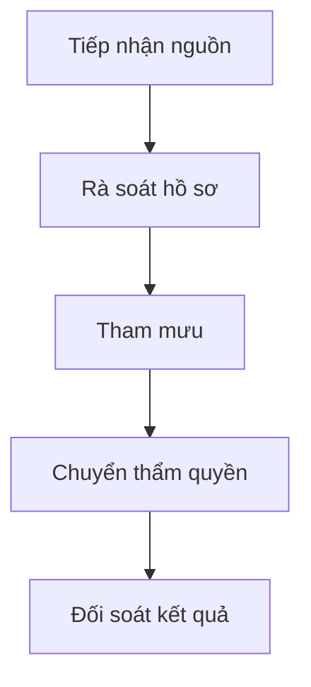

# M02 — KẾ HOẠCH TRIỂN KHAI CHI TIẾT DÀNH CHO TEAM AGENT

> **Module:** Nội vụ, lao động và người có công · **Baseline:** `dovandatym1-ship-it/pvh-demo` PR #12 @ `fa214999` · **Ngày:** 11/11/2026 · **Loại tài liệu:** PLAN / REVIEW REQUIRED, không phải xác nhận pháp lý hay code DONE.

## 0. Quy tắc sử dụng / bất biến của dự án

- 01 codebase dùng chung cho nhiều xã; tenant và quyền luôn suy từ phiên phía server. `main`, Phase 1–6, Supabase `Demo-pvh` không được tự merge/deploy/migrate/reset. Thiết kế mở rộng nhiều tenant cần ADR riêng vì schema hiện có ràng buộc singleton.
- **SOURCE** = đã nhìn thấy trong code/SQL nhánh tích hợp; **DESIGN** = trường/quy trình đề xuất cần BA-owner duyệt; **LIVE** = chỉ đánh khi có truy xuất cloud và chứng cứ checksum/DB, không tự suy từ migration file.
- UI luôn tiếng Việt; mã snake_case chỉ ở code/DB; không tạo văn bản quyết định pháp lý giả. Mọi biểu mẫu và quyền ký phải đối chiếu văn bản chuyên ngành đang hiệu lực trước implementation.
- Mỗi task chạy trên branch riêng từ SHA đã chốt, có owner file, commit, test receipt và PR audit; chỉ **Đỗ Văn Đạt** duyệt/merge. Không tự ý tăng phạm vi so với 128 OP nguồn và 5 chức năng M11 đã được đưa vào kiểm kê.
- Luồng **BA01 → DB01 → BE01 → FE01 → QA01 → INT01**. BA các OP có thể làm song song; DB migration được điều phối một owner/module để không xung đột timestamp, SQL và FK; FE chia component độc lập, không cùng sửa route/page khi chưa được lock.

## 1. Phạm vi, code hiện có và ranh giới

- **Mục tiêu module:** Nội vụ, lao động và người có công.
- **Tác nhân:** cán bộ nội vụ; cán bộ lao động; lãnh đạo rà soát; cơ quan thẩm quyền nguồn.
- **Màn hình hiện có:** `/noi-vu` (trạng thái chức năng cần đối chiếu).
- **Bảng SQL ứng viên:** `public.ncc_beneficiaries`, `public.labor_contracts`, `public.labor_disputes`.
- **Số operation trong Function Map:** 18 (mã nguồn OP-Mxx).
- **Feature-level của spec hiện có:** M02-F01 — Quản lý cán bộ, công chức; M02-F02 — Vị trí việc làm; M02-F03 — Thi đua, khen thưởng; M02-F04 — Người có công; M02-F05 — Lao động và việc làm; M02-F06 — Quan hệ lao động.

**Một số file code neo để agent tìm đúng nơi:**

- `src/features/m02-internal-affairs/components/labor-panels.tsx`
- `src/features/m02-internal-affairs/components/ncc-table.tsx`
- `src/features/m02-internal-affairs/schemas/internal-affairs.schema.ts`
- `src/features/m02-internal-affairs/server/actions.ts`
- `src/features/m02-internal-affairs/server/policy.ts`
- `src/features/m02-internal-affairs/server/queries.ts`
- `src/features/m02-internal-affairs/types/index.ts`
- `src/features/m02-internal-affairs/types/presentation.ts`

**Nguồn bắt buộc:** `docs/business/FUNCTION_MAP_PVH_v0.1.md`; `docs/plans/PVH_MASTER_INTEGRATION_2026-11-09/OP_FUNCTION_SCREEN_CODE_DB_CROSSWALK.csv`; `docs/specs/PVH_FULL_MODULE_SPEC_2026-11-09/M02.md`; SQL migration của PR #12. Không được coi `SOURCE_ONLY` là nghiệm thu runtime.

## 2. Flow E2E cấp module



Tiếp nhận hồ sơ nguồn → kiểm tra phạm vi/chủ thể → thẩm tra → tham mưu/chuyển → ghi kết quả nguồn. Với lỗi/thiếu thẩm quyền, trả hồ sơ về bước phù hợp kèm lý do và sự kiện audit; không sửa hồi tố dữ liệu đã chốt.

**Ma trận hành vi mặc định cho từng màn:** Danh sách (server paging/count), tìm kiếm/lọc/sort, xem chi tiết, thêm/sửa/ẩn hoặc ngừng hiệu lực theo quyền, đính kèm/chứng cứ nếu có, tra cứu lịch sử, xuất có kiểm quyền. Tính năng không áp dụng như nhật ký bất biến hoặc dữ liệu nguồn read-only phải ghi rõ N/A; không ép CRUD xóa đối với dữ liệu pháp lý.

## 3. Trường chuẩn dùng chung (DESIGN, áp dụng khi phù hợp)

| Field | Kiểu PostgreSQL | Quy tắc | Hiển thị / bảo vệ |
|---|---|---|---|
| `id` | `uuid` | PK server-generated | Định danh; mã kỹ thuật ẩn khỏi UI |
| `tenant_id` | `uuid` | FK, lấy từ session/membership | Đơn vị cấp xã; mã kỹ thuật ẩn khỏi UI |
| `org_unit_id` | `uuid` | FK đơn vị, kiểm scope | Đơn vị quản lý; mã kỹ thuật ẩn khỏi UI |
| `status` | `text` | Enum versioned theo đối tượng | Trạng thái; mã kỹ thuật ẩn khỏi UI |
| `version` | `integer` | OCC, tăng sau ghi | Phiên bản; mã kỹ thuật ẩn khỏi UI |
| `created_at` | `timestamptz` | UTC server | Thời điểm tạo; mã kỹ thuật ẩn khỏi UI |
| `created_by` | `uuid` | auth.uid server | Người tạo; mã kỹ thuật ẩn khỏi UI |
| `updated_at` | `timestamptz` | UTC server | Thời điểm cập nhật; mã kỹ thuật ẩn khỏi UI |
| `updated_by` | `uuid` | auth.uid server | Người cập nhật; mã kỹ thuật ẩn khỏi UI |
| `source_ref` | `text` | Nguồn hồ sơ/giấy tờ/đầu mối | Tài liệu nguồn; mã kỹ thuật ẩn khỏi UI |
| `is_active` | `boolean` | Soft retire nếu có phụ thuộc | Còn hiệu lực; mã kỹ thuật ẩn khỏi UI |

### Hợp đồng dữ liệu toàn module

- Mỗi record phải có owner, purpose, effective period khi phù hợp, nguồn gốc, mức nhạy cảm và retention theo policy được duyệt. Không lấy `tenant_id`, `created_by` hoặc `role_code` từ body client để quyết quyền.
- Mọi bảng mới có PK/FK, unique theo scope/kỳ, CHECK cho số/ngày/enum, index trên filter/FK/tenant, RLS (kể cả `FORCE RLS` theo rủi ro), hạn chế `SECURITY DEFINER`, quyền EXECUTE được revoke/grant có chủ đích.
- Cấm bỏ qua `SELECT` policy cần thiết cho UPDATE; kiểm `USING` và `WITH CHECK`; không dùng claims user-editable. Audit immutable, event/outbox idempotency; file private Storage + signed download theo từng user.
- Quy tắc `NULL` ≠ `0` ≠ `N/A` ≠ chưa xác nhận; dashboard và báo cáo giữ lineage và thời điểm chốt; export không được lộ PII ngoài quyền.

## 4. Data Dictionary SOURCE của nhánh tích hợp (không đồng nghĩa đã có trên cloud)

### `public.ncc_beneficiaries` — SOURCE trong nhánh tích hợp

| Cột | Kiểu trong SQL | Bắt buộc trong SQL | Ghi chú rà soát |
|---|---|---|---|
| `id` | `uuid` | Không hoặc theo constraint | Phải đối chiếu UI/API, RLS và migration history |
| `tenant_id` | `uuid` | Có | Phải đối chiếu UI/API, RLS và migration history |
| `code` | `text` | Có | Phải đối chiếu UI/API, RLS và migration history |
| `full_name` | `text` | Có | Phải đối chiếu UI/API, RLS và migration history |
| `cccd` | `text` | Không hoặc theo constraint | Phải đối chiếu UI/API, RLS và migration history |
| `hamlet_id` | `uuid` | Có | Phải đối chiếu UI/API, RLS và migration history |
| `category` | `text` | Có | Phải đối chiếu UI/API, RLS và migration history |
| `medal_title` | `text` | Có | Phải đối chiếu UI/API, RLS và migration history |
| `monthly_allowance` | `numeric(15,2)` | Không hoặc theo constraint | Phải đối chiếu UI/API, RLS và migration history |
| `has_deduplication_flag` | `boolean` | Có | Phải đối chiếu UI/API, RLS và migration history |
| `deduplication_warning` | `text` | Không hoặc theo constraint | Phải đối chiếu UI/API, RLS và migration history |
| `status` | `text` | Có | Phải đối chiếu UI/API, RLS và migration history |
| `version` | `integer` | Có | Phải đối chiếu UI/API, RLS và migration history |
| `created_at` | `timestamptz` | Có | Phải đối chiếu UI/API, RLS và migration history |

### `public.labor_contracts` — SOURCE trong nhánh tích hợp

| Cột | Kiểu trong SQL | Bắt buộc trong SQL | Ghi chú rà soát |
|---|---|---|---|
| `id` | `uuid` | Không hoặc theo constraint | Phải đối chiếu UI/API, RLS và migration history |
| `tenant_id` | `uuid` | Có | Phải đối chiếu UI/API, RLS và migration history |
| `business_name` | `text` | Có | Phải đối chiếu UI/API, RLS và migration history |
| `tax_code` | `text` | Có | Phải đối chiếu UI/API, RLS và migration history |
| `total_workers` | `integer` | Có | Phải đối chiếu UI/API, RLS và migration history |
| `min_wage_paid` | `numeric(15,2)` | Có | Phải đối chiếu UI/API, RLS và migration history |
| `regional_min_wage` | `numeric(15,2)` | Có | Phải đối chiếu UI/API, RLS và migration history |
| `is_under_min_wage` | `boolean` | Không hoặc theo constraint | Phải đối chiếu UI/API, RLS và migration history |
| `seasonal_workers_count` | `integer` | Có | Phải đối chiếu UI/API, RLS và migration history |
| `bhxh_registered_count` | `integer` | Có | Phải đối chiếu UI/API, RLS và migration history |
| `evaluation_period` | `text` | Có | Phải đối chiếu UI/API, RLS và migration history |
| `source_reference` | `text` | Có | Phải đối chiếu UI/API, RLS và migration history |
| `version` | `integer` | Có | Phải đối chiếu UI/API, RLS và migration history |
| `created_at` | `timestamptz` | Có | Phải đối chiếu UI/API, RLS và migration history |

### `public.labor_disputes` — SOURCE trong nhánh tích hợp

| Cột | Kiểu trong SQL | Bắt buộc trong SQL | Ghi chú rà soát |
|---|---|---|---|
| `id` | `uuid` | Không hoặc theo constraint | Phải đối chiếu UI/API, RLS và migration history |
| `tenant_id` | `uuid` | Có | Phải đối chiếu UI/API, RLS và migration history |
| `code` | `text` | Có | Phải đối chiếu UI/API, RLS và migration history |
| `requester_name` | `text` | Có | Phải đối chiếu UI/API, RLS và migration history |
| `requester_role` | `text` | Có | Phải đối chiếu UI/API, RLS và migration history |
| `respondent_name` | `text` | Có | Phải đối chiếu UI/API, RLS và migration history |
| `dispute_content` | `text` | Có | Phải đối chiếu UI/API, RLS và migration history |
| `dispute_type` | `text` | Có | Phải đối chiếu UI/API, RLS và migration history |
| `received_date` | `date` | Có | Phải đối chiếu UI/API, RLS và migration history |
| `status` | `text` | Có | Phải đối chiếu UI/API, RLS và migration history |
| `outcome_summary` | `text` | Không hoặc theo constraint | Phải đối chiếu UI/API, RLS và migration history |
| `source_reference` | `text` | Có | Phải đối chiếu UI/API, RLS và migration history |
| `decision_reference` | `text` | Không hoặc theo constraint | Phải đối chiếu UI/API, RLS và migration history |
| `version` | `integer` | Có | Phải đối chiếu UI/API, RLS và migration history |
| `created_at` | `timestamptz` | Có | Phải đối chiếu UI/API, RLS và migration history |

### 4.1. Ánh xạ tên trường thiết kế ↔ cột đã có (không tạo cột trùng)

| Trường tại biểu mẫu/đặc tả | Cột chuẩn ứng viên trong SQL | Quy tắc |
|---|---|---|
| `beneficiary_code` | `public.ncc_beneficiaries.code` | Agent DB/BA phải kiểm tra semantics và không tạo thêm cột trước khi chốt mapping |
| `dispute_code` | `public.labor_disputes.code` | Agent DB/BA phải kiểm tra semantics và không tạo thêm cột trước khi chốt mapping |
| `policy_category` | `public.ncc_beneficiaries.category` | Agent DB/BA phải kiểm tra semantics và không tạo thêm cột trước khi chốt mapping |

## 5. WBS chi tiết cho từng operation/feature

Mỗi task dưới đây có mã duy nhất, phụ thuộc và DoD; nhóm BA/DB/BE/FE/QA/INT dùng làm work packages. Cột trường là cấu trúc đề xuất/đối chiếu source, **không phải danh sách pháp lý bắt buộc đã duyệt**.

### OP-M02-001 — Tham mưu tổ chức bộ máy, đơn vị sự nghiệp; hồ sơ đề xuất gắn văn bản

- **Mức độ code:** Chưa tìm thấy hành vi tương ứng trong đối chiếu tĩnh.
- **Nhóm luồng:** `CASE` · **Source status:** `DISCOVERED` · **Screen Map:** `SCR-CV-02 ⟨OP-M02-001⟩` · **Mức nhạy cảm nguồn:** `—`.
- **Nguồn yêu cầu:** BL-013; REQ-M02-01.
- **Code API/DB ứng viên (chỉ để rà soát):** NOT_FOUND_STATIC: no staffing proposal/action/RPC / NOT_FOUND_STATIC: no position/agency proposal entity; profiles and org_units are not personnel case records.
- **Đầu ra nghiệp vụ:** biên nhận có mã và phiên bản (nếu ghi), danh sách/chi tiết theo quyền, trạng thái, lịch sử, nguồn đối soát, thông báo và báo cáo chỉ khi có nguồn thật.

#### Luồng chính và các bước kiểm soát

1. Cán bộ mở nghiệp vụ **Tham mưu tổ chức bộ máy, đơn vị sự nghiệp; hồ sơ đề xuất gắn văn bản**, chọn đúng xã/địa bàn và ghi `proposal_code`, `proposal_type`, `legal_basis`, `justification`; hệ thống dẫn chiếu nguồn và kỳ hiệu lực.
2. Server xác thực phiên, membership còn hiệu lực, permission cấp tác vụ, phạm vi bản ghi và mức nhạy cảm; tenant lấy từ server, không nhận từ form.
3. Kiểm tra schema, ràng buộc trường, mã nguồn, khóa trùng, phiên bản, liên kết FK và tình trạng đối tượng; lỗi trả từng trường bằng tiếng Việt.
4. Tạo hồ sơ tiếp nhận có mã, nguồn và phiên bản biểu mẫu; kiểm trùng chủ thể/kỳ trước khi cấp biên nhận.
5. Cán bộ có quyền bổ sung minh chứng, lưu nháp; người rà soát khác người nhập kiểm điều kiện/chủ thể và ghi lý do yêu cầu bổ sung.
6. Nếu vượt thẩm quyền, tạo phiếu chuyển/đề xuất và chờ mã quyết định nguồn; không tự sinh kết quả pháp lý hoặc coi bản demo là quyết định.
7. Ghi sự kiện bất biến, actor/time/version, tạo thông báo nếu hợp đồng sự kiện quy định; cập nhật dashboard/report theo nguồn phát sinh có truy vết.
8. Người dùng thấy biên nhận/chi tiết, trạng thái và lỗi rõ ràng; hỗ trợ tra cứu, lọc, phân trang và truy xuất lịch sử theo quyền.

**Luồng ngoại lệ:** (E1) sai quyền/sai xã→403 và audit deny, không trả bản ghi; (E2) sai trường/thiếu nguồn→422 theo trường; (E3) trùng/đổi phiên bản→409 và refresh; (E4) nguồn ngoài không xác nhận→PENDING/UNAVAILABLE, không ghi “thành công”; (E5) hồ sơ chốt/đã tham chiếu→không xóa vật lý; (E6) thiếu chứng cứ→CHƯA ĐỦ THÔNG TIN, không tự kết luận không đủ điều kiện.

#### Trường đầu vào/đầu ra bắt buộc đặc tả

| Field snake_case | Nhãn tiếng Việt dự kiến | PostgreSQL | Bắt buộc (đề xuất) | Validation / business rule | Nhạy cảm | Nguồn |
|---|---|---|---|---|---|---|
| `id` | Định danh | `uuid` | Server | PK sinh trên server, không nhận ID tùy ý từ client khi tạo | Nội bộ | SOURCE (cùng tên cột trong module; cần xác minh entity) |
| `tenant_id` | Đơn vị cấp xã | `uuid` | Server | FK đúng tenant, tồn tại, còn hiệu lực, scope | Nội bộ | SOURCE (cùng tên cột trong module; cần xác minh entity) |
| `proposal_code` | Mã đề xuất | `text` | BA xác nhận bắt buộc | Chuẩn hóa trim, giới hạn 1–80 ký tự, unique theo owner/kỳ nếu áp dụng | Nội bộ | DESIGN |
| `org_unit_id` | Đơn vị quản lý | `uuid` | BA xác nhận bắt buộc | FK đúng tenant, tồn tại, còn hiệu lực, scope | Nội bộ | DESIGN |
| `proposal_type` | Loại đề xuất | `text` | BA xác nhận bắt buộc | Trim; giới hạn độ dài theo Data Dictionary; không nhận HTML/script | Nội bộ | DESIGN |
| `legal_basis` | Pháp lý căn cứ | `text` | Theo loại hồ sơ | Trim; giới hạn độ dài theo Data Dictionary; không nhận HTML/script | Nội bộ | DESIGN |
| `justification` | Giải trình | `text` | Theo loại hồ sơ | Trim; giới hạn độ dài theo Data Dictionary; không nhận HTML/script | Nội bộ | DESIGN |
| `attached_document_id` | Định danh đính kèm văn bản | `uuid` | Theo loại hồ sơ | FK đúng tenant, tồn tại, còn hiệu lực, scope | Nội bộ | DESIGN |
| `status` | Trạng thái | `text` | Server | Enum versioned; cấm tự thêm trạng thái ở client | Nội bộ | SOURCE (cùng tên cột trong module; cần xác minh entity) |
| `version` | Phiên bản | `integer` | Server | Số nguyên không âm trừ trường đã duyệt cho phép âm | Nội bộ | SOURCE (cùng tên cột trong module; cần xác minh entity) |
| `created_at` | Thời điểm tạo | `timestamptz` | Server | UTC trong DB, hiển thị giờ Việt Nam; ngày hợp lệ | Nội bộ | SOURCE (cùng tên cột trong module; cần xác minh entity) |
| `created_by` | Người tạo | `uuid` | Server | FK đúng tenant, tồn tại, còn hiệu lực, scope | Nội bộ | DESIGN |

**Quy tắc giao diện:** ẩn mã kỹ thuật; form field-level errors; read-only nguồn ngoài; phân biệt bản nháp/kết quả đã xác nhận; modal xác nhận với lý do khi hủy/ẩn/chuyển; danh sách có tổng số thực và link chi tiết; export chỉ những cột được phép. **KPI:** chỉ bổ sung sau khi ghi rõ bảng+cột+trạng thái+điều kiện lọc+ngày dữ liệu+RLS+link drill-down.

#### Task giao cho agent (mỗi task là 1 work package có thể kiểm thử)

| Task ID | Agent | Đầu vào | Việc phải làm / đầu ra | Phụ thuộc | Definition of Done |
|---|---|---|---|---|---|
| M02-001-BA01 | BA nghiệp vụ | Function Map, quyền/pháp lý, mẫu nguồn | Đặc tả actor, biến thể, trường bắt buộc, trạng thái, ngoại lệ, ownership và rule register đã dẫn nguồn | — | Biên bản duyệt phạm vi OP-M02-001; không còn trường 'cần xác minh' chưa gán owner |
| M02-001-DB01 | DB/RLS | BA01 + schema thực/migration đang có | Migration cho entity/constraint/FK/index theo tenant; RLS và pgTAP; không sửa migration đã áp cloud | M02-001-BA01 | Replay clean trên staging; thử 2 ngữ cảnh xã theo ADR (không vượt ràng buộc singleton), 3 vai trò, scope deny, concurrency và rollback |
| M02-001-BE01 | Backend | BA01 + DB01 | Server Action/query/RPC/DTO tại `src/features/m02-internal-affairs/server/`; kiểm quyền server, idempotency, audit, error mapping | M02-001-DB01 | Unit+contract test: thành công, sai schema, sai tenant, thiếu quyền, stale version, retry không nhân đôi |
| M02-001-FE01 | Frontend | BA01 + hợp đồng API từ BE01 | Form tiếng Việt, danh sách/chi tiết, lọc/tìm/sort/page, CRUD có điều kiện tại `src/features/m02-internal-affairs/components/`; loading/empty/error/mobile | M02-001-BE01 | Browser 375/768/1440px; focus/keyboard; mỗi trường có nhãn, mô tả lỗi; không cho sửa khi không có quyền |
| M02-001-QA01 | QA/Automation | BA01 + DB01/BE01/FE01 | Bộ ca kiểm thử OP-M02-001: happy/negative/boundary/role/tenant/PII/export/audit; fixture và receipt SHA | M02-001-FE01 | Có test IDs gắn OP-M02-001, chạy đúng HEAD, không chỉ snapshot UI; fail case có log che dữ liệu |
| M02-001-SEC01 | Security | BE01 + phân loại dữ liệu | Test mask server DTO, mục đích truy cập, field-level export deny, retention, no direct client leak | M02-001-BE01 | Cross-role/tenant data denied even via direct API; logs không chứa PII |
| M02-001-INT01 | Tích hợp | QA01 + mã nguồn nhánh dự kiến | Liên kết M00 quyền/M01 việc/M09 chỉ tiêu/M10 nguồn nếu áp dụng; evidence route→action→DB→test; PR chỉ đổi phạm vi task | M02-001-QA01 + M02-001-SEC01 | Không thiếu phép C/R/U/D áp dụng; không có false-success; reviewer Đỗ Văn Đạt ký nhận |

#### Acceptance scenarios

- **AC-OP-M02-001-01 (hợp lệ):** Given phiên có quyền và nguồn `proposal_code` và `org_unit_id` hợp lệ; When thực hiện theo luồng CASE; Then lưu/tra cứu đúng kết quả, trả ID hoặc biên nhận, audit và version.
- **AC-OP-M02-001-02 (bị chặn):** Given sai địa bàn, không có permission hoặc dữ liệu thiếu; When gọi trực tiếp API/RPC; Then trả lỗi không rò dữ liệu và không tạo bản ghi/event thành công.
- **AC-OP-M02-001-03 (đồng thời/nguồn):** Given cập nhật trùng hoặc source/version cũ; When gửi lặp hoặc hai người chỉnh cùng bản ghi; Then idempotent/reject conflict, không ghi đè phiên bản mới.
- **AC-OP-M02-001-04 (giao diện):** Given vai trò chỉ xem; When mở bằng điện thoại hoặc đường dẫn trực tiếp; Then các tác vụ sửa/xuất không đúng quyền bị ẩn *và* server từ chối.

**Evidence tối thiểu:** commit SHA; đường dẫn file liên quan; migration history/checksum (nếu thay DB); link CI thực thi; pgTAP/RLS test ID; ảnh/trace 375/768/1440; dữ liệu test và người ký duyệt. Trạng thái OP chỉ được đổi `UNVERIFIED` → `STATIC_CHECKED` → `INTEGRATED_TESTED` → `OWNER_ACCEPTED` khi có biên nhận tương ứng.

### OP-M02-002 — Tham mưu địa giới và tổ chức chính quyền địa phương

- **Mức độ code:** Chưa tìm thấy hành vi tương ứng trong đối chiếu tĩnh.
- **Nhóm luồng:** `TRACK` · **Source status:** `DISCOVERED` · **Screen Map:** `SCR-CV-02 ⟨OP-M02-002⟩` · **Mức nhạy cảm nguồn:** `—`.
- **Nguồn yêu cầu:** BL-014; REQ-M02-01.
- **Code API/DB ứng viên (chỉ để rà soát):** NOT_FOUND_STATIC: no boundary proposal or competent-authority transfer action/RPC / NOT_FOUND_STATIC: org_units is operational directory data, not a boundary-advisory case/history entity.
- **Đầu ra nghiệp vụ:** biên nhận có mã và phiên bản (nếu ghi), danh sách/chi tiết theo quyền, trạng thái, lịch sử, nguồn đối soát, thông báo và báo cáo chỉ khi có nguồn thật.

#### Luồng chính và các bước kiểm soát

1. Cán bộ mở nghiệp vụ **Tham mưu địa giới và tổ chức chính quyền địa phương**, chọn đúng xã/địa bàn và ghi `boundary_code`, `affected_unit_ids`, `change_type`, `authority_ref`; hệ thống dẫn chiếu nguồn và kỳ hiệu lực.
2. Server xác thực phiên, membership còn hiệu lực, permission cấp tác vụ, phạm vi bản ghi và mức nhạy cảm; tenant lấy từ server, không nhận từ form.
3. Kiểm tra schema, ràng buộc trường, mã nguồn, khóa trùng, phiên bản, liên kết FK và tình trạng đối tượng; lỗi trả từng trường bằng tiếng Việt.
4. Tạo bản theo dõi/kế hoạch cùng người phụ trách, mốc thời gian và nguồn chỉ tiêu/kết quả.
5. Giao đầu việc liên quan M01 nếu có; cập nhật theo phiên bản và ghi lý do sửa dữ liệu đã được xác nhận.
6. Người xác nhận độc lập đối soát mục tiêu–thực tế–minh chứng; đóng kỳ khi đủ điều kiện hoặc nêu thiếu nguồn.
7. Ghi sự kiện bất biến, actor/time/version, tạo thông báo nếu hợp đồng sự kiện quy định; cập nhật dashboard/report theo nguồn phát sinh có truy vết.
8. Người dùng thấy biên nhận/chi tiết, trạng thái và lỗi rõ ràng; hỗ trợ tra cứu, lọc, phân trang và truy xuất lịch sử theo quyền.

**Luồng ngoại lệ:** (E1) sai quyền/sai xã→403 và audit deny, không trả bản ghi; (E2) sai trường/thiếu nguồn→422 theo trường; (E3) trùng/đổi phiên bản→409 và refresh; (E4) nguồn ngoài không xác nhận→PENDING/UNAVAILABLE, không ghi “thành công”; (E5) hồ sơ chốt/đã tham chiếu→không xóa vật lý; (E6) thiếu chứng cứ→CHƯA ĐỦ THÔNG TIN, không tự kết luận không đủ điều kiện.

#### Trường đầu vào/đầu ra bắt buộc đặc tả

| Field snake_case | Nhãn tiếng Việt dự kiến | PostgreSQL | Bắt buộc (đề xuất) | Validation / business rule | Nhạy cảm | Nguồn |
|---|---|---|---|---|---|---|
| `id` | Định danh | `uuid` | Server | PK sinh trên server, không nhận ID tùy ý từ client khi tạo | Nội bộ | SOURCE (cùng tên cột trong module; cần xác minh entity) |
| `tenant_id` | Đơn vị cấp xã | `uuid` | Server | FK đúng tenant, tồn tại, còn hiệu lực, scope | Nội bộ | SOURCE (cùng tên cột trong module; cần xác minh entity) |
| `boundary_code` | Mã địa giới | `text` | BA xác nhận bắt buộc | Chuẩn hóa trim, giới hạn 1–80 ký tự, unique theo owner/kỳ nếu áp dụng | Nội bộ | DESIGN |
| `affected_unit_ids` | Bị ảnh hưởng đơn vị danh sách định danh | `uuid[]` | BA xác nhận bắt buộc | Từng ID có quyền truy cập, không trùng, tối đa theo contract | Nội bộ | DESIGN |
| `change_type` | Loại thay đổi | `text` | BA xác nhận bắt buộc | Trim; giới hạn độ dài theo Data Dictionary; không nhận HTML/script | Nội bộ | DESIGN |
| `authority_ref` | Văn bản xác định thẩm quyền | `text` | Theo loại hồ sơ | Trim; giới hạn độ dài theo Data Dictionary; không nhận HTML/script | Nội bộ | DESIGN |
| `effective_date` | Ngày hiệu lực | `date` | Theo loại hồ sơ | ISO 8601; ngày bắt đầu ≤ ngày kết thúc khi có cặp | Nội bộ | DESIGN |
| `proposal_status` | Trạng thái đề xuất | `text` | Theo loại hồ sơ | Enum versioned; cấm tự thêm trạng thái ở client | Nội bộ | DESIGN |
| `status` | Trạng thái | `text` | Server | Enum versioned; cấm tự thêm trạng thái ở client | Nội bộ | SOURCE (cùng tên cột trong module; cần xác minh entity) |
| `version` | Phiên bản | `integer` | Server | Số nguyên không âm trừ trường đã duyệt cho phép âm | Nội bộ | SOURCE (cùng tên cột trong module; cần xác minh entity) |
| `created_at` | Thời điểm tạo | `timestamptz` | Server | UTC trong DB, hiển thị giờ Việt Nam; ngày hợp lệ | Nội bộ | SOURCE (cùng tên cột trong module; cần xác minh entity) |
| `created_by` | Người tạo | `uuid` | Server | FK đúng tenant, tồn tại, còn hiệu lực, scope | Nội bộ | DESIGN |

**Quy tắc giao diện:** ẩn mã kỹ thuật; form field-level errors; read-only nguồn ngoài; phân biệt bản nháp/kết quả đã xác nhận; modal xác nhận với lý do khi hủy/ẩn/chuyển; danh sách có tổng số thực và link chi tiết; export chỉ những cột được phép. **KPI:** chỉ bổ sung sau khi ghi rõ bảng+cột+trạng thái+điều kiện lọc+ngày dữ liệu+RLS+link drill-down.

#### Task giao cho agent (mỗi task là 1 work package có thể kiểm thử)

| Task ID | Agent | Đầu vào | Việc phải làm / đầu ra | Phụ thuộc | Definition of Done |
|---|---|---|---|---|---|
| M02-002-BA01 | BA nghiệp vụ | Function Map, quyền/pháp lý, mẫu nguồn | Đặc tả actor, biến thể, trường bắt buộc, trạng thái, ngoại lệ, ownership và rule register đã dẫn nguồn | — | Biên bản duyệt phạm vi OP-M02-002; không còn trường 'cần xác minh' chưa gán owner |
| M02-002-DB01 | DB/RLS | BA01 + schema thực/migration đang có | Migration cho entity/constraint/FK/index theo tenant; RLS và pgTAP; không sửa migration đã áp cloud | M02-002-BA01 | Replay clean trên staging; thử 2 ngữ cảnh xã theo ADR (không vượt ràng buộc singleton), 3 vai trò, scope deny, concurrency và rollback |
| M02-002-BE01 | Backend | BA01 + DB01 | Server Action/query/RPC/DTO tại `src/features/m02-internal-affairs/server/`; kiểm quyền server, idempotency, audit, error mapping | M02-002-DB01 | Unit+contract test: thành công, sai schema, sai tenant, thiếu quyền, stale version, retry không nhân đôi |
| M02-002-FE01 | Frontend | BA01 + hợp đồng API từ BE01 | Form tiếng Việt, danh sách/chi tiết, lọc/tìm/sort/page, CRUD có điều kiện tại `src/features/m02-internal-affairs/components/`; loading/empty/error/mobile | M02-002-BE01 | Browser 375/768/1440px; focus/keyboard; mỗi trường có nhãn, mô tả lỗi; không cho sửa khi không có quyền |
| M02-002-QA01 | QA/Automation | BA01 + DB01/BE01/FE01 | Bộ ca kiểm thử OP-M02-002: happy/negative/boundary/role/tenant/PII/export/audit; fixture và receipt SHA | M02-002-FE01 | Có test IDs gắn OP-M02-002, chạy đúng HEAD, không chỉ snapshot UI; fail case có log che dữ liệu |
| M02-002-SEC01 | Security | BE01 + phân loại dữ liệu | Test mask server DTO, mục đích truy cập, field-level export deny, retention, no direct client leak | M02-002-BE01 | Cross-role/tenant data denied even via direct API; logs không chứa PII |
| M02-002-INT01 | Tích hợp | QA01 + mã nguồn nhánh dự kiến | Liên kết M00 quyền/M01 việc/M09 chỉ tiêu/M10 nguồn nếu áp dụng; evidence route→action→DB→test; PR chỉ đổi phạm vi task | M02-002-QA01 + M02-002-SEC01 | Không thiếu phép C/R/U/D áp dụng; không có false-success; reviewer Đỗ Văn Đạt ký nhận |

#### Acceptance scenarios

- **AC-OP-M02-002-01 (hợp lệ):** Given phiên có quyền và nguồn `boundary_code` và `affected_unit_ids` hợp lệ; When thực hiện theo luồng TRACK; Then lưu/tra cứu đúng kết quả, trả ID hoặc biên nhận, audit và version.
- **AC-OP-M02-002-02 (bị chặn):** Given sai địa bàn, không có permission hoặc dữ liệu thiếu; When gọi trực tiếp API/RPC; Then trả lỗi không rò dữ liệu và không tạo bản ghi/event thành công.
- **AC-OP-M02-002-03 (đồng thời/nguồn):** Given cập nhật trùng hoặc source/version cũ; When gửi lặp hoặc hai người chỉnh cùng bản ghi; Then idempotent/reject conflict, không ghi đè phiên bản mới.
- **AC-OP-M02-002-04 (giao diện):** Given vai trò chỉ xem; When mở bằng điện thoại hoặc đường dẫn trực tiếp; Then các tác vụ sửa/xuất không đúng quyền bị ẩn *và* server từ chối.

**Evidence tối thiểu:** commit SHA; đường dẫn file liên quan; migration history/checksum (nếu thay DB); link CI thực thi; pgTAP/RLS test ID; ảnh/trace 375/768/1440; dữ liệu test và người ký duyệt. Trạng thái OP chỉ được đổi `UNVERIFIED` → `STATIC_CHECKED` → `INTEGRATED_TESTED` → `OWNER_ACCEPTED` khi có biên nhận tương ứng.

### OP-M02-003 — Tổng hợp, điều chỉnh vị trí việc làm, tỷ lệ bố trí công chức; chế độ công vụ nội bộ

- **Mức độ code:** Chưa tìm thấy hành vi tương ứng trong đối chiếu tĩnh.
- **Nhóm luồng:** `TRACK` · **Source status:** `DISCOVERED` · **Screen Map:** `SCR-NV-01` · **Mức nhạy cảm nguồn:** `—`.
- **Nguồn yêu cầu:** BL-010, BL-015; REQ-M02-01.
- **Code API/DB ứng viên (chỉ để rà soát):** NOT_FOUND_STATIC: no position-count/adjustment action or RPC / NOT_FOUND_STATIC: no position, quota, effective-date or change-history table.
- **Đầu ra nghiệp vụ:** biên nhận có mã và phiên bản (nếu ghi), danh sách/chi tiết theo quyền, trạng thái, lịch sử, nguồn đối soát, thông báo và báo cáo chỉ khi có nguồn thật.

#### Luồng chính và các bước kiểm soát

1. Cán bộ mở nghiệp vụ **Tổng hợp, điều chỉnh vị trí việc làm, tỷ lệ bố trí công chức; chế độ công vụ nội bộ**, chọn đúng xã/địa bàn và ghi `position_code`, `position_title`, `staff_quota`, `filled_count`; hệ thống dẫn chiếu nguồn và kỳ hiệu lực.
2. Server xác thực phiên, membership còn hiệu lực, permission cấp tác vụ, phạm vi bản ghi và mức nhạy cảm; tenant lấy từ server, không nhận từ form.
3. Kiểm tra schema, ràng buộc trường, mã nguồn, khóa trùng, phiên bản, liên kết FK và tình trạng đối tượng; lỗi trả từng trường bằng tiếng Việt.
4. Tạo bản theo dõi/kế hoạch cùng người phụ trách, mốc thời gian và nguồn chỉ tiêu/kết quả.
5. Giao đầu việc liên quan M01 nếu có; cập nhật theo phiên bản và ghi lý do sửa dữ liệu đã được xác nhận.
6. Người xác nhận độc lập đối soát mục tiêu–thực tế–minh chứng; đóng kỳ khi đủ điều kiện hoặc nêu thiếu nguồn.
7. Ghi sự kiện bất biến, actor/time/version, tạo thông báo nếu hợp đồng sự kiện quy định; cập nhật dashboard/report theo nguồn phát sinh có truy vết.
8. Người dùng thấy biên nhận/chi tiết, trạng thái và lỗi rõ ràng; hỗ trợ tra cứu, lọc, phân trang và truy xuất lịch sử theo quyền.

**Luồng ngoại lệ:** (E1) sai quyền/sai xã→403 và audit deny, không trả bản ghi; (E2) sai trường/thiếu nguồn→422 theo trường; (E3) trùng/đổi phiên bản→409 và refresh; (E4) nguồn ngoài không xác nhận→PENDING/UNAVAILABLE, không ghi “thành công”; (E5) hồ sơ chốt/đã tham chiếu→không xóa vật lý; (E6) thiếu chứng cứ→CHƯA ĐỦ THÔNG TIN, không tự kết luận không đủ điều kiện.

#### Trường đầu vào/đầu ra bắt buộc đặc tả

| Field snake_case | Nhãn tiếng Việt dự kiến | PostgreSQL | Bắt buộc (đề xuất) | Validation / business rule | Nhạy cảm | Nguồn |
|---|---|---|---|---|---|---|
| `id` | Định danh | `uuid` | Server | PK sinh trên server, không nhận ID tùy ý từ client khi tạo | Nội bộ | SOURCE (cùng tên cột trong module; cần xác minh entity) |
| `tenant_id` | Đơn vị cấp xã | `uuid` | Server | FK đúng tenant, tồn tại, còn hiệu lực, scope | Nội bộ | SOURCE (cùng tên cột trong module; cần xác minh entity) |
| `position_code` | Mã vị trí việc làm | `text` | BA xác nhận bắt buộc | Chuẩn hóa trim, giới hạn 1–80 ký tự, unique theo owner/kỳ nếu áp dụng | Nội bộ | DESIGN |
| `position_title` | Tiêu đề vị trí việc làm | `text` | BA xác nhận bắt buộc | Trim; giới hạn độ dài theo Data Dictionary; không nhận HTML/script | Nội bộ | DESIGN |
| `staff_quota` | Cán bộ chỉ tiêu biên chế | `integer` | BA xác nhận bắt buộc | Số nguyên không âm trừ trường đã duyệt cho phép âm | Nội bộ | DESIGN |
| `filled_count` | Số lượng đã bố trí | `integer` | Theo loại hồ sơ | Số nguyên không âm trừ trường đã duyệt cho phép âm | Nội bộ | DESIGN |
| `shortage_count` | Số lượng còn thiếu | `integer` | Theo loại hồ sơ | Số nguyên không âm trừ trường đã duyệt cho phép âm | Nội bộ | DESIGN |
| `period` | Kỳ | `text` | Theo loại hồ sơ | Trim; giới hạn độ dài theo Data Dictionary; không nhận HTML/script | Nội bộ | DESIGN |
| `source_ref` | Tài liệu nguồn | `text` | Theo loại hồ sơ | Trim; giới hạn độ dài theo Data Dictionary; không nhận HTML/script | Nội bộ | DESIGN |
| `status` | Trạng thái | `text` | Server | Enum versioned; cấm tự thêm trạng thái ở client | Nội bộ | SOURCE (cùng tên cột trong module; cần xác minh entity) |
| `version` | Phiên bản | `integer` | Server | Số nguyên không âm trừ trường đã duyệt cho phép âm | Nội bộ | SOURCE (cùng tên cột trong module; cần xác minh entity) |
| `created_at` | Thời điểm tạo | `timestamptz` | Server | UTC trong DB, hiển thị giờ Việt Nam; ngày hợp lệ | Nội bộ | SOURCE (cùng tên cột trong module; cần xác minh entity) |
| `created_by` | Người tạo | `uuid` | Server | FK đúng tenant, tồn tại, còn hiệu lực, scope | Nội bộ | DESIGN |

**Quy tắc giao diện:** ẩn mã kỹ thuật; form field-level errors; read-only nguồn ngoài; phân biệt bản nháp/kết quả đã xác nhận; modal xác nhận với lý do khi hủy/ẩn/chuyển; danh sách có tổng số thực và link chi tiết; export chỉ những cột được phép. **KPI:** chỉ bổ sung sau khi ghi rõ bảng+cột+trạng thái+điều kiện lọc+ngày dữ liệu+RLS+link drill-down.

#### Task giao cho agent (mỗi task là 1 work package có thể kiểm thử)

| Task ID | Agent | Đầu vào | Việc phải làm / đầu ra | Phụ thuộc | Definition of Done |
|---|---|---|---|---|---|
| M02-003-BA01 | BA nghiệp vụ | Function Map, quyền/pháp lý, mẫu nguồn | Đặc tả actor, biến thể, trường bắt buộc, trạng thái, ngoại lệ, ownership và rule register đã dẫn nguồn | — | Biên bản duyệt phạm vi OP-M02-003; không còn trường 'cần xác minh' chưa gán owner |
| M02-003-DB01 | DB/RLS | BA01 + schema thực/migration đang có | Migration cho entity/constraint/FK/index theo tenant; RLS và pgTAP; không sửa migration đã áp cloud | M02-003-BA01 | Replay clean trên staging; thử 2 ngữ cảnh xã theo ADR (không vượt ràng buộc singleton), 3 vai trò, scope deny, concurrency và rollback |
| M02-003-BE01 | Backend | BA01 + DB01 | Server Action/query/RPC/DTO tại `src/features/m02-internal-affairs/server/`; kiểm quyền server, idempotency, audit, error mapping | M02-003-DB01 | Unit+contract test: thành công, sai schema, sai tenant, thiếu quyền, stale version, retry không nhân đôi |
| M02-003-FE01 | Frontend | BA01 + hợp đồng API từ BE01 | Form tiếng Việt, danh sách/chi tiết, lọc/tìm/sort/page, CRUD có điều kiện tại `src/features/m02-internal-affairs/components/`; loading/empty/error/mobile | M02-003-BE01 | Browser 375/768/1440px; focus/keyboard; mỗi trường có nhãn, mô tả lỗi; không cho sửa khi không có quyền |
| M02-003-QA01 | QA/Automation | BA01 + DB01/BE01/FE01 | Bộ ca kiểm thử OP-M02-003: happy/negative/boundary/role/tenant/PII/export/audit; fixture và receipt SHA | M02-003-FE01 | Có test IDs gắn OP-M02-003, chạy đúng HEAD, không chỉ snapshot UI; fail case có log che dữ liệu |
| M02-003-SEC01 | Security | BE01 + phân loại dữ liệu | Test mask server DTO, mục đích truy cập, field-level export deny, retention, no direct client leak | M02-003-BE01 | Cross-role/tenant data denied even via direct API; logs không chứa PII |
| M02-003-INT01 | Tích hợp | QA01 + mã nguồn nhánh dự kiến | Liên kết M00 quyền/M01 việc/M09 chỉ tiêu/M10 nguồn nếu áp dụng; evidence route→action→DB→test; PR chỉ đổi phạm vi task | M02-003-QA01 + M02-003-SEC01 | Không thiếu phép C/R/U/D áp dụng; không có false-success; reviewer Đỗ Văn Đạt ký nhận |

#### Acceptance scenarios

- **AC-OP-M02-003-01 (hợp lệ):** Given phiên có quyền và nguồn `position_code` và `position_title` hợp lệ; When thực hiện theo luồng TRACK; Then lưu/tra cứu đúng kết quả, trả ID hoặc biên nhận, audit và version.
- **AC-OP-M02-003-02 (bị chặn):** Given sai địa bàn, không có permission hoặc dữ liệu thiếu; When gọi trực tiếp API/RPC; Then trả lỗi không rò dữ liệu và không tạo bản ghi/event thành công.
- **AC-OP-M02-003-03 (đồng thời/nguồn):** Given cập nhật trùng hoặc source/version cũ; When gửi lặp hoặc hai người chỉnh cùng bản ghi; Then idempotent/reject conflict, không ghi đè phiên bản mới.
- **AC-OP-M02-003-04 (giao diện):** Given vai trò chỉ xem; When mở bằng điện thoại hoặc đường dẫn trực tiếp; Then các tác vụ sửa/xuất không đúng quyền bị ẩn *và* server từ chối.

**Evidence tối thiểu:** commit SHA; đường dẫn file liên quan; migration history/checksum (nếu thay DB); link CI thực thi; pgTAP/RLS test ID; ảnh/trace 375/768/1440; dữ liệu test và người ký duyệt. Trạng thái OP chỉ được đổi `UNVERIFIED` → `STATIC_CHECKED` → `INTEGRATED_TESTED` → `OWNER_ACCEPTED` khi có biên nhận tương ứng.

### OP-M02-004 — Theo dõi hồ sơ cán bộ, công chức, viên chức trong phạm vi giao

- **Mức độ code:** Chưa tìm thấy hành vi tương ứng trong đối chiếu tĩnh.
- **Nhóm luồng:** `QUERY` · **Source status:** `DISCOVERED` · **Screen Map:** `SCR-NV-02` · **Mức nhạy cảm nguồn:** `CAO`.
- **Nguồn yêu cầu:** BL-016; REQ-M02-01.
- **Code API/DB ứng viên (chỉ để rà soát):** NOT_FOUND_STATIC: no staff lifecycle/profile action or RPC / NOT_FOUND_STATIC: public.profiles is account/contact data, not a civil-servant service-history and document dossier.
- **Đầu ra nghiệp vụ:** biên nhận có mã và phiên bản (nếu ghi), danh sách/chi tiết theo quyền, trạng thái, lịch sử, nguồn đối soát, thông báo và báo cáo chỉ khi có nguồn thật.

#### Luồng chính và các bước kiểm soát

1. Cán bộ mở nghiệp vụ **Theo dõi hồ sơ cán bộ, công chức, viên chức trong phạm vi giao**, chọn đúng xã/địa bàn và ghi `staff_code`, `full_name`, `appointment_date`, `record_status`; hệ thống dẫn chiếu nguồn và kỳ hiệu lực.
2. Server xác thực phiên, membership còn hiệu lực, permission cấp tác vụ, phạm vi bản ghi và mức nhạy cảm; tenant lấy từ server, không nhận từ form.
3. Kiểm tra schema, ràng buộc trường, mã nguồn, khóa trùng, phiên bản, liên kết FK và tình trạng đối tượng; lỗi trả từng trường bằng tiếng Việt.
4. Server lập truy vấn theo tenant, vai trò, địa bàn, thời điểm hiệu lực; lọc/đếm/phân trang tại CSDL.
5. Tính chỉ tiêu từ bản ghi nguồn thực với chính sách NULL, 0 và chưa báo cáo riêng; không đưa dữ liệu ngoài quyền lên client.
6. Hiển thị danh sách/chi tiết và nguồn gốc; xuất tệp chỉ khi có quyền, ghi lịch sử xuất và kiểm lại quyền từng dòng.
7. Ghi sự kiện bất biến, actor/time/version, tạo thông báo nếu hợp đồng sự kiện quy định; cập nhật dashboard/report theo nguồn phát sinh có truy vết.
8. Người dùng thấy biên nhận/chi tiết, trạng thái và lỗi rõ ràng; hỗ trợ tra cứu, lọc, phân trang và truy xuất lịch sử theo quyền.

**Luồng ngoại lệ:** (E1) sai quyền/sai xã→403 và audit deny, không trả bản ghi; (E2) sai trường/thiếu nguồn→422 theo trường; (E3) trùng/đổi phiên bản→409 và refresh; (E4) nguồn ngoài không xác nhận→PENDING/UNAVAILABLE, không ghi “thành công”; (E5) hồ sơ chốt/đã tham chiếu→không xóa vật lý; (E6) thiếu chứng cứ→CHƯA ĐỦ THÔNG TIN, không tự kết luận không đủ điều kiện.

#### Trường đầu vào/đầu ra bắt buộc đặc tả

| Field snake_case | Nhãn tiếng Việt dự kiến | PostgreSQL | Bắt buộc (đề xuất) | Validation / business rule | Nhạy cảm | Nguồn |
|---|---|---|---|---|---|---|
| `id` | Định danh | `uuid` | Server | PK sinh trên server, không nhận ID tùy ý từ client khi tạo | Nội bộ | SOURCE (cùng tên cột trong module; cần xác minh entity) |
| `tenant_id` | Đơn vị cấp xã | `uuid` | Server | FK đúng tenant, tồn tại, còn hiệu lực, scope | Nội bộ | SOURCE (cùng tên cột trong module; cần xác minh entity) |
| `staff_code` | Mã cán bộ | `text` | BA xác nhận bắt buộc | Chuẩn hóa trim, giới hạn 1–80 ký tự, unique theo owner/kỳ nếu áp dụng | Nội bộ | DESIGN |
| `full_name` | Họ và tên | `text` | BA xác nhận bắt buộc | Trim; giới hạn độ dài theo Data Dictionary; không nhận HTML/script | Hạn chế | SOURCE (cùng tên cột trong module; cần xác minh entity) |
| `position_id` | Định danh vị trí việc làm | `uuid` | BA xác nhận bắt buộc | FK đúng tenant, tồn tại, còn hiệu lực, scope | Nội bộ | DESIGN |
| `org_unit_id` | Đơn vị quản lý | `uuid` | Theo loại hồ sơ | FK đúng tenant, tồn tại, còn hiệu lực, scope | Nội bộ | DESIGN |
| `appointment_date` | Ngày bổ nhiệm | `date` | Theo loại hồ sơ | ISO 8601; ngày bắt đầu ≤ ngày kết thúc khi có cặp | Nội bộ | DESIGN |
| `record_status` | Tình trạng hồ sơ | `text` | Theo loại hồ sơ | Enum versioned; cấm tự thêm trạng thái ở client | Nội bộ | DESIGN |
| `source_ref` | Tài liệu nguồn | `text` | Theo loại hồ sơ | Trim; giới hạn độ dài theo Data Dictionary; không nhận HTML/script | Nội bộ | DESIGN |
| `status` | Trạng thái | `text` | Server | Enum versioned; cấm tự thêm trạng thái ở client | Nội bộ | SOURCE (cùng tên cột trong module; cần xác minh entity) |
| `version` | Phiên bản | `integer` | Server | Số nguyên không âm trừ trường đã duyệt cho phép âm | Nội bộ | SOURCE (cùng tên cột trong module; cần xác minh entity) |
| `created_at` | Thời điểm tạo | `timestamptz` | Server | UTC trong DB, hiển thị giờ Việt Nam; ngày hợp lệ | Nội bộ | SOURCE (cùng tên cột trong module; cần xác minh entity) |
| `created_by` | Người tạo | `uuid` | Server | FK đúng tenant, tồn tại, còn hiệu lực, scope | Nội bộ | DESIGN |

**Quy tắc giao diện:** ẩn mã kỹ thuật; form field-level errors; read-only nguồn ngoài; phân biệt bản nháp/kết quả đã xác nhận; modal xác nhận với lý do khi hủy/ẩn/chuyển; danh sách có tổng số thực và link chi tiết; export chỉ những cột được phép. **KPI:** chỉ bổ sung sau khi ghi rõ bảng+cột+trạng thái+điều kiện lọc+ngày dữ liệu+RLS+link drill-down.

#### Task giao cho agent (mỗi task là 1 work package có thể kiểm thử)

| Task ID | Agent | Đầu vào | Việc phải làm / đầu ra | Phụ thuộc | Definition of Done |
|---|---|---|---|---|---|
| M02-004-BA01 | BA nghiệp vụ | Function Map, quyền/pháp lý, mẫu nguồn | Đặc tả actor, biến thể, trường bắt buộc, trạng thái, ngoại lệ, ownership và rule register đã dẫn nguồn | — | Biên bản duyệt phạm vi OP-M02-004; không còn trường 'cần xác minh' chưa gán owner |
| M02-004-DB01 | DB/RLS | BA01 + schema thực/migration đang có | Migration cho entity/constraint/FK/index theo tenant; RLS và pgTAP; không sửa migration đã áp cloud; tối ưu read-side count/filter | M02-004-BA01 | Replay clean trên staging; thử 2 ngữ cảnh xã theo ADR (không vượt ràng buộc singleton), 3 vai trò, scope deny, concurrency và rollback |
| M02-004-BE01 | Backend | BA01 + DB01 | Server Action/query/RPC/DTO tại `src/features/m02-internal-affairs/server/`; kiểm quyền server, idempotency, audit, error mapping; truy vấn chỉ đọc, không tự sinh tác vụ ghi | M02-004-DB01 | Unit+contract test: thành công, sai schema, sai tenant, thiếu quyền, stale version, retry không nhân đôi |
| M02-004-FE01 | Frontend | BA01 + hợp đồng API từ BE01 | Form tiếng Việt, danh sách/chi tiết, lọc/tìm/sort/page, CRUD có điều kiện tại `src/features/m02-internal-affairs/components/`; loading/empty/error/mobile; export kiểm lại quyền | M02-004-BE01 | Browser 375/768/1440px; focus/keyboard; mỗi trường có nhãn, mô tả lỗi; không cho sửa khi không có quyền |
| M02-004-QA01 | QA/Automation | BA01 + DB01/BE01/FE01 | Bộ ca kiểm thử OP-M02-004: happy/negative/boundary/role/tenant/PII/export/audit; fixture và receipt SHA | M02-004-FE01 | Có test IDs gắn OP-M02-004, chạy đúng HEAD, không chỉ snapshot UI; fail case có log che dữ liệu |
| M02-004-SEC01 | Security | BE01 + phân loại dữ liệu | Test mask server DTO, mục đích truy cập, field-level export deny, retention, no direct client leak | M02-004-BE01 | Cross-role/tenant data denied even via direct API; logs không chứa PII |
| M02-004-INT01 | Tích hợp | QA01 + mã nguồn nhánh dự kiến | Liên kết M00 quyền/M01 việc/M09 chỉ tiêu/M10 nguồn nếu áp dụng; evidence route→action→DB→test; PR chỉ đổi phạm vi task | M02-004-QA01 + M02-004-SEC01 | Không thiếu phép C/R/U/D áp dụng; không có false-success; reviewer Đỗ Văn Đạt ký nhận |

#### Acceptance scenarios

- **AC-OP-M02-004-01 (hợp lệ):** Given phiên có quyền và nguồn `staff_code` và `full_name` hợp lệ; When thực hiện theo luồng QUERY; Then lưu/tra cứu đúng kết quả, trả ID hoặc biên nhận, audit và version.
- **AC-OP-M02-004-02 (bị chặn):** Given sai địa bàn, không có permission hoặc dữ liệu thiếu; When gọi trực tiếp API/RPC; Then trả lỗi không rò dữ liệu và không tạo bản ghi/event thành công.
- **AC-OP-M02-004-03 (đồng thời/nguồn):** Given cập nhật trùng hoặc source/version cũ; When gửi lặp hoặc hai người chỉnh cùng bản ghi; Then idempotent/reject conflict, không ghi đè phiên bản mới.
- **AC-OP-M02-004-04 (giao diện):** Given vai trò chỉ xem; When mở bằng điện thoại hoặc đường dẫn trực tiếp; Then các tác vụ sửa/xuất không đúng quyền bị ẩn *và* server từ chối.

**Evidence tối thiểu:** commit SHA; đường dẫn file liên quan; migration history/checksum (nếu thay DB); link CI thực thi; pgTAP/RLS test ID; ảnh/trace 375/768/1440; dữ liệu test và người ký duyệt. Trạng thái OP chỉ được đổi `UNVERIFIED` → `STATIC_CHECKED` → `INTEGRATED_TESTED` → `OWNER_ACCEPTED` khi có biên nhận tương ứng.

### OP-M02-005 — Kế hoạch, nhiệm vụ cải cách hành chính theo 6 lĩnh vực; minh chứng theo bộ tiêu chí

- **Mức độ code:** Chưa tìm thấy hành vi tương ứng trong đối chiếu tĩnh.
- **Nhóm luồng:** `TRACK` · **Source status:** `DISCOVERED` · **Screen Map:** `SCR-CV-03 ⟨OP-M02-005⟩` · **Mức nhạy cảm nguồn:** `—`.
- **Nguồn yêu cầu:** BL-017; REQ-M02-02.
- **Code API/DB ứng viên (chỉ để rà soát):** NOT_FOUND_STATIC: no six-area plan, criteria, evidence or review action/RPC / NOT_FOUND_STATIC: no M02 reform-plan/criteria/evidence entity.
- **Đầu ra nghiệp vụ:** biên nhận có mã và phiên bản (nếu ghi), danh sách/chi tiết theo quyền, trạng thái, lịch sử, nguồn đối soát, thông báo và báo cáo chỉ khi có nguồn thật.

#### Luồng chính và các bước kiểm soát

1. Cán bộ mở nghiệp vụ **Kế hoạch, nhiệm vụ cải cách hành chính theo 6 lĩnh vực; minh chứng theo bộ tiêu chí**, chọn đúng xã/địa bàn và ghi `reform_area`, `criterion_code`, `target_value`, `actual_value`; hệ thống dẫn chiếu nguồn và kỳ hiệu lực.
2. Server xác thực phiên, membership còn hiệu lực, permission cấp tác vụ, phạm vi bản ghi và mức nhạy cảm; tenant lấy từ server, không nhận từ form.
3. Kiểm tra schema, ràng buộc trường, mã nguồn, khóa trùng, phiên bản, liên kết FK và tình trạng đối tượng; lỗi trả từng trường bằng tiếng Việt.
4. Tạo bản theo dõi/kế hoạch cùng người phụ trách, mốc thời gian và nguồn chỉ tiêu/kết quả.
5. Giao đầu việc liên quan M01 nếu có; cập nhật theo phiên bản và ghi lý do sửa dữ liệu đã được xác nhận.
6. Người xác nhận độc lập đối soát mục tiêu–thực tế–minh chứng; đóng kỳ khi đủ điều kiện hoặc nêu thiếu nguồn.
7. Ghi sự kiện bất biến, actor/time/version, tạo thông báo nếu hợp đồng sự kiện quy định; cập nhật dashboard/report theo nguồn phát sinh có truy vết.
8. Người dùng thấy biên nhận/chi tiết, trạng thái và lỗi rõ ràng; hỗ trợ tra cứu, lọc, phân trang và truy xuất lịch sử theo quyền.

**Luồng ngoại lệ:** (E1) sai quyền/sai xã→403 và audit deny, không trả bản ghi; (E2) sai trường/thiếu nguồn→422 theo trường; (E3) trùng/đổi phiên bản→409 và refresh; (E4) nguồn ngoài không xác nhận→PENDING/UNAVAILABLE, không ghi “thành công”; (E5) hồ sơ chốt/đã tham chiếu→không xóa vật lý; (E6) thiếu chứng cứ→CHƯA ĐỦ THÔNG TIN, không tự kết luận không đủ điều kiện.

#### Trường đầu vào/đầu ra bắt buộc đặc tả

| Field snake_case | Nhãn tiếng Việt dự kiến | PostgreSQL | Bắt buộc (đề xuất) | Validation / business rule | Nhạy cảm | Nguồn |
|---|---|---|---|---|---|---|
| `id` | Định danh | `uuid` | Server | PK sinh trên server, không nhận ID tùy ý từ client khi tạo | Nội bộ | SOURCE (cùng tên cột trong module; cần xác minh entity) |
| `tenant_id` | Đơn vị cấp xã | `uuid` | Server | FK đúng tenant, tồn tại, còn hiệu lực, scope | Nội bộ | SOURCE (cùng tên cột trong module; cần xác minh entity) |
| `reform_plan_id` | Định danh cải cách kế hoạch | `uuid` | BA xác nhận bắt buộc | FK đúng tenant, tồn tại, còn hiệu lực, scope | Nội bộ | DESIGN |
| `reform_area` | Cải cách lĩnh vực | `text` | BA xác nhận bắt buộc | Trim; giới hạn độ dài theo Data Dictionary; không nhận HTML/script | Nội bộ | DESIGN |
| `criterion_code` | Mã tiêu chí | `text` | BA xác nhận bắt buộc | Chuẩn hóa trim, giới hạn 1–80 ký tự, unique theo owner/kỳ nếu áp dụng | Nội bộ | DESIGN |
| `target_value` | Mục tiêu giá trị | `numeric(15,2)` | Theo loại hồ sơ | Hữu hạn; không NaN/Infinity; đơn vị và quy tắc làm tròn được duyệt | Nội bộ | DESIGN |
| `actual_value` | Thực tế giá trị | `numeric(15,2)` | Theo loại hồ sơ | Hữu hạn; không NaN/Infinity; đơn vị và quy tắc làm tròn được duyệt | Nội bộ | DESIGN |
| `evidence_id` | Tệp minh chứng | `uuid` | Theo loại hồ sơ | FK đúng tenant, tồn tại, còn hiệu lực, scope | Nội bộ | DESIGN |
| `period` | Kỳ | `text` | Theo loại hồ sơ | Trim; giới hạn độ dài theo Data Dictionary; không nhận HTML/script | Nội bộ | DESIGN |
| `status` | Trạng thái | `text` | Server | Enum versioned; cấm tự thêm trạng thái ở client | Nội bộ | SOURCE (cùng tên cột trong module; cần xác minh entity) |
| `version` | Phiên bản | `integer` | Server | Số nguyên không âm trừ trường đã duyệt cho phép âm | Nội bộ | SOURCE (cùng tên cột trong module; cần xác minh entity) |
| `created_at` | Thời điểm tạo | `timestamptz` | Server | UTC trong DB, hiển thị giờ Việt Nam; ngày hợp lệ | Nội bộ | SOURCE (cùng tên cột trong module; cần xác minh entity) |
| `created_by` | Người tạo | `uuid` | Server | FK đúng tenant, tồn tại, còn hiệu lực, scope | Nội bộ | DESIGN |

**Quy tắc giao diện:** ẩn mã kỹ thuật; form field-level errors; read-only nguồn ngoài; phân biệt bản nháp/kết quả đã xác nhận; modal xác nhận với lý do khi hủy/ẩn/chuyển; danh sách có tổng số thực và link chi tiết; export chỉ những cột được phép. **KPI:** chỉ bổ sung sau khi ghi rõ bảng+cột+trạng thái+điều kiện lọc+ngày dữ liệu+RLS+link drill-down.

#### Task giao cho agent (mỗi task là 1 work package có thể kiểm thử)

| Task ID | Agent | Đầu vào | Việc phải làm / đầu ra | Phụ thuộc | Definition of Done |
|---|---|---|---|---|---|
| M02-005-BA01 | BA nghiệp vụ | Function Map, quyền/pháp lý, mẫu nguồn | Đặc tả actor, biến thể, trường bắt buộc, trạng thái, ngoại lệ, ownership và rule register đã dẫn nguồn | — | Biên bản duyệt phạm vi OP-M02-005; không còn trường 'cần xác minh' chưa gán owner |
| M02-005-DB01 | DB/RLS | BA01 + schema thực/migration đang có | Migration cho entity/constraint/FK/index theo tenant; RLS và pgTAP; không sửa migration đã áp cloud | M02-005-BA01 | Replay clean trên staging; thử 2 ngữ cảnh xã theo ADR (không vượt ràng buộc singleton), 3 vai trò, scope deny, concurrency và rollback |
| M02-005-BE01 | Backend | BA01 + DB01 | Server Action/query/RPC/DTO tại `src/features/m02-internal-affairs/server/`; kiểm quyền server, idempotency, audit, error mapping | M02-005-DB01 | Unit+contract test: thành công, sai schema, sai tenant, thiếu quyền, stale version, retry không nhân đôi |
| M02-005-FE01 | Frontend | BA01 + hợp đồng API từ BE01 | Form tiếng Việt, danh sách/chi tiết, lọc/tìm/sort/page, CRUD có điều kiện tại `src/features/m02-internal-affairs/components/`; loading/empty/error/mobile | M02-005-BE01 | Browser 375/768/1440px; focus/keyboard; mỗi trường có nhãn, mô tả lỗi; không cho sửa khi không có quyền |
| M02-005-QA01 | QA/Automation | BA01 + DB01/BE01/FE01 | Bộ ca kiểm thử OP-M02-005: happy/negative/boundary/role/tenant/PII/export/audit; fixture và receipt SHA | M02-005-FE01 | Có test IDs gắn OP-M02-005, chạy đúng HEAD, không chỉ snapshot UI; fail case có log che dữ liệu |
| M02-005-SEC01 | Security | BE01 + phân loại dữ liệu | Test mask server DTO, mục đích truy cập, field-level export deny, retention, no direct client leak | M02-005-BE01 | Cross-role/tenant data denied even via direct API; logs không chứa PII |
| M02-005-INT01 | Tích hợp | QA01 + mã nguồn nhánh dự kiến | Liên kết M00 quyền/M01 việc/M09 chỉ tiêu/M10 nguồn nếu áp dụng; evidence route→action→DB→test; PR chỉ đổi phạm vi task | M02-005-QA01 + M02-005-SEC01 | Không thiếu phép C/R/U/D áp dụng; không có false-success; reviewer Đỗ Văn Đạt ký nhận |

#### Acceptance scenarios

- **AC-OP-M02-005-01 (hợp lệ):** Given phiên có quyền và nguồn `reform_plan_id` và `reform_area` hợp lệ; When thực hiện theo luồng TRACK; Then lưu/tra cứu đúng kết quả, trả ID hoặc biên nhận, audit và version.
- **AC-OP-M02-005-02 (bị chặn):** Given sai địa bàn, không có permission hoặc dữ liệu thiếu; When gọi trực tiếp API/RPC; Then trả lỗi không rò dữ liệu và không tạo bản ghi/event thành công.
- **AC-OP-M02-005-03 (đồng thời/nguồn):** Given cập nhật trùng hoặc source/version cũ; When gửi lặp hoặc hai người chỉnh cùng bản ghi; Then idempotent/reject conflict, không ghi đè phiên bản mới.
- **AC-OP-M02-005-04 (giao diện):** Given vai trò chỉ xem; When mở bằng điện thoại hoặc đường dẫn trực tiếp; Then các tác vụ sửa/xuất không đúng quyền bị ẩn *và* server từ chối.

**Evidence tối thiểu:** commit SHA; đường dẫn file liên quan; migration history/checksum (nếu thay DB); link CI thực thi; pgTAP/RLS test ID; ảnh/trace 375/768/1440; dữ liệu test và người ký duyệt. Trạng thái OP chỉ được đổi `UNVERIFIED` → `STATIC_CHECKED` → `INTEGRATED_TESTED` → `OWNER_ACCEPTED` khi có biên nhận tương ứng.

### OP-M02-006 — Đợt thi đua, khen thưởng: danh sách đề nghị, minh chứng, rà trùng theo loại/kỳ, quyết định nguồn

- **Mức độ code:** Chưa tìm thấy hành vi tương ứng trong đối chiếu tĩnh.
- **Nhóm luồng:** `QUERY` · **Source status:** `DISCOVERED` · **Screen Map:** `SCR-NV-03` · **Mức nhạy cảm nguồn:** `—`.
- **Nguồn yêu cầu:** BL-019; REQ-M02-03.
- **Code API/DB ứng viên (chỉ để rà soát):** NOT_FOUND_STATIC: no nominee list, evidence, duplicate check or source-decision action/RPC / NOT_FOUND_STATIC: no award campaign, nominee/evidence or decision entity.
- **Đầu ra nghiệp vụ:** biên nhận có mã và phiên bản (nếu ghi), danh sách/chi tiết theo quyền, trạng thái, lịch sử, nguồn đối soát, thông báo và báo cáo chỉ khi có nguồn thật.

#### Luồng chính và các bước kiểm soát

1. Cán bộ mở nghiệp vụ **Đợt thi đua, khen thưởng: danh sách đề nghị, minh chứng, rà trùng theo loại/kỳ, quyết định nguồn**, chọn đúng xã/địa bàn và ghi `campaign_code`, `award_type`, `nomination_date`, `duplicate_flag`; hệ thống dẫn chiếu nguồn và kỳ hiệu lực.
2. Server xác thực phiên, membership còn hiệu lực, permission cấp tác vụ, phạm vi bản ghi và mức nhạy cảm; tenant lấy từ server, không nhận từ form.
3. Kiểm tra schema, ràng buộc trường, mã nguồn, khóa trùng, phiên bản, liên kết FK và tình trạng đối tượng; lỗi trả từng trường bằng tiếng Việt.
4. Server lập truy vấn theo tenant, vai trò, địa bàn, thời điểm hiệu lực; lọc/đếm/phân trang tại CSDL.
5. Tính chỉ tiêu từ bản ghi nguồn thực với chính sách NULL, 0 và chưa báo cáo riêng; không đưa dữ liệu ngoài quyền lên client.
6. Hiển thị danh sách/chi tiết và nguồn gốc; xuất tệp chỉ khi có quyền, ghi lịch sử xuất và kiểm lại quyền từng dòng.
7. Ghi sự kiện bất biến, actor/time/version, tạo thông báo nếu hợp đồng sự kiện quy định; cập nhật dashboard/report theo nguồn phát sinh có truy vết.
8. Người dùng thấy biên nhận/chi tiết, trạng thái và lỗi rõ ràng; hỗ trợ tra cứu, lọc, phân trang và truy xuất lịch sử theo quyền.

**Luồng ngoại lệ:** (E1) sai quyền/sai xã→403 và audit deny, không trả bản ghi; (E2) sai trường/thiếu nguồn→422 theo trường; (E3) trùng/đổi phiên bản→409 và refresh; (E4) nguồn ngoài không xác nhận→PENDING/UNAVAILABLE, không ghi “thành công”; (E5) hồ sơ chốt/đã tham chiếu→không xóa vật lý; (E6) thiếu chứng cứ→CHƯA ĐỦ THÔNG TIN, không tự kết luận không đủ điều kiện.

#### Trường đầu vào/đầu ra bắt buộc đặc tả

| Field snake_case | Nhãn tiếng Việt dự kiến | PostgreSQL | Bắt buộc (đề xuất) | Validation / business rule | Nhạy cảm | Nguồn |
|---|---|---|---|---|---|---|
| `id` | Định danh | `uuid` | Server | PK sinh trên server, không nhận ID tùy ý từ client khi tạo | Nội bộ | SOURCE (cùng tên cột trong module; cần xác minh entity) |
| `tenant_id` | Đơn vị cấp xã | `uuid` | Server | FK đúng tenant, tồn tại, còn hiệu lực, scope | Nội bộ | SOURCE (cùng tên cột trong module; cần xác minh entity) |
| `campaign_code` | Mã đợt | `text` | BA xác nhận bắt buộc | Chuẩn hóa trim, giới hạn 1–80 ký tự, unique theo owner/kỳ nếu áp dụng | Nội bộ | DESIGN |
| `award_type` | Loại khen thưởng | `text` | BA xác nhận bắt buộc | Trim; giới hạn độ dài theo Data Dictionary; không nhận HTML/script | Nội bộ | DESIGN |
| `nominee_id` | Định danh người được đề cử | `uuid` | BA xác nhận bắt buộc | FK đúng tenant, tồn tại, còn hiệu lực, scope | Nội bộ | DESIGN |
| `nomination_date` | Ngày đề cử | `date` | Theo loại hồ sơ | ISO 8601; ngày bắt đầu ≤ ngày kết thúc khi có cặp | Nội bộ | DESIGN |
| `evidence_id` | Tệp minh chứng | `uuid` | Theo loại hồ sơ | FK đúng tenant, tồn tại, còn hiệu lực, scope | Nội bộ | DESIGN |
| `duplicate_flag` | Trùng cờ cảnh báo | `boolean` | Theo loại hồ sơ | true/false; không diễn dịch NULL thành false | Nội bộ | DESIGN |
| `decision_ref` | Tham chiếu quyết định | `text` | Theo loại hồ sơ | Trim; giới hạn độ dài theo Data Dictionary; không nhận HTML/script | Nội bộ | DESIGN |
| `status` | Trạng thái | `text` | Server | Enum versioned; cấm tự thêm trạng thái ở client | Nội bộ | SOURCE (cùng tên cột trong module; cần xác minh entity) |
| `version` | Phiên bản | `integer` | Server | Số nguyên không âm trừ trường đã duyệt cho phép âm | Nội bộ | SOURCE (cùng tên cột trong module; cần xác minh entity) |
| `created_at` | Thời điểm tạo | `timestamptz` | Server | UTC trong DB, hiển thị giờ Việt Nam; ngày hợp lệ | Nội bộ | SOURCE (cùng tên cột trong module; cần xác minh entity) |
| `created_by` | Người tạo | `uuid` | Server | FK đúng tenant, tồn tại, còn hiệu lực, scope | Nội bộ | DESIGN |

**Quy tắc giao diện:** ẩn mã kỹ thuật; form field-level errors; read-only nguồn ngoài; phân biệt bản nháp/kết quả đã xác nhận; modal xác nhận với lý do khi hủy/ẩn/chuyển; danh sách có tổng số thực và link chi tiết; export chỉ những cột được phép. **KPI:** chỉ bổ sung sau khi ghi rõ bảng+cột+trạng thái+điều kiện lọc+ngày dữ liệu+RLS+link drill-down.

#### Task giao cho agent (mỗi task là 1 work package có thể kiểm thử)

| Task ID | Agent | Đầu vào | Việc phải làm / đầu ra | Phụ thuộc | Definition of Done |
|---|---|---|---|---|---|
| M02-006-BA01 | BA nghiệp vụ | Function Map, quyền/pháp lý, mẫu nguồn | Đặc tả actor, biến thể, trường bắt buộc, trạng thái, ngoại lệ, ownership và rule register đã dẫn nguồn | — | Biên bản duyệt phạm vi OP-M02-006; không còn trường 'cần xác minh' chưa gán owner |
| M02-006-DB01 | DB/RLS | BA01 + schema thực/migration đang có | Migration cho entity/constraint/FK/index theo tenant; RLS và pgTAP; không sửa migration đã áp cloud; tối ưu read-side count/filter | M02-006-BA01 | Replay clean trên staging; thử 2 ngữ cảnh xã theo ADR (không vượt ràng buộc singleton), 3 vai trò, scope deny, concurrency và rollback |
| M02-006-BE01 | Backend | BA01 + DB01 | Server Action/query/RPC/DTO tại `src/features/m02-internal-affairs/server/`; kiểm quyền server, idempotency, audit, error mapping; truy vấn chỉ đọc, không tự sinh tác vụ ghi | M02-006-DB01 | Unit+contract test: thành công, sai schema, sai tenant, thiếu quyền, stale version, retry không nhân đôi |
| M02-006-FE01 | Frontend | BA01 + hợp đồng API từ BE01 | Form tiếng Việt, danh sách/chi tiết, lọc/tìm/sort/page, CRUD có điều kiện tại `src/features/m02-internal-affairs/components/`; loading/empty/error/mobile; export kiểm lại quyền | M02-006-BE01 | Browser 375/768/1440px; focus/keyboard; mỗi trường có nhãn, mô tả lỗi; không cho sửa khi không có quyền |
| M02-006-QA01 | QA/Automation | BA01 + DB01/BE01/FE01 | Bộ ca kiểm thử OP-M02-006: happy/negative/boundary/role/tenant/PII/export/audit; fixture và receipt SHA | M02-006-FE01 | Có test IDs gắn OP-M02-006, chạy đúng HEAD, không chỉ snapshot UI; fail case có log che dữ liệu |
| M02-006-SEC01 | Security | BE01 + phân loại dữ liệu | Test mask server DTO, mục đích truy cập, field-level export deny, retention, no direct client leak | M02-006-BE01 | Cross-role/tenant data denied even via direct API; logs không chứa PII |
| M02-006-INT01 | Tích hợp | QA01 + mã nguồn nhánh dự kiến | Liên kết M00 quyền/M01 việc/M09 chỉ tiêu/M10 nguồn nếu áp dụng; evidence route→action→DB→test; PR chỉ đổi phạm vi task | M02-006-QA01 + M02-006-SEC01 | Không thiếu phép C/R/U/D áp dụng; không có false-success; reviewer Đỗ Văn Đạt ký nhận |

#### Acceptance scenarios

- **AC-OP-M02-006-01 (hợp lệ):** Given phiên có quyền và nguồn `campaign_code` và `award_type` hợp lệ; When thực hiện theo luồng QUERY; Then lưu/tra cứu đúng kết quả, trả ID hoặc biên nhận, audit và version.
- **AC-OP-M02-006-02 (bị chặn):** Given sai địa bàn, không có permission hoặc dữ liệu thiếu; When gọi trực tiếp API/RPC; Then trả lỗi không rò dữ liệu và không tạo bản ghi/event thành công.
- **AC-OP-M02-006-03 (đồng thời/nguồn):** Given cập nhật trùng hoặc source/version cũ; When gửi lặp hoặc hai người chỉnh cùng bản ghi; Then idempotent/reject conflict, không ghi đè phiên bản mới.
- **AC-OP-M02-006-04 (giao diện):** Given vai trò chỉ xem; When mở bằng điện thoại hoặc đường dẫn trực tiếp; Then các tác vụ sửa/xuất không đúng quyền bị ẩn *và* server từ chối.

**Evidence tối thiểu:** commit SHA; đường dẫn file liên quan; migration history/checksum (nếu thay DB); link CI thực thi; pgTAP/RLS test ID; ảnh/trace 375/768/1440; dữ liệu test và người ký duyệt. Trạng thái OP chỉ được đổi `UNVERIFIED` → `STATIC_CHECKED` → `INTEGRATED_TESTED` → `OWNER_ACCEPTED` khi có biên nhận tương ứng.

### OP-M02-007 — Hội, quỹ xã hội, tổ chức phi chính phủ: hồ sơ tổ chức và tham mưu

- **Mức độ code:** Chưa tìm thấy hành vi tương ứng trong đối chiếu tĩnh.
- **Nhóm luồng:** `CASE` · **Source status:** `DISCOVERED` · **Screen Map:** `SCR-CV-02 ⟨OP-M02-007⟩` · **Mức nhạy cảm nguồn:** `—`.
- **Nguồn yêu cầu:** BL-018; REQ-M02-07.
- **Code API/DB ứng viên (chỉ để rà soát):** NOT_FOUND_STATIC: no organization intake or advisory action/RPC / NOT_FOUND_STATIC: no association, fund, NGO or organization-status-history entity.
- **Đầu ra nghiệp vụ:** biên nhận có mã và phiên bản (nếu ghi), danh sách/chi tiết theo quyền, trạng thái, lịch sử, nguồn đối soát, thông báo và báo cáo chỉ khi có nguồn thật.

#### Luồng chính và các bước kiểm soát

1. Cán bộ mở nghiệp vụ **Hội, quỹ xã hội, tổ chức phi chính phủ: hồ sơ tổ chức và tham mưu**, chọn đúng xã/địa bàn và ghi `organization_code`, `organization_type`, `organization_name`, `representative_name`; hệ thống dẫn chiếu nguồn và kỳ hiệu lực.
2. Server xác thực phiên, membership còn hiệu lực, permission cấp tác vụ, phạm vi bản ghi và mức nhạy cảm; tenant lấy từ server, không nhận từ form.
3. Kiểm tra schema, ràng buộc trường, mã nguồn, khóa trùng, phiên bản, liên kết FK và tình trạng đối tượng; lỗi trả từng trường bằng tiếng Việt.
4. Tạo hồ sơ tiếp nhận có mã, nguồn và phiên bản biểu mẫu; kiểm trùng chủ thể/kỳ trước khi cấp biên nhận.
5. Cán bộ có quyền bổ sung minh chứng, lưu nháp; người rà soát khác người nhập kiểm điều kiện/chủ thể và ghi lý do yêu cầu bổ sung.
6. Nếu vượt thẩm quyền, tạo phiếu chuyển/đề xuất và chờ mã quyết định nguồn; không tự sinh kết quả pháp lý hoặc coi bản demo là quyết định.
7. Ghi sự kiện bất biến, actor/time/version, tạo thông báo nếu hợp đồng sự kiện quy định; cập nhật dashboard/report theo nguồn phát sinh có truy vết.
8. Người dùng thấy biên nhận/chi tiết, trạng thái và lỗi rõ ràng; hỗ trợ tra cứu, lọc, phân trang và truy xuất lịch sử theo quyền.

**Luồng ngoại lệ:** (E1) sai quyền/sai xã→403 và audit deny, không trả bản ghi; (E2) sai trường/thiếu nguồn→422 theo trường; (E3) trùng/đổi phiên bản→409 và refresh; (E4) nguồn ngoài không xác nhận→PENDING/UNAVAILABLE, không ghi “thành công”; (E5) hồ sơ chốt/đã tham chiếu→không xóa vật lý; (E6) thiếu chứng cứ→CHƯA ĐỦ THÔNG TIN, không tự kết luận không đủ điều kiện.

#### Trường đầu vào/đầu ra bắt buộc đặc tả

| Field snake_case | Nhãn tiếng Việt dự kiến | PostgreSQL | Bắt buộc (đề xuất) | Validation / business rule | Nhạy cảm | Nguồn |
|---|---|---|---|---|---|---|
| `id` | Định danh | `uuid` | Server | PK sinh trên server, không nhận ID tùy ý từ client khi tạo | Nội bộ | SOURCE (cùng tên cột trong module; cần xác minh entity) |
| `tenant_id` | Đơn vị cấp xã | `uuid` | Server | FK đúng tenant, tồn tại, còn hiệu lực, scope | Nội bộ | SOURCE (cùng tên cột trong module; cần xác minh entity) |
| `organization_code` | Mã tổ chức | `text` | BA xác nhận bắt buộc | Chuẩn hóa trim, giới hạn 1–80 ký tự, unique theo owner/kỳ nếu áp dụng | Nội bộ | DESIGN |
| `organization_type` | Loại tổ chức | `text` | BA xác nhận bắt buộc | Trim; giới hạn độ dài theo Data Dictionary; không nhận HTML/script | Nội bộ | DESIGN |
| `organization_name` | Tên tổ chức | `text` | BA xác nhận bắt buộc | Trim; giới hạn độ dài theo Data Dictionary; không nhận HTML/script | Nội bộ | DESIGN |
| `representative_name` | Tên người đại diện | `text` | Theo loại hồ sơ | Trim; giới hạn độ dài theo Data Dictionary; không nhận HTML/script | Hạn chế | DESIGN |
| `authorization_ref` | Tham chiếu ủy quyền | `text` | Theo loại hồ sơ | Trim; giới hạn độ dài theo Data Dictionary; không nhận HTML/script | Nội bộ | DESIGN |
| `status` | Trạng thái | `text` | Server | Enum versioned; cấm tự thêm trạng thái ở client | Nội bộ | SOURCE (cùng tên cột trong module; cần xác minh entity) |
| `version` | Phiên bản | `integer` | Server | Số nguyên không âm trừ trường đã duyệt cho phép âm | Nội bộ | SOURCE (cùng tên cột trong module; cần xác minh entity) |
| `created_at` | Thời điểm tạo | `timestamptz` | Server | UTC trong DB, hiển thị giờ Việt Nam; ngày hợp lệ | Nội bộ | SOURCE (cùng tên cột trong module; cần xác minh entity) |
| `created_by` | Người tạo | `uuid` | Server | FK đúng tenant, tồn tại, còn hiệu lực, scope | Nội bộ | DESIGN |

**Quy tắc giao diện:** ẩn mã kỹ thuật; form field-level errors; read-only nguồn ngoài; phân biệt bản nháp/kết quả đã xác nhận; modal xác nhận với lý do khi hủy/ẩn/chuyển; danh sách có tổng số thực và link chi tiết; export chỉ những cột được phép. **KPI:** chỉ bổ sung sau khi ghi rõ bảng+cột+trạng thái+điều kiện lọc+ngày dữ liệu+RLS+link drill-down.

#### Task giao cho agent (mỗi task là 1 work package có thể kiểm thử)

| Task ID | Agent | Đầu vào | Việc phải làm / đầu ra | Phụ thuộc | Definition of Done |
|---|---|---|---|---|---|
| M02-007-BA01 | BA nghiệp vụ | Function Map, quyền/pháp lý, mẫu nguồn | Đặc tả actor, biến thể, trường bắt buộc, trạng thái, ngoại lệ, ownership và rule register đã dẫn nguồn | — | Biên bản duyệt phạm vi OP-M02-007; không còn trường 'cần xác minh' chưa gán owner |
| M02-007-DB01 | DB/RLS | BA01 + schema thực/migration đang có | Migration cho entity/constraint/FK/index theo tenant; RLS và pgTAP; không sửa migration đã áp cloud | M02-007-BA01 | Replay clean trên staging; thử 2 ngữ cảnh xã theo ADR (không vượt ràng buộc singleton), 3 vai trò, scope deny, concurrency và rollback |
| M02-007-BE01 | Backend | BA01 + DB01 | Server Action/query/RPC/DTO tại `src/features/m02-internal-affairs/server/`; kiểm quyền server, idempotency, audit, error mapping | M02-007-DB01 | Unit+contract test: thành công, sai schema, sai tenant, thiếu quyền, stale version, retry không nhân đôi |
| M02-007-FE01 | Frontend | BA01 + hợp đồng API từ BE01 | Form tiếng Việt, danh sách/chi tiết, lọc/tìm/sort/page, CRUD có điều kiện tại `src/features/m02-internal-affairs/components/`; loading/empty/error/mobile | M02-007-BE01 | Browser 375/768/1440px; focus/keyboard; mỗi trường có nhãn, mô tả lỗi; không cho sửa khi không có quyền |
| M02-007-QA01 | QA/Automation | BA01 + DB01/BE01/FE01 | Bộ ca kiểm thử OP-M02-007: happy/negative/boundary/role/tenant/PII/export/audit; fixture và receipt SHA | M02-007-FE01 | Có test IDs gắn OP-M02-007, chạy đúng HEAD, không chỉ snapshot UI; fail case có log che dữ liệu |
| M02-007-SEC01 | Security | BE01 + phân loại dữ liệu | Test mask server DTO, mục đích truy cập, field-level export deny, retention, no direct client leak | M02-007-BE01 | Cross-role/tenant data denied even via direct API; logs không chứa PII |
| M02-007-INT01 | Tích hợp | QA01 + mã nguồn nhánh dự kiến | Liên kết M00 quyền/M01 việc/M09 chỉ tiêu/M10 nguồn nếu áp dụng; evidence route→action→DB→test; PR chỉ đổi phạm vi task | M02-007-QA01 + M02-007-SEC01 | Không thiếu phép C/R/U/D áp dụng; không có false-success; reviewer Đỗ Văn Đạt ký nhận |

#### Acceptance scenarios

- **AC-OP-M02-007-01 (hợp lệ):** Given phiên có quyền và nguồn `organization_code` và `organization_type` hợp lệ; When thực hiện theo luồng CASE; Then lưu/tra cứu đúng kết quả, trả ID hoặc biên nhận, audit và version.
- **AC-OP-M02-007-02 (bị chặn):** Given sai địa bàn, không có permission hoặc dữ liệu thiếu; When gọi trực tiếp API/RPC; Then trả lỗi không rò dữ liệu và không tạo bản ghi/event thành công.
- **AC-OP-M02-007-03 (đồng thời/nguồn):** Given cập nhật trùng hoặc source/version cũ; When gửi lặp hoặc hai người chỉnh cùng bản ghi; Then idempotent/reject conflict, không ghi đè phiên bản mới.
- **AC-OP-M02-007-04 (giao diện):** Given vai trò chỉ xem; When mở bằng điện thoại hoặc đường dẫn trực tiếp; Then các tác vụ sửa/xuất không đúng quyền bị ẩn *và* server từ chối.

**Evidence tối thiểu:** commit SHA; đường dẫn file liên quan; migration history/checksum (nếu thay DB); link CI thực thi; pgTAP/RLS test ID; ảnh/trace 375/768/1440; dữ liệu test và người ký duyệt. Trạng thái OP chỉ được đổi `UNVERIFIED` → `STATIC_CHECKED` → `INTEGRATED_TESTED` → `OWNER_ACCEPTED` khi có biên nhận tương ứng.

### OP-M02-008 — Quản lý nhà nước về văn thư, lưu trữ: hướng dẫn, theo dõi thực hiện

- **Mức độ code:** Chưa tìm thấy hành vi tương ứng trong đối chiếu tĩnh.
- **Nhóm luồng:** `QUERY` · **Source status:** `DISCOVERED` · **Screen Map:** `SCR-CV-03 ⟨OP-M02-008⟩` · **Mức nhạy cảm nguồn:** `—`.
- **Nguồn yêu cầu:** BL-020; REQ-M02-07.
- **Code API/DB ứng viên (chỉ để rà soát):** NOT_FOUND_STATIC: no archive guidance, inventory, retention or compliance action/RPC / NOT_FOUND_STATIC: evidence_files is M01 attachment metadata; no archival register, retention schedule or archive-transfer entity found.
- **Đầu ra nghiệp vụ:** biên nhận có mã và phiên bản (nếu ghi), danh sách/chi tiết theo quyền, trạng thái, lịch sử, nguồn đối soát, thông báo và báo cáo chỉ khi có nguồn thật.

#### Luồng chính và các bước kiểm soát

1. Cán bộ mở nghiệp vụ **Quản lý nhà nước về văn thư, lưu trữ: hướng dẫn, theo dõi thực hiện**, chọn đúng xã/địa bàn và ghi `document_code`, `document_type`, `archive_location`, `retention_class`; hệ thống dẫn chiếu nguồn và kỳ hiệu lực.
2. Server xác thực phiên, membership còn hiệu lực, permission cấp tác vụ, phạm vi bản ghi và mức nhạy cảm; tenant lấy từ server, không nhận từ form.
3. Kiểm tra schema, ràng buộc trường, mã nguồn, khóa trùng, phiên bản, liên kết FK và tình trạng đối tượng; lỗi trả từng trường bằng tiếng Việt.
4. Server lập truy vấn theo tenant, vai trò, địa bàn, thời điểm hiệu lực; lọc/đếm/phân trang tại CSDL.
5. Tính chỉ tiêu từ bản ghi nguồn thực với chính sách NULL, 0 và chưa báo cáo riêng; không đưa dữ liệu ngoài quyền lên client.
6. Hiển thị danh sách/chi tiết và nguồn gốc; xuất tệp chỉ khi có quyền, ghi lịch sử xuất và kiểm lại quyền từng dòng.
7. Ghi sự kiện bất biến, actor/time/version, tạo thông báo nếu hợp đồng sự kiện quy định; cập nhật dashboard/report theo nguồn phát sinh có truy vết.
8. Người dùng thấy biên nhận/chi tiết, trạng thái và lỗi rõ ràng; hỗ trợ tra cứu, lọc, phân trang và truy xuất lịch sử theo quyền.

**Luồng ngoại lệ:** (E1) sai quyền/sai xã→403 và audit deny, không trả bản ghi; (E2) sai trường/thiếu nguồn→422 theo trường; (E3) trùng/đổi phiên bản→409 và refresh; (E4) nguồn ngoài không xác nhận→PENDING/UNAVAILABLE, không ghi “thành công”; (E5) hồ sơ chốt/đã tham chiếu→không xóa vật lý; (E6) thiếu chứng cứ→CHƯA ĐỦ THÔNG TIN, không tự kết luận không đủ điều kiện.

#### Trường đầu vào/đầu ra bắt buộc đặc tả

| Field snake_case | Nhãn tiếng Việt dự kiến | PostgreSQL | Bắt buộc (đề xuất) | Validation / business rule | Nhạy cảm | Nguồn |
|---|---|---|---|---|---|---|
| `id` | Định danh | `uuid` | Server | PK sinh trên server, không nhận ID tùy ý từ client khi tạo | Nội bộ | SOURCE (cùng tên cột trong module; cần xác minh entity) |
| `tenant_id` | Đơn vị cấp xã | `uuid` | Server | FK đúng tenant, tồn tại, còn hiệu lực, scope | Nội bộ | SOURCE (cùng tên cột trong module; cần xác minh entity) |
| `document_code` | Mã văn bản | `text` | BA xác nhận bắt buộc | Chuẩn hóa trim, giới hạn 1–80 ký tự, unique theo owner/kỳ nếu áp dụng | Nội bộ | DESIGN |
| `document_type` | Loại văn bản | `text` | BA xác nhận bắt buộc | Trim; giới hạn độ dài theo Data Dictionary; không nhận HTML/script | Nội bộ | DESIGN |
| `archive_location` | Lưu trữ vị trí | `text` | BA xác nhận bắt buộc | Trim; giới hạn độ dài theo Data Dictionary; không nhận HTML/script | Nội bộ | DESIGN |
| `retention_class` | Thời hạn lưu loại lưu trữ | `text` | Theo loại hồ sơ | Trim; giới hạn độ dài theo Data Dictionary; không nhận HTML/script | Nội bộ | DESIGN |
| `issued_date` | Ngày ban hành | `date` | Theo loại hồ sơ | ISO 8601; ngày bắt đầu ≤ ngày kết thúc khi có cặp | Nội bộ | DESIGN |
| `source_ref` | Tài liệu nguồn | `text` | Theo loại hồ sơ | Trim; giới hạn độ dài theo Data Dictionary; không nhận HTML/script | Nội bộ | DESIGN |
| `status` | Trạng thái | `text` | Server | Enum versioned; cấm tự thêm trạng thái ở client | Nội bộ | SOURCE (cùng tên cột trong module; cần xác minh entity) |
| `version` | Phiên bản | `integer` | Server | Số nguyên không âm trừ trường đã duyệt cho phép âm | Nội bộ | SOURCE (cùng tên cột trong module; cần xác minh entity) |
| `created_at` | Thời điểm tạo | `timestamptz` | Server | UTC trong DB, hiển thị giờ Việt Nam; ngày hợp lệ | Nội bộ | SOURCE (cùng tên cột trong module; cần xác minh entity) |
| `created_by` | Người tạo | `uuid` | Server | FK đúng tenant, tồn tại, còn hiệu lực, scope | Nội bộ | DESIGN |

**Quy tắc giao diện:** ẩn mã kỹ thuật; form field-level errors; read-only nguồn ngoài; phân biệt bản nháp/kết quả đã xác nhận; modal xác nhận với lý do khi hủy/ẩn/chuyển; danh sách có tổng số thực và link chi tiết; export chỉ những cột được phép. **KPI:** chỉ bổ sung sau khi ghi rõ bảng+cột+trạng thái+điều kiện lọc+ngày dữ liệu+RLS+link drill-down.

#### Task giao cho agent (mỗi task là 1 work package có thể kiểm thử)

| Task ID | Agent | Đầu vào | Việc phải làm / đầu ra | Phụ thuộc | Definition of Done |
|---|---|---|---|---|---|
| M02-008-BA01 | BA nghiệp vụ | Function Map, quyền/pháp lý, mẫu nguồn | Đặc tả actor, biến thể, trường bắt buộc, trạng thái, ngoại lệ, ownership và rule register đã dẫn nguồn | — | Biên bản duyệt phạm vi OP-M02-008; không còn trường 'cần xác minh' chưa gán owner |
| M02-008-DB01 | DB/RLS | BA01 + schema thực/migration đang có | Migration cho entity/constraint/FK/index theo tenant; RLS và pgTAP; không sửa migration đã áp cloud; tối ưu read-side count/filter | M02-008-BA01 | Replay clean trên staging; thử 2 ngữ cảnh xã theo ADR (không vượt ràng buộc singleton), 3 vai trò, scope deny, concurrency và rollback |
| M02-008-BE01 | Backend | BA01 + DB01 | Server Action/query/RPC/DTO tại `src/features/m02-internal-affairs/server/`; kiểm quyền server, idempotency, audit, error mapping; truy vấn chỉ đọc, không tự sinh tác vụ ghi | M02-008-DB01 | Unit+contract test: thành công, sai schema, sai tenant, thiếu quyền, stale version, retry không nhân đôi |
| M02-008-FE01 | Frontend | BA01 + hợp đồng API từ BE01 | Form tiếng Việt, danh sách/chi tiết, lọc/tìm/sort/page, CRUD có điều kiện tại `src/features/m02-internal-affairs/components/`; loading/empty/error/mobile; export kiểm lại quyền | M02-008-BE01 | Browser 375/768/1440px; focus/keyboard; mỗi trường có nhãn, mô tả lỗi; không cho sửa khi không có quyền |
| M02-008-QA01 | QA/Automation | BA01 + DB01/BE01/FE01 | Bộ ca kiểm thử OP-M02-008: happy/negative/boundary/role/tenant/PII/export/audit; fixture và receipt SHA | M02-008-FE01 | Có test IDs gắn OP-M02-008, chạy đúng HEAD, không chỉ snapshot UI; fail case có log che dữ liệu |
| M02-008-SEC01 | Security | BE01 + phân loại dữ liệu | Test mask server DTO, mục đích truy cập, field-level export deny, retention, no direct client leak | M02-008-BE01 | Cross-role/tenant data denied even via direct API; logs không chứa PII |
| M02-008-INT01 | Tích hợp | QA01 + mã nguồn nhánh dự kiến | Liên kết M00 quyền/M01 việc/M09 chỉ tiêu/M10 nguồn nếu áp dụng; evidence route→action→DB→test; PR chỉ đổi phạm vi task | M02-008-QA01 + M02-008-SEC01 | Không thiếu phép C/R/U/D áp dụng; không có false-success; reviewer Đỗ Văn Đạt ký nhận |

#### Acceptance scenarios

- **AC-OP-M02-008-01 (hợp lệ):** Given phiên có quyền và nguồn `document_code` và `document_type` hợp lệ; When thực hiện theo luồng QUERY; Then lưu/tra cứu đúng kết quả, trả ID hoặc biên nhận, audit và version.
- **AC-OP-M02-008-02 (bị chặn):** Given sai địa bàn, không có permission hoặc dữ liệu thiếu; When gọi trực tiếp API/RPC; Then trả lỗi không rò dữ liệu và không tạo bản ghi/event thành công.
- **AC-OP-M02-008-03 (đồng thời/nguồn):** Given cập nhật trùng hoặc source/version cũ; When gửi lặp hoặc hai người chỉnh cùng bản ghi; Then idempotent/reject conflict, không ghi đè phiên bản mới.
- **AC-OP-M02-008-04 (giao diện):** Given vai trò chỉ xem; When mở bằng điện thoại hoặc đường dẫn trực tiếp; Then các tác vụ sửa/xuất không đúng quyền bị ẩn *và* server từ chối.

**Evidence tối thiểu:** commit SHA; đường dẫn file liên quan; migration history/checksum (nếu thay DB); link CI thực thi; pgTAP/RLS test ID; ảnh/trace 375/768/1440; dữ liệu test và người ký duyệt. Trạng thái OP chỉ được đổi `UNVERIFIED` → `STATIC_CHECKED` → `INTEGRATED_TESTED` → `OWNER_ACCEPTED` khi có biên nhận tương ứng.

### OP-M02-009 — Kế hoạch, hoạt động công tác thanh niên

- **Mức độ code:** Chưa tìm thấy hành vi tương ứng trong đối chiếu tĩnh.
- **Nhóm luồng:** `TRACK` · **Source status:** `DISCOVERED` · **Screen Map:** `SCR-CV-03 ⟨OP-M02-009⟩` · **Mức nhạy cảm nguồn:** `—`.
- **Nguồn yêu cầu:** BL-021; REQ-M02-04.
- **Code API/DB ứng viên (chỉ để rà soát):** NOT_FOUND_STATIC: no youth-program, event, participant or outcome action/RPC / NOT_FOUND_STATIC: no M02 youth plan/activity/result entity.
- **Đầu ra nghiệp vụ:** biên nhận có mã và phiên bản (nếu ghi), danh sách/chi tiết theo quyền, trạng thái, lịch sử, nguồn đối soát, thông báo và báo cáo chỉ khi có nguồn thật.

#### Luồng chính và các bước kiểm soát

1. Cán bộ mở nghiệp vụ **Kế hoạch, hoạt động công tác thanh niên**, chọn đúng xã/địa bàn và ghi `activity_code`, `youth_group`, `target_count`, `activity_date`; hệ thống dẫn chiếu nguồn và kỳ hiệu lực.
2. Server xác thực phiên, membership còn hiệu lực, permission cấp tác vụ, phạm vi bản ghi và mức nhạy cảm; tenant lấy từ server, không nhận từ form.
3. Kiểm tra schema, ràng buộc trường, mã nguồn, khóa trùng, phiên bản, liên kết FK và tình trạng đối tượng; lỗi trả từng trường bằng tiếng Việt.
4. Tạo bản theo dõi/kế hoạch cùng người phụ trách, mốc thời gian và nguồn chỉ tiêu/kết quả.
5. Giao đầu việc liên quan M01 nếu có; cập nhật theo phiên bản và ghi lý do sửa dữ liệu đã được xác nhận.
6. Người xác nhận độc lập đối soát mục tiêu–thực tế–minh chứng; đóng kỳ khi đủ điều kiện hoặc nêu thiếu nguồn.
7. Ghi sự kiện bất biến, actor/time/version, tạo thông báo nếu hợp đồng sự kiện quy định; cập nhật dashboard/report theo nguồn phát sinh có truy vết.
8. Người dùng thấy biên nhận/chi tiết, trạng thái và lỗi rõ ràng; hỗ trợ tra cứu, lọc, phân trang và truy xuất lịch sử theo quyền.

**Luồng ngoại lệ:** (E1) sai quyền/sai xã→403 và audit deny, không trả bản ghi; (E2) sai trường/thiếu nguồn→422 theo trường; (E3) trùng/đổi phiên bản→409 và refresh; (E4) nguồn ngoài không xác nhận→PENDING/UNAVAILABLE, không ghi “thành công”; (E5) hồ sơ chốt/đã tham chiếu→không xóa vật lý; (E6) thiếu chứng cứ→CHƯA ĐỦ THÔNG TIN, không tự kết luận không đủ điều kiện.

#### Trường đầu vào/đầu ra bắt buộc đặc tả

| Field snake_case | Nhãn tiếng Việt dự kiến | PostgreSQL | Bắt buộc (đề xuất) | Validation / business rule | Nhạy cảm | Nguồn |
|---|---|---|---|---|---|---|
| `id` | Định danh | `uuid` | Server | PK sinh trên server, không nhận ID tùy ý từ client khi tạo | Nội bộ | SOURCE (cùng tên cột trong module; cần xác minh entity) |
| `tenant_id` | Đơn vị cấp xã | `uuid` | Server | FK đúng tenant, tồn tại, còn hiệu lực, scope | Nội bộ | SOURCE (cùng tên cột trong module; cần xác minh entity) |
| `activity_code` | Mã hoạt động | `text` | BA xác nhận bắt buộc | Chuẩn hóa trim, giới hạn 1–80 ký tự, unique theo owner/kỳ nếu áp dụng | Nội bộ | DESIGN |
| `youth_group` | Thanh niên nhóm | `text` | BA xác nhận bắt buộc | Trim; giới hạn độ dài theo Data Dictionary; không nhận HTML/script | Nội bộ | DESIGN |
| `target_count` | Số lượng mục tiêu | `integer` | BA xác nhận bắt buộc | Số nguyên không âm trừ trường đã duyệt cho phép âm | Nội bộ | DESIGN |
| `activity_date` | Ngày hoạt động | `date` | Theo loại hồ sơ | ISO 8601; ngày bắt đầu ≤ ngày kết thúc khi có cặp | Nội bộ | DESIGN |
| `participants_count` | Số lượng người tham gia | `integer` | Theo loại hồ sơ | Số nguyên không âm trừ trường đã duyệt cho phép âm | Nội bộ | DESIGN |
| `result_summary` | Tóm tắt kết quả | `text` | Theo loại hồ sơ | Trim; giới hạn độ dài theo Data Dictionary; không nhận HTML/script | Nội bộ | DESIGN |
| `status` | Trạng thái | `text` | Server | Enum versioned; cấm tự thêm trạng thái ở client | Nội bộ | SOURCE (cùng tên cột trong module; cần xác minh entity) |
| `version` | Phiên bản | `integer` | Server | Số nguyên không âm trừ trường đã duyệt cho phép âm | Nội bộ | SOURCE (cùng tên cột trong module; cần xác minh entity) |
| `created_at` | Thời điểm tạo | `timestamptz` | Server | UTC trong DB, hiển thị giờ Việt Nam; ngày hợp lệ | Nội bộ | SOURCE (cùng tên cột trong module; cần xác minh entity) |
| `created_by` | Người tạo | `uuid` | Server | FK đúng tenant, tồn tại, còn hiệu lực, scope | Nội bộ | DESIGN |

**Quy tắc giao diện:** ẩn mã kỹ thuật; form field-level errors; read-only nguồn ngoài; phân biệt bản nháp/kết quả đã xác nhận; modal xác nhận với lý do khi hủy/ẩn/chuyển; danh sách có tổng số thực và link chi tiết; export chỉ những cột được phép. **KPI:** chỉ bổ sung sau khi ghi rõ bảng+cột+trạng thái+điều kiện lọc+ngày dữ liệu+RLS+link drill-down.

#### Task giao cho agent (mỗi task là 1 work package có thể kiểm thử)

| Task ID | Agent | Đầu vào | Việc phải làm / đầu ra | Phụ thuộc | Definition of Done |
|---|---|---|---|---|---|
| M02-009-BA01 | BA nghiệp vụ | Function Map, quyền/pháp lý, mẫu nguồn | Đặc tả actor, biến thể, trường bắt buộc, trạng thái, ngoại lệ, ownership và rule register đã dẫn nguồn | — | Biên bản duyệt phạm vi OP-M02-009; không còn trường 'cần xác minh' chưa gán owner |
| M02-009-DB01 | DB/RLS | BA01 + schema thực/migration đang có | Migration cho entity/constraint/FK/index theo tenant; RLS và pgTAP; không sửa migration đã áp cloud | M02-009-BA01 | Replay clean trên staging; thử 2 ngữ cảnh xã theo ADR (không vượt ràng buộc singleton), 3 vai trò, scope deny, concurrency và rollback |
| M02-009-BE01 | Backend | BA01 + DB01 | Server Action/query/RPC/DTO tại `src/features/m02-internal-affairs/server/`; kiểm quyền server, idempotency, audit, error mapping | M02-009-DB01 | Unit+contract test: thành công, sai schema, sai tenant, thiếu quyền, stale version, retry không nhân đôi |
| M02-009-FE01 | Frontend | BA01 + hợp đồng API từ BE01 | Form tiếng Việt, danh sách/chi tiết, lọc/tìm/sort/page, CRUD có điều kiện tại `src/features/m02-internal-affairs/components/`; loading/empty/error/mobile | M02-009-BE01 | Browser 375/768/1440px; focus/keyboard; mỗi trường có nhãn, mô tả lỗi; không cho sửa khi không có quyền |
| M02-009-QA01 | QA/Automation | BA01 + DB01/BE01/FE01 | Bộ ca kiểm thử OP-M02-009: happy/negative/boundary/role/tenant/PII/export/audit; fixture và receipt SHA | M02-009-FE01 | Có test IDs gắn OP-M02-009, chạy đúng HEAD, không chỉ snapshot UI; fail case có log che dữ liệu |
| M02-009-SEC01 | Security | BE01 + phân loại dữ liệu | Test mask server DTO, mục đích truy cập, field-level export deny, retention, no direct client leak | M02-009-BE01 | Cross-role/tenant data denied even via direct API; logs không chứa PII |
| M02-009-INT01 | Tích hợp | QA01 + mã nguồn nhánh dự kiến | Liên kết M00 quyền/M01 việc/M09 chỉ tiêu/M10 nguồn nếu áp dụng; evidence route→action→DB→test; PR chỉ đổi phạm vi task | M02-009-QA01 + M02-009-SEC01 | Không thiếu phép C/R/U/D áp dụng; không có false-success; reviewer Đỗ Văn Đạt ký nhận |

#### Acceptance scenarios

- **AC-OP-M02-009-01 (hợp lệ):** Given phiên có quyền và nguồn `activity_code` và `youth_group` hợp lệ; When thực hiện theo luồng TRACK; Then lưu/tra cứu đúng kết quả, trả ID hoặc biên nhận, audit và version.
- **AC-OP-M02-009-02 (bị chặn):** Given sai địa bàn, không có permission hoặc dữ liệu thiếu; When gọi trực tiếp API/RPC; Then trả lỗi không rò dữ liệu và không tạo bản ghi/event thành công.
- **AC-OP-M02-009-03 (đồng thời/nguồn):** Given cập nhật trùng hoặc source/version cũ; When gửi lặp hoặc hai người chỉnh cùng bản ghi; Then idempotent/reject conflict, không ghi đè phiên bản mới.
- **AC-OP-M02-009-04 (giao diện):** Given vai trò chỉ xem; When mở bằng điện thoại hoặc đường dẫn trực tiếp; Then các tác vụ sửa/xuất không đúng quyền bị ẩn *và* server từ chối.

**Evidence tối thiểu:** commit SHA; đường dẫn file liên quan; migration history/checksum (nếu thay DB); link CI thực thi; pgTAP/RLS test ID; ảnh/trace 375/768/1440; dữ liệu test và người ký duyệt. Trạng thái OP chỉ được đổi `UNVERIFIED` → `STATIC_CHECKED` → `INTEGRATED_TESTED` → `OWNER_ACCEPTED` khi có biên nhận tương ứng.

### OP-M02-010 — Kế hoạch, hoạt động bình đẳng giới

- **Mức độ code:** Chưa tìm thấy hành vi tương ứng trong đối chiếu tĩnh.
- **Nhóm luồng:** `TRACK` · **Source status:** `DISCOVERED` · **Screen Map:** `SCR-CV-03 ⟨OP-M02-010⟩` · **Mức nhạy cảm nguồn:** `—`.
- **Nguồn yêu cầu:** BL-027; REQ-M02-04.
- **Code API/DB ứng viên (chỉ để rà soát):** NOT_FOUND_STATIC: no campaign, indicator, activity or referral action/RPC / NOT_FOUND_STATIC: no gender-equality case/activity/indicator entity.
- **Đầu ra nghiệp vụ:** biên nhận có mã và phiên bản (nếu ghi), danh sách/chi tiết theo quyền, trạng thái, lịch sử, nguồn đối soát, thông báo và báo cáo chỉ khi có nguồn thật.

#### Luồng chính và các bước kiểm soát

1. Cán bộ mở nghiệp vụ **Kế hoạch, hoạt động bình đẳng giới**, chọn đúng xã/địa bàn và ghi `plan_code`, `gender_equality_topic`, `target_group`, `activity_date`; hệ thống dẫn chiếu nguồn và kỳ hiệu lực.
2. Server xác thực phiên, membership còn hiệu lực, permission cấp tác vụ, phạm vi bản ghi và mức nhạy cảm; tenant lấy từ server, không nhận từ form.
3. Kiểm tra schema, ràng buộc trường, mã nguồn, khóa trùng, phiên bản, liên kết FK và tình trạng đối tượng; lỗi trả từng trường bằng tiếng Việt.
4. Tạo bản theo dõi/kế hoạch cùng người phụ trách, mốc thời gian và nguồn chỉ tiêu/kết quả.
5. Giao đầu việc liên quan M01 nếu có; cập nhật theo phiên bản và ghi lý do sửa dữ liệu đã được xác nhận.
6. Người xác nhận độc lập đối soát mục tiêu–thực tế–minh chứng; đóng kỳ khi đủ điều kiện hoặc nêu thiếu nguồn.
7. Ghi sự kiện bất biến, actor/time/version, tạo thông báo nếu hợp đồng sự kiện quy định; cập nhật dashboard/report theo nguồn phát sinh có truy vết.
8. Người dùng thấy biên nhận/chi tiết, trạng thái và lỗi rõ ràng; hỗ trợ tra cứu, lọc, phân trang và truy xuất lịch sử theo quyền.

**Luồng ngoại lệ:** (E1) sai quyền/sai xã→403 và audit deny, không trả bản ghi; (E2) sai trường/thiếu nguồn→422 theo trường; (E3) trùng/đổi phiên bản→409 và refresh; (E4) nguồn ngoài không xác nhận→PENDING/UNAVAILABLE, không ghi “thành công”; (E5) hồ sơ chốt/đã tham chiếu→không xóa vật lý; (E6) thiếu chứng cứ→CHƯA ĐỦ THÔNG TIN, không tự kết luận không đủ điều kiện.

#### Trường đầu vào/đầu ra bắt buộc đặc tả

| Field snake_case | Nhãn tiếng Việt dự kiến | PostgreSQL | Bắt buộc (đề xuất) | Validation / business rule | Nhạy cảm | Nguồn |
|---|---|---|---|---|---|---|
| `id` | Định danh | `uuid` | Server | PK sinh trên server, không nhận ID tùy ý từ client khi tạo | Nội bộ | SOURCE (cùng tên cột trong module; cần xác minh entity) |
| `tenant_id` | Đơn vị cấp xã | `uuid` | Server | FK đúng tenant, tồn tại, còn hiệu lực, scope | Nội bộ | SOURCE (cùng tên cột trong module; cần xác minh entity) |
| `plan_code` | Mã kế hoạch | `text` | BA xác nhận bắt buộc | Chuẩn hóa trim, giới hạn 1–80 ký tự, unique theo owner/kỳ nếu áp dụng | Nội bộ | DESIGN |
| `gender_equality_topic` | Giới bình đẳng chủ đề | `text` | BA xác nhận bắt buộc | Trim; giới hạn độ dài theo Data Dictionary; không nhận HTML/script | Nội bộ | DESIGN |
| `target_group` | Mục tiêu nhóm | `text` | BA xác nhận bắt buộc | Trim; giới hạn độ dài theo Data Dictionary; không nhận HTML/script | Nội bộ | DESIGN |
| `activity_date` | Ngày hoạt động | `date` | Theo loại hồ sơ | ISO 8601; ngày bắt đầu ≤ ngày kết thúc khi có cặp | Nội bộ | DESIGN |
| `attendance_count` | Số lượng tham dự | `integer` | Theo loại hồ sơ | Số nguyên không âm trừ trường đã duyệt cho phép âm | Nội bộ | DESIGN |
| `result_summary` | Tóm tắt kết quả | `text` | Theo loại hồ sơ | Trim; giới hạn độ dài theo Data Dictionary; không nhận HTML/script | Nội bộ | DESIGN |
| `status` | Trạng thái | `text` | Server | Enum versioned; cấm tự thêm trạng thái ở client | Nội bộ | SOURCE (cùng tên cột trong module; cần xác minh entity) |
| `version` | Phiên bản | `integer` | Server | Số nguyên không âm trừ trường đã duyệt cho phép âm | Nội bộ | SOURCE (cùng tên cột trong module; cần xác minh entity) |
| `created_at` | Thời điểm tạo | `timestamptz` | Server | UTC trong DB, hiển thị giờ Việt Nam; ngày hợp lệ | Nội bộ | SOURCE (cùng tên cột trong module; cần xác minh entity) |
| `created_by` | Người tạo | `uuid` | Server | FK đúng tenant, tồn tại, còn hiệu lực, scope | Nội bộ | DESIGN |

**Quy tắc giao diện:** ẩn mã kỹ thuật; form field-level errors; read-only nguồn ngoài; phân biệt bản nháp/kết quả đã xác nhận; modal xác nhận với lý do khi hủy/ẩn/chuyển; danh sách có tổng số thực và link chi tiết; export chỉ những cột được phép. **KPI:** chỉ bổ sung sau khi ghi rõ bảng+cột+trạng thái+điều kiện lọc+ngày dữ liệu+RLS+link drill-down.

#### Task giao cho agent (mỗi task là 1 work package có thể kiểm thử)

| Task ID | Agent | Đầu vào | Việc phải làm / đầu ra | Phụ thuộc | Definition of Done |
|---|---|---|---|---|---|
| M02-010-BA01 | BA nghiệp vụ | Function Map, quyền/pháp lý, mẫu nguồn | Đặc tả actor, biến thể, trường bắt buộc, trạng thái, ngoại lệ, ownership và rule register đã dẫn nguồn | — | Biên bản duyệt phạm vi OP-M02-010; không còn trường 'cần xác minh' chưa gán owner |
| M02-010-DB01 | DB/RLS | BA01 + schema thực/migration đang có | Migration cho entity/constraint/FK/index theo tenant; RLS và pgTAP; không sửa migration đã áp cloud | M02-010-BA01 | Replay clean trên staging; thử 2 ngữ cảnh xã theo ADR (không vượt ràng buộc singleton), 3 vai trò, scope deny, concurrency và rollback |
| M02-010-BE01 | Backend | BA01 + DB01 | Server Action/query/RPC/DTO tại `src/features/m02-internal-affairs/server/`; kiểm quyền server, idempotency, audit, error mapping | M02-010-DB01 | Unit+contract test: thành công, sai schema, sai tenant, thiếu quyền, stale version, retry không nhân đôi |
| M02-010-FE01 | Frontend | BA01 + hợp đồng API từ BE01 | Form tiếng Việt, danh sách/chi tiết, lọc/tìm/sort/page, CRUD có điều kiện tại `src/features/m02-internal-affairs/components/`; loading/empty/error/mobile | M02-010-BE01 | Browser 375/768/1440px; focus/keyboard; mỗi trường có nhãn, mô tả lỗi; không cho sửa khi không có quyền |
| M02-010-QA01 | QA/Automation | BA01 + DB01/BE01/FE01 | Bộ ca kiểm thử OP-M02-010: happy/negative/boundary/role/tenant/PII/export/audit; fixture và receipt SHA | M02-010-FE01 | Có test IDs gắn OP-M02-010, chạy đúng HEAD, không chỉ snapshot UI; fail case có log che dữ liệu |
| M02-010-SEC01 | Security | BE01 + phân loại dữ liệu | Test mask server DTO, mục đích truy cập, field-level export deny, retention, no direct client leak | M02-010-BE01 | Cross-role/tenant data denied even via direct API; logs không chứa PII |
| M02-010-INT01 | Tích hợp | QA01 + mã nguồn nhánh dự kiến | Liên kết M00 quyền/M01 việc/M09 chỉ tiêu/M10 nguồn nếu áp dụng; evidence route→action→DB→test; PR chỉ đổi phạm vi task | M02-010-QA01 + M02-010-SEC01 | Không thiếu phép C/R/U/D áp dụng; không có false-success; reviewer Đỗ Văn Đạt ký nhận |

#### Acceptance scenarios

- **AC-OP-M02-010-01 (hợp lệ):** Given phiên có quyền và nguồn `plan_code` và `gender_equality_topic` hợp lệ; When thực hiện theo luồng TRACK; Then lưu/tra cứu đúng kết quả, trả ID hoặc biên nhận, audit và version.
- **AC-OP-M02-010-02 (bị chặn):** Given sai địa bàn, không có permission hoặc dữ liệu thiếu; When gọi trực tiếp API/RPC; Then trả lỗi không rò dữ liệu và không tạo bản ghi/event thành công.
- **AC-OP-M02-010-03 (đồng thời/nguồn):** Given cập nhật trùng hoặc source/version cũ; When gửi lặp hoặc hai người chỉnh cùng bản ghi; Then idempotent/reject conflict, không ghi đè phiên bản mới.
- **AC-OP-M02-010-04 (giao diện):** Given vai trò chỉ xem; When mở bằng điện thoại hoặc đường dẫn trực tiếp; Then các tác vụ sửa/xuất không đúng quyền bị ẩn *và* server từ chối.

**Evidence tối thiểu:** commit SHA; đường dẫn file liên quan; migration history/checksum (nếu thay DB); link CI thực thi; pgTAP/RLS test ID; ảnh/trace 375/768/1440; dữ liệu test và người ký duyệt. Trạng thái OP chỉ được đổi `UNVERIFIED` → `STATIC_CHECKED` → `INTEGRATED_TESTED` → `OWNER_ACCEPTED` khi có biên nhận tương ứng.

### OP-M02-011 — Tham mưu nội dung lao động, tiền lương tại địa phương

- **Mức độ code:** Đã thấy điểm vào/code liên quan; chưa đủ điều kiện kết luận khép kín.
- **Nhóm luồng:** `TRACK` · **Source status:** `DISCOVERED` · **Screen Map:** `SCR-CV-02 ⟨OP-M02-011⟩` · **Mức nhạy cảm nguồn:** `—`.
- **Nguồn yêu cầu:** BL-022; REQ-M02-05.
- **Code API/DB ứng viên (chỉ để rà soát):** getLaborContracts→public.labor_contracts SELECT; no wage-policy advisory or case write action found / public.labor_contracts(business_name,tax_code,total_workers,min_wage_paid,regional_min_wage,is_under_min_wage,seasonal_workers_count,bhxh_registered_count,evaluation_period,source_reference,version); no wage-rule version/effective period or employer response.
- **Đầu ra nghiệp vụ:** biên nhận có mã và phiên bản (nếu ghi), danh sách/chi tiết theo quyền, trạng thái, lịch sử, nguồn đối soát, thông báo và báo cáo chỉ khi có nguồn thật.

#### Luồng chính và các bước kiểm soát

1. Cán bộ mở nghiệp vụ **Tham mưu nội dung lao động, tiền lương tại địa phương**, chọn đúng xã/địa bàn và ghi `evaluation_period`, `min_wage_paid`, `regional_min_wage`, `bhxh_registered_count`; hệ thống dẫn chiếu nguồn và kỳ hiệu lực.
2. Server xác thực phiên, membership còn hiệu lực, permission cấp tác vụ, phạm vi bản ghi và mức nhạy cảm; tenant lấy từ server, không nhận từ form.
3. Kiểm tra schema, ràng buộc trường, mã nguồn, khóa trùng, phiên bản, liên kết FK và tình trạng đối tượng; lỗi trả từng trường bằng tiếng Việt.
4. Tạo bản theo dõi/kế hoạch cùng người phụ trách, mốc thời gian và nguồn chỉ tiêu/kết quả.
5. Giao đầu việc liên quan M01 nếu có; cập nhật theo phiên bản và ghi lý do sửa dữ liệu đã được xác nhận.
6. Người xác nhận độc lập đối soát mục tiêu–thực tế–minh chứng; đóng kỳ khi đủ điều kiện hoặc nêu thiếu nguồn.
7. Ghi sự kiện bất biến, actor/time/version, tạo thông báo nếu hợp đồng sự kiện quy định; cập nhật dashboard/report theo nguồn phát sinh có truy vết.
8. Người dùng thấy biên nhận/chi tiết, trạng thái và lỗi rõ ràng; hỗ trợ tra cứu, lọc, phân trang và truy xuất lịch sử theo quyền.

**Luồng ngoại lệ:** (E1) sai quyền/sai xã→403 và audit deny, không trả bản ghi; (E2) sai trường/thiếu nguồn→422 theo trường; (E3) trùng/đổi phiên bản→409 và refresh; (E4) nguồn ngoài không xác nhận→PENDING/UNAVAILABLE, không ghi “thành công”; (E5) hồ sơ chốt/đã tham chiếu→không xóa vật lý; (E6) thiếu chứng cứ→CHƯA ĐỦ THÔNG TIN, không tự kết luận không đủ điều kiện.

#### Trường đầu vào/đầu ra bắt buộc đặc tả

| Field snake_case | Nhãn tiếng Việt dự kiến | PostgreSQL | Bắt buộc (đề xuất) | Validation / business rule | Nhạy cảm | Nguồn |
|---|---|---|---|---|---|---|
| `id` | Định danh | `uuid` | Server | PK sinh trên server, không nhận ID tùy ý từ client khi tạo | Nội bộ | SOURCE (cùng tên cột trong module; cần xác minh entity) |
| `tenant_id` | Đơn vị cấp xã | `uuid` | Server | FK đúng tenant, tồn tại, còn hiệu lực, scope | Nội bộ | SOURCE (cùng tên cột trong module; cần xác minh entity) |
| `employer_id` | Định danh người sử dụng lao động | `uuid` | BA xác nhận bắt buộc | FK đúng tenant, tồn tại, còn hiệu lực, scope | Nội bộ | DESIGN |
| `evaluation_period` | Kỳ đánh giá | `text` | BA xác nhận bắt buộc | Trim; giới hạn độ dài theo Data Dictionary; không nhận HTML/script | Nội bộ | SOURCE (cùng tên cột trong module; cần xác minh entity) |
| `min_wage_paid` | Tối thiểu mức lương đã trả | `numeric(15,2)` | BA xác nhận bắt buộc | Hữu hạn; không NaN/Infinity; đơn vị và quy tắc làm tròn được duyệt | Hạn chế | SOURCE (cùng tên cột trong module; cần xác minh entity) |
| `regional_min_wage` | Theo vùng tối thiểu mức lương | `numeric(15,2)` | Theo loại hồ sơ | Hữu hạn; không NaN/Infinity; đơn vị và quy tắc làm tròn được duyệt | Hạn chế | SOURCE (cùng tên cột trong module; cần xác minh entity) |
| `bhxh_registered_count` | Số lượng bảo hiểm xã hội đăng ký | `integer` | Theo loại hồ sơ | Số nguyên không âm trừ trường đã duyệt cho phép âm | Nội bộ | SOURCE (cùng tên cột trong module; cần xác minh entity) |
| `source_reference` | Mã tham chiếu nguồn | `text` | Theo loại hồ sơ | Chuẩn hóa trim, giới hạn 1–80 ký tự, unique theo owner/kỳ nếu áp dụng | Nội bộ | SOURCE (cùng tên cột trong module; cần xác minh entity) |
| `status` | Trạng thái | `text` | Server | Enum versioned; cấm tự thêm trạng thái ở client | Nội bộ | SOURCE (cùng tên cột trong module; cần xác minh entity) |
| `version` | Phiên bản | `integer` | Server | Số nguyên không âm trừ trường đã duyệt cho phép âm | Nội bộ | SOURCE (cùng tên cột trong module; cần xác minh entity) |
| `created_at` | Thời điểm tạo | `timestamptz` | Server | UTC trong DB, hiển thị giờ Việt Nam; ngày hợp lệ | Nội bộ | SOURCE (cùng tên cột trong module; cần xác minh entity) |
| `created_by` | Người tạo | `uuid` | Server | FK đúng tenant, tồn tại, còn hiệu lực, scope | Nội bộ | DESIGN |

**Quy tắc giao diện:** ẩn mã kỹ thuật; form field-level errors; read-only nguồn ngoài; phân biệt bản nháp/kết quả đã xác nhận; modal xác nhận với lý do khi hủy/ẩn/chuyển; danh sách có tổng số thực và link chi tiết; export chỉ những cột được phép. **KPI:** chỉ bổ sung sau khi ghi rõ bảng+cột+trạng thái+điều kiện lọc+ngày dữ liệu+RLS+link drill-down.

#### Task giao cho agent (mỗi task là 1 work package có thể kiểm thử)

| Task ID | Agent | Đầu vào | Việc phải làm / đầu ra | Phụ thuộc | Definition of Done |
|---|---|---|---|---|---|
| M02-011-BA01 | BA nghiệp vụ | Function Map, quyền/pháp lý, mẫu nguồn | Đặc tả actor, biến thể, trường bắt buộc, trạng thái, ngoại lệ, ownership và rule register đã dẫn nguồn | — | Biên bản duyệt phạm vi OP-M02-011; không còn trường 'cần xác minh' chưa gán owner |
| M02-011-DB01 | DB/RLS | BA01 + schema thực/migration đang có | Migration cho entity/constraint/FK/index theo tenant; RLS và pgTAP; không sửa migration đã áp cloud | M02-011-BA01 | Replay clean trên staging; thử 2 ngữ cảnh xã theo ADR (không vượt ràng buộc singleton), 3 vai trò, scope deny, concurrency và rollback |
| M02-011-BE01 | Backend | BA01 + DB01 | Server Action/query/RPC/DTO tại `src/features/m02-internal-affairs/server/`; kiểm quyền server, idempotency, audit, error mapping | M02-011-DB01 | Unit+contract test: thành công, sai schema, sai tenant, thiếu quyền, stale version, retry không nhân đôi |
| M02-011-FE01 | Frontend | BA01 + hợp đồng API từ BE01 | Form tiếng Việt, danh sách/chi tiết, lọc/tìm/sort/page, CRUD có điều kiện tại `src/features/m02-internal-affairs/components/`; loading/empty/error/mobile | M02-011-BE01 | Browser 375/768/1440px; focus/keyboard; mỗi trường có nhãn, mô tả lỗi; không cho sửa khi không có quyền |
| M02-011-QA01 | QA/Automation | BA01 + DB01/BE01/FE01 | Bộ ca kiểm thử OP-M02-011: happy/negative/boundary/role/tenant/PII/export/audit; fixture và receipt SHA | M02-011-FE01 | Có test IDs gắn OP-M02-011, chạy đúng HEAD, không chỉ snapshot UI; fail case có log che dữ liệu |
| M02-011-SEC01 | Security | BE01 + phân loại dữ liệu | Test mask server DTO, mục đích truy cập, field-level export deny, retention, no direct client leak | M02-011-BE01 | Cross-role/tenant data denied even via direct API; logs không chứa PII |
| M02-011-INT01 | Tích hợp | QA01 + mã nguồn nhánh dự kiến | Liên kết M00 quyền/M01 việc/M09 chỉ tiêu/M10 nguồn nếu áp dụng; evidence route→action→DB→test; PR chỉ đổi phạm vi task | M02-011-QA01 + M02-011-SEC01 | Không thiếu phép C/R/U/D áp dụng; không có false-success; reviewer Đỗ Văn Đạt ký nhận |

#### Acceptance scenarios

- **AC-OP-M02-011-01 (hợp lệ):** Given phiên có quyền và nguồn `employer_id` và `evaluation_period` hợp lệ; When thực hiện theo luồng TRACK; Then lưu/tra cứu đúng kết quả, trả ID hoặc biên nhận, audit và version.
- **AC-OP-M02-011-02 (bị chặn):** Given sai địa bàn, không có permission hoặc dữ liệu thiếu; When gọi trực tiếp API/RPC; Then trả lỗi không rò dữ liệu và không tạo bản ghi/event thành công.
- **AC-OP-M02-011-03 (đồng thời/nguồn):** Given cập nhật trùng hoặc source/version cũ; When gửi lặp hoặc hai người chỉnh cùng bản ghi; Then idempotent/reject conflict, không ghi đè phiên bản mới.
- **AC-OP-M02-011-04 (giao diện):** Given vai trò chỉ xem; When mở bằng điện thoại hoặc đường dẫn trực tiếp; Then các tác vụ sửa/xuất không đúng quyền bị ẩn *và* server từ chối.

**Evidence tối thiểu:** commit SHA; đường dẫn file liên quan; migration history/checksum (nếu thay DB); link CI thực thi; pgTAP/RLS test ID; ảnh/trace 375/768/1440; dữ liệu test và người ký duyệt. Trạng thái OP chỉ được đổi `UNVERIFIED` → `STATIC_CHECKED` → `INTEGRATED_TESTED` → `OWNER_ACCEPTED` khi có biên nhận tương ứng.

### OP-M02-012 — Thông tin việc làm, nhu cầu lao động/đào tạo tại địa bàn

- **Mức độ code:** Chưa tìm thấy hành vi tương ứng trong đối chiếu tĩnh.
- **Nhóm luồng:** `TRACK` · **Source status:** `DISCOVERED` · **Screen Map:** `SCR-NV-05` · **Mức nhạy cảm nguồn:** `HC`.
- **Nguồn yêu cầu:** BL-023; REQ-M02-05.
- **Code API/DB ứng viên (chỉ để rà soát):** NOT_FOUND_STATIC: no employment/training intake, matching or referral action/RPC / NOT_FOUND_STATIC: labor_contracts is aggregate employer wage data; no vacancy, skill, training-needs or participant entity.
- **Đầu ra nghiệp vụ:** biên nhận có mã và phiên bản (nếu ghi), danh sách/chi tiết theo quyền, trạng thái, lịch sử, nguồn đối soát, thông báo và báo cáo chỉ khi có nguồn thật.

#### Luồng chính và các bước kiểm soát

1. Cán bộ mở nghiệp vụ **Thông tin việc làm, nhu cầu lao động/đào tạo tại địa bàn**, chọn đúng xã/địa bàn và ghi `occupation_code`, `requested_workers`, `training_need`; hệ thống dẫn chiếu nguồn và kỳ hiệu lực.
2. Server xác thực phiên, membership còn hiệu lực, permission cấp tác vụ, phạm vi bản ghi và mức nhạy cảm; tenant lấy từ server, không nhận từ form.
3. Kiểm tra schema, ràng buộc trường, mã nguồn, khóa trùng, phiên bản, liên kết FK và tình trạng đối tượng; lỗi trả từng trường bằng tiếng Việt.
4. Tạo bản theo dõi/kế hoạch cùng người phụ trách, mốc thời gian và nguồn chỉ tiêu/kết quả.
5. Giao đầu việc liên quan M01 nếu có; cập nhật theo phiên bản và ghi lý do sửa dữ liệu đã được xác nhận.
6. Người xác nhận độc lập đối soát mục tiêu–thực tế–minh chứng; đóng kỳ khi đủ điều kiện hoặc nêu thiếu nguồn.
7. Ghi sự kiện bất biến, actor/time/version, tạo thông báo nếu hợp đồng sự kiện quy định; cập nhật dashboard/report theo nguồn phát sinh có truy vết.
8. Người dùng thấy biên nhận/chi tiết, trạng thái và lỗi rõ ràng; hỗ trợ tra cứu, lọc, phân trang và truy xuất lịch sử theo quyền.

**Luồng ngoại lệ:** (E1) sai quyền/sai xã→403 và audit deny, không trả bản ghi; (E2) sai trường/thiếu nguồn→422 theo trường; (E3) trùng/đổi phiên bản→409 và refresh; (E4) nguồn ngoài không xác nhận→PENDING/UNAVAILABLE, không ghi “thành công”; (E5) hồ sơ chốt/đã tham chiếu→không xóa vật lý; (E6) thiếu chứng cứ→CHƯA ĐỦ THÔNG TIN, không tự kết luận không đủ điều kiện.

#### Trường đầu vào/đầu ra bắt buộc đặc tả

| Field snake_case | Nhãn tiếng Việt dự kiến | PostgreSQL | Bắt buộc (đề xuất) | Validation / business rule | Nhạy cảm | Nguồn |
|---|---|---|---|---|---|---|
| `id` | Định danh | `uuid` | Server | PK sinh trên server, không nhận ID tùy ý từ client khi tạo | Nội bộ | SOURCE (cùng tên cột trong module; cần xác minh entity) |
| `tenant_id` | Đơn vị cấp xã | `uuid` | Server | FK đúng tenant, tồn tại, còn hiệu lực, scope | Nội bộ | SOURCE (cùng tên cột trong module; cần xác minh entity) |
| `labor_demand_id` | Định danh lao động nhu cầu | `uuid` | BA xác nhận bắt buộc | FK đúng tenant, tồn tại, còn hiệu lực, scope | Nội bộ | DESIGN |
| `employer_id` | Định danh người sử dụng lao động | `uuid` | BA xác nhận bắt buộc | FK đúng tenant, tồn tại, còn hiệu lực, scope | Nội bộ | DESIGN |
| `occupation_code` | Mã nghề nghiệp | `text` | BA xác nhận bắt buộc | Chuẩn hóa trim, giới hạn 1–80 ký tự, unique theo owner/kỳ nếu áp dụng | Nội bộ | DESIGN |
| `requested_workers` | Đề nghị lao động | `integer` | Theo loại hồ sơ | Số nguyên ≥0, giới hạn tối đa và ngữ nghĩa từng kỳ do BA xác nhận | Nội bộ | DESIGN |
| `training_need` | Đào tạo nhu cầu | `text` | Theo loại hồ sơ | Trim; giới hạn độ dài theo Data Dictionary; không nhận HTML/script | Nội bộ | DESIGN |
| `reported_at` | Thời điểm báo cáo | `timestamptz` | Theo loại hồ sơ | UTC trong DB, hiển thị giờ Việt Nam; ngày hợp lệ | Nội bộ | DESIGN |
| `status` | Trạng thái | `text` | Server | Enum versioned; cấm tự thêm trạng thái ở client | Nội bộ | SOURCE (cùng tên cột trong module; cần xác minh entity) |
| `version` | Phiên bản | `integer` | Server | Số nguyên không âm trừ trường đã duyệt cho phép âm | Nội bộ | SOURCE (cùng tên cột trong module; cần xác minh entity) |
| `created_at` | Thời điểm tạo | `timestamptz` | Server | UTC trong DB, hiển thị giờ Việt Nam; ngày hợp lệ | Nội bộ | SOURCE (cùng tên cột trong module; cần xác minh entity) |
| `created_by` | Người tạo | `uuid` | Server | FK đúng tenant, tồn tại, còn hiệu lực, scope | Nội bộ | DESIGN |

**Quy tắc giao diện:** ẩn mã kỹ thuật; form field-level errors; read-only nguồn ngoài; phân biệt bản nháp/kết quả đã xác nhận; modal xác nhận với lý do khi hủy/ẩn/chuyển; danh sách có tổng số thực và link chi tiết; export chỉ những cột được phép. **KPI:** chỉ bổ sung sau khi ghi rõ bảng+cột+trạng thái+điều kiện lọc+ngày dữ liệu+RLS+link drill-down.

#### Task giao cho agent (mỗi task là 1 work package có thể kiểm thử)

| Task ID | Agent | Đầu vào | Việc phải làm / đầu ra | Phụ thuộc | Definition of Done |
|---|---|---|---|---|---|
| M02-012-BA01 | BA nghiệp vụ | Function Map, quyền/pháp lý, mẫu nguồn | Đặc tả actor, biến thể, trường bắt buộc, trạng thái, ngoại lệ, ownership và rule register đã dẫn nguồn | — | Biên bản duyệt phạm vi OP-M02-012; không còn trường 'cần xác minh' chưa gán owner |
| M02-012-DB01 | DB/RLS | BA01 + schema thực/migration đang có | Migration cho entity/constraint/FK/index theo tenant; RLS và pgTAP; không sửa migration đã áp cloud | M02-012-BA01 | Replay clean trên staging; thử 2 ngữ cảnh xã theo ADR (không vượt ràng buộc singleton), 3 vai trò, scope deny, concurrency và rollback |
| M02-012-BE01 | Backend | BA01 + DB01 | Server Action/query/RPC/DTO tại `src/features/m02-internal-affairs/server/`; kiểm quyền server, idempotency, audit, error mapping | M02-012-DB01 | Unit+contract test: thành công, sai schema, sai tenant, thiếu quyền, stale version, retry không nhân đôi |
| M02-012-FE01 | Frontend | BA01 + hợp đồng API từ BE01 | Form tiếng Việt, danh sách/chi tiết, lọc/tìm/sort/page, CRUD có điều kiện tại `src/features/m02-internal-affairs/components/`; loading/empty/error/mobile | M02-012-BE01 | Browser 375/768/1440px; focus/keyboard; mỗi trường có nhãn, mô tả lỗi; không cho sửa khi không có quyền |
| M02-012-QA01 | QA/Automation | BA01 + DB01/BE01/FE01 | Bộ ca kiểm thử OP-M02-012: happy/negative/boundary/role/tenant/PII/export/audit; fixture và receipt SHA | M02-012-FE01 | Có test IDs gắn OP-M02-012, chạy đúng HEAD, không chỉ snapshot UI; fail case có log che dữ liệu |
| M02-012-SEC01 | Security | BE01 + phân loại dữ liệu | Test mask server DTO, mục đích truy cập, field-level export deny, retention, no direct client leak | M02-012-BE01 | Cross-role/tenant data denied even via direct API; logs không chứa PII |
| M02-012-INT01 | Tích hợp | QA01 + mã nguồn nhánh dự kiến | Liên kết M00 quyền/M01 việc/M09 chỉ tiêu/M10 nguồn nếu áp dụng; evidence route→action→DB→test; PR chỉ đổi phạm vi task | M02-012-QA01 + M02-012-SEC01 | Không thiếu phép C/R/U/D áp dụng; không có false-success; reviewer Đỗ Văn Đạt ký nhận |

#### Acceptance scenarios

- **AC-OP-M02-012-01 (hợp lệ):** Given phiên có quyền và nguồn `labor_demand_id` và `employer_id` hợp lệ; When thực hiện theo luồng TRACK; Then lưu/tra cứu đúng kết quả, trả ID hoặc biên nhận, audit và version.
- **AC-OP-M02-012-02 (bị chặn):** Given sai địa bàn, không có permission hoặc dữ liệu thiếu; When gọi trực tiếp API/RPC; Then trả lỗi không rò dữ liệu và không tạo bản ghi/event thành công.
- **AC-OP-M02-012-03 (đồng thời/nguồn):** Given cập nhật trùng hoặc source/version cũ; When gửi lặp hoặc hai người chỉnh cùng bản ghi; Then idempotent/reject conflict, không ghi đè phiên bản mới.
- **AC-OP-M02-012-04 (giao diện):** Given vai trò chỉ xem; When mở bằng điện thoại hoặc đường dẫn trực tiếp; Then các tác vụ sửa/xuất không đúng quyền bị ẩn *và* server từ chối.

**Evidence tối thiểu:** commit SHA; đường dẫn file liên quan; migration history/checksum (nếu thay DB); link CI thực thi; pgTAP/RLS test ID; ảnh/trace 375/768/1440; dữ liệu test và người ký duyệt. Trạng thái OP chỉ được đổi `UNVERIFIED` → `STATIC_CHECKED` → `INTEGRATED_TESTED` → `OWNER_ACCEPTED` khi có biên nhận tương ứng.

### OP-M02-013 — Phối hợp triển khai chính sách BHXH (tách BHYT ở M06)

- **Mức độ code:** Đã thấy điểm vào/code liên quan; chưa đủ điều kiện kết luận khép kín.
- **Nhóm luồng:** `CASE` · **Source status:** `DISCOVERED` · **Screen Map:** `SCR-CV-02 ⟨OP-M02-013⟩` · **Mức nhạy cảm nguồn:** `HC`.
- **Nguồn yêu cầu:** BL-024; REQ-M02-05.
- **Code API/DB ứng viên (chỉ để rà soát):** getLaborContracts→public.labor_contracts SELECT; no BHXH source discrepancy/reconciliation action / public.labor_contracts.bhxh_registered_count is an aggregate; no person/source reference/period/discrepancy/handoff entity.
- **Đầu ra nghiệp vụ:** biên nhận có mã và phiên bản (nếu ghi), danh sách/chi tiết theo quyền, trạng thái, lịch sử, nguồn đối soát, thông báo và báo cáo chỉ khi có nguồn thật.

#### Luồng chính và các bước kiểm soát

1. Cán bộ mở nghiệp vụ **Phối hợp triển khai chính sách BHXH (tách BHYT ở M06)**, chọn đúng xã/địa bàn và ghi `bhxh_source_ref`, `employee_count`, `registered_count`, `discrepancy_count`; hệ thống dẫn chiếu nguồn và kỳ hiệu lực.
2. Server xác thực phiên, membership còn hiệu lực, permission cấp tác vụ, phạm vi bản ghi và mức nhạy cảm; tenant lấy từ server, không nhận từ form.
3. Kiểm tra schema, ràng buộc trường, mã nguồn, khóa trùng, phiên bản, liên kết FK và tình trạng đối tượng; lỗi trả từng trường bằng tiếng Việt.
4. Tạo hồ sơ tiếp nhận có mã, nguồn và phiên bản biểu mẫu; kiểm trùng chủ thể/kỳ trước khi cấp biên nhận.
5. Cán bộ có quyền bổ sung minh chứng, lưu nháp; người rà soát khác người nhập kiểm điều kiện/chủ thể và ghi lý do yêu cầu bổ sung.
6. Nếu vượt thẩm quyền, tạo phiếu chuyển/đề xuất và chờ mã quyết định nguồn; không tự sinh kết quả pháp lý hoặc coi bản demo là quyết định.
7. Ghi sự kiện bất biến, actor/time/version, tạo thông báo nếu hợp đồng sự kiện quy định; cập nhật dashboard/report theo nguồn phát sinh có truy vết.
8. Người dùng thấy biên nhận/chi tiết, trạng thái và lỗi rõ ràng; hỗ trợ tra cứu, lọc, phân trang và truy xuất lịch sử theo quyền.

**Luồng ngoại lệ:** (E1) sai quyền/sai xã→403 và audit deny, không trả bản ghi; (E2) sai trường/thiếu nguồn→422 theo trường; (E3) trùng/đổi phiên bản→409 và refresh; (E4) nguồn ngoài không xác nhận→PENDING/UNAVAILABLE, không ghi “thành công”; (E5) hồ sơ chốt/đã tham chiếu→không xóa vật lý; (E6) thiếu chứng cứ→CHƯA ĐỦ THÔNG TIN, không tự kết luận không đủ điều kiện.

#### Trường đầu vào/đầu ra bắt buộc đặc tả

| Field snake_case | Nhãn tiếng Việt dự kiến | PostgreSQL | Bắt buộc (đề xuất) | Validation / business rule | Nhạy cảm | Nguồn |
|---|---|---|---|---|---|---|
| `id` | Định danh | `uuid` | Server | PK sinh trên server, không nhận ID tùy ý từ client khi tạo | Nội bộ | SOURCE (cùng tên cột trong module; cần xác minh entity) |
| `tenant_id` | Đơn vị cấp xã | `uuid` | Server | FK đúng tenant, tồn tại, còn hiệu lực, scope | Nội bộ | SOURCE (cùng tên cột trong module; cần xác minh entity) |
| `bhxh_source_ref` | Tham chiếu bảo hiểm xã hội nguồn | `text` | BA xác nhận bắt buộc | Trim; giới hạn độ dài theo Data Dictionary; không nhận HTML/script | Nội bộ | DESIGN |
| `employee_count` | Số lượng người lao động | `integer` | BA xác nhận bắt buộc | Số nguyên không âm trừ trường đã duyệt cho phép âm | Nội bộ | DESIGN |
| `registered_count` | Số lượng đăng ký | `integer` | BA xác nhận bắt buộc | Số nguyên không âm trừ trường đã duyệt cho phép âm | Nội bộ | DESIGN |
| `discrepancy_count` | Số lượng sai lệch | `integer` | Theo loại hồ sơ | Số nguyên không âm trừ trường đã duyệt cho phép âm | Nội bộ | DESIGN |
| `reporting_period` | Kỳ báo cáo | `text` | Theo loại hồ sơ | Trim; giới hạn độ dài theo Data Dictionary; không nhận HTML/script | Nội bộ | DESIGN |
| `followup_status` | Trạng thái theo dõi tiếp | `text` | Theo loại hồ sơ | Enum versioned; cấm tự thêm trạng thái ở client | Nội bộ | DESIGN |
| `status` | Trạng thái | `text` | Server | Enum versioned; cấm tự thêm trạng thái ở client | Nội bộ | SOURCE (cùng tên cột trong module; cần xác minh entity) |
| `version` | Phiên bản | `integer` | Server | Số nguyên không âm trừ trường đã duyệt cho phép âm | Nội bộ | SOURCE (cùng tên cột trong module; cần xác minh entity) |
| `created_at` | Thời điểm tạo | `timestamptz` | Server | UTC trong DB, hiển thị giờ Việt Nam; ngày hợp lệ | Nội bộ | SOURCE (cùng tên cột trong module; cần xác minh entity) |
| `created_by` | Người tạo | `uuid` | Server | FK đúng tenant, tồn tại, còn hiệu lực, scope | Nội bộ | DESIGN |

**Quy tắc giao diện:** ẩn mã kỹ thuật; form field-level errors; read-only nguồn ngoài; phân biệt bản nháp/kết quả đã xác nhận; modal xác nhận với lý do khi hủy/ẩn/chuyển; danh sách có tổng số thực và link chi tiết; export chỉ những cột được phép. **KPI:** chỉ bổ sung sau khi ghi rõ bảng+cột+trạng thái+điều kiện lọc+ngày dữ liệu+RLS+link drill-down.

#### Task giao cho agent (mỗi task là 1 work package có thể kiểm thử)

| Task ID | Agent | Đầu vào | Việc phải làm / đầu ra | Phụ thuộc | Definition of Done |
|---|---|---|---|---|---|
| M02-013-BA01 | BA nghiệp vụ | Function Map, quyền/pháp lý, mẫu nguồn | Đặc tả actor, biến thể, trường bắt buộc, trạng thái, ngoại lệ, ownership và rule register đã dẫn nguồn | — | Biên bản duyệt phạm vi OP-M02-013; không còn trường 'cần xác minh' chưa gán owner |
| M02-013-DB01 | DB/RLS | BA01 + schema thực/migration đang có | Migration cho entity/constraint/FK/index theo tenant; RLS và pgTAP; không sửa migration đã áp cloud | M02-013-BA01 | Replay clean trên staging; thử 2 ngữ cảnh xã theo ADR (không vượt ràng buộc singleton), 3 vai trò, scope deny, concurrency và rollback |
| M02-013-BE01 | Backend | BA01 + DB01 | Server Action/query/RPC/DTO tại `src/features/m02-internal-affairs/server/`; kiểm quyền server, idempotency, audit, error mapping | M02-013-DB01 | Unit+contract test: thành công, sai schema, sai tenant, thiếu quyền, stale version, retry không nhân đôi |
| M02-013-FE01 | Frontend | BA01 + hợp đồng API từ BE01 | Form tiếng Việt, danh sách/chi tiết, lọc/tìm/sort/page, CRUD có điều kiện tại `src/features/m02-internal-affairs/components/`; loading/empty/error/mobile | M02-013-BE01 | Browser 375/768/1440px; focus/keyboard; mỗi trường có nhãn, mô tả lỗi; không cho sửa khi không có quyền |
| M02-013-QA01 | QA/Automation | BA01 + DB01/BE01/FE01 | Bộ ca kiểm thử OP-M02-013: happy/negative/boundary/role/tenant/PII/export/audit; fixture và receipt SHA | M02-013-FE01 | Có test IDs gắn OP-M02-013, chạy đúng HEAD, không chỉ snapshot UI; fail case có log che dữ liệu |
| M02-013-SEC01 | Security | BE01 + phân loại dữ liệu | Test mask server DTO, mục đích truy cập, field-level export deny, retention, no direct client leak | M02-013-BE01 | Cross-role/tenant data denied even via direct API; logs không chứa PII |
| M02-013-INT01 | Tích hợp | QA01 + mã nguồn nhánh dự kiến | Liên kết M00 quyền/M01 việc/M09 chỉ tiêu/M10 nguồn nếu áp dụng; evidence route→action→DB→test; PR chỉ đổi phạm vi task | M02-013-QA01 + M02-013-SEC01 | Không thiếu phép C/R/U/D áp dụng; không có false-success; reviewer Đỗ Văn Đạt ký nhận |

#### Acceptance scenarios

- **AC-OP-M02-013-01 (hợp lệ):** Given phiên có quyền và nguồn `bhxh_source_ref` và `employee_count` hợp lệ; When thực hiện theo luồng CASE; Then lưu/tra cứu đúng kết quả, trả ID hoặc biên nhận, audit và version.
- **AC-OP-M02-013-02 (bị chặn):** Given sai địa bàn, không có permission hoặc dữ liệu thiếu; When gọi trực tiếp API/RPC; Then trả lỗi không rò dữ liệu và không tạo bản ghi/event thành công.
- **AC-OP-M02-013-03 (đồng thời/nguồn):** Given cập nhật trùng hoặc source/version cũ; When gửi lặp hoặc hai người chỉnh cùng bản ghi; Then idempotent/reject conflict, không ghi đè phiên bản mới.
- **AC-OP-M02-013-04 (giao diện):** Given vai trò chỉ xem; When mở bằng điện thoại hoặc đường dẫn trực tiếp; Then các tác vụ sửa/xuất không đúng quyền bị ẩn *và* server từ chối.

**Evidence tối thiểu:** commit SHA; đường dẫn file liên quan; migration history/checksum (nếu thay DB); link CI thực thi; pgTAP/RLS test ID; ảnh/trace 375/768/1440; dữ liệu test và người ký duyệt. Trạng thái OP chỉ được đổi `UNVERIFIED` → `STATIC_CHECKED` → `INTEGRATED_TESTED` → `OWNER_ACCEPTED` khi có biên nhận tương ứng.

### OP-M02-014 — Theo dõi an toàn, vệ sinh lao động

- **Mức độ code:** Chưa tìm thấy hành vi tương ứng trong đối chiếu tĩnh.
- **Nhóm luồng:** `QUERY` · **Source status:** `DISCOVERED` · **Screen Map:** `SCR-CV-03 ⟨OP-M02-014⟩` · **Mức nhạy cảm nguồn:** `—`.
- **Nguồn yêu cầu:** BL-025; REQ-M02-05.
- **Code API/DB ứng viên (chỉ để rà soát):** NOT_FOUND_STATIC: no workplace inspection/finding/remediation action/RPC / NOT_FOUND_STATIC: no occupational-safety establishment, inspection, violation or evidence entity.
- **Đầu ra nghiệp vụ:** biên nhận có mã và phiên bản (nếu ghi), danh sách/chi tiết theo quyền, trạng thái, lịch sử, nguồn đối soát, thông báo và báo cáo chỉ khi có nguồn thật.

#### Luồng chính và các bước kiểm soát

1. Cán bộ mở nghiệp vụ **Theo dõi an toàn, vệ sinh lao động**, chọn đúng xã/địa bàn và ghi `inspection_code`, `risk_type`, `corrective_action`, `due_date`; hệ thống dẫn chiếu nguồn và kỳ hiệu lực.
2. Server xác thực phiên, membership còn hiệu lực, permission cấp tác vụ, phạm vi bản ghi và mức nhạy cảm; tenant lấy từ server, không nhận từ form.
3. Kiểm tra schema, ràng buộc trường, mã nguồn, khóa trùng, phiên bản, liên kết FK và tình trạng đối tượng; lỗi trả từng trường bằng tiếng Việt.
4. Server lập truy vấn theo tenant, vai trò, địa bàn, thời điểm hiệu lực; lọc/đếm/phân trang tại CSDL.
5. Tính chỉ tiêu từ bản ghi nguồn thực với chính sách NULL, 0 và chưa báo cáo riêng; không đưa dữ liệu ngoài quyền lên client.
6. Hiển thị danh sách/chi tiết và nguồn gốc; xuất tệp chỉ khi có quyền, ghi lịch sử xuất và kiểm lại quyền từng dòng.
7. Ghi sự kiện bất biến, actor/time/version, tạo thông báo nếu hợp đồng sự kiện quy định; cập nhật dashboard/report theo nguồn phát sinh có truy vết.
8. Người dùng thấy biên nhận/chi tiết, trạng thái và lỗi rõ ràng; hỗ trợ tra cứu, lọc, phân trang và truy xuất lịch sử theo quyền.

**Luồng ngoại lệ:** (E1) sai quyền/sai xã→403 và audit deny, không trả bản ghi; (E2) sai trường/thiếu nguồn→422 theo trường; (E3) trùng/đổi phiên bản→409 và refresh; (E4) nguồn ngoài không xác nhận→PENDING/UNAVAILABLE, không ghi “thành công”; (E5) hồ sơ chốt/đã tham chiếu→không xóa vật lý; (E6) thiếu chứng cứ→CHƯA ĐỦ THÔNG TIN, không tự kết luận không đủ điều kiện.

#### Trường đầu vào/đầu ra bắt buộc đặc tả

| Field snake_case | Nhãn tiếng Việt dự kiến | PostgreSQL | Bắt buộc (đề xuất) | Validation / business rule | Nhạy cảm | Nguồn |
|---|---|---|---|---|---|---|
| `id` | Định danh | `uuid` | Server | PK sinh trên server, không nhận ID tùy ý từ client khi tạo | Nội bộ | SOURCE (cùng tên cột trong module; cần xác minh entity) |
| `tenant_id` | Đơn vị cấp xã | `uuid` | Server | FK đúng tenant, tồn tại, còn hiệu lực, scope | Nội bộ | SOURCE (cùng tên cột trong module; cần xác minh entity) |
| `inspection_code` | Mã kiểm tra | `text` | BA xác nhận bắt buộc | Chuẩn hóa trim, giới hạn 1–80 ký tự, unique theo owner/kỳ nếu áp dụng | Nội bộ | DESIGN |
| `employer_id` | Định danh người sử dụng lao động | `uuid` | BA xác nhận bắt buộc | FK đúng tenant, tồn tại, còn hiệu lực, scope | Nội bộ | DESIGN |
| `risk_type` | Loại rủi ro | `text` | BA xác nhận bắt buộc | Trim; giới hạn độ dài theo Data Dictionary; không nhận HTML/script | Nội bộ | DESIGN |
| `observed_at` | Thời điểm ghi nhận | `timestamptz` | Theo loại hồ sơ | UTC trong DB, hiển thị giờ Việt Nam; ngày hợp lệ | Nội bộ | DESIGN |
| `corrective_action` | Khắc phục thao tác | `text` | Theo loại hồ sơ | Trim; giới hạn độ dài theo Data Dictionary; không nhận HTML/script | Nội bộ | DESIGN |
| `due_date` | Hạn xử lý | `date` | Theo loại hồ sơ | ISO 8601; ngày bắt đầu ≤ ngày kết thúc khi có cặp | Nội bộ | DESIGN |
| `referral_status` | Trạng thái chuyển tiếp | `text` | Theo loại hồ sơ | Enum versioned; cấm tự thêm trạng thái ở client | Nội bộ | DESIGN |
| `status` | Trạng thái | `text` | Server | Enum versioned; cấm tự thêm trạng thái ở client | Nội bộ | SOURCE (cùng tên cột trong module; cần xác minh entity) |
| `version` | Phiên bản | `integer` | Server | Số nguyên không âm trừ trường đã duyệt cho phép âm | Nội bộ | SOURCE (cùng tên cột trong module; cần xác minh entity) |
| `created_at` | Thời điểm tạo | `timestamptz` | Server | UTC trong DB, hiển thị giờ Việt Nam; ngày hợp lệ | Nội bộ | SOURCE (cùng tên cột trong module; cần xác minh entity) |
| `created_by` | Người tạo | `uuid` | Server | FK đúng tenant, tồn tại, còn hiệu lực, scope | Nội bộ | DESIGN |

**Quy tắc giao diện:** ẩn mã kỹ thuật; form field-level errors; read-only nguồn ngoài; phân biệt bản nháp/kết quả đã xác nhận; modal xác nhận với lý do khi hủy/ẩn/chuyển; danh sách có tổng số thực và link chi tiết; export chỉ những cột được phép. **KPI:** chỉ bổ sung sau khi ghi rõ bảng+cột+trạng thái+điều kiện lọc+ngày dữ liệu+RLS+link drill-down.

#### Task giao cho agent (mỗi task là 1 work package có thể kiểm thử)

| Task ID | Agent | Đầu vào | Việc phải làm / đầu ra | Phụ thuộc | Definition of Done |
|---|---|---|---|---|---|
| M02-014-BA01 | BA nghiệp vụ | Function Map, quyền/pháp lý, mẫu nguồn | Đặc tả actor, biến thể, trường bắt buộc, trạng thái, ngoại lệ, ownership và rule register đã dẫn nguồn | — | Biên bản duyệt phạm vi OP-M02-014; không còn trường 'cần xác minh' chưa gán owner |
| M02-014-DB01 | DB/RLS | BA01 + schema thực/migration đang có | Migration cho entity/constraint/FK/index theo tenant; RLS và pgTAP; không sửa migration đã áp cloud; tối ưu read-side count/filter | M02-014-BA01 | Replay clean trên staging; thử 2 ngữ cảnh xã theo ADR (không vượt ràng buộc singleton), 3 vai trò, scope deny, concurrency và rollback |
| M02-014-BE01 | Backend | BA01 + DB01 | Server Action/query/RPC/DTO tại `src/features/m02-internal-affairs/server/`; kiểm quyền server, idempotency, audit, error mapping; truy vấn chỉ đọc, không tự sinh tác vụ ghi | M02-014-DB01 | Unit+contract test: thành công, sai schema, sai tenant, thiếu quyền, stale version, retry không nhân đôi |
| M02-014-FE01 | Frontend | BA01 + hợp đồng API từ BE01 | Form tiếng Việt, danh sách/chi tiết, lọc/tìm/sort/page, CRUD có điều kiện tại `src/features/m02-internal-affairs/components/`; loading/empty/error/mobile; export kiểm lại quyền | M02-014-BE01 | Browser 375/768/1440px; focus/keyboard; mỗi trường có nhãn, mô tả lỗi; không cho sửa khi không có quyền |
| M02-014-QA01 | QA/Automation | BA01 + DB01/BE01/FE01 | Bộ ca kiểm thử OP-M02-014: happy/negative/boundary/role/tenant/PII/export/audit; fixture và receipt SHA | M02-014-FE01 | Có test IDs gắn OP-M02-014, chạy đúng HEAD, không chỉ snapshot UI; fail case có log che dữ liệu |
| M02-014-SEC01 | Security | BE01 + phân loại dữ liệu | Test mask server DTO, mục đích truy cập, field-level export deny, retention, no direct client leak | M02-014-BE01 | Cross-role/tenant data denied even via direct API; logs không chứa PII |
| M02-014-INT01 | Tích hợp | QA01 + mã nguồn nhánh dự kiến | Liên kết M00 quyền/M01 việc/M09 chỉ tiêu/M10 nguồn nếu áp dụng; evidence route→action→DB→test; PR chỉ đổi phạm vi task | M02-014-QA01 + M02-014-SEC01 | Không thiếu phép C/R/U/D áp dụng; không có false-success; reviewer Đỗ Văn Đạt ký nhận |

#### Acceptance scenarios

- **AC-OP-M02-014-01 (hợp lệ):** Given phiên có quyền và nguồn `inspection_code` và `employer_id` hợp lệ; When thực hiện theo luồng QUERY; Then lưu/tra cứu đúng kết quả, trả ID hoặc biên nhận, audit và version.
- **AC-OP-M02-014-02 (bị chặn):** Given sai địa bàn, không có permission hoặc dữ liệu thiếu; When gọi trực tiếp API/RPC; Then trả lỗi không rò dữ liệu và không tạo bản ghi/event thành công.
- **AC-OP-M02-014-03 (đồng thời/nguồn):** Given cập nhật trùng hoặc source/version cũ; When gửi lặp hoặc hai người chỉnh cùng bản ghi; Then idempotent/reject conflict, không ghi đè phiên bản mới.
- **AC-OP-M02-014-04 (giao diện):** Given vai trò chỉ xem; When mở bằng điện thoại hoặc đường dẫn trực tiếp; Then các tác vụ sửa/xuất không đúng quyền bị ẩn *và* server từ chối.

**Evidence tối thiểu:** commit SHA; đường dẫn file liên quan; migration history/checksum (nếu thay DB); link CI thực thi; pgTAP/RLS test ID; ảnh/trace 375/768/1440; dữ liệu test và người ký duyệt. Trạng thái OP chỉ được đổi `UNVERIFIED` → `STATIC_CHECKED` → `INTEGRATED_TESTED` → `OWNER_ACCEPTED` khi có biên nhận tương ứng.

### OP-M02-015 — Hồ sơ người có công; đợt rà soát/thăm hỏi/hỗ trợ; một người nhiều hồ sơ, kết quả từ nguồn

- **Mức độ code:** Đã thấy điểm vào/code liên quan; chưa đủ điều kiện kết luận khép kín.
- **Nhóm luồng:** `CASE` · **Source status:** `DISCOVERED` · **Screen Map:** `SCR-NV-04` · **Mức nhạy cảm nguồn:** `CAO`.
- **Nguồn yêu cầu:** BL-026; REQ-M02-06.
- **Code API/DB ứng viên (chỉ để rà soát):** getNCCBeneficiaries→app.list_ncc_beneficiaries (masked hamlet-scoped read only); no NCC create/update, source-decision, campaign or history action found / public.ncc_beneficiaries(full_name,cccd,hamlet_id,category,medal_title,monthly_allowance,deduplication_flag/warning,status,version); no canonical person FK, source decision, effective period, multiple-case/assistance history or event ledger.
- **Đầu ra nghiệp vụ:** biên nhận có mã và phiên bản (nếu ghi), danh sách/chi tiết theo quyền, trạng thái, lịch sử, nguồn đối soát, thông báo và báo cáo chỉ khi có nguồn thật.

#### Luồng chính và các bước kiểm soát

1. Cán bộ mở nghiệp vụ **Hồ sơ người có công; đợt rà soát/thăm hỏi/hỗ trợ; một người nhiều hồ sơ, kết quả từ nguồn**, chọn đúng xã/địa bàn và ghi `beneficiary_code`, `full_name`, `identity_hash`, `policy_category`; hệ thống dẫn chiếu nguồn và kỳ hiệu lực.
2. Server xác thực phiên, membership còn hiệu lực, permission cấp tác vụ, phạm vi bản ghi và mức nhạy cảm; tenant lấy từ server, không nhận từ form.
3. Kiểm tra schema, ràng buộc trường, mã nguồn, khóa trùng, phiên bản, liên kết FK và tình trạng đối tượng; lỗi trả từng trường bằng tiếng Việt.
4. Tạo hồ sơ tiếp nhận có mã, nguồn và phiên bản biểu mẫu; kiểm trùng chủ thể/kỳ trước khi cấp biên nhận.
5. Cán bộ có quyền bổ sung minh chứng, lưu nháp; người rà soát khác người nhập kiểm điều kiện/chủ thể và ghi lý do yêu cầu bổ sung.
6. Nếu vượt thẩm quyền, tạo phiếu chuyển/đề xuất và chờ mã quyết định nguồn; không tự sinh kết quả pháp lý hoặc coi bản demo là quyết định.
7. Ghi sự kiện bất biến, actor/time/version, tạo thông báo nếu hợp đồng sự kiện quy định; cập nhật dashboard/report theo nguồn phát sinh có truy vết.
8. Người dùng thấy biên nhận/chi tiết, trạng thái và lỗi rõ ràng; hỗ trợ tra cứu, lọc, phân trang và truy xuất lịch sử theo quyền.

**Luồng ngoại lệ:** (E1) sai quyền/sai xã→403 và audit deny, không trả bản ghi; (E2) sai trường/thiếu nguồn→422 theo trường; (E3) trùng/đổi phiên bản→409 và refresh; (E4) nguồn ngoài không xác nhận→PENDING/UNAVAILABLE, không ghi “thành công”; (E5) hồ sơ chốt/đã tham chiếu→không xóa vật lý; (E6) thiếu chứng cứ→CHƯA ĐỦ THÔNG TIN, không tự kết luận không đủ điều kiện.

#### Trường đầu vào/đầu ra bắt buộc đặc tả

| Field snake_case | Nhãn tiếng Việt dự kiến | PostgreSQL | Bắt buộc (đề xuất) | Validation / business rule | Nhạy cảm | Nguồn |
|---|---|---|---|---|---|---|
| `id` | Định danh | `uuid` | Server | PK sinh trên server, không nhận ID tùy ý từ client khi tạo | Nội bộ | SOURCE (cùng tên cột trong module; cần xác minh entity) |
| `tenant_id` | Đơn vị cấp xã | `uuid` | Server | FK đúng tenant, tồn tại, còn hiệu lực, scope | Nội bộ | SOURCE (cùng tên cột trong module; cần xác minh entity) |
| `beneficiary_code` | Mã đối tượng | `text` | BA xác nhận bắt buộc | Chuẩn hóa trim, giới hạn 1–80 ký tự, unique theo owner/kỳ nếu áp dụng | Nội bộ | DESIGN |
| `full_name` | Họ và tên | `text` | BA xác nhận bắt buộc | Trim; giới hạn độ dài theo Data Dictionary; không nhận HTML/script | Hạn chế | SOURCE (cùng tên cột trong module; cần xác minh entity) |
| `identity_hash` | Mã định danh được băm | `text` | BA xác nhận bắt buộc | Trim; giới hạn độ dài theo Data Dictionary; không nhận HTML/script | Hạn chế | DESIGN |
| `policy_category` | Diện chính sách | `text` | Theo loại hồ sơ | Trim; giới hạn độ dài theo Data Dictionary; không nhận HTML/script | Nội bộ | DESIGN |
| `hamlet_id` | Thôn/xóm | `uuid` | Theo loại hồ sơ | FK đúng tenant, tồn tại, còn hiệu lực, scope | Nội bộ | SOURCE (cùng tên cột trong module; cần xác minh entity) |
| `allowance_amount` | Mức trợ cấp | `numeric(15,2)` | Theo loại hồ sơ | Hữu hạn; không NaN/Infinity; đơn vị và quy tắc làm tròn được duyệt | Hạn chế | DESIGN |
| `decision_ref` | Tham chiếu quyết định | `text` | Theo loại hồ sơ | Trim; giới hạn độ dài theo Data Dictionary; không nhận HTML/script | Nội bộ | DESIGN |
| `status` | Trạng thái | `text` | Server | Enum versioned; cấm tự thêm trạng thái ở client | Nội bộ | SOURCE (cùng tên cột trong module; cần xác minh entity) |
| `version` | Phiên bản | `integer` | Server | Số nguyên không âm trừ trường đã duyệt cho phép âm | Nội bộ | SOURCE (cùng tên cột trong module; cần xác minh entity) |
| `created_at` | Thời điểm tạo | `timestamptz` | Server | UTC trong DB, hiển thị giờ Việt Nam; ngày hợp lệ | Nội bộ | SOURCE (cùng tên cột trong module; cần xác minh entity) |
| `created_by` | Người tạo | `uuid` | Server | FK đúng tenant, tồn tại, còn hiệu lực, scope | Nội bộ | DESIGN |

**Quy tắc giao diện:** ẩn mã kỹ thuật; form field-level errors; read-only nguồn ngoài; phân biệt bản nháp/kết quả đã xác nhận; modal xác nhận với lý do khi hủy/ẩn/chuyển; danh sách có tổng số thực và link chi tiết; export chỉ những cột được phép. **KPI:** chỉ bổ sung sau khi ghi rõ bảng+cột+trạng thái+điều kiện lọc+ngày dữ liệu+RLS+link drill-down.

#### Task giao cho agent (mỗi task là 1 work package có thể kiểm thử)

| Task ID | Agent | Đầu vào | Việc phải làm / đầu ra | Phụ thuộc | Definition of Done |
|---|---|---|---|---|---|
| M02-015-BA01 | BA nghiệp vụ | Function Map, quyền/pháp lý, mẫu nguồn | Đặc tả actor, biến thể, trường bắt buộc, trạng thái, ngoại lệ, ownership và rule register đã dẫn nguồn | — | Biên bản duyệt phạm vi OP-M02-015; không còn trường 'cần xác minh' chưa gán owner |
| M02-015-DB01 | DB/RLS | BA01 + schema thực/migration đang có | Migration cho entity/constraint/FK/index theo tenant; RLS và pgTAP; không sửa migration đã áp cloud | M02-015-BA01 | Replay clean trên staging; thử 2 ngữ cảnh xã theo ADR (không vượt ràng buộc singleton), 3 vai trò, scope deny, concurrency và rollback |
| M02-015-BE01 | Backend | BA01 + DB01 | Server Action/query/RPC/DTO tại `src/features/m02-internal-affairs/server/`; kiểm quyền server, idempotency, audit, error mapping | M02-015-DB01 | Unit+contract test: thành công, sai schema, sai tenant, thiếu quyền, stale version, retry không nhân đôi |
| M02-015-FE01 | Frontend | BA01 + hợp đồng API từ BE01 | Form tiếng Việt, danh sách/chi tiết, lọc/tìm/sort/page, CRUD có điều kiện tại `src/features/m02-internal-affairs/components/`; loading/empty/error/mobile | M02-015-BE01 | Browser 375/768/1440px; focus/keyboard; mỗi trường có nhãn, mô tả lỗi; không cho sửa khi không có quyền |
| M02-015-QA01 | QA/Automation | BA01 + DB01/BE01/FE01 | Bộ ca kiểm thử OP-M02-015: happy/negative/boundary/role/tenant/PII/export/audit; fixture và receipt SHA | M02-015-FE01 | Có test IDs gắn OP-M02-015, chạy đúng HEAD, không chỉ snapshot UI; fail case có log che dữ liệu |
| M02-015-SEC01 | Security | BE01 + phân loại dữ liệu | Test mask server DTO, mục đích truy cập, field-level export deny, retention, no direct client leak | M02-015-BE01 | Cross-role/tenant data denied even via direct API; logs không chứa PII |
| M02-015-INT01 | Tích hợp | QA01 + mã nguồn nhánh dự kiến | Liên kết M00 quyền/M01 việc/M09 chỉ tiêu/M10 nguồn nếu áp dụng; evidence route→action→DB→test; PR chỉ đổi phạm vi task | M02-015-QA01 + M02-015-SEC01 | Không thiếu phép C/R/U/D áp dụng; không có false-success; reviewer Đỗ Văn Đạt ký nhận |

#### Acceptance scenarios

- **AC-OP-M02-015-01 (hợp lệ):** Given phiên có quyền và nguồn `beneficiary_code` và `full_name` hợp lệ; When thực hiện theo luồng CASE; Then lưu/tra cứu đúng kết quả, trả ID hoặc biên nhận, audit và version.
- **AC-OP-M02-015-02 (bị chặn):** Given sai địa bàn, không có permission hoặc dữ liệu thiếu; When gọi trực tiếp API/RPC; Then trả lỗi không rò dữ liệu và không tạo bản ghi/event thành công.
- **AC-OP-M02-015-03 (đồng thời/nguồn):** Given cập nhật trùng hoặc source/version cũ; When gửi lặp hoặc hai người chỉnh cùng bản ghi; Then idempotent/reject conflict, không ghi đè phiên bản mới.
- **AC-OP-M02-015-04 (giao diện):** Given vai trò chỉ xem; When mở bằng điện thoại hoặc đường dẫn trực tiếp; Then các tác vụ sửa/xuất không đúng quyền bị ẩn *và* server từ chối.

**Evidence tối thiểu:** commit SHA; đường dẫn file liên quan; migration history/checksum (nếu thay DB); link CI thực thi; pgTAP/RLS test ID; ảnh/trace 375/768/1440; dữ liệu test và người ký duyệt. Trạng thái OP chỉ được đổi `UNVERIFIED` → `STATIC_CHECKED` → `INTEGRATED_TESTED` → `OWNER_ACCEPTED` khi có biên nhận tương ứng.

### OP-M02-016 — Công tác hòa giải viên lao động

- **Mức độ code:** Đã thấy điểm vào/code liên quan; chưa đủ điều kiện kết luận khép kín.
- **Nhóm luồng:** `CASE` · **Source status:** `DISCOVERED` · **Screen Map:** `SCR-CV-02 ⟨OP-M02-016⟩` · **Mức nhạy cảm nguồn:** `HC`.
- **Nguồn yêu cầu:** BL-028; REQ-M02-08.
- **Code API/DB ứng viên (chỉ để rà soát):** getLaborDisputes→public.labor_disputes SELECT; resolveLaborDisputeAction→app.resolve_labor_dispute (schedule/result with source reference and OCC) / public.labor_disputes(requester/respondent,roles,content,type,received_date,status,outcome_summary,source_reference,decision_reference,version); no assigned mediator, meeting participants/date, notices, minutes attachment or referral receipt.
- **Đầu ra nghiệp vụ:** biên nhận có mã và phiên bản (nếu ghi), danh sách/chi tiết theo quyền, trạng thái, lịch sử, nguồn đối soát, thông báo và báo cáo chỉ khi có nguồn thật.

#### Luồng chính và các bước kiểm soát

1. Cán bộ mở nghiệp vụ **Công tác hòa giải viên lao động**, chọn đúng xã/địa bàn và ghi `dispute_code`, `requester_name`, `respondent_name`, `dispute_type`; hệ thống dẫn chiếu nguồn và kỳ hiệu lực.
2. Server xác thực phiên, membership còn hiệu lực, permission cấp tác vụ, phạm vi bản ghi và mức nhạy cảm; tenant lấy từ server, không nhận từ form.
3. Kiểm tra schema, ràng buộc trường, mã nguồn, khóa trùng, phiên bản, liên kết FK và tình trạng đối tượng; lỗi trả từng trường bằng tiếng Việt.
4. Tạo hồ sơ tiếp nhận có mã, nguồn và phiên bản biểu mẫu; kiểm trùng chủ thể/kỳ trước khi cấp biên nhận.
5. Cán bộ có quyền bổ sung minh chứng, lưu nháp; người rà soát khác người nhập kiểm điều kiện/chủ thể và ghi lý do yêu cầu bổ sung.
6. Nếu vượt thẩm quyền, tạo phiếu chuyển/đề xuất và chờ mã quyết định nguồn; không tự sinh kết quả pháp lý hoặc coi bản demo là quyết định.
7. Ghi sự kiện bất biến, actor/time/version, tạo thông báo nếu hợp đồng sự kiện quy định; cập nhật dashboard/report theo nguồn phát sinh có truy vết.
8. Người dùng thấy biên nhận/chi tiết, trạng thái và lỗi rõ ràng; hỗ trợ tra cứu, lọc, phân trang và truy xuất lịch sử theo quyền.

**Luồng ngoại lệ:** (E1) sai quyền/sai xã→403 và audit deny, không trả bản ghi; (E2) sai trường/thiếu nguồn→422 theo trường; (E3) trùng/đổi phiên bản→409 và refresh; (E4) nguồn ngoài không xác nhận→PENDING/UNAVAILABLE, không ghi “thành công”; (E5) hồ sơ chốt/đã tham chiếu→không xóa vật lý; (E6) thiếu chứng cứ→CHƯA ĐỦ THÔNG TIN, không tự kết luận không đủ điều kiện.

#### Trường đầu vào/đầu ra bắt buộc đặc tả

| Field snake_case | Nhãn tiếng Việt dự kiến | PostgreSQL | Bắt buộc (đề xuất) | Validation / business rule | Nhạy cảm | Nguồn |
|---|---|---|---|---|---|---|
| `id` | Định danh | `uuid` | Server | PK sinh trên server, không nhận ID tùy ý từ client khi tạo | Nội bộ | SOURCE (cùng tên cột trong module; cần xác minh entity) |
| `tenant_id` | Đơn vị cấp xã | `uuid` | Server | FK đúng tenant, tồn tại, còn hiệu lực, scope | Nội bộ | SOURCE (cùng tên cột trong module; cần xác minh entity) |
| `dispute_code` | Mã tranh chấp | `text` | BA xác nhận bắt buộc | Chuẩn hóa trim, giới hạn 1–80 ký tự, unique theo owner/kỳ nếu áp dụng | Nội bộ | DESIGN |
| `requester_name` | Tên người yêu cầu | `text` | BA xác nhận bắt buộc | Trim; giới hạn độ dài theo Data Dictionary; không nhận HTML/script | Hạn chế | SOURCE (cùng tên cột trong module; cần xác minh entity) |
| `respondent_name` | Tên bên được yêu cầu | `text` | BA xác nhận bắt buộc | Trim; giới hạn độ dài theo Data Dictionary; không nhận HTML/script | Nội bộ | SOURCE (cùng tên cột trong module; cần xác minh entity) |
| `dispute_type` | Loại tranh chấp | `text` | Theo loại hồ sơ | Trim; giới hạn độ dài theo Data Dictionary; không nhận HTML/script | Nội bộ | SOURCE (cùng tên cột trong module; cần xác minh entity) |
| `received_date` | Ngày tiếp nhận | `date` | Theo loại hồ sơ | ISO 8601; ngày bắt đầu ≤ ngày kết thúc khi có cặp | Nội bộ | SOURCE (cùng tên cột trong module; cần xác minh entity) |
| `outcome_summary` | Kết quả tổng hợp | `text` | Theo loại hồ sơ | Trim; giới hạn độ dài theo Data Dictionary; không nhận HTML/script | Nội bộ | SOURCE (cùng tên cột trong module; cần xác minh entity) |
| `decision_reference` | Tham chiếu quyết định | `text` | Theo loại hồ sơ | Chuẩn hóa trim, giới hạn 1–80 ký tự, unique theo owner/kỳ nếu áp dụng | Nội bộ | SOURCE (cùng tên cột trong module; cần xác minh entity) |
| `status` | Trạng thái | `text` | Server | Enum versioned; cấm tự thêm trạng thái ở client | Nội bộ | SOURCE (cùng tên cột trong module; cần xác minh entity) |
| `version` | Phiên bản | `integer` | Server | Số nguyên không âm trừ trường đã duyệt cho phép âm | Nội bộ | SOURCE (cùng tên cột trong module; cần xác minh entity) |
| `created_at` | Thời điểm tạo | `timestamptz` | Server | UTC trong DB, hiển thị giờ Việt Nam; ngày hợp lệ | Nội bộ | SOURCE (cùng tên cột trong module; cần xác minh entity) |
| `created_by` | Người tạo | `uuid` | Server | FK đúng tenant, tồn tại, còn hiệu lực, scope | Nội bộ | DESIGN |

**Quy tắc giao diện:** ẩn mã kỹ thuật; form field-level errors; read-only nguồn ngoài; phân biệt bản nháp/kết quả đã xác nhận; modal xác nhận với lý do khi hủy/ẩn/chuyển; danh sách có tổng số thực và link chi tiết; export chỉ những cột được phép. **KPI:** chỉ bổ sung sau khi ghi rõ bảng+cột+trạng thái+điều kiện lọc+ngày dữ liệu+RLS+link drill-down.

#### Task giao cho agent (mỗi task là 1 work package có thể kiểm thử)

| Task ID | Agent | Đầu vào | Việc phải làm / đầu ra | Phụ thuộc | Definition of Done |
|---|---|---|---|---|---|
| M02-016-BA01 | BA nghiệp vụ | Function Map, quyền/pháp lý, mẫu nguồn | Đặc tả actor, biến thể, trường bắt buộc, trạng thái, ngoại lệ, ownership và rule register đã dẫn nguồn | — | Biên bản duyệt phạm vi OP-M02-016; không còn trường 'cần xác minh' chưa gán owner |
| M02-016-DB01 | DB/RLS | BA01 + schema thực/migration đang có | Migration cho entity/constraint/FK/index theo tenant; RLS và pgTAP; không sửa migration đã áp cloud | M02-016-BA01 | Replay clean trên staging; thử 2 ngữ cảnh xã theo ADR (không vượt ràng buộc singleton), 3 vai trò, scope deny, concurrency và rollback |
| M02-016-BE01 | Backend | BA01 + DB01 | Server Action/query/RPC/DTO tại `src/features/m02-internal-affairs/server/`; kiểm quyền server, idempotency, audit, error mapping | M02-016-DB01 | Unit+contract test: thành công, sai schema, sai tenant, thiếu quyền, stale version, retry không nhân đôi |
| M02-016-FE01 | Frontend | BA01 + hợp đồng API từ BE01 | Form tiếng Việt, danh sách/chi tiết, lọc/tìm/sort/page, CRUD có điều kiện tại `src/features/m02-internal-affairs/components/`; loading/empty/error/mobile | M02-016-BE01 | Browser 375/768/1440px; focus/keyboard; mỗi trường có nhãn, mô tả lỗi; không cho sửa khi không có quyền |
| M02-016-QA01 | QA/Automation | BA01 + DB01/BE01/FE01 | Bộ ca kiểm thử OP-M02-016: happy/negative/boundary/role/tenant/PII/export/audit; fixture và receipt SHA | M02-016-FE01 | Có test IDs gắn OP-M02-016, chạy đúng HEAD, không chỉ snapshot UI; fail case có log che dữ liệu |
| M02-016-SEC01 | Security | BE01 + phân loại dữ liệu | Test mask server DTO, mục đích truy cập, field-level export deny, retention, no direct client leak | M02-016-BE01 | Cross-role/tenant data denied even via direct API; logs không chứa PII |
| M02-016-INT01 | Tích hợp | QA01 + mã nguồn nhánh dự kiến | Liên kết M00 quyền/M01 việc/M09 chỉ tiêu/M10 nguồn nếu áp dụng; evidence route→action→DB→test; PR chỉ đổi phạm vi task | M02-016-QA01 + M02-016-SEC01 | Không thiếu phép C/R/U/D áp dụng; không có false-success; reviewer Đỗ Văn Đạt ký nhận |

#### Acceptance scenarios

- **AC-OP-M02-016-01 (hợp lệ):** Given phiên có quyền và nguồn `dispute_code` và `requester_name` hợp lệ; When thực hiện theo luồng CASE; Then lưu/tra cứu đúng kết quả, trả ID hoặc biên nhận, audit và version.
- **AC-OP-M02-016-02 (bị chặn):** Given sai địa bàn, không có permission hoặc dữ liệu thiếu; When gọi trực tiếp API/RPC; Then trả lỗi không rò dữ liệu và không tạo bản ghi/event thành công.
- **AC-OP-M02-016-03 (đồng thời/nguồn):** Given cập nhật trùng hoặc source/version cũ; When gửi lặp hoặc hai người chỉnh cùng bản ghi; Then idempotent/reject conflict, không ghi đè phiên bản mới.
- **AC-OP-M02-016-04 (giao diện):** Given vai trò chỉ xem; When mở bằng điện thoại hoặc đường dẫn trực tiếp; Then các tác vụ sửa/xuất không đúng quyền bị ẩn *và* server từ chối.

**Evidence tối thiểu:** commit SHA; đường dẫn file liên quan; migration history/checksum (nếu thay DB); link CI thực thi; pgTAP/RLS test ID; ảnh/trace 375/768/1440; dữ liệu test và người ký duyệt. Trạng thái OP chỉ được đổi `UNVERIFIED` → `STATIC_CHECKED` → `INTEGRATED_TESTED` → `OWNER_ACCEPTED` khi có biên nhận tương ứng.

### OP-M02-017 — Tham mưu liên quan đình công

- **Mức độ code:** Đã thấy điểm vào/code liên quan; chưa đủ điều kiện kết luận khép kín.
- **Nhóm luồng:** `CASE` · **Source status:** `DISCOVERED` · **Screen Map:** `SCR-CV-02 ⟨OP-M02-017⟩` · **Mức nhạy cảm nguồn:** `HC`.
- **Nguồn yêu cầu:** BL-029; REQ-M02-08.
- **Code API/DB ứng viên (chỉ để rà soát):** resolveLaborDisputeAction resolves general dispute; no strike-notice, emergency/continuity or authority-transfer action / labor_disputes only distinguishes INDIVIDUAL/COLLECTIVE and generic status; no strike case, employer/worker notice, timeline, contingency or authority handoff.
- **Đầu ra nghiệp vụ:** biên nhận có mã và phiên bản (nếu ghi), danh sách/chi tiết theo quyền, trạng thái, lịch sử, nguồn đối soát, thông báo và báo cáo chỉ khi có nguồn thật.

#### Luồng chính và các bước kiểm soát

1. Cán bộ mở nghiệp vụ **Tham mưu liên quan đình công**, chọn đúng xã/địa bàn và ghi `strike_case_code`, `received_date`, `authority_ref`, `coordination_status`; hệ thống dẫn chiếu nguồn và kỳ hiệu lực.
2. Server xác thực phiên, membership còn hiệu lực, permission cấp tác vụ, phạm vi bản ghi và mức nhạy cảm; tenant lấy từ server, không nhận từ form.
3. Kiểm tra schema, ràng buộc trường, mã nguồn, khóa trùng, phiên bản, liên kết FK và tình trạng đối tượng; lỗi trả từng trường bằng tiếng Việt.
4. Tạo hồ sơ tiếp nhận có mã, nguồn và phiên bản biểu mẫu; kiểm trùng chủ thể/kỳ trước khi cấp biên nhận.
5. Cán bộ có quyền bổ sung minh chứng, lưu nháp; người rà soát khác người nhập kiểm điều kiện/chủ thể và ghi lý do yêu cầu bổ sung.
6. Nếu vượt thẩm quyền, tạo phiếu chuyển/đề xuất và chờ mã quyết định nguồn; không tự sinh kết quả pháp lý hoặc coi bản demo là quyết định.
7. Ghi sự kiện bất biến, actor/time/version, tạo thông báo nếu hợp đồng sự kiện quy định; cập nhật dashboard/report theo nguồn phát sinh có truy vết.
8. Người dùng thấy biên nhận/chi tiết, trạng thái và lỗi rõ ràng; hỗ trợ tra cứu, lọc, phân trang và truy xuất lịch sử theo quyền.

**Luồng ngoại lệ:** (E1) sai quyền/sai xã→403 và audit deny, không trả bản ghi; (E2) sai trường/thiếu nguồn→422 theo trường; (E3) trùng/đổi phiên bản→409 và refresh; (E4) nguồn ngoài không xác nhận→PENDING/UNAVAILABLE, không ghi “thành công”; (E5) hồ sơ chốt/đã tham chiếu→không xóa vật lý; (E6) thiếu chứng cứ→CHƯA ĐỦ THÔNG TIN, không tự kết luận không đủ điều kiện.

#### Trường đầu vào/đầu ra bắt buộc đặc tả

| Field snake_case | Nhãn tiếng Việt dự kiến | PostgreSQL | Bắt buộc (đề xuất) | Validation / business rule | Nhạy cảm | Nguồn |
|---|---|---|---|---|---|---|
| `id` | Định danh | `uuid` | Server | PK sinh trên server, không nhận ID tùy ý từ client khi tạo | Nội bộ | SOURCE (cùng tên cột trong module; cần xác minh entity) |
| `tenant_id` | Đơn vị cấp xã | `uuid` | Server | FK đúng tenant, tồn tại, còn hiệu lực, scope | Nội bộ | SOURCE (cùng tên cột trong module; cần xác minh entity) |
| `strike_case_code` | Mã đình công hồ sơ | `text` | BA xác nhận bắt buộc | Chuẩn hóa trim, giới hạn 1–80 ký tự, unique theo owner/kỳ nếu áp dụng | Nội bộ | DESIGN |
| `employer_id` | Định danh người sử dụng lao động | `uuid` | BA xác nhận bắt buộc | FK đúng tenant, tồn tại, còn hiệu lực, scope | Nội bộ | DESIGN |
| `received_date` | Ngày tiếp nhận | `date` | BA xác nhận bắt buộc | ISO 8601; ngày bắt đầu ≤ ngày kết thúc khi có cặp | Nội bộ | SOURCE (cùng tên cột trong module; cần xác minh entity) |
| `authority_ref` | Văn bản xác định thẩm quyền | `text` | Theo loại hồ sơ | Trim; giới hạn độ dài theo Data Dictionary; không nhận HTML/script | Nội bộ | DESIGN |
| `coordination_status` | Trạng thái phối hợp | `text` | Theo loại hồ sơ | Enum versioned; cấm tự thêm trạng thái ở client | Nội bộ | DESIGN |
| `handover_ref` | Tham chiếu bàn giao | `text` | Theo loại hồ sơ | Trim; giới hạn độ dài theo Data Dictionary; không nhận HTML/script | Nội bộ | DESIGN |
| `status` | Trạng thái | `text` | Server | Enum versioned; cấm tự thêm trạng thái ở client | Nội bộ | SOURCE (cùng tên cột trong module; cần xác minh entity) |
| `version` | Phiên bản | `integer` | Server | Số nguyên không âm trừ trường đã duyệt cho phép âm | Nội bộ | SOURCE (cùng tên cột trong module; cần xác minh entity) |
| `created_at` | Thời điểm tạo | `timestamptz` | Server | UTC trong DB, hiển thị giờ Việt Nam; ngày hợp lệ | Nội bộ | SOURCE (cùng tên cột trong module; cần xác minh entity) |
| `created_by` | Người tạo | `uuid` | Server | FK đúng tenant, tồn tại, còn hiệu lực, scope | Nội bộ | DESIGN |

**Quy tắc giao diện:** ẩn mã kỹ thuật; form field-level errors; read-only nguồn ngoài; phân biệt bản nháp/kết quả đã xác nhận; modal xác nhận với lý do khi hủy/ẩn/chuyển; danh sách có tổng số thực và link chi tiết; export chỉ những cột được phép. **KPI:** chỉ bổ sung sau khi ghi rõ bảng+cột+trạng thái+điều kiện lọc+ngày dữ liệu+RLS+link drill-down.

#### Task giao cho agent (mỗi task là 1 work package có thể kiểm thử)

| Task ID | Agent | Đầu vào | Việc phải làm / đầu ra | Phụ thuộc | Definition of Done |
|---|---|---|---|---|---|
| M02-017-BA01 | BA nghiệp vụ | Function Map, quyền/pháp lý, mẫu nguồn | Đặc tả actor, biến thể, trường bắt buộc, trạng thái, ngoại lệ, ownership và rule register đã dẫn nguồn | — | Biên bản duyệt phạm vi OP-M02-017; không còn trường 'cần xác minh' chưa gán owner |
| M02-017-DB01 | DB/RLS | BA01 + schema thực/migration đang có | Migration cho entity/constraint/FK/index theo tenant; RLS và pgTAP; không sửa migration đã áp cloud | M02-017-BA01 | Replay clean trên staging; thử 2 ngữ cảnh xã theo ADR (không vượt ràng buộc singleton), 3 vai trò, scope deny, concurrency và rollback |
| M02-017-BE01 | Backend | BA01 + DB01 | Server Action/query/RPC/DTO tại `src/features/m02-internal-affairs/server/`; kiểm quyền server, idempotency, audit, error mapping | M02-017-DB01 | Unit+contract test: thành công, sai schema, sai tenant, thiếu quyền, stale version, retry không nhân đôi |
| M02-017-FE01 | Frontend | BA01 + hợp đồng API từ BE01 | Form tiếng Việt, danh sách/chi tiết, lọc/tìm/sort/page, CRUD có điều kiện tại `src/features/m02-internal-affairs/components/`; loading/empty/error/mobile | M02-017-BE01 | Browser 375/768/1440px; focus/keyboard; mỗi trường có nhãn, mô tả lỗi; không cho sửa khi không có quyền |
| M02-017-QA01 | QA/Automation | BA01 + DB01/BE01/FE01 | Bộ ca kiểm thử OP-M02-017: happy/negative/boundary/role/tenant/PII/export/audit; fixture và receipt SHA | M02-017-FE01 | Có test IDs gắn OP-M02-017, chạy đúng HEAD, không chỉ snapshot UI; fail case có log che dữ liệu |
| M02-017-SEC01 | Security | BE01 + phân loại dữ liệu | Test mask server DTO, mục đích truy cập, field-level export deny, retention, no direct client leak | M02-017-BE01 | Cross-role/tenant data denied even via direct API; logs không chứa PII |
| M02-017-INT01 | Tích hợp | QA01 + mã nguồn nhánh dự kiến | Liên kết M00 quyền/M01 việc/M09 chỉ tiêu/M10 nguồn nếu áp dụng; evidence route→action→DB→test; PR chỉ đổi phạm vi task | M02-017-QA01 + M02-017-SEC01 | Không thiếu phép C/R/U/D áp dụng; không có false-success; reviewer Đỗ Văn Đạt ký nhận |

#### Acceptance scenarios

- **AC-OP-M02-017-01 (hợp lệ):** Given phiên có quyền và nguồn `strike_case_code` và `employer_id` hợp lệ; When thực hiện theo luồng CASE; Then lưu/tra cứu đúng kết quả, trả ID hoặc biên nhận, audit và version.
- **AC-OP-M02-017-02 (bị chặn):** Given sai địa bàn, không có permission hoặc dữ liệu thiếu; When gọi trực tiếp API/RPC; Then trả lỗi không rò dữ liệu và không tạo bản ghi/event thành công.
- **AC-OP-M02-017-03 (đồng thời/nguồn):** Given cập nhật trùng hoặc source/version cũ; When gửi lặp hoặc hai người chỉnh cùng bản ghi; Then idempotent/reject conflict, không ghi đè phiên bản mới.
- **AC-OP-M02-017-04 (giao diện):** Given vai trò chỉ xem; When mở bằng điện thoại hoặc đường dẫn trực tiếp; Then các tác vụ sửa/xuất không đúng quyền bị ẩn *và* server từ chối.

**Evidence tối thiểu:** commit SHA; đường dẫn file liên quan; migration history/checksum (nếu thay DB); link CI thực thi; pgTAP/RLS test ID; ảnh/trace 375/768/1440; dữ liệu test và người ký duyệt. Trạng thái OP chỉ được đổi `UNVERIFIED` → `STATIC_CHECKED` → `INTEGRATED_TESTED` → `OWNER_ACCEPTED` khi có biên nhận tương ứng.

### OP-M02-018 — Trường hợp sử dụng người chưa đủ 13 tuổi theo điều kiện ủy quyền

- **Mức độ code:** Chưa tìm thấy hành vi tương ứng trong đối chiếu tĩnh.
- **Nhóm luồng:** `TRACK` · **Source status:** `DISCOVERED` · **Screen Map:** `SCR-CV-02 ⟨OP-M02-018⟩` · **Mức nhạy cảm nguồn:** `CAO`.
- **Nguồn yêu cầu:** BL-030; REQ-M02-08.
- **Code API/DB ứng viên (chỉ để rà soát):** NOT_FOUND_STATIC: no age/guardian/authorization/condition review action or RPC / NOT_FOUND_STATIC: no protected minor employment or authorization entity; generic dispute fields are not a minor case file.
- **Đầu ra nghiệp vụ:** biên nhận có mã và phiên bản (nếu ghi), danh sách/chi tiết theo quyền, trạng thái, lịch sử, nguồn đối soát, thông báo và báo cáo chỉ khi có nguồn thật.

#### Luồng chính và các bước kiểm soát

1. Cán bộ mở nghiệp vụ **Trường hợp sử dụng người chưa đủ 13 tuổi theo điều kiện ủy quyền**, chọn đúng xã/địa bàn và ghi `application_code`, `minor_age`, `guardian_consent_ref`, `authorized_scope`; hệ thống dẫn chiếu nguồn và kỳ hiệu lực.
2. Server xác thực phiên, membership còn hiệu lực, permission cấp tác vụ, phạm vi bản ghi và mức nhạy cảm; tenant lấy từ server, không nhận từ form.
3. Kiểm tra schema, ràng buộc trường, mã nguồn, khóa trùng, phiên bản, liên kết FK và tình trạng đối tượng; lỗi trả từng trường bằng tiếng Việt.
4. Tạo bản theo dõi/kế hoạch cùng người phụ trách, mốc thời gian và nguồn chỉ tiêu/kết quả.
5. Giao đầu việc liên quan M01 nếu có; cập nhật theo phiên bản và ghi lý do sửa dữ liệu đã được xác nhận.
6. Người xác nhận độc lập đối soát mục tiêu–thực tế–minh chứng; đóng kỳ khi đủ điều kiện hoặc nêu thiếu nguồn.
7. Ghi sự kiện bất biến, actor/time/version, tạo thông báo nếu hợp đồng sự kiện quy định; cập nhật dashboard/report theo nguồn phát sinh có truy vết.
8. Người dùng thấy biên nhận/chi tiết, trạng thái và lỗi rõ ràng; hỗ trợ tra cứu, lọc, phân trang và truy xuất lịch sử theo quyền.

**Luồng ngoại lệ:** (E1) sai quyền/sai xã→403 và audit deny, không trả bản ghi; (E2) sai trường/thiếu nguồn→422 theo trường; (E3) trùng/đổi phiên bản→409 và refresh; (E4) nguồn ngoài không xác nhận→PENDING/UNAVAILABLE, không ghi “thành công”; (E5) hồ sơ chốt/đã tham chiếu→không xóa vật lý; (E6) thiếu chứng cứ→CHƯA ĐỦ THÔNG TIN, không tự kết luận không đủ điều kiện.

#### Trường đầu vào/đầu ra bắt buộc đặc tả

| Field snake_case | Nhãn tiếng Việt dự kiến | PostgreSQL | Bắt buộc (đề xuất) | Validation / business rule | Nhạy cảm | Nguồn |
|---|---|---|---|---|---|---|
| `id` | Định danh | `uuid` | Server | PK sinh trên server, không nhận ID tùy ý từ client khi tạo | Nội bộ | SOURCE (cùng tên cột trong module; cần xác minh entity) |
| `tenant_id` | Đơn vị cấp xã | `uuid` | Server | FK đúng tenant, tồn tại, còn hiệu lực, scope | Nội bộ | SOURCE (cùng tên cột trong module; cần xác minh entity) |
| `application_code` | Mã đơn | `text` | BA xác nhận bắt buộc | Chuẩn hóa trim, giới hạn 1–80 ký tự, unique theo owner/kỳ nếu áp dụng | Nội bộ | DESIGN |
| `minor_age` | Người chưa thành niên tuổi | `integer` | BA xác nhận bắt buộc | Số nguyên ≥0, giới hạn tối đa và ngữ nghĩa từng kỳ do BA xác nhận | Hạn chế | DESIGN |
| `guardian_consent_ref` | Tham chiếu người giám hộ đồng ý | `text` | BA xác nhận bắt buộc | Trim; giới hạn độ dài theo Data Dictionary; không nhận HTML/script | Hạn chế | DESIGN |
| `authorized_scope` | Được phép phạm vi | `text` | Theo loại hồ sơ | Trim; giới hạn độ dài theo Data Dictionary; không nhận HTML/script | Nội bộ | DESIGN |
| `authority_ref` | Văn bản xác định thẩm quyền | `text` | Theo loại hồ sơ | Trim; giới hạn độ dài theo Data Dictionary; không nhận HTML/script | Nội bộ | DESIGN |
| `review_status` | Trạng thái rà soát | `text` | Theo loại hồ sơ | Enum versioned; cấm tự thêm trạng thái ở client | Nội bộ | DESIGN |
| `status` | Trạng thái | `text` | Server | Enum versioned; cấm tự thêm trạng thái ở client | Nội bộ | SOURCE (cùng tên cột trong module; cần xác minh entity) |
| `version` | Phiên bản | `integer` | Server | Số nguyên không âm trừ trường đã duyệt cho phép âm | Nội bộ | SOURCE (cùng tên cột trong module; cần xác minh entity) |
| `created_at` | Thời điểm tạo | `timestamptz` | Server | UTC trong DB, hiển thị giờ Việt Nam; ngày hợp lệ | Nội bộ | SOURCE (cùng tên cột trong module; cần xác minh entity) |
| `created_by` | Người tạo | `uuid` | Server | FK đúng tenant, tồn tại, còn hiệu lực, scope | Nội bộ | DESIGN |

**Quy tắc giao diện:** ẩn mã kỹ thuật; form field-level errors; read-only nguồn ngoài; phân biệt bản nháp/kết quả đã xác nhận; modal xác nhận với lý do khi hủy/ẩn/chuyển; danh sách có tổng số thực và link chi tiết; export chỉ những cột được phép. **KPI:** chỉ bổ sung sau khi ghi rõ bảng+cột+trạng thái+điều kiện lọc+ngày dữ liệu+RLS+link drill-down.

#### Task giao cho agent (mỗi task là 1 work package có thể kiểm thử)

| Task ID | Agent | Đầu vào | Việc phải làm / đầu ra | Phụ thuộc | Definition of Done |
|---|---|---|---|---|---|
| M02-018-BA01 | BA nghiệp vụ | Function Map, quyền/pháp lý, mẫu nguồn | Đặc tả actor, biến thể, trường bắt buộc, trạng thái, ngoại lệ, ownership và rule register đã dẫn nguồn | — | Biên bản duyệt phạm vi OP-M02-018; không còn trường 'cần xác minh' chưa gán owner |
| M02-018-DB01 | DB/RLS | BA01 + schema thực/migration đang có | Migration cho entity/constraint/FK/index theo tenant; RLS và pgTAP; không sửa migration đã áp cloud | M02-018-BA01 | Replay clean trên staging; thử 2 ngữ cảnh xã theo ADR (không vượt ràng buộc singleton), 3 vai trò, scope deny, concurrency và rollback |
| M02-018-BE01 | Backend | BA01 + DB01 | Server Action/query/RPC/DTO tại `src/features/m02-internal-affairs/server/`; kiểm quyền server, idempotency, audit, error mapping | M02-018-DB01 | Unit+contract test: thành công, sai schema, sai tenant, thiếu quyền, stale version, retry không nhân đôi |
| M02-018-FE01 | Frontend | BA01 + hợp đồng API từ BE01 | Form tiếng Việt, danh sách/chi tiết, lọc/tìm/sort/page, CRUD có điều kiện tại `src/features/m02-internal-affairs/components/`; loading/empty/error/mobile | M02-018-BE01 | Browser 375/768/1440px; focus/keyboard; mỗi trường có nhãn, mô tả lỗi; không cho sửa khi không có quyền |
| M02-018-QA01 | QA/Automation | BA01 + DB01/BE01/FE01 | Bộ ca kiểm thử OP-M02-018: happy/negative/boundary/role/tenant/PII/export/audit; fixture và receipt SHA | M02-018-FE01 | Có test IDs gắn OP-M02-018, chạy đúng HEAD, không chỉ snapshot UI; fail case có log che dữ liệu |
| M02-018-SEC01 | Security | BE01 + phân loại dữ liệu | Test mask server DTO, mục đích truy cập, field-level export deny, retention, no direct client leak | M02-018-BE01 | Cross-role/tenant data denied even via direct API; logs không chứa PII |
| M02-018-INT01 | Tích hợp | QA01 + mã nguồn nhánh dự kiến | Liên kết M00 quyền/M01 việc/M09 chỉ tiêu/M10 nguồn nếu áp dụng; evidence route→action→DB→test; PR chỉ đổi phạm vi task | M02-018-QA01 + M02-018-SEC01 | Không thiếu phép C/R/U/D áp dụng; không có false-success; reviewer Đỗ Văn Đạt ký nhận |

#### Acceptance scenarios

- **AC-OP-M02-018-01 (hợp lệ):** Given phiên có quyền và nguồn `application_code` và `minor_age` hợp lệ; When thực hiện theo luồng TRACK; Then lưu/tra cứu đúng kết quả, trả ID hoặc biên nhận, audit và version.
- **AC-OP-M02-018-02 (bị chặn):** Given sai địa bàn, không có permission hoặc dữ liệu thiếu; When gọi trực tiếp API/RPC; Then trả lỗi không rò dữ liệu và không tạo bản ghi/event thành công.
- **AC-OP-M02-018-03 (đồng thời/nguồn):** Given cập nhật trùng hoặc source/version cũ; When gửi lặp hoặc hai người chỉnh cùng bản ghi; Then idempotent/reject conflict, không ghi đè phiên bản mới.
- **AC-OP-M02-018-04 (giao diện):** Given vai trò chỉ xem; When mở bằng điện thoại hoặc đường dẫn trực tiếp; Then các tác vụ sửa/xuất không đúng quyền bị ẩn *và* server từ chối.

**Evidence tối thiểu:** commit SHA; đường dẫn file liên quan; migration history/checksum (nếu thay DB); link CI thực thi; pgTAP/RLS test ID; ảnh/trace 375/768/1440; dữ liệu test và người ký duyệt. Trạng thái OP chỉ được đổi `UNVERIFIED` → `STATIC_CHECKED` → `INTEGRATED_TESTED` → `OWNER_ACCEPTED` khi có biên nhận tương ứng.

## 6. Kế hoạch giao team, file ownership và waves

| Wave | Agent chịu trách nhiệm | Phạm vi file bị khóa | Điều kiện mở wave kế tiếp |
|---|---|---|---|
| W0 — Baseline | BA lead + Architect | Tài liệu M02, decision ledger | OP/actor/nguồn pháp lý/field/version/điều kiện đã được Đạt duyệt |
| W1 — Schema | DB lead | `supabase/migrations/*m02*`, `supabase/tests/*` | Replay sạch, FK/tenant/permission/RLS negative + advisors |
| W2 — API | BE agents chia theo OP; không cùng sửa service file | `src/features/m02-internal-affairs/server/`, `schemas/`, `types/` | Route/action/DTO tách biệt, idempotency/authorization test pass |
| W3 — UI | FE agents chia form, table, modal và page owner | `src/features/m02-internal-affairs/components/`; 01 page owner `/noi-vu` | CRUD/flow/empty/error/keyboard/mobile và nhãn Việt pass |
| W4 — End-to-end | QA + Security + Integration | `tests/`, `supabase/tests/`, docs receipts | Browser→API→DB/Storage, 3 vai trò, 2 ngữ cảnh xã theo ADR, 101+ record |
| W5 — Owner sign-off | Đỗ Văn Đạt | PR review, RTM, gate receipt | Không P0, không false success, không thiếu luồng đang trong MVP |

**Thứ tự module ưu tiên tổng thể:** M00 → M11 → M01 → M04 → M05 → M08 → M02 → M03 → M06 → M07 → M09 → M10. Các nghiệp vụ cùng module được làm BA song song; merge DB theo thứ tự FK trước rồi backend, UI, test. Khóa tránh xung đột: 1 agent sở hữu 1 file tại một thời điểm; branch không rebase/force-push nhánh phase gốc; PR nhỏ theo OP/feature.

## 7. Gate kiểm thử và chất lượng bắt buộc

- **G-BA:** mỗi OP có variant, căn cứ/thẩm quyền, 100% trường có nhãn VN/type/nullable/default/source/retention/PII/validation; chưa xác nhận phải có owner và blocker, không để TBD vô chủ.
- **G-DB:** clean replay local/staging; `supabase migration list` + checksum; pgTAP kiểm RLS deny/allow, index/FK, idempotency, concurrent update, cross-tenant, inactive membership; không đụng Demo-pvh production.
- **G-BE:** client không tự cấp quyền, actions fail-closed, không gửi raw PII đến dashboard, error mapping đồng nhất, audit đúng actor và source.
- **G-UI:** tất cả màn có điều hướng theo role, list/search/filter/page/detail/add/edit/archive/import/export theo tính chất; không có English labels; 375/768/1440px, WCAG cơ bản, loading/error/empty.
- **G-E2E:** ít nhất 1 happy + 4 negative + 1 concurrency + 1 retry + 1 import/export (nếu có) trên mỗi OP; đối chiếu response với hàng DB và quyền tải tệp.
- **G-OPERATE:** backup/restore staging, observability, phân loại sự kiện và tài liệu vận hành, kiểm hiệu năng query thực bằng EXPLAIN; chưa ghi nhận chỉ số “100%” nếu gate chưa đóng.

## 8. Các quyết định cần duyệt trước khi coding luật/DB mới

1. Thẩm quyền thực hiện và văn bản/mẫu theo loại hồ sơ: BA chỉ mô tả, không giả định xã có quyền ký/phê duyệt.
2. Entity owner: dùng chung M00/M11/M01 hay module chuyên ngành; không tạo nhiều bản sao người/cơ sở/trạng thái nguồn.
3. Tenant: 01 DB nhiều xã hay mỗi xã một project riêng; ràng buộc `singleton` của schema hiện hữu cần ADR trước khi nâng cấp.
4. Quy tắc công khai, che trường, dữ liệu trẻ em/y tế/tôn giáo khi áp dụng; thời gian lưu, quyền xuất và xóa dữ liệu.
5. Cut-off, biểu mẫu và nguồn xác nhận KPI/báo cáo; không có nguồn thì hiển thị “Chưa có dữ liệu”, không tính số 0 giả.

## 9. Hướng dẫn giao task trực tiếp cho agent

```text
Bạn là agent triển khai PVH M02. Nhận DUY NHẤT task <TASK_ID> từ tài liệu này.
1. Đọc baseline PR #12 @ fa214999, Function Map, spec module và phần M02 tương ứng.
2. Kiểm tra git status/branch mới; KHÔNG merge main, KHÔNG sửa Supabase Demo-pvh.
3. Liệt kê exact files bạn sẽ sở hữu; báo xung đột, điểm chưa duyệt trước khi code.
4. Thực hiện chỉ output/DoD của task và không tự mở rộng quyền/pháp lý/migration cloud.
5. Viết test dương/âm, chạy test cần thiết, đính kèm receipt (SHA, lệnh, log tóm tắt, bảng/route/field).
6. Mở PR Draft, cập nhật OP traceability; chuyển agent kế tiếp khi dependency PASS.
7. Không dùng '100% hoàn thiện' trước DB+E2E+UAT+Owner acceptance.
```

**Tài liệu tiêu chuẩn Supabase kiểm chứng tại thời điểm lập plan:** [RLS](https://supabase.com/docs/guides/database/postgres/row-level-security), [Database functions](https://supabase.com/docs/guides/database/functions), [CLI v3 breaking change](https://supabase.com/changelog/supabase-cli-v3). Trước khi thực thi migration, agent bắt buộc kiểm tra phiên bản CLI và tài liệu hiện hành.
