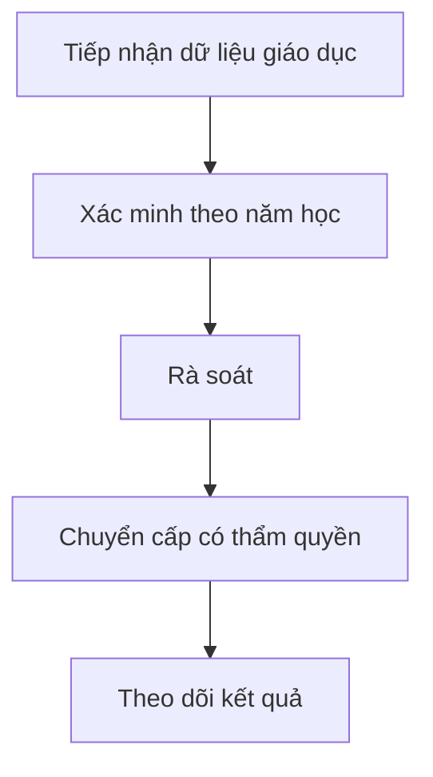

# M03 — KẾ HOẠCH TRIỂN KHAI CHI TIẾT DÀNH CHO TEAM AGENT

> **Module:** Giáo dục và đào tạo · **Baseline:** `dovandatym1-ship-it/pvh-demo` PR #12 @ `fa214999` · **Ngày:** 11/11/2026 · **Loại tài liệu:** PLAN / REVIEW REQUIRED, không phải xác nhận pháp lý hay code DONE.

## 0. Quy tắc sử dụng / bất biến của dự án

- 01 codebase dùng chung cho nhiều xã; tenant và quyền luôn suy từ phiên phía server. `main`, Phase 1–6, Supabase `Demo-pvh` không được tự merge/deploy/migrate/reset. Thiết kế mở rộng nhiều tenant cần ADR riêng vì schema hiện có ràng buộc singleton.
- **SOURCE** = đã nhìn thấy trong code/SQL nhánh tích hợp; **DESIGN** = trường/quy trình đề xuất cần BA-owner duyệt; **LIVE** = chỉ đánh khi có truy xuất cloud và chứng cứ checksum/DB, không tự suy từ migration file.
- UI luôn tiếng Việt; mã snake_case chỉ ở code/DB; không tạo văn bản quyết định pháp lý giả. Mọi biểu mẫu và quyền ký phải đối chiếu văn bản chuyên ngành đang hiệu lực trước implementation.
- Mỗi task chạy trên branch riêng từ SHA đã chốt, có owner file, commit, test receipt và PR audit; chỉ **Đỗ Văn Đạt** duyệt/merge. Không tự ý tăng phạm vi so với 128 OP nguồn và 5 chức năng M11 đã được đưa vào kiểm kê.
- Luồng **BA01 → DB01 → BE01 → FE01 → QA01 → INT01**. BA các OP có thể làm song song; DB migration được điều phối một owner/module để không xung đột timestamp, SQL và FK; FE chia component độc lập, không cùng sửa route/page khi chưa được lock.

## 1. Phạm vi, code hiện có và ranh giới

- **Mục tiêu module:** Giáo dục và đào tạo.
- **Tác nhân:** cán bộ giáo dục; đầu mối trường; lãnh đạo rà soát; cơ quan giáo dục cấp trên.
- **Màn hình hiện có:** `/giao-duc` (trạng thái chức năng cần đối chiếu).
- **Bảng SQL ứng viên:** `public.schools`, `public.private_childcare_facilities`, `public.tuition_exemptions`.
- **Số operation trong Function Map:** 12 (mã nguồn OP-Mxx).
- **Feature-level của spec hiện có:** M03-F01 — Cơ sở giáo dục; M03-F02 — Nhóm trẻ, lớp mẫu giáo độc lập; M03-F03 — Phổ cập giáo dục, xóa mù chữ; M03-F04 — Học sinh và chính sách giáo dục; M03-F05 — Đội ngũ giáo dục; M03-F06 — Hoạt động giáo dục; M03-F07 — Thống kê giáo dục.

**Một số file code neo để agent tìm đúng nơi:**

- `src/features/m03-education/components/exemption-table.tsx`
- `src/features/m03-education/components/school-table.tsx`
- `src/features/m03-education/schemas/education.schema.ts`
- `src/features/m03-education/server/actions.ts`
- `src/features/m03-education/server/policy.ts`
- `src/features/m03-education/server/queries.ts`
- `src/features/m03-education/types/index.ts`

**Nguồn bắt buộc:** `docs/business/FUNCTION_MAP_PVH_v0.1.md`; `docs/plans/PVH_MASTER_INTEGRATION_2026-11-09/OP_FUNCTION_SCREEN_CODE_DB_CROSSWALK.csv`; `docs/specs/PVH_FULL_MODULE_SPEC_2026-11-09/M03.md`; SQL migration của PR #12. Không được coi `SOURCE_ONLY` là nghiệm thu runtime.

## 2. Flow E2E cấp module



Tiếp nhận dữ liệu trường/hồ sơ → kiểm tra theo năm học → rà soát → chuyển đúng thẩm quyền → theo dõi. Với lỗi/thiếu thẩm quyền, trả hồ sơ về bước phù hợp kèm lý do và sự kiện audit; không sửa hồi tố dữ liệu đã chốt.

**Ma trận hành vi mặc định cho từng màn:** Danh sách (server paging/count), tìm kiếm/lọc/sort, xem chi tiết, thêm/sửa/ẩn hoặc ngừng hiệu lực theo quyền, đính kèm/chứng cứ nếu có, tra cứu lịch sử, xuất có kiểm quyền. Tính năng không áp dụng như nhật ký bất biến hoặc dữ liệu nguồn read-only phải ghi rõ N/A; không ép CRUD xóa đối với dữ liệu pháp lý.

## 3. Trường chuẩn dùng chung (DESIGN, áp dụng khi phù hợp)

| Field | Kiểu PostgreSQL | Quy tắc | Hiển thị / bảo vệ |
|---|---|---|---|
| `id` | `uuid` | PK server-generated | Định danh; mã kỹ thuật ẩn khỏi UI |
| `tenant_id` | `uuid` | FK, lấy từ session/membership | Đơn vị cấp xã; mã kỹ thuật ẩn khỏi UI |
| `org_unit_id` | `uuid` | FK đơn vị, kiểm scope | Đơn vị quản lý; mã kỹ thuật ẩn khỏi UI |
| `status` | `text` | Enum versioned theo đối tượng | Trạng thái; mã kỹ thuật ẩn khỏi UI |
| `version` | `integer` | OCC, tăng sau ghi | Phiên bản; mã kỹ thuật ẩn khỏi UI |
| `created_at` | `timestamptz` | UTC server | Thời điểm tạo; mã kỹ thuật ẩn khỏi UI |
| `created_by` | `uuid` | auth.uid server | Người tạo; mã kỹ thuật ẩn khỏi UI |
| `updated_at` | `timestamptz` | UTC server | Thời điểm cập nhật; mã kỹ thuật ẩn khỏi UI |
| `updated_by` | `uuid` | auth.uid server | Người cập nhật; mã kỹ thuật ẩn khỏi UI |
| `source_ref` | `text` | Nguồn hồ sơ/giấy tờ/đầu mối | Tài liệu nguồn; mã kỹ thuật ẩn khỏi UI |
| `is_active` | `boolean` | Soft retire nếu có phụ thuộc | Còn hiệu lực; mã kỹ thuật ẩn khỏi UI |

### Hợp đồng dữ liệu toàn module

- Mỗi record phải có owner, purpose, effective period khi phù hợp, nguồn gốc, mức nhạy cảm và retention theo policy được duyệt. Không lấy `tenant_id`, `created_by` hoặc `role_code` từ body client để quyết quyền.
- Mọi bảng mới có PK/FK, unique theo scope/kỳ, CHECK cho số/ngày/enum, index trên filter/FK/tenant, RLS (kể cả `FORCE RLS` theo rủi ro), hạn chế `SECURITY DEFINER`, quyền EXECUTE được revoke/grant có chủ đích.
- Cấm bỏ qua `SELECT` policy cần thiết cho UPDATE; kiểm `USING` và `WITH CHECK`; không dùng claims user-editable. Audit immutable, event/outbox idempotency; file private Storage + signed download theo từng user.
- Quy tắc `NULL` ≠ `0` ≠ `N/A` ≠ chưa xác nhận; dashboard và báo cáo giữ lineage và thời điểm chốt; export không được lộ PII ngoài quyền.

## 4. Data Dictionary SOURCE của nhánh tích hợp (không đồng nghĩa đã có trên cloud)

### `public.schools` — SOURCE trong nhánh tích hợp

| Cột | Kiểu trong SQL | Bắt buộc trong SQL | Ghi chú rà soát |
|---|---|---|---|
| `id` | `uuid` | Không hoặc theo constraint | Phải đối chiếu UI/API, RLS và migration history |
| `tenant_id` | `uuid` | Có | Phải đối chiếu UI/API, RLS và migration history |
| `name` | `text` | Có | Phải đối chiếu UI/API, RLS và migration history |
| `level` | `text` | Có | Phải đối chiếu UI/API, RLS và migration history |
| `principal` | `text` | Có | Phải đối chiếu UI/API, RLS và migration history |
| `total_students` | `integer` | Có | Phải đối chiếu UI/API, RLS và migration history |
| `school_year` | `text` | Có | Phải đối chiếu UI/API, RLS và migration history |
| `universalization_standard` | `text` | Có | Phải đối chiếu UI/API, RLS và migration history |
| `version` | `integer` | Có | Phải đối chiếu UI/API, RLS và migration history |
| `created_at` | `timestamptz` | Có | Phải đối chiếu UI/API, RLS và migration history |

### `public.private_childcare_facilities` — SOURCE trong nhánh tích hợp

| Cột | Kiểu trong SQL | Bắt buộc trong SQL | Ghi chú rà soát |
|---|---|---|---|
| `id` | `uuid` | Không hoặc theo constraint | Phải đối chiếu UI/API, RLS và migration history |
| `tenant_id` | `uuid` | Có | Phải đối chiếu UI/API, RLS và migration history |
| `name` | `text` | Có | Phải đối chiếu UI/API, RLS và migration history |
| `facility_type` | `text` | Có | Phải đối chiếu UI/API, RLS và migration history |
| `owner_name` | `text` | Có | Phải đối chiếu UI/API, RLS và migration history |
| `owner_cccd` | `text` | Không hoặc theo constraint | Phải đối chiếu UI/API, RLS và migration history |
| `capacity` | `integer` | Có | Phải đối chiếu UI/API, RLS và migration history |
| `current_enrolled` | `integer` | Có | Phải đối chiếu UI/API, RLS và migration history |
| `total_area_sqm` | `numeric(12,2)` | Không hoặc theo constraint | Phải đối chiếu UI/API, RLS và migration history |
| `sqm_per_child` | `numeric(10,2)` | Không hoặc theo constraint | Phải đối chiếu UI/API, RLS và migration history |
| `fire_safety_certified` | `boolean` | Có | Phải đối chiếu UI/API, RLS và migration history |
| `food_safety_certified` | `boolean` | Có | Phải đối chiếu UI/API, RLS và migration history |
| `licensing_status` | `text` | Có | Phải đối chiếu UI/API, RLS và migration history |
| `version` | `integer` | Có | Phải đối chiếu UI/API, RLS và migration history |
| `created_at` | `timestamptz` | Có | Phải đối chiếu UI/API, RLS và migration history |

### `public.tuition_exemptions` — SOURCE trong nhánh tích hợp

| Cột | Kiểu trong SQL | Bắt buộc trong SQL | Ghi chú rà soát |
|---|---|---|---|
| `id` | `uuid` | Không hoặc theo constraint | Phải đối chiếu UI/API, RLS và migration history |
| `tenant_id` | `uuid` | Có | Phải đối chiếu UI/API, RLS và migration history |
| `student_name` | `text` | Có | Phải đối chiếu UI/API, RLS và migration history |
| `school_name` | `text` | Có | Phải đối chiếu UI/API, RLS và migration history |
| `grade` | `text` | Có | Phải đối chiếu UI/API, RLS và migration history |
| `category` | `text` | Có | Phải đối chiếu UI/API, RLS và migration history |
| `exemption_percent` | `integer` | Có | Phải đối chiếu UI/API, RLS và migration history |
| `support_amount` | `numeric(15,2)` | Có | Phải đối chiếu UI/API, RLS và migration history |
| `status` | `text` | Có | Phải đối chiếu UI/API, RLS và migration history |
| `semester` | `text` | Có | Phải đối chiếu UI/API, RLS và migration history |
| `version` | `integer` | Có | Phải đối chiếu UI/API, RLS và migration history |
| `decision_reference` | `text` | Không hoặc theo constraint | Phải đối chiếu UI/API, RLS và migration history |
| `decision_by` | `uuid` | Không hoặc theo constraint | Phải đối chiếu UI/API, RLS và migration history |
| `decision_at` | `timestamptz` | Không hoặc theo constraint | Phải đối chiếu UI/API, RLS và migration history |
| `created_at` | `timestamptz` | Có | Phải đối chiếu UI/API, RLS và migration history |

### 4.1. Ánh xạ tên trường thiết kế ↔ cột đã có (không tạo cột trùng)

| Trường tại biểu mẫu/đặc tả | Cột chuẩn ứng viên trong SQL | Quy tắc |
|---|---|---|
| `name` | `public.schools.name` | Agent DB/BA phải kiểm tra semantics và không tạo thêm cột trước khi chốt mapping |
| `facility_name` | `public.private_childcare_facilities.name` | Agent DB/BA phải kiểm tra semantics và không tạo thêm cột trước khi chốt mapping |
| `student_count` | `public.schools.total_students` | Agent DB/BA phải kiểm tra semantics và không tạo thêm cột trước khi chốt mapping |

## 5. WBS chi tiết cho từng operation/feature

Mỗi task dưới đây có mã duy nhất, phụ thuộc và DoD; nhóm BA/DB/BE/FE/QA/INT dùng làm work packages. Cột trường là cấu trúc đề xuất/đối chiếu source, **không phải danh sách pháp lý bắt buộc đã duyệt**.

### OP-M03-001 — Hồ sơ chuyên ngành cơ sở giáo dục mầm non, tiểu học, THCS: mã ngành, cấp học, loại hình, đầu mối, lịch sử

- **Mức độ code:** Đã thấy điểm vào/code liên quan; chưa đủ điều kiện kết luận khép kín.
- **Nhóm luồng:** `QUERY` · **Source status:** `DISCOVERED` · **Screen Map:** `SCR-GD-01` · **Mức nhạy cảm nguồn:** `—`.
- **Nguồn yêu cầu:** BL-036, BL-037, BL-038; REQ-M03-01.
- **Code API/DB ứng viên (chỉ để rà soát):** getSchools/getPrivateChildcareFacilities→public.schools and public.private_childcare_facilities SELECT; no facility lifecycle action found / public.schools(name,level,principal,total_students,school_year,universalization_standard,version); private_childcare_facilities(name,type,owner_name,owner_cccd,capacity,enrollment,area,safety flags,licensing_status,version); missing canonical facility code/address/contact/source/effective history.
- **Đầu ra nghiệp vụ:** biên nhận có mã và phiên bản (nếu ghi), danh sách/chi tiết theo quyền, trạng thái, lịch sử, nguồn đối soát, thông báo và báo cáo chỉ khi có nguồn thật.

#### Luồng chính và các bước kiểm soát

1. Cán bộ mở nghiệp vụ **Hồ sơ chuyên ngành cơ sở giáo dục mầm non, tiểu học, THCS: mã ngành, cấp học, loại hình, đầu mối, lịch sử**, chọn đúng xã/địa bàn và ghi `school_code`, `name`, `level`, `school_year`; hệ thống dẫn chiếu nguồn và kỳ hiệu lực.
2. Server xác thực phiên, membership còn hiệu lực, permission cấp tác vụ, phạm vi bản ghi và mức nhạy cảm; tenant lấy từ server, không nhận từ form.
3. Kiểm tra schema, ràng buộc trường, mã nguồn, khóa trùng, phiên bản, liên kết FK và tình trạng đối tượng; lỗi trả từng trường bằng tiếng Việt.
4. Server lập truy vấn theo tenant, vai trò, địa bàn, thời điểm hiệu lực; lọc/đếm/phân trang tại CSDL.
5. Tính chỉ tiêu từ bản ghi nguồn thực với chính sách NULL, 0 và chưa báo cáo riêng; không đưa dữ liệu ngoài quyền lên client.
6. Hiển thị danh sách/chi tiết và nguồn gốc; xuất tệp chỉ khi có quyền, ghi lịch sử xuất và kiểm lại quyền từng dòng.
7. Ghi sự kiện bất biến, actor/time/version, tạo thông báo nếu hợp đồng sự kiện quy định; cập nhật dashboard/report theo nguồn phát sinh có truy vết.
8. Người dùng thấy biên nhận/chi tiết, trạng thái và lỗi rõ ràng; hỗ trợ tra cứu, lọc, phân trang và truy xuất lịch sử theo quyền.

**Luồng ngoại lệ:** (E1) sai quyền/sai xã→403 và audit deny, không trả bản ghi; (E2) sai trường/thiếu nguồn→422 theo trường; (E3) trùng/đổi phiên bản→409 và refresh; (E4) nguồn ngoài không xác nhận→PENDING/UNAVAILABLE, không ghi “thành công”; (E5) hồ sơ chốt/đã tham chiếu→không xóa vật lý; (E6) thiếu chứng cứ→CHƯA ĐỦ THÔNG TIN, không tự kết luận không đủ điều kiện.

#### Trường đầu vào/đầu ra bắt buộc đặc tả

| Field snake_case | Nhãn tiếng Việt dự kiến | PostgreSQL | Bắt buộc (đề xuất) | Validation / business rule | Nhạy cảm | Nguồn |
|---|---|---|---|---|---|---|
| `id` | Định danh | `uuid` | Server | PK sinh trên server, không nhận ID tùy ý từ client khi tạo | Nội bộ | SOURCE (cùng tên cột trong module; cần xác minh entity) |
| `tenant_id` | Đơn vị cấp xã | `uuid` | Server | FK đúng tenant, tồn tại, còn hiệu lực, scope | Nội bộ | SOURCE (cùng tên cột trong module; cần xác minh entity) |
| `school_code` | Mã trường | `text` | BA xác nhận bắt buộc | Chuẩn hóa trim, giới hạn 1–80 ký tự, unique theo owner/kỳ nếu áp dụng | Nội bộ | DESIGN |
| `name` | Tên | `text` | BA xác nhận bắt buộc | Trim; giới hạn độ dài theo Data Dictionary; không nhận HTML/script | Nội bộ | SOURCE (cùng tên cột trong module; cần xác minh entity) |
| `level` | Cấp | `text` | BA xác nhận bắt buộc | Trim; giới hạn độ dài theo Data Dictionary; không nhận HTML/script | Nội bộ | SOURCE (cùng tên cột trong module; cần xác minh entity) |
| `school_year` | Năm học | `text` | Theo loại hồ sơ | Kiểm schema, định dạng và nguồn theo hợp đồng dữ liệu | Nội bộ | SOURCE (cùng tên cột trong module; cần xác minh entity) |
| `principal` | Hiệu trưởng | `text` | Theo loại hồ sơ | Trim; giới hạn độ dài theo Data Dictionary; không nhận HTML/script | Nội bộ | SOURCE (cùng tên cột trong module; cần xác minh entity) |
| `total_students` | Tổng học sinh | `integer` | Theo loại hồ sơ | Số nguyên ≥0, giới hạn tối đa và ngữ nghĩa từng kỳ do BA xác nhận | Nội bộ | SOURCE (cùng tên cột trong module; cần xác minh entity) |
| `source_ref` | Tài liệu nguồn | `text` | Theo loại hồ sơ | Trim; giới hạn độ dài theo Data Dictionary; không nhận HTML/script | Nội bộ | DESIGN |
| `status` | Trạng thái | `text` | Server | Enum versioned; cấm tự thêm trạng thái ở client | Nội bộ | SOURCE (cùng tên cột trong module; cần xác minh entity) |
| `version` | Phiên bản | `integer` | Server | Số nguyên không âm trừ trường đã duyệt cho phép âm | Nội bộ | SOURCE (cùng tên cột trong module; cần xác minh entity) |
| `created_at` | Thời điểm tạo | `timestamptz` | Server | UTC trong DB, hiển thị giờ Việt Nam; ngày hợp lệ | Nội bộ | SOURCE (cùng tên cột trong module; cần xác minh entity) |
| `created_by` | Người tạo | `uuid` | Server | FK đúng tenant, tồn tại, còn hiệu lực, scope | Nội bộ | DESIGN |

**Quy tắc giao diện:** ẩn mã kỹ thuật; form field-level errors; read-only nguồn ngoài; phân biệt bản nháp/kết quả đã xác nhận; modal xác nhận với lý do khi hủy/ẩn/chuyển; danh sách có tổng số thực và link chi tiết; export chỉ những cột được phép. **KPI:** chỉ bổ sung sau khi ghi rõ bảng+cột+trạng thái+điều kiện lọc+ngày dữ liệu+RLS+link drill-down.

#### Task giao cho agent (mỗi task là 1 work package có thể kiểm thử)

| Task ID | Agent | Đầu vào | Việc phải làm / đầu ra | Phụ thuộc | Definition of Done |
|---|---|---|---|---|---|
| M03-001-BA01 | BA nghiệp vụ | Function Map, quyền/pháp lý, mẫu nguồn | Đặc tả actor, biến thể, trường bắt buộc, trạng thái, ngoại lệ, ownership và rule register đã dẫn nguồn | — | Biên bản duyệt phạm vi OP-M03-001; không còn trường 'cần xác minh' chưa gán owner |
| M03-001-DB01 | DB/RLS | BA01 + schema thực/migration đang có | Migration cho entity/constraint/FK/index theo tenant; RLS và pgTAP; không sửa migration đã áp cloud; tối ưu read-side count/filter | M03-001-BA01 | Replay clean trên staging; thử 2 ngữ cảnh xã theo ADR (không vượt ràng buộc singleton), 3 vai trò, scope deny, concurrency và rollback |
| M03-001-BE01 | Backend | BA01 + DB01 | Server Action/query/RPC/DTO tại `src/features/m03-education/server/`; kiểm quyền server, idempotency, audit, error mapping; truy vấn chỉ đọc, không tự sinh tác vụ ghi | M03-001-DB01 | Unit+contract test: thành công, sai schema, sai tenant, thiếu quyền, stale version, retry không nhân đôi |
| M03-001-FE01 | Frontend | BA01 + hợp đồng API từ BE01 | Form tiếng Việt, danh sách/chi tiết, lọc/tìm/sort/page, CRUD có điều kiện tại `src/features/m03-education/components/`; loading/empty/error/mobile; export kiểm lại quyền | M03-001-BE01 | Browser 375/768/1440px; focus/keyboard; mỗi trường có nhãn, mô tả lỗi; không cho sửa khi không có quyền |
| M03-001-QA01 | QA/Automation | BA01 + DB01/BE01/FE01 | Bộ ca kiểm thử OP-M03-001: happy/negative/boundary/role/tenant/PII/export/audit; fixture và receipt SHA | M03-001-FE01 | Có test IDs gắn OP-M03-001, chạy đúng HEAD, không chỉ snapshot UI; fail case có log che dữ liệu |
| M03-001-SEC01 | Security | BE01 + phân loại dữ liệu | Test mask server DTO, mục đích truy cập, field-level export deny, retention, no direct client leak | M03-001-BE01 | Cross-role/tenant data denied even via direct API; logs không chứa PII |
| M03-001-INT01 | Tích hợp | QA01 + mã nguồn nhánh dự kiến | Liên kết M00 quyền/M01 việc/M09 chỉ tiêu/M10 nguồn nếu áp dụng; evidence route→action→DB→test; PR chỉ đổi phạm vi task | M03-001-QA01 + M03-001-SEC01 | Không thiếu phép C/R/U/D áp dụng; không có false-success; reviewer Đỗ Văn Đạt ký nhận |

#### Acceptance scenarios

- **AC-OP-M03-001-01 (hợp lệ):** Given phiên có quyền và nguồn `school_code` và `name` hợp lệ; When thực hiện theo luồng QUERY; Then lưu/tra cứu đúng kết quả, trả ID hoặc biên nhận, audit và version.
- **AC-OP-M03-001-02 (bị chặn):** Given sai địa bàn, không có permission hoặc dữ liệu thiếu; When gọi trực tiếp API/RPC; Then trả lỗi không rò dữ liệu và không tạo bản ghi/event thành công.
- **AC-OP-M03-001-03 (đồng thời/nguồn):** Given cập nhật trùng hoặc source/version cũ; When gửi lặp hoặc hai người chỉnh cùng bản ghi; Then idempotent/reject conflict, không ghi đè phiên bản mới.
- **AC-OP-M03-001-04 (giao diện):** Given vai trò chỉ xem; When mở bằng điện thoại hoặc đường dẫn trực tiếp; Then các tác vụ sửa/xuất không đúng quyền bị ẩn *và* server từ chối.

**Evidence tối thiểu:** commit SHA; đường dẫn file liên quan; migration history/checksum (nếu thay DB); link CI thực thi; pgTAP/RLS test ID; ảnh/trace 375/768/1440; dữ liệu test và người ký duyệt. Trạng thái OP chỉ được đổi `UNVERIFIED` → `STATIC_CHECKED` → `INTEGRATED_TESTED` → `OWNER_ACCEPTED` khi có biên nhận tương ứng.

### OP-M03-002 — Trung tâm học tập cộng đồng: tổ chức và hoạt động

- **Mức độ code:** Đã thấy điểm vào/code liên quan; chưa đủ điều kiện kết luận khép kín.
- **Nhóm luồng:** `TRACK` · **Source status:** `DISCOVERED` · **Screen Map:** `SCR-GD-01` · **Mức nhạy cảm nguồn:** `—`.
- **Nguồn yêu cầu:** BL-039; REQ-M03-01; REQ-M01-04.
- **Code API/DB ứng viên (chỉ để rà soát):** getPrivateChildcareFacilities→public.private_childcare_facilities SELECT; no community learning center operations / private_childcare_facilities has two childcare types; no community learning center identity, governing body, courses, sessions, participants or result entity.
- **Đầu ra nghiệp vụ:** biên nhận có mã và phiên bản (nếu ghi), danh sách/chi tiết theo quyền, trạng thái, lịch sử, nguồn đối soát, thông báo và báo cáo chỉ khi có nguồn thật.

#### Luồng chính và các bước kiểm soát

1. Cán bộ mở nghiệp vụ **Trung tâm học tập cộng đồng: tổ chức và hoạt động**, chọn đúng xã/địa bàn và ghi `facility_code`, `name`, `facility_type`, `owner_name`; hệ thống dẫn chiếu nguồn và kỳ hiệu lực.
2. Server xác thực phiên, membership còn hiệu lực, permission cấp tác vụ, phạm vi bản ghi và mức nhạy cảm; tenant lấy từ server, không nhận từ form.
3. Kiểm tra schema, ràng buộc trường, mã nguồn, khóa trùng, phiên bản, liên kết FK và tình trạng đối tượng; lỗi trả từng trường bằng tiếng Việt.
4. Tạo bản theo dõi/kế hoạch cùng người phụ trách, mốc thời gian và nguồn chỉ tiêu/kết quả.
5. Giao đầu việc liên quan M01 nếu có; cập nhật theo phiên bản và ghi lý do sửa dữ liệu đã được xác nhận.
6. Người xác nhận độc lập đối soát mục tiêu–thực tế–minh chứng; đóng kỳ khi đủ điều kiện hoặc nêu thiếu nguồn.
7. Ghi sự kiện bất biến, actor/time/version, tạo thông báo nếu hợp đồng sự kiện quy định; cập nhật dashboard/report theo nguồn phát sinh có truy vết.
8. Người dùng thấy biên nhận/chi tiết, trạng thái và lỗi rõ ràng; hỗ trợ tra cứu, lọc, phân trang và truy xuất lịch sử theo quyền.

**Luồng ngoại lệ:** (E1) sai quyền/sai xã→403 và audit deny, không trả bản ghi; (E2) sai trường/thiếu nguồn→422 theo trường; (E3) trùng/đổi phiên bản→409 và refresh; (E4) nguồn ngoài không xác nhận→PENDING/UNAVAILABLE, không ghi “thành công”; (E5) hồ sơ chốt/đã tham chiếu→không xóa vật lý; (E6) thiếu chứng cứ→CHƯA ĐỦ THÔNG TIN, không tự kết luận không đủ điều kiện.

#### Trường đầu vào/đầu ra bắt buộc đặc tả

| Field snake_case | Nhãn tiếng Việt dự kiến | PostgreSQL | Bắt buộc (đề xuất) | Validation / business rule | Nhạy cảm | Nguồn |
|---|---|---|---|---|---|---|
| `id` | Định danh | `uuid` | Server | PK sinh trên server, không nhận ID tùy ý từ client khi tạo | Nội bộ | SOURCE (cùng tên cột trong module; cần xác minh entity) |
| `tenant_id` | Đơn vị cấp xã | `uuid` | Server | FK đúng tenant, tồn tại, còn hiệu lực, scope | Nội bộ | SOURCE (cùng tên cột trong module; cần xác minh entity) |
| `facility_code` | Mã cơ sở | `text` | BA xác nhận bắt buộc | Chuẩn hóa trim, giới hạn 1–80 ký tự, unique theo owner/kỳ nếu áp dụng | Nội bộ | DESIGN |
| `name` | Tên | `text` | BA xác nhận bắt buộc | Trim; giới hạn độ dài theo Data Dictionary; không nhận HTML/script | Nội bộ | SOURCE (cùng tên cột trong module; cần xác minh entity) |
| `facility_type` | Loại cơ sở | `text` | BA xác nhận bắt buộc | Trim; giới hạn độ dài theo Data Dictionary; không nhận HTML/script | Nội bộ | SOURCE (cùng tên cột trong module; cần xác minh entity) |
| `owner_name` | Tên chủ quản | `text` | Theo loại hồ sơ | Trim; giới hạn độ dài theo Data Dictionary; không nhận HTML/script | Hạn chế | SOURCE (cùng tên cột trong module; cần xác minh entity) |
| `capacity` | Sức chứa | `integer` | Theo loại hồ sơ | Số nguyên không âm trừ trường đã duyệt cho phép âm | Nội bộ | SOURCE (cùng tên cột trong module; cần xác minh entity) |
| `current_enrolled` | Hiện tại đang theo học | `integer` | Theo loại hồ sơ | Số nguyên không âm trừ trường đã duyệt cho phép âm | Nội bộ | SOURCE (cùng tên cột trong module; cần xác minh entity) |
| `licensing_status` | Trạng thái cấp phép | `text` | Theo loại hồ sơ | Enum versioned; cấm tự thêm trạng thái ở client | Nội bộ | SOURCE (cùng tên cột trong module; cần xác minh entity) |
| `status` | Trạng thái | `text` | Server | Enum versioned; cấm tự thêm trạng thái ở client | Nội bộ | SOURCE (cùng tên cột trong module; cần xác minh entity) |
| `version` | Phiên bản | `integer` | Server | Số nguyên không âm trừ trường đã duyệt cho phép âm | Nội bộ | SOURCE (cùng tên cột trong module; cần xác minh entity) |
| `created_at` | Thời điểm tạo | `timestamptz` | Server | UTC trong DB, hiển thị giờ Việt Nam; ngày hợp lệ | Nội bộ | SOURCE (cùng tên cột trong module; cần xác minh entity) |
| `created_by` | Người tạo | `uuid` | Server | FK đúng tenant, tồn tại, còn hiệu lực, scope | Nội bộ | DESIGN |

**Quy tắc giao diện:** ẩn mã kỹ thuật; form field-level errors; read-only nguồn ngoài; phân biệt bản nháp/kết quả đã xác nhận; modal xác nhận với lý do khi hủy/ẩn/chuyển; danh sách có tổng số thực và link chi tiết; export chỉ những cột được phép. **KPI:** chỉ bổ sung sau khi ghi rõ bảng+cột+trạng thái+điều kiện lọc+ngày dữ liệu+RLS+link drill-down.

#### Task giao cho agent (mỗi task là 1 work package có thể kiểm thử)

| Task ID | Agent | Đầu vào | Việc phải làm / đầu ra | Phụ thuộc | Definition of Done |
|---|---|---|---|---|---|
| M03-002-BA01 | BA nghiệp vụ | Function Map, quyền/pháp lý, mẫu nguồn | Đặc tả actor, biến thể, trường bắt buộc, trạng thái, ngoại lệ, ownership và rule register đã dẫn nguồn | — | Biên bản duyệt phạm vi OP-M03-002; không còn trường 'cần xác minh' chưa gán owner |
| M03-002-DB01 | DB/RLS | BA01 + schema thực/migration đang có | Migration cho entity/constraint/FK/index theo tenant; RLS và pgTAP; không sửa migration đã áp cloud | M03-002-BA01 | Replay clean trên staging; thử 2 ngữ cảnh xã theo ADR (không vượt ràng buộc singleton), 3 vai trò, scope deny, concurrency và rollback |
| M03-002-BE01 | Backend | BA01 + DB01 | Server Action/query/RPC/DTO tại `src/features/m03-education/server/`; kiểm quyền server, idempotency, audit, error mapping | M03-002-DB01 | Unit+contract test: thành công, sai schema, sai tenant, thiếu quyền, stale version, retry không nhân đôi |
| M03-002-FE01 | Frontend | BA01 + hợp đồng API từ BE01 | Form tiếng Việt, danh sách/chi tiết, lọc/tìm/sort/page, CRUD có điều kiện tại `src/features/m03-education/components/`; loading/empty/error/mobile | M03-002-BE01 | Browser 375/768/1440px; focus/keyboard; mỗi trường có nhãn, mô tả lỗi; không cho sửa khi không có quyền |
| M03-002-QA01 | QA/Automation | BA01 + DB01/BE01/FE01 | Bộ ca kiểm thử OP-M03-002: happy/negative/boundary/role/tenant/PII/export/audit; fixture và receipt SHA | M03-002-FE01 | Có test IDs gắn OP-M03-002, chạy đúng HEAD, không chỉ snapshot UI; fail case có log che dữ liệu |
| M03-002-SEC01 | Security | BE01 + phân loại dữ liệu | Test mask server DTO, mục đích truy cập, field-level export deny, retention, no direct client leak | M03-002-BE01 | Cross-role/tenant data denied even via direct API; logs không chứa PII |
| M03-002-INT01 | Tích hợp | QA01 + mã nguồn nhánh dự kiến | Liên kết M00 quyền/M01 việc/M09 chỉ tiêu/M10 nguồn nếu áp dụng; evidence route→action→DB→test; PR chỉ đổi phạm vi task | M03-002-QA01 + M03-002-SEC01 | Không thiếu phép C/R/U/D áp dụng; không có false-success; reviewer Đỗ Văn Đạt ký nhận |

#### Acceptance scenarios

- **AC-OP-M03-002-01 (hợp lệ):** Given phiên có quyền và nguồn `facility_code` và `name` hợp lệ; When thực hiện theo luồng TRACK; Then lưu/tra cứu đúng kết quả, trả ID hoặc biên nhận, audit và version.
- **AC-OP-M03-002-02 (bị chặn):** Given sai địa bàn, không có permission hoặc dữ liệu thiếu; When gọi trực tiếp API/RPC; Then trả lỗi không rò dữ liệu và không tạo bản ghi/event thành công.
- **AC-OP-M03-002-03 (đồng thời/nguồn):** Given cập nhật trùng hoặc source/version cũ; When gửi lặp hoặc hai người chỉnh cùng bản ghi; Then idempotent/reject conflict, không ghi đè phiên bản mới.
- **AC-OP-M03-002-04 (giao diện):** Given vai trò chỉ xem; When mở bằng điện thoại hoặc đường dẫn trực tiếp; Then các tác vụ sửa/xuất không đúng quyền bị ẩn *và* server từ chối.

**Evidence tối thiểu:** commit SHA; đường dẫn file liên quan; migration history/checksum (nếu thay DB); link CI thực thi; pgTAP/RLS test ID; ảnh/trace 375/768/1440; dữ liệu test và người ký duyệt. Trạng thái OP chỉ được đổi `UNVERIFIED` → `STATIC_CHECKED` → `INTEGRATED_TESTED` → `OWNER_ACCEPTED` khi có biên nhận tương ứng.

### OP-M03-003 — Kế hoạch phát triển giáo dục cấp xã

- **Mức độ code:** Chưa tìm thấy hành vi tương ứng trong đối chiếu tĩnh.
- **Nhóm luồng:** `TRACK` · **Source status:** `DISCOVERED` · **Screen Map:** `SCR-CV-03 ⟨OP-M03-003⟩` · **Mức nhạy cảm nguồn:** `—`.
- **Nguồn yêu cầu:** BL-031; REQ-M03-03.
- **Code API/DB ứng viên (chỉ để rà soát):** NOT_FOUND_STATIC: no M03 plan objective/target/milestone/approval action or RPC / NOT_FOUND_STATIC: no M03 education-plan entity; M01 work items are not a versioned sector plan.
- **Đầu ra nghiệp vụ:** biên nhận có mã và phiên bản (nếu ghi), danh sách/chi tiết theo quyền, trạng thái, lịch sử, nguồn đối soát, thông báo và báo cáo chỉ khi có nguồn thật.

#### Luồng chính và các bước kiểm soát

1. Cán bộ mở nghiệp vụ **Kế hoạch phát triển giáo dục cấp xã**, chọn đúng xã/địa bàn và ghi `plan_code`, `school_year`, `objective`, `target_students`; hệ thống dẫn chiếu nguồn và kỳ hiệu lực.
2. Server xác thực phiên, membership còn hiệu lực, permission cấp tác vụ, phạm vi bản ghi và mức nhạy cảm; tenant lấy từ server, không nhận từ form.
3. Kiểm tra schema, ràng buộc trường, mã nguồn, khóa trùng, phiên bản, liên kết FK và tình trạng đối tượng; lỗi trả từng trường bằng tiếng Việt.
4. Tạo bản theo dõi/kế hoạch cùng người phụ trách, mốc thời gian và nguồn chỉ tiêu/kết quả.
5. Giao đầu việc liên quan M01 nếu có; cập nhật theo phiên bản và ghi lý do sửa dữ liệu đã được xác nhận.
6. Người xác nhận độc lập đối soát mục tiêu–thực tế–minh chứng; đóng kỳ khi đủ điều kiện hoặc nêu thiếu nguồn.
7. Ghi sự kiện bất biến, actor/time/version, tạo thông báo nếu hợp đồng sự kiện quy định; cập nhật dashboard/report theo nguồn phát sinh có truy vết.
8. Người dùng thấy biên nhận/chi tiết, trạng thái và lỗi rõ ràng; hỗ trợ tra cứu, lọc, phân trang và truy xuất lịch sử theo quyền.

**Luồng ngoại lệ:** (E1) sai quyền/sai xã→403 và audit deny, không trả bản ghi; (E2) sai trường/thiếu nguồn→422 theo trường; (E3) trùng/đổi phiên bản→409 và refresh; (E4) nguồn ngoài không xác nhận→PENDING/UNAVAILABLE, không ghi “thành công”; (E5) hồ sơ chốt/đã tham chiếu→không xóa vật lý; (E6) thiếu chứng cứ→CHƯA ĐỦ THÔNG TIN, không tự kết luận không đủ điều kiện.

#### Trường đầu vào/đầu ra bắt buộc đặc tả

| Field snake_case | Nhãn tiếng Việt dự kiến | PostgreSQL | Bắt buộc (đề xuất) | Validation / business rule | Nhạy cảm | Nguồn |
|---|---|---|---|---|---|---|
| `id` | Định danh | `uuid` | Server | PK sinh trên server, không nhận ID tùy ý từ client khi tạo | Nội bộ | SOURCE (cùng tên cột trong module; cần xác minh entity) |
| `tenant_id` | Đơn vị cấp xã | `uuid` | Server | FK đúng tenant, tồn tại, còn hiệu lực, scope | Nội bộ | SOURCE (cùng tên cột trong module; cần xác minh entity) |
| `plan_code` | Mã kế hoạch | `text` | BA xác nhận bắt buộc | Chuẩn hóa trim, giới hạn 1–80 ký tự, unique theo owner/kỳ nếu áp dụng | Nội bộ | DESIGN |
| `school_year` | Năm học | `text` | BA xác nhận bắt buộc | Kiểm schema, định dạng và nguồn theo hợp đồng dữ liệu | Nội bộ | SOURCE (cùng tên cột trong module; cần xác minh entity) |
| `objective` | Mục tiêu | `text` | BA xác nhận bắt buộc | Trim; giới hạn độ dài theo Data Dictionary; không nhận HTML/script | Nội bộ | DESIGN |
| `target_students` | Mục tiêu học sinh | `integer` | Theo loại hồ sơ | Số nguyên ≥0, giới hạn tối đa và ngữ nghĩa từng kỳ do BA xác nhận | Nội bộ | DESIGN |
| `owner_unit_id` | Định danh chủ quản đơn vị | `uuid` | Theo loại hồ sơ | FK đúng tenant, tồn tại, còn hiệu lực, scope | Nội bộ | DESIGN |
| `approved_ref` | Tham chiếu phê duyệt | `text` | Theo loại hồ sơ | Trim; giới hạn độ dài theo Data Dictionary; không nhận HTML/script | Nội bộ | DESIGN |
| `status` | Trạng thái | `text` | Server | Enum versioned; cấm tự thêm trạng thái ở client | Nội bộ | SOURCE (cùng tên cột trong module; cần xác minh entity) |
| `version` | Phiên bản | `integer` | Server | Số nguyên không âm trừ trường đã duyệt cho phép âm | Nội bộ | SOURCE (cùng tên cột trong module; cần xác minh entity) |
| `created_at` | Thời điểm tạo | `timestamptz` | Server | UTC trong DB, hiển thị giờ Việt Nam; ngày hợp lệ | Nội bộ | SOURCE (cùng tên cột trong module; cần xác minh entity) |
| `created_by` | Người tạo | `uuid` | Server | FK đúng tenant, tồn tại, còn hiệu lực, scope | Nội bộ | DESIGN |

**Quy tắc giao diện:** ẩn mã kỹ thuật; form field-level errors; read-only nguồn ngoài; phân biệt bản nháp/kết quả đã xác nhận; modal xác nhận với lý do khi hủy/ẩn/chuyển; danh sách có tổng số thực và link chi tiết; export chỉ những cột được phép. **KPI:** chỉ bổ sung sau khi ghi rõ bảng+cột+trạng thái+điều kiện lọc+ngày dữ liệu+RLS+link drill-down.

#### Task giao cho agent (mỗi task là 1 work package có thể kiểm thử)

| Task ID | Agent | Đầu vào | Việc phải làm / đầu ra | Phụ thuộc | Definition of Done |
|---|---|---|---|---|---|
| M03-003-BA01 | BA nghiệp vụ | Function Map, quyền/pháp lý, mẫu nguồn | Đặc tả actor, biến thể, trường bắt buộc, trạng thái, ngoại lệ, ownership và rule register đã dẫn nguồn | — | Biên bản duyệt phạm vi OP-M03-003; không còn trường 'cần xác minh' chưa gán owner |
| M03-003-DB01 | DB/RLS | BA01 + schema thực/migration đang có | Migration cho entity/constraint/FK/index theo tenant; RLS và pgTAP; không sửa migration đã áp cloud | M03-003-BA01 | Replay clean trên staging; thử 2 ngữ cảnh xã theo ADR (không vượt ràng buộc singleton), 3 vai trò, scope deny, concurrency và rollback |
| M03-003-BE01 | Backend | BA01 + DB01 | Server Action/query/RPC/DTO tại `src/features/m03-education/server/`; kiểm quyền server, idempotency, audit, error mapping | M03-003-DB01 | Unit+contract test: thành công, sai schema, sai tenant, thiếu quyền, stale version, retry không nhân đôi |
| M03-003-FE01 | Frontend | BA01 + hợp đồng API từ BE01 | Form tiếng Việt, danh sách/chi tiết, lọc/tìm/sort/page, CRUD có điều kiện tại `src/features/m03-education/components/`; loading/empty/error/mobile | M03-003-BE01 | Browser 375/768/1440px; focus/keyboard; mỗi trường có nhãn, mô tả lỗi; không cho sửa khi không có quyền |
| M03-003-QA01 | QA/Automation | BA01 + DB01/BE01/FE01 | Bộ ca kiểm thử OP-M03-003: happy/negative/boundary/role/tenant/PII/export/audit; fixture và receipt SHA | M03-003-FE01 | Có test IDs gắn OP-M03-003, chạy đúng HEAD, không chỉ snapshot UI; fail case có log che dữ liệu |
| M03-003-SEC01 | Security | BE01 + phân loại dữ liệu | Test mask server DTO, mục đích truy cập, field-level export deny, retention, no direct client leak | M03-003-BE01 | Cross-role/tenant data denied even via direct API; logs không chứa PII |
| M03-003-INT01 | Tích hợp | QA01 + mã nguồn nhánh dự kiến | Liên kết M00 quyền/M01 việc/M09 chỉ tiêu/M10 nguồn nếu áp dụng; evidence route→action→DB→test; PR chỉ đổi phạm vi task | M03-003-QA01 + M03-003-SEC01 | Không thiếu phép C/R/U/D áp dụng; không có false-success; reviewer Đỗ Văn Đạt ký nhận |

#### Acceptance scenarios

- **AC-OP-M03-003-01 (hợp lệ):** Given phiên có quyền và nguồn `plan_code` và `school_year` hợp lệ; When thực hiện theo luồng TRACK; Then lưu/tra cứu đúng kết quả, trả ID hoặc biên nhận, audit và version.
- **AC-OP-M03-003-02 (bị chặn):** Given sai địa bàn, không có permission hoặc dữ liệu thiếu; When gọi trực tiếp API/RPC; Then trả lỗi không rò dữ liệu và không tạo bản ghi/event thành công.
- **AC-OP-M03-003-03 (đồng thời/nguồn):** Given cập nhật trùng hoặc source/version cũ; When gửi lặp hoặc hai người chỉnh cùng bản ghi; Then idempotent/reject conflict, không ghi đè phiên bản mới.
- **AC-OP-M03-003-04 (giao diện):** Given vai trò chỉ xem; When mở bằng điện thoại hoặc đường dẫn trực tiếp; Then các tác vụ sửa/xuất không đúng quyền bị ẩn *và* server từ chối.

**Evidence tối thiểu:** commit SHA; đường dẫn file liên quan; migration history/checksum (nếu thay DB); link CI thực thi; pgTAP/RLS test ID; ảnh/trace 375/768/1440; dữ liệu test và người ký duyệt. Trạng thái OP chỉ được đổi `UNVERIFIED` → `STATIC_CHECKED` → `INTEGRATED_TESTED` → `OWNER_ACCEPTED` khi có biên nhận tương ứng.

### OP-M03-004 — Phối hợp, hướng dẫn tuyển sinh đầu cấp

- **Mức độ code:** Chưa tìm thấy hành vi tương ứng trong đối chiếu tĩnh.
- **Nhóm luồng:** `TRACK` · **Source status:** `DISCOVERED` · **Screen Map:** `SCR-CV-03 ⟨OP-M03-004⟩` · **Mức nhạy cảm nguồn:** `—`.
- **Nguồn yêu cầu:** BL-040; REQ-M03-03.
- **Code API/DB ứng viên (chỉ để rà soát):** NOT_FOUND_STATIC: no admission intake, school assignment, eligibility or guidance action/RPC / NOT_FOUND_STATIC: no enrollment application, cohort, capacity-allocation or referral entity.
- **Đầu ra nghiệp vụ:** biên nhận có mã và phiên bản (nếu ghi), danh sách/chi tiết theo quyền, trạng thái, lịch sử, nguồn đối soát, thông báo và báo cáo chỉ khi có nguồn thật.

#### Luồng chính và các bước kiểm soát

1. Cán bộ mở nghiệp vụ **Phối hợp, hướng dẫn tuyển sinh đầu cấp**, chọn đúng xã/địa bàn và ghi `enrollment_period`, `grade`, `expected_quota`, `received_applications`; hệ thống dẫn chiếu nguồn và kỳ hiệu lực.
2. Server xác thực phiên, membership còn hiệu lực, permission cấp tác vụ, phạm vi bản ghi và mức nhạy cảm; tenant lấy từ server, không nhận từ form.
3. Kiểm tra schema, ràng buộc trường, mã nguồn, khóa trùng, phiên bản, liên kết FK và tình trạng đối tượng; lỗi trả từng trường bằng tiếng Việt.
4. Tạo bản theo dõi/kế hoạch cùng người phụ trách, mốc thời gian và nguồn chỉ tiêu/kết quả.
5. Giao đầu việc liên quan M01 nếu có; cập nhật theo phiên bản và ghi lý do sửa dữ liệu đã được xác nhận.
6. Người xác nhận độc lập đối soát mục tiêu–thực tế–minh chứng; đóng kỳ khi đủ điều kiện hoặc nêu thiếu nguồn.
7. Ghi sự kiện bất biến, actor/time/version, tạo thông báo nếu hợp đồng sự kiện quy định; cập nhật dashboard/report theo nguồn phát sinh có truy vết.
8. Người dùng thấy biên nhận/chi tiết, trạng thái và lỗi rõ ràng; hỗ trợ tra cứu, lọc, phân trang và truy xuất lịch sử theo quyền.

**Luồng ngoại lệ:** (E1) sai quyền/sai xã→403 và audit deny, không trả bản ghi; (E2) sai trường/thiếu nguồn→422 theo trường; (E3) trùng/đổi phiên bản→409 và refresh; (E4) nguồn ngoài không xác nhận→PENDING/UNAVAILABLE, không ghi “thành công”; (E5) hồ sơ chốt/đã tham chiếu→không xóa vật lý; (E6) thiếu chứng cứ→CHƯA ĐỦ THÔNG TIN, không tự kết luận không đủ điều kiện.

#### Trường đầu vào/đầu ra bắt buộc đặc tả

| Field snake_case | Nhãn tiếng Việt dự kiến | PostgreSQL | Bắt buộc (đề xuất) | Validation / business rule | Nhạy cảm | Nguồn |
|---|---|---|---|---|---|---|
| `id` | Định danh | `uuid` | Server | PK sinh trên server, không nhận ID tùy ý từ client khi tạo | Nội bộ | SOURCE (cùng tên cột trong module; cần xác minh entity) |
| `tenant_id` | Đơn vị cấp xã | `uuid` | Server | FK đúng tenant, tồn tại, còn hiệu lực, scope | Nội bộ | SOURCE (cùng tên cột trong module; cần xác minh entity) |
| `enrollment_period` | Kỳ tuyển sinh | `text` | BA xác nhận bắt buộc | Trim; giới hạn độ dài theo Data Dictionary; không nhận HTML/script | Nội bộ | DESIGN |
| `school_id` | Định danh trường | `uuid` | BA xác nhận bắt buộc | FK đúng tenant, tồn tại, còn hiệu lực, scope | Nội bộ | DESIGN |
| `grade` | Khối lớp | `text` | BA xác nhận bắt buộc | Trim; giới hạn độ dài theo Data Dictionary; không nhận HTML/script | Nội bộ | SOURCE (cùng tên cột trong module; cần xác minh entity) |
| `expected_quota` | Dự kiến chỉ tiêu biên chế | `integer` | Theo loại hồ sơ | Số nguyên không âm trừ trường đã duyệt cho phép âm | Nội bộ | DESIGN |
| `received_applications` | Tiếp nhận hồ sơ đăng ký | `integer` | Theo loại hồ sơ | Số nguyên ≥0, giới hạn tối đa và ngữ nghĩa từng kỳ do BA xác nhận | Nội bộ | DESIGN |
| `discrepancy_count` | Số lượng sai lệch | `integer` | Theo loại hồ sơ | Số nguyên không âm trừ trường đã duyệt cho phép âm | Nội bộ | DESIGN |
| `status` | Trạng thái | `text` | Server | Enum versioned; cấm tự thêm trạng thái ở client | Nội bộ | SOURCE (cùng tên cột trong module; cần xác minh entity) |
| `version` | Phiên bản | `integer` | Server | Số nguyên không âm trừ trường đã duyệt cho phép âm | Nội bộ | SOURCE (cùng tên cột trong module; cần xác minh entity) |
| `created_at` | Thời điểm tạo | `timestamptz` | Server | UTC trong DB, hiển thị giờ Việt Nam; ngày hợp lệ | Nội bộ | SOURCE (cùng tên cột trong module; cần xác minh entity) |
| `created_by` | Người tạo | `uuid` | Server | FK đúng tenant, tồn tại, còn hiệu lực, scope | Nội bộ | DESIGN |

**Quy tắc giao diện:** ẩn mã kỹ thuật; form field-level errors; read-only nguồn ngoài; phân biệt bản nháp/kết quả đã xác nhận; modal xác nhận với lý do khi hủy/ẩn/chuyển; danh sách có tổng số thực và link chi tiết; export chỉ những cột được phép. **KPI:** chỉ bổ sung sau khi ghi rõ bảng+cột+trạng thái+điều kiện lọc+ngày dữ liệu+RLS+link drill-down.

#### Task giao cho agent (mỗi task là 1 work package có thể kiểm thử)

| Task ID | Agent | Đầu vào | Việc phải làm / đầu ra | Phụ thuộc | Definition of Done |
|---|---|---|---|---|---|
| M03-004-BA01 | BA nghiệp vụ | Function Map, quyền/pháp lý, mẫu nguồn | Đặc tả actor, biến thể, trường bắt buộc, trạng thái, ngoại lệ, ownership và rule register đã dẫn nguồn | — | Biên bản duyệt phạm vi OP-M03-004; không còn trường 'cần xác minh' chưa gán owner |
| M03-004-DB01 | DB/RLS | BA01 + schema thực/migration đang có | Migration cho entity/constraint/FK/index theo tenant; RLS và pgTAP; không sửa migration đã áp cloud | M03-004-BA01 | Replay clean trên staging; thử 2 ngữ cảnh xã theo ADR (không vượt ràng buộc singleton), 3 vai trò, scope deny, concurrency và rollback |
| M03-004-BE01 | Backend | BA01 + DB01 | Server Action/query/RPC/DTO tại `src/features/m03-education/server/`; kiểm quyền server, idempotency, audit, error mapping | M03-004-DB01 | Unit+contract test: thành công, sai schema, sai tenant, thiếu quyền, stale version, retry không nhân đôi |
| M03-004-FE01 | Frontend | BA01 + hợp đồng API từ BE01 | Form tiếng Việt, danh sách/chi tiết, lọc/tìm/sort/page, CRUD có điều kiện tại `src/features/m03-education/components/`; loading/empty/error/mobile | M03-004-BE01 | Browser 375/768/1440px; focus/keyboard; mỗi trường có nhãn, mô tả lỗi; không cho sửa khi không có quyền |
| M03-004-QA01 | QA/Automation | BA01 + DB01/BE01/FE01 | Bộ ca kiểm thử OP-M03-004: happy/negative/boundary/role/tenant/PII/export/audit; fixture và receipt SHA | M03-004-FE01 | Có test IDs gắn OP-M03-004, chạy đúng HEAD, không chỉ snapshot UI; fail case có log che dữ liệu |
| M03-004-SEC01 | Security | BE01 + phân loại dữ liệu | Test mask server DTO, mục đích truy cập, field-level export deny, retention, no direct client leak | M03-004-BE01 | Cross-role/tenant data denied even via direct API; logs không chứa PII |
| M03-004-INT01 | Tích hợp | QA01 + mã nguồn nhánh dự kiến | Liên kết M00 quyền/M01 việc/M09 chỉ tiêu/M10 nguồn nếu áp dụng; evidence route→action→DB→test; PR chỉ đổi phạm vi task | M03-004-QA01 + M03-004-SEC01 | Không thiếu phép C/R/U/D áp dụng; không có false-success; reviewer Đỗ Văn Đạt ký nhận |

#### Acceptance scenarios

- **AC-OP-M03-004-01 (hợp lệ):** Given phiên có quyền và nguồn `enrollment_period` và `school_id` hợp lệ; When thực hiện theo luồng TRACK; Then lưu/tra cứu đúng kết quả, trả ID hoặc biên nhận, audit và version.
- **AC-OP-M03-004-02 (bị chặn):** Given sai địa bàn, không có permission hoặc dữ liệu thiếu; When gọi trực tiếp API/RPC; Then trả lỗi không rò dữ liệu và không tạo bản ghi/event thành công.
- **AC-OP-M03-004-03 (đồng thời/nguồn):** Given cập nhật trùng hoặc source/version cũ; When gửi lặp hoặc hai người chỉnh cùng bản ghi; Then idempotent/reject conflict, không ghi đè phiên bản mới.
- **AC-OP-M03-004-04 (giao diện):** Given vai trò chỉ xem; When mở bằng điện thoại hoặc đường dẫn trực tiếp; Then các tác vụ sửa/xuất không đúng quyền bị ẩn *và* server từ chối.

**Evidence tối thiểu:** commit SHA; đường dẫn file liên quan; migration history/checksum (nếu thay DB); link CI thực thi; pgTAP/RLS test ID; ảnh/trace 375/768/1440; dữ liệu test và người ký duyệt. Trạng thái OP chỉ được đổi `UNVERIFIED` → `STATIC_CHECKED` → `INTEGRATED_TESTED` → `OWNER_ACCEPTED` khi có biên nhận tương ứng.

### OP-M03-005 — Kế hoạch phổ cập giáo dục, xóa mù chữ

- **Mức độ code:** Đã thấy điểm vào/code liên quan; chưa đủ điều kiện kết luận khép kín.
- **Nhóm luồng:** `TRACK` · **Source status:** `DISCOVERED` · **Screen Map:** `SCR-CV-03 ⟨OP-M03-005⟩` · **Mức nhạy cảm nguồn:** `—`.
- **Nguồn yêu cầu:** BL-032; REQ-M03-02.
- **Code API/DB ứng viên (chỉ để rà soát):** No M03 planning or task action found; getSchools only reads current school summary / schools.universalization_standard is a current summary enum; no planned target, population denominator, campaign period or versioned plan entity.
- **Đầu ra nghiệp vụ:** biên nhận có mã và phiên bản (nếu ghi), danh sách/chi tiết theo quyền, trạng thái, lịch sử, nguồn đối soát, thông báo và báo cáo chỉ khi có nguồn thật.

#### Luồng chính và các bước kiểm soát

1. Cán bộ mở nghiệp vụ **Kế hoạch phổ cập giáo dục, xóa mù chữ**, chọn đúng xã/địa bàn và ghi `campaign_code`, `school_year`, `age_group`, `target_population`; hệ thống dẫn chiếu nguồn và kỳ hiệu lực.
2. Server xác thực phiên, membership còn hiệu lực, permission cấp tác vụ, phạm vi bản ghi và mức nhạy cảm; tenant lấy từ server, không nhận từ form.
3. Kiểm tra schema, ràng buộc trường, mã nguồn, khóa trùng, phiên bản, liên kết FK và tình trạng đối tượng; lỗi trả từng trường bằng tiếng Việt.
4. Tạo bản theo dõi/kế hoạch cùng người phụ trách, mốc thời gian và nguồn chỉ tiêu/kết quả.
5. Giao đầu việc liên quan M01 nếu có; cập nhật theo phiên bản và ghi lý do sửa dữ liệu đã được xác nhận.
6. Người xác nhận độc lập đối soát mục tiêu–thực tế–minh chứng; đóng kỳ khi đủ điều kiện hoặc nêu thiếu nguồn.
7. Ghi sự kiện bất biến, actor/time/version, tạo thông báo nếu hợp đồng sự kiện quy định; cập nhật dashboard/report theo nguồn phát sinh có truy vết.
8. Người dùng thấy biên nhận/chi tiết, trạng thái và lỗi rõ ràng; hỗ trợ tra cứu, lọc, phân trang và truy xuất lịch sử theo quyền.

**Luồng ngoại lệ:** (E1) sai quyền/sai xã→403 và audit deny, không trả bản ghi; (E2) sai trường/thiếu nguồn→422 theo trường; (E3) trùng/đổi phiên bản→409 và refresh; (E4) nguồn ngoài không xác nhận→PENDING/UNAVAILABLE, không ghi “thành công”; (E5) hồ sơ chốt/đã tham chiếu→không xóa vật lý; (E6) thiếu chứng cứ→CHƯA ĐỦ THÔNG TIN, không tự kết luận không đủ điều kiện.

#### Trường đầu vào/đầu ra bắt buộc đặc tả

| Field snake_case | Nhãn tiếng Việt dự kiến | PostgreSQL | Bắt buộc (đề xuất) | Validation / business rule | Nhạy cảm | Nguồn |
|---|---|---|---|---|---|---|
| `id` | Định danh | `uuid` | Server | PK sinh trên server, không nhận ID tùy ý từ client khi tạo | Nội bộ | SOURCE (cùng tên cột trong module; cần xác minh entity) |
| `tenant_id` | Đơn vị cấp xã | `uuid` | Server | FK đúng tenant, tồn tại, còn hiệu lực, scope | Nội bộ | SOURCE (cùng tên cột trong module; cần xác minh entity) |
| `campaign_code` | Mã đợt | `text` | BA xác nhận bắt buộc | Chuẩn hóa trim, giới hạn 1–80 ký tự, unique theo owner/kỳ nếu áp dụng | Nội bộ | DESIGN |
| `school_year` | Năm học | `text` | BA xác nhận bắt buộc | Kiểm schema, định dạng và nguồn theo hợp đồng dữ liệu | Nội bộ | SOURCE (cùng tên cột trong module; cần xác minh entity) |
| `age_group` | Tuổi nhóm | `text` | BA xác nhận bắt buộc | Trim; giới hạn độ dài theo Data Dictionary; không nhận HTML/script | Nội bộ | DESIGN |
| `target_population` | Mục tiêu dân số | `integer` | Theo loại hồ sơ | Số nguyên ≥0, giới hạn tối đa và ngữ nghĩa từng kỳ do BA xác nhận | Nội bộ | DESIGN |
| `completed_count` | Số lượng hoàn thành | `integer` | Theo loại hồ sơ | Số nguyên không âm trừ trường đã duyệt cho phép âm | Nội bộ | DESIGN |
| `literacy_rate` | Tỷ lệ biết chữ | `numeric(15,2)` | Theo loại hồ sơ | Hữu hạn; không NaN/Infinity; đơn vị và quy tắc làm tròn được duyệt | Nội bộ | DESIGN |
| `status` | Trạng thái | `text` | Server | Enum versioned; cấm tự thêm trạng thái ở client | Nội bộ | SOURCE (cùng tên cột trong module; cần xác minh entity) |
| `version` | Phiên bản | `integer` | Server | Số nguyên không âm trừ trường đã duyệt cho phép âm | Nội bộ | SOURCE (cùng tên cột trong module; cần xác minh entity) |
| `created_at` | Thời điểm tạo | `timestamptz` | Server | UTC trong DB, hiển thị giờ Việt Nam; ngày hợp lệ | Nội bộ | SOURCE (cùng tên cột trong module; cần xác minh entity) |
| `created_by` | Người tạo | `uuid` | Server | FK đúng tenant, tồn tại, còn hiệu lực, scope | Nội bộ | DESIGN |

**Quy tắc giao diện:** ẩn mã kỹ thuật; form field-level errors; read-only nguồn ngoài; phân biệt bản nháp/kết quả đã xác nhận; modal xác nhận với lý do khi hủy/ẩn/chuyển; danh sách có tổng số thực và link chi tiết; export chỉ những cột được phép. **KPI:** chỉ bổ sung sau khi ghi rõ bảng+cột+trạng thái+điều kiện lọc+ngày dữ liệu+RLS+link drill-down.

#### Task giao cho agent (mỗi task là 1 work package có thể kiểm thử)

| Task ID | Agent | Đầu vào | Việc phải làm / đầu ra | Phụ thuộc | Definition of Done |
|---|---|---|---|---|---|
| M03-005-BA01 | BA nghiệp vụ | Function Map, quyền/pháp lý, mẫu nguồn | Đặc tả actor, biến thể, trường bắt buộc, trạng thái, ngoại lệ, ownership và rule register đã dẫn nguồn | — | Biên bản duyệt phạm vi OP-M03-005; không còn trường 'cần xác minh' chưa gán owner |
| M03-005-DB01 | DB/RLS | BA01 + schema thực/migration đang có | Migration cho entity/constraint/FK/index theo tenant; RLS và pgTAP; không sửa migration đã áp cloud | M03-005-BA01 | Replay clean trên staging; thử 2 ngữ cảnh xã theo ADR (không vượt ràng buộc singleton), 3 vai trò, scope deny, concurrency và rollback |
| M03-005-BE01 | Backend | BA01 + DB01 | Server Action/query/RPC/DTO tại `src/features/m03-education/server/`; kiểm quyền server, idempotency, audit, error mapping | M03-005-DB01 | Unit+contract test: thành công, sai schema, sai tenant, thiếu quyền, stale version, retry không nhân đôi |
| M03-005-FE01 | Frontend | BA01 + hợp đồng API từ BE01 | Form tiếng Việt, danh sách/chi tiết, lọc/tìm/sort/page, CRUD có điều kiện tại `src/features/m03-education/components/`; loading/empty/error/mobile | M03-005-BE01 | Browser 375/768/1440px; focus/keyboard; mỗi trường có nhãn, mô tả lỗi; không cho sửa khi không có quyền |
| M03-005-QA01 | QA/Automation | BA01 + DB01/BE01/FE01 | Bộ ca kiểm thử OP-M03-005: happy/negative/boundary/role/tenant/PII/export/audit; fixture và receipt SHA | M03-005-FE01 | Có test IDs gắn OP-M03-005, chạy đúng HEAD, không chỉ snapshot UI; fail case có log che dữ liệu |
| M03-005-SEC01 | Security | BE01 + phân loại dữ liệu | Test mask server DTO, mục đích truy cập, field-level export deny, retention, no direct client leak | M03-005-BE01 | Cross-role/tenant data denied even via direct API; logs không chứa PII |
| M03-005-INT01 | Tích hợp | QA01 + mã nguồn nhánh dự kiến | Liên kết M00 quyền/M01 việc/M09 chỉ tiêu/M10 nguồn nếu áp dụng; evidence route→action→DB→test; PR chỉ đổi phạm vi task | M03-005-QA01 + M03-005-SEC01 | Không thiếu phép C/R/U/D áp dụng; không có false-success; reviewer Đỗ Văn Đạt ký nhận |

#### Acceptance scenarios

- **AC-OP-M03-005-01 (hợp lệ):** Given phiên có quyền và nguồn `campaign_code` và `school_year` hợp lệ; When thực hiện theo luồng TRACK; Then lưu/tra cứu đúng kết quả, trả ID hoặc biên nhận, audit và version.
- **AC-OP-M03-005-02 (bị chặn):** Given sai địa bàn, không có permission hoặc dữ liệu thiếu; When gọi trực tiếp API/RPC; Then trả lỗi không rò dữ liệu và không tạo bản ghi/event thành công.
- **AC-OP-M03-005-03 (đồng thời/nguồn):** Given cập nhật trùng hoặc source/version cũ; When gửi lặp hoặc hai người chỉnh cùng bản ghi; Then idempotent/reject conflict, không ghi đè phiên bản mới.
- **AC-OP-M03-005-04 (giao diện):** Given vai trò chỉ xem; When mở bằng điện thoại hoặc đường dẫn trực tiếp; Then các tác vụ sửa/xuất không đúng quyền bị ẩn *và* server từ chối.

**Evidence tối thiểu:** commit SHA; đường dẫn file liên quan; migration history/checksum (nếu thay DB); link CI thực thi; pgTAP/RLS test ID; ảnh/trace 375/768/1440; dữ liệu test và người ký duyệt. Trạng thái OP chỉ được đổi `UNVERIFIED` → `STATIC_CHECKED` → `INTEGRATED_TESTED` → `OWNER_ACCEPTED` khi có biên nhận tương ứng.

### OP-M03-006 — Đợt rà soát phổ cập, giáo dục bắt buộc, xóa mù chữ: số liệu, sai lệch, kết quả trình

- **Mức độ code:** Đã thấy điểm vào/code liên quan; chưa đủ điều kiện kết luận khép kín.
- **Nhóm luồng:** `CASE` · **Source status:** `DISCOVERED` · **Screen Map:** `SCR-GD-02` · **Mức nhạy cảm nguồn:** `—`.
- **Nguồn yêu cầu:** BL-041; REQ-M03-02.
- **Code API/DB ứng viên (chỉ để rà soát):** getSchools→public.schools SELECT; no submission/reconciliation/result action/RPC / schools provides school/year/student count and universalization_standard only; no review round, household/person counts, source, discrepancy, evidence or submitted result.
- **Đầu ra nghiệp vụ:** biên nhận có mã và phiên bản (nếu ghi), danh sách/chi tiết theo quyền, trạng thái, lịch sử, nguồn đối soát, thông báo và báo cáo chỉ khi có nguồn thật.

#### Luồng chính và các bước kiểm soát

1. Cán bộ mở nghiệp vụ **Đợt rà soát phổ cập, giáo dục bắt buộc, xóa mù chữ: số liệu, sai lệch, kết quả trình**, chọn đúng xã/địa bàn và ghi `review_round`, `school_year`, `target_count`, `verified_count`; hệ thống dẫn chiếu nguồn và kỳ hiệu lực.
2. Server xác thực phiên, membership còn hiệu lực, permission cấp tác vụ, phạm vi bản ghi và mức nhạy cảm; tenant lấy từ server, không nhận từ form.
3. Kiểm tra schema, ràng buộc trường, mã nguồn, khóa trùng, phiên bản, liên kết FK và tình trạng đối tượng; lỗi trả từng trường bằng tiếng Việt.
4. Tạo hồ sơ tiếp nhận có mã, nguồn và phiên bản biểu mẫu; kiểm trùng chủ thể/kỳ trước khi cấp biên nhận.
5. Cán bộ có quyền bổ sung minh chứng, lưu nháp; người rà soát khác người nhập kiểm điều kiện/chủ thể và ghi lý do yêu cầu bổ sung.
6. Nếu vượt thẩm quyền, tạo phiếu chuyển/đề xuất và chờ mã quyết định nguồn; không tự sinh kết quả pháp lý hoặc coi bản demo là quyết định.
7. Ghi sự kiện bất biến, actor/time/version, tạo thông báo nếu hợp đồng sự kiện quy định; cập nhật dashboard/report theo nguồn phát sinh có truy vết.
8. Người dùng thấy biên nhận/chi tiết, trạng thái và lỗi rõ ràng; hỗ trợ tra cứu, lọc, phân trang và truy xuất lịch sử theo quyền.

**Luồng ngoại lệ:** (E1) sai quyền/sai xã→403 và audit deny, không trả bản ghi; (E2) sai trường/thiếu nguồn→422 theo trường; (E3) trùng/đổi phiên bản→409 và refresh; (E4) nguồn ngoài không xác nhận→PENDING/UNAVAILABLE, không ghi “thành công”; (E5) hồ sơ chốt/đã tham chiếu→không xóa vật lý; (E6) thiếu chứng cứ→CHƯA ĐỦ THÔNG TIN, không tự kết luận không đủ điều kiện.

#### Trường đầu vào/đầu ra bắt buộc đặc tả

| Field snake_case | Nhãn tiếng Việt dự kiến | PostgreSQL | Bắt buộc (đề xuất) | Validation / business rule | Nhạy cảm | Nguồn |
|---|---|---|---|---|---|---|
| `id` | Định danh | `uuid` | Server | PK sinh trên server, không nhận ID tùy ý từ client khi tạo | Nội bộ | SOURCE (cùng tên cột trong module; cần xác minh entity) |
| `tenant_id` | Đơn vị cấp xã | `uuid` | Server | FK đúng tenant, tồn tại, còn hiệu lực, scope | Nội bộ | SOURCE (cùng tên cột trong module; cần xác minh entity) |
| `review_round` | Rà soát đợt | `text` | BA xác nhận bắt buộc | Trim; giới hạn độ dài theo Data Dictionary; không nhận HTML/script | Nội bộ | DESIGN |
| `school_year` | Năm học | `text` | BA xác nhận bắt buộc | Kiểm schema, định dạng và nguồn theo hợp đồng dữ liệu | Nội bộ | SOURCE (cùng tên cột trong module; cần xác minh entity) |
| `hamlet_id` | Thôn/xóm | `uuid` | BA xác nhận bắt buộc | FK đúng tenant, tồn tại, còn hiệu lực, scope | Nội bộ | DESIGN |
| `target_count` | Số lượng mục tiêu | `integer` | Theo loại hồ sơ | Số nguyên không âm trừ trường đã duyệt cho phép âm | Nội bộ | DESIGN |
| `verified_count` | Số lượng xác minh | `integer` | Theo loại hồ sơ | Số nguyên không âm trừ trường đã duyệt cho phép âm | Nội bộ | DESIGN |
| `missing_evidence_count` | Số lượng thiếu minh chứng | `integer` | Theo loại hồ sơ | Số nguyên không âm trừ trường đã duyệt cho phép âm | Nội bộ | DESIGN |
| `status` | Trạng thái | `text` | Server | Enum versioned; cấm tự thêm trạng thái ở client | Nội bộ | SOURCE (cùng tên cột trong module; cần xác minh entity) |
| `version` | Phiên bản | `integer` | Server | Số nguyên không âm trừ trường đã duyệt cho phép âm | Nội bộ | SOURCE (cùng tên cột trong module; cần xác minh entity) |
| `created_at` | Thời điểm tạo | `timestamptz` | Server | UTC trong DB, hiển thị giờ Việt Nam; ngày hợp lệ | Nội bộ | SOURCE (cùng tên cột trong module; cần xác minh entity) |
| `created_by` | Người tạo | `uuid` | Server | FK đúng tenant, tồn tại, còn hiệu lực, scope | Nội bộ | DESIGN |

**Quy tắc giao diện:** ẩn mã kỹ thuật; form field-level errors; read-only nguồn ngoài; phân biệt bản nháp/kết quả đã xác nhận; modal xác nhận với lý do khi hủy/ẩn/chuyển; danh sách có tổng số thực và link chi tiết; export chỉ những cột được phép. **KPI:** chỉ bổ sung sau khi ghi rõ bảng+cột+trạng thái+điều kiện lọc+ngày dữ liệu+RLS+link drill-down.

#### Task giao cho agent (mỗi task là 1 work package có thể kiểm thử)

| Task ID | Agent | Đầu vào | Việc phải làm / đầu ra | Phụ thuộc | Definition of Done |
|---|---|---|---|---|---|
| M03-006-BA01 | BA nghiệp vụ | Function Map, quyền/pháp lý, mẫu nguồn | Đặc tả actor, biến thể, trường bắt buộc, trạng thái, ngoại lệ, ownership và rule register đã dẫn nguồn | — | Biên bản duyệt phạm vi OP-M03-006; không còn trường 'cần xác minh' chưa gán owner |
| M03-006-DB01 | DB/RLS | BA01 + schema thực/migration đang có | Migration cho entity/constraint/FK/index theo tenant; RLS và pgTAP; không sửa migration đã áp cloud | M03-006-BA01 | Replay clean trên staging; thử 2 ngữ cảnh xã theo ADR (không vượt ràng buộc singleton), 3 vai trò, scope deny, concurrency và rollback |
| M03-006-BE01 | Backend | BA01 + DB01 | Server Action/query/RPC/DTO tại `src/features/m03-education/server/`; kiểm quyền server, idempotency, audit, error mapping | M03-006-DB01 | Unit+contract test: thành công, sai schema, sai tenant, thiếu quyền, stale version, retry không nhân đôi |
| M03-006-FE01 | Frontend | BA01 + hợp đồng API từ BE01 | Form tiếng Việt, danh sách/chi tiết, lọc/tìm/sort/page, CRUD có điều kiện tại `src/features/m03-education/components/`; loading/empty/error/mobile | M03-006-BE01 | Browser 375/768/1440px; focus/keyboard; mỗi trường có nhãn, mô tả lỗi; không cho sửa khi không có quyền |
| M03-006-QA01 | QA/Automation | BA01 + DB01/BE01/FE01 | Bộ ca kiểm thử OP-M03-006: happy/negative/boundary/role/tenant/PII/export/audit; fixture và receipt SHA | M03-006-FE01 | Có test IDs gắn OP-M03-006, chạy đúng HEAD, không chỉ snapshot UI; fail case có log che dữ liệu |
| M03-006-SEC01 | Security | BE01 + phân loại dữ liệu | Test mask server DTO, mục đích truy cập, field-level export deny, retention, no direct client leak | M03-006-BE01 | Cross-role/tenant data denied even via direct API; logs không chứa PII |
| M03-006-INT01 | Tích hợp | QA01 + mã nguồn nhánh dự kiến | Liên kết M00 quyền/M01 việc/M09 chỉ tiêu/M10 nguồn nếu áp dụng; evidence route→action→DB→test; PR chỉ đổi phạm vi task | M03-006-QA01 + M03-006-SEC01 | Không thiếu phép C/R/U/D áp dụng; không có false-success; reviewer Đỗ Văn Đạt ký nhận |

#### Acceptance scenarios

- **AC-OP-M03-006-01 (hợp lệ):** Given phiên có quyền và nguồn `review_round` và `school_year` hợp lệ; When thực hiện theo luồng CASE; Then lưu/tra cứu đúng kết quả, trả ID hoặc biên nhận, audit và version.
- **AC-OP-M03-006-02 (bị chặn):** Given sai địa bàn, không có permission hoặc dữ liệu thiếu; When gọi trực tiếp API/RPC; Then trả lỗi không rò dữ liệu và không tạo bản ghi/event thành công.
- **AC-OP-M03-006-03 (đồng thời/nguồn):** Given cập nhật trùng hoặc source/version cũ; When gửi lặp hoặc hai người chỉnh cùng bản ghi; Then idempotent/reject conflict, không ghi đè phiên bản mới.
- **AC-OP-M03-006-04 (giao diện):** Given vai trò chỉ xem; When mở bằng điện thoại hoặc đường dẫn trực tiếp; Then các tác vụ sửa/xuất không đúng quyền bị ẩn *và* server từ chối.

**Evidence tối thiểu:** commit SHA; đường dẫn file liên quan; migration history/checksum (nếu thay DB); link CI thực thi; pgTAP/RLS test ID; ảnh/trace 375/768/1440; dữ liệu test và người ký duyệt. Trạng thái OP chỉ được đổi `UNVERIFIED` → `STATIC_CHECKED` → `INTEGRATED_TESTED` → `OWNER_ACCEPTED` khi có biên nhận tương ứng.

### OP-M03-007 — Hồ sơ thành lập/cho phép thành lập cơ sở giáo dục

- **Mức độ code:** Chưa tìm thấy hành vi tương ứng trong đối chiếu tĩnh.
- **Nhóm luồng:** `CASE` · **Source status:** `DISCOVERED` · **Screen Map:** `SCR-CV-02 ⟨OP-M03-007⟩` · **Mức nhạy cảm nguồn:** `—`.
- **Nguồn yêu cầu:** BL-033; REQ-M03-04; WF-05.
- **Code API/DB ứng viên (chỉ để rà soát):** NOT_FOUND_STATIC: no establishment/approval application, competent-authority handoff or receipt action / NOT_FOUND_STATIC: schools/childcare tables are current registries; no establishment application, required-document or decision-history entity.
- **Đầu ra nghiệp vụ:** biên nhận có mã và phiên bản (nếu ghi), danh sách/chi tiết theo quyền, trạng thái, lịch sử, nguồn đối soát, thông báo và báo cáo chỉ khi có nguồn thật.

#### Luồng chính và các bước kiểm soát

1. Cán bộ mở nghiệp vụ **Hồ sơ thành lập/cho phép thành lập cơ sở giáo dục**, chọn đúng xã/địa bàn và ghi `dossier_code`, `facility_type`, `applicant_name`, `site_address`; hệ thống dẫn chiếu nguồn và kỳ hiệu lực.
2. Server xác thực phiên, membership còn hiệu lực, permission cấp tác vụ, phạm vi bản ghi và mức nhạy cảm; tenant lấy từ server, không nhận từ form.
3. Kiểm tra schema, ràng buộc trường, mã nguồn, khóa trùng, phiên bản, liên kết FK và tình trạng đối tượng; lỗi trả từng trường bằng tiếng Việt.
4. Tạo hồ sơ tiếp nhận có mã, nguồn và phiên bản biểu mẫu; kiểm trùng chủ thể/kỳ trước khi cấp biên nhận.
5. Cán bộ có quyền bổ sung minh chứng, lưu nháp; người rà soát khác người nhập kiểm điều kiện/chủ thể và ghi lý do yêu cầu bổ sung.
6. Nếu vượt thẩm quyền, tạo phiếu chuyển/đề xuất và chờ mã quyết định nguồn; không tự sinh kết quả pháp lý hoặc coi bản demo là quyết định.
7. Ghi sự kiện bất biến, actor/time/version, tạo thông báo nếu hợp đồng sự kiện quy định; cập nhật dashboard/report theo nguồn phát sinh có truy vết.
8. Người dùng thấy biên nhận/chi tiết, trạng thái và lỗi rõ ràng; hỗ trợ tra cứu, lọc, phân trang và truy xuất lịch sử theo quyền.

**Luồng ngoại lệ:** (E1) sai quyền/sai xã→403 và audit deny, không trả bản ghi; (E2) sai trường/thiếu nguồn→422 theo trường; (E3) trùng/đổi phiên bản→409 và refresh; (E4) nguồn ngoài không xác nhận→PENDING/UNAVAILABLE, không ghi “thành công”; (E5) hồ sơ chốt/đã tham chiếu→không xóa vật lý; (E6) thiếu chứng cứ→CHƯA ĐỦ THÔNG TIN, không tự kết luận không đủ điều kiện.

#### Trường đầu vào/đầu ra bắt buộc đặc tả

| Field snake_case | Nhãn tiếng Việt dự kiến | PostgreSQL | Bắt buộc (đề xuất) | Validation / business rule | Nhạy cảm | Nguồn |
|---|---|---|---|---|---|---|
| `id` | Định danh | `uuid` | Server | PK sinh trên server, không nhận ID tùy ý từ client khi tạo | Nội bộ | SOURCE (cùng tên cột trong module; cần xác minh entity) |
| `tenant_id` | Đơn vị cấp xã | `uuid` | Server | FK đúng tenant, tồn tại, còn hiệu lực, scope | Nội bộ | SOURCE (cùng tên cột trong module; cần xác minh entity) |
| `dossier_code` | Mã hồ sơ | `text` | BA xác nhận bắt buộc | Chuẩn hóa trim, giới hạn 1–80 ký tự, unique theo owner/kỳ nếu áp dụng | Nội bộ | DESIGN |
| `facility_type` | Loại cơ sở | `text` | BA xác nhận bắt buộc | Trim; giới hạn độ dài theo Data Dictionary; không nhận HTML/script | Nội bộ | SOURCE (cùng tên cột trong module; cần xác minh entity) |
| `applicant_name` | Tên người đề nghị | `text` | BA xác nhận bắt buộc | Trim; giới hạn độ dài theo Data Dictionary; không nhận HTML/script | Nội bộ | DESIGN |
| `site_address` | Địa điểm địa chỉ | `text` | Theo loại hồ sơ | Trim; giới hạn độ dài theo Data Dictionary; không nhận HTML/script | Nội bộ | DESIGN |
| `authority_ref` | Văn bản xác định thẩm quyền | `text` | Theo loại hồ sơ | Trim; giới hạn độ dài theo Data Dictionary; không nhận HTML/script | Nội bộ | DESIGN |
| `submitted_at` | Thời điểm nộp | `timestamptz` | Theo loại hồ sơ | UTC trong DB, hiển thị giờ Việt Nam; ngày hợp lệ | Nội bộ | DESIGN |
| `status` | Trạng thái | `text` | Server | Enum versioned; cấm tự thêm trạng thái ở client | Nội bộ | SOURCE (cùng tên cột trong module; cần xác minh entity) |
| `version` | Phiên bản | `integer` | Server | Số nguyên không âm trừ trường đã duyệt cho phép âm | Nội bộ | SOURCE (cùng tên cột trong module; cần xác minh entity) |
| `created_at` | Thời điểm tạo | `timestamptz` | Server | UTC trong DB, hiển thị giờ Việt Nam; ngày hợp lệ | Nội bộ | SOURCE (cùng tên cột trong module; cần xác minh entity) |
| `created_by` | Người tạo | `uuid` | Server | FK đúng tenant, tồn tại, còn hiệu lực, scope | Nội bộ | DESIGN |

**Quy tắc giao diện:** ẩn mã kỹ thuật; form field-level errors; read-only nguồn ngoài; phân biệt bản nháp/kết quả đã xác nhận; modal xác nhận với lý do khi hủy/ẩn/chuyển; danh sách có tổng số thực và link chi tiết; export chỉ những cột được phép. **KPI:** chỉ bổ sung sau khi ghi rõ bảng+cột+trạng thái+điều kiện lọc+ngày dữ liệu+RLS+link drill-down.

#### Task giao cho agent (mỗi task là 1 work package có thể kiểm thử)

| Task ID | Agent | Đầu vào | Việc phải làm / đầu ra | Phụ thuộc | Definition of Done |
|---|---|---|---|---|---|
| M03-007-BA01 | BA nghiệp vụ | Function Map, quyền/pháp lý, mẫu nguồn | Đặc tả actor, biến thể, trường bắt buộc, trạng thái, ngoại lệ, ownership và rule register đã dẫn nguồn | — | Biên bản duyệt phạm vi OP-M03-007; không còn trường 'cần xác minh' chưa gán owner |
| M03-007-DB01 | DB/RLS | BA01 + schema thực/migration đang có | Migration cho entity/constraint/FK/index theo tenant; RLS và pgTAP; không sửa migration đã áp cloud | M03-007-BA01 | Replay clean trên staging; thử 2 ngữ cảnh xã theo ADR (không vượt ràng buộc singleton), 3 vai trò, scope deny, concurrency và rollback |
| M03-007-BE01 | Backend | BA01 + DB01 | Server Action/query/RPC/DTO tại `src/features/m03-education/server/`; kiểm quyền server, idempotency, audit, error mapping | M03-007-DB01 | Unit+contract test: thành công, sai schema, sai tenant, thiếu quyền, stale version, retry không nhân đôi |
| M03-007-FE01 | Frontend | BA01 + hợp đồng API từ BE01 | Form tiếng Việt, danh sách/chi tiết, lọc/tìm/sort/page, CRUD có điều kiện tại `src/features/m03-education/components/`; loading/empty/error/mobile | M03-007-BE01 | Browser 375/768/1440px; focus/keyboard; mỗi trường có nhãn, mô tả lỗi; không cho sửa khi không có quyền |
| M03-007-QA01 | QA/Automation | BA01 + DB01/BE01/FE01 | Bộ ca kiểm thử OP-M03-007: happy/negative/boundary/role/tenant/PII/export/audit; fixture và receipt SHA | M03-007-FE01 | Có test IDs gắn OP-M03-007, chạy đúng HEAD, không chỉ snapshot UI; fail case có log che dữ liệu |
| M03-007-SEC01 | Security | BE01 + phân loại dữ liệu | Test mask server DTO, mục đích truy cập, field-level export deny, retention, no direct client leak | M03-007-BE01 | Cross-role/tenant data denied even via direct API; logs không chứa PII |
| M03-007-INT01 | Tích hợp | QA01 + mã nguồn nhánh dự kiến | Liên kết M00 quyền/M01 việc/M09 chỉ tiêu/M10 nguồn nếu áp dụng; evidence route→action→DB→test; PR chỉ đổi phạm vi task | M03-007-QA01 + M03-007-SEC01 | Không thiếu phép C/R/U/D áp dụng; không có false-success; reviewer Đỗ Văn Đạt ký nhận |

#### Acceptance scenarios

- **AC-OP-M03-007-01 (hợp lệ):** Given phiên có quyền và nguồn `dossier_code` và `facility_type` hợp lệ; When thực hiện theo luồng CASE; Then lưu/tra cứu đúng kết quả, trả ID hoặc biên nhận, audit và version.
- **AC-OP-M03-007-02 (bị chặn):** Given sai địa bàn, không có permission hoặc dữ liệu thiếu; When gọi trực tiếp API/RPC; Then trả lỗi không rò dữ liệu và không tạo bản ghi/event thành công.
- **AC-OP-M03-007-03 (đồng thời/nguồn):** Given cập nhật trùng hoặc source/version cũ; When gửi lặp hoặc hai người chỉnh cùng bản ghi; Then idempotent/reject conflict, không ghi đè phiên bản mới.
- **AC-OP-M03-007-04 (giao diện):** Given vai trò chỉ xem; When mở bằng điện thoại hoặc đường dẫn trực tiếp; Then các tác vụ sửa/xuất không đúng quyền bị ẩn *và* server từ chối.

**Evidence tối thiểu:** commit SHA; đường dẫn file liên quan; migration history/checksum (nếu thay DB); link CI thực thi; pgTAP/RLS test ID; ảnh/trace 375/768/1440; dữ liệu test và người ký duyệt. Trạng thái OP chỉ được đổi `UNVERIFIED` → `STATIC_CHECKED` → `INTEGRATED_TESTED` → `OWNER_ACCEPTED` khi có biên nhận tương ứng.

### OP-M03-008 — Hồ sơ cho hoạt động, đình chỉ, sáp nhập, giải thể cơ sở giáo dục

- **Mức độ code:** Đã thấy điểm vào/code liên quan; chưa đủ điều kiện kết luận khép kín.
- **Nhóm luồng:** `CASE` · **Source status:** `DISCOVERED` · **Screen Map:** `SCR-CV-02 ⟨OP-M03-008⟩` · **Mức nhạy cảm nguồn:** `—`.
- **Nguồn yêu cầu:** BL-034; REQ-M03-04; WF-05.
- **Code API/DB ứng viên (chỉ để rà soát):** No license/suspend/merge/dissolve action or RPC; only tuition approval action exists / private_childcare_facilities.licensing_status enum LICENSED/PROBATION/SUSPENDED/DISSOLVED has no decision reference, effective date, reason or event history; schools has no lifecycle status.
- **Đầu ra nghiệp vụ:** biên nhận có mã và phiên bản (nếu ghi), danh sách/chi tiết theo quyền, trạng thái, lịch sử, nguồn đối soát, thông báo và báo cáo chỉ khi có nguồn thật.

#### Luồng chính và các bước kiểm soát

1. Cán bộ mở nghiệp vụ **Hồ sơ cho hoạt động, đình chỉ, sáp nhập, giải thể cơ sở giáo dục**, chọn đúng xã/địa bàn và ghi `action_type`, `reason`, `inspection_ref`, `decision_ref`; hệ thống dẫn chiếu nguồn và kỳ hiệu lực.
2. Server xác thực phiên, membership còn hiệu lực, permission cấp tác vụ, phạm vi bản ghi và mức nhạy cảm; tenant lấy từ server, không nhận từ form.
3. Kiểm tra schema, ràng buộc trường, mã nguồn, khóa trùng, phiên bản, liên kết FK và tình trạng đối tượng; lỗi trả từng trường bằng tiếng Việt.
4. Tạo hồ sơ tiếp nhận có mã, nguồn và phiên bản biểu mẫu; kiểm trùng chủ thể/kỳ trước khi cấp biên nhận.
5. Cán bộ có quyền bổ sung minh chứng, lưu nháp; người rà soát khác người nhập kiểm điều kiện/chủ thể và ghi lý do yêu cầu bổ sung.
6. Nếu vượt thẩm quyền, tạo phiếu chuyển/đề xuất và chờ mã quyết định nguồn; không tự sinh kết quả pháp lý hoặc coi bản demo là quyết định.
7. Ghi sự kiện bất biến, actor/time/version, tạo thông báo nếu hợp đồng sự kiện quy định; cập nhật dashboard/report theo nguồn phát sinh có truy vết.
8. Người dùng thấy biên nhận/chi tiết, trạng thái và lỗi rõ ràng; hỗ trợ tra cứu, lọc, phân trang và truy xuất lịch sử theo quyền.

**Luồng ngoại lệ:** (E1) sai quyền/sai xã→403 và audit deny, không trả bản ghi; (E2) sai trường/thiếu nguồn→422 theo trường; (E3) trùng/đổi phiên bản→409 và refresh; (E4) nguồn ngoài không xác nhận→PENDING/UNAVAILABLE, không ghi “thành công”; (E5) hồ sơ chốt/đã tham chiếu→không xóa vật lý; (E6) thiếu chứng cứ→CHƯA ĐỦ THÔNG TIN, không tự kết luận không đủ điều kiện.

#### Trường đầu vào/đầu ra bắt buộc đặc tả

| Field snake_case | Nhãn tiếng Việt dự kiến | PostgreSQL | Bắt buộc (đề xuất) | Validation / business rule | Nhạy cảm | Nguồn |
|---|---|---|---|---|---|---|
| `id` | Định danh | `uuid` | Server | PK sinh trên server, không nhận ID tùy ý từ client khi tạo | Nội bộ | SOURCE (cùng tên cột trong module; cần xác minh entity) |
| `tenant_id` | Đơn vị cấp xã | `uuid` | Server | FK đúng tenant, tồn tại, còn hiệu lực, scope | Nội bộ | SOURCE (cùng tên cột trong module; cần xác minh entity) |
| `facility_id` | Định danh cơ sở | `uuid` | BA xác nhận bắt buộc | FK đúng tenant, tồn tại, còn hiệu lực, scope | Nội bộ | DESIGN |
| `action_type` | Loại thao tác | `text` | BA xác nhận bắt buộc | Trim; giới hạn độ dài theo Data Dictionary; không nhận HTML/script | Nội bộ | DESIGN |
| `reason` | Lý do | `text` | BA xác nhận bắt buộc | Trim; giới hạn độ dài theo Data Dictionary; không nhận HTML/script | Nội bộ | DESIGN |
| `inspection_ref` | Tham chiếu kiểm tra | `text` | Theo loại hồ sơ | Trim; giới hạn độ dài theo Data Dictionary; không nhận HTML/script | Nội bộ | DESIGN |
| `decision_ref` | Tham chiếu quyết định | `text` | Theo loại hồ sơ | Trim; giới hạn độ dài theo Data Dictionary; không nhận HTML/script | Nội bộ | DESIGN |
| `effective_date` | Ngày hiệu lực | `date` | Theo loại hồ sơ | ISO 8601; ngày bắt đầu ≤ ngày kết thúc khi có cặp | Nội bộ | DESIGN |
| `status` | Trạng thái | `text` | Server | Enum versioned; cấm tự thêm trạng thái ở client | Nội bộ | SOURCE (cùng tên cột trong module; cần xác minh entity) |
| `version` | Phiên bản | `integer` | Server | Số nguyên không âm trừ trường đã duyệt cho phép âm | Nội bộ | SOURCE (cùng tên cột trong module; cần xác minh entity) |
| `created_at` | Thời điểm tạo | `timestamptz` | Server | UTC trong DB, hiển thị giờ Việt Nam; ngày hợp lệ | Nội bộ | SOURCE (cùng tên cột trong module; cần xác minh entity) |
| `created_by` | Người tạo | `uuid` | Server | FK đúng tenant, tồn tại, còn hiệu lực, scope | Nội bộ | DESIGN |

**Quy tắc giao diện:** ẩn mã kỹ thuật; form field-level errors; read-only nguồn ngoài; phân biệt bản nháp/kết quả đã xác nhận; modal xác nhận với lý do khi hủy/ẩn/chuyển; danh sách có tổng số thực và link chi tiết; export chỉ những cột được phép. **KPI:** chỉ bổ sung sau khi ghi rõ bảng+cột+trạng thái+điều kiện lọc+ngày dữ liệu+RLS+link drill-down.

#### Task giao cho agent (mỗi task là 1 work package có thể kiểm thử)

| Task ID | Agent | Đầu vào | Việc phải làm / đầu ra | Phụ thuộc | Definition of Done |
|---|---|---|---|---|---|
| M03-008-BA01 | BA nghiệp vụ | Function Map, quyền/pháp lý, mẫu nguồn | Đặc tả actor, biến thể, trường bắt buộc, trạng thái, ngoại lệ, ownership và rule register đã dẫn nguồn | — | Biên bản duyệt phạm vi OP-M03-008; không còn trường 'cần xác minh' chưa gán owner |
| M03-008-DB01 | DB/RLS | BA01 + schema thực/migration đang có | Migration cho entity/constraint/FK/index theo tenant; RLS và pgTAP; không sửa migration đã áp cloud | M03-008-BA01 | Replay clean trên staging; thử 2 ngữ cảnh xã theo ADR (không vượt ràng buộc singleton), 3 vai trò, scope deny, concurrency và rollback |
| M03-008-BE01 | Backend | BA01 + DB01 | Server Action/query/RPC/DTO tại `src/features/m03-education/server/`; kiểm quyền server, idempotency, audit, error mapping | M03-008-DB01 | Unit+contract test: thành công, sai schema, sai tenant, thiếu quyền, stale version, retry không nhân đôi |
| M03-008-FE01 | Frontend | BA01 + hợp đồng API từ BE01 | Form tiếng Việt, danh sách/chi tiết, lọc/tìm/sort/page, CRUD có điều kiện tại `src/features/m03-education/components/`; loading/empty/error/mobile | M03-008-BE01 | Browser 375/768/1440px; focus/keyboard; mỗi trường có nhãn, mô tả lỗi; không cho sửa khi không có quyền |
| M03-008-QA01 | QA/Automation | BA01 + DB01/BE01/FE01 | Bộ ca kiểm thử OP-M03-008: happy/negative/boundary/role/tenant/PII/export/audit; fixture và receipt SHA | M03-008-FE01 | Có test IDs gắn OP-M03-008, chạy đúng HEAD, không chỉ snapshot UI; fail case có log che dữ liệu |
| M03-008-SEC01 | Security | BE01 + phân loại dữ liệu | Test mask server DTO, mục đích truy cập, field-level export deny, retention, no direct client leak | M03-008-BE01 | Cross-role/tenant data denied even via direct API; logs không chứa PII |
| M03-008-INT01 | Tích hợp | QA01 + mã nguồn nhánh dự kiến | Liên kết M00 quyền/M01 việc/M09 chỉ tiêu/M10 nguồn nếu áp dụng; evidence route→action→DB→test; PR chỉ đổi phạm vi task | M03-008-QA01 + M03-008-SEC01 | Không thiếu phép C/R/U/D áp dụng; không có false-success; reviewer Đỗ Văn Đạt ký nhận |

#### Acceptance scenarios

- **AC-OP-M03-008-01 (hợp lệ):** Given phiên có quyền và nguồn `facility_id` và `action_type` hợp lệ; When thực hiện theo luồng CASE; Then lưu/tra cứu đúng kết quả, trả ID hoặc biên nhận, audit và version.
- **AC-OP-M03-008-02 (bị chặn):** Given sai địa bàn, không có permission hoặc dữ liệu thiếu; When gọi trực tiếp API/RPC; Then trả lỗi không rò dữ liệu và không tạo bản ghi/event thành công.
- **AC-OP-M03-008-03 (đồng thời/nguồn):** Given cập nhật trùng hoặc source/version cũ; When gửi lặp hoặc hai người chỉnh cùng bản ghi; Then idempotent/reject conflict, không ghi đè phiên bản mới.
- **AC-OP-M03-008-04 (giao diện):** Given vai trò chỉ xem; When mở bằng điện thoại hoặc đường dẫn trực tiếp; Then các tác vụ sửa/xuất không đúng quyền bị ẩn *và* server từ chối.

**Evidence tối thiểu:** commit SHA; đường dẫn file liên quan; migration history/checksum (nếu thay DB); link CI thực thi; pgTAP/RLS test ID; ảnh/trace 375/768/1440; dữ liệu test và người ký duyệt. Trạng thái OP chỉ được đổi `UNVERIFIED` → `STATIC_CHECKED` → `INTEGRATED_TESTED` → `OWNER_ACCEPTED` khi có biên nhận tương ứng.

### OP-M03-009 — Đề xuất nhân sự quản lý cơ sở giáo dục

- **Mức độ code:** Chưa tìm thấy hành vi tương ứng trong đối chiếu tĩnh.
- **Nhóm luồng:** `TRACK` · **Source status:** `DISCOVERED` · **Screen Map:** `SCR-CV-02 ⟨OP-M03-009⟩` · **Mức nhạy cảm nguồn:** `HC`.
- **Nguồn yêu cầu:** BL-035; REQ-M03-05.
- **Code API/DB ứng viên (chỉ để rà soát):** NOT_FOUND_STATIC: no nominee/qualification/consultation/approval action or RPC / NOT_FOUND_STATIC: no school-manager proposal/personnel entity; school.principal is a display field only.
- **Đầu ra nghiệp vụ:** biên nhận có mã và phiên bản (nếu ghi), danh sách/chi tiết theo quyền, trạng thái, lịch sử, nguồn đối soát, thông báo và báo cáo chỉ khi có nguồn thật.

#### Luồng chính và các bước kiểm soát

1. Cán bộ mở nghiệp vụ **Đề xuất nhân sự quản lý cơ sở giáo dục**, chọn đúng xã/địa bàn và ghi `position_title`, `proposal_date`, `review_status`; hệ thống dẫn chiếu nguồn và kỳ hiệu lực.
2. Server xác thực phiên, membership còn hiệu lực, permission cấp tác vụ, phạm vi bản ghi và mức nhạy cảm; tenant lấy từ server, không nhận từ form.
3. Kiểm tra schema, ràng buộc trường, mã nguồn, khóa trùng, phiên bản, liên kết FK và tình trạng đối tượng; lỗi trả từng trường bằng tiếng Việt.
4. Tạo bản theo dõi/kế hoạch cùng người phụ trách, mốc thời gian và nguồn chỉ tiêu/kết quả.
5. Giao đầu việc liên quan M01 nếu có; cập nhật theo phiên bản và ghi lý do sửa dữ liệu đã được xác nhận.
6. Người xác nhận độc lập đối soát mục tiêu–thực tế–minh chứng; đóng kỳ khi đủ điều kiện hoặc nêu thiếu nguồn.
7. Ghi sự kiện bất biến, actor/time/version, tạo thông báo nếu hợp đồng sự kiện quy định; cập nhật dashboard/report theo nguồn phát sinh có truy vết.
8. Người dùng thấy biên nhận/chi tiết, trạng thái và lỗi rõ ràng; hỗ trợ tra cứu, lọc, phân trang và truy xuất lịch sử theo quyền.

**Luồng ngoại lệ:** (E1) sai quyền/sai xã→403 và audit deny, không trả bản ghi; (E2) sai trường/thiếu nguồn→422 theo trường; (E3) trùng/đổi phiên bản→409 và refresh; (E4) nguồn ngoài không xác nhận→PENDING/UNAVAILABLE, không ghi “thành công”; (E5) hồ sơ chốt/đã tham chiếu→không xóa vật lý; (E6) thiếu chứng cứ→CHƯA ĐỦ THÔNG TIN, không tự kết luận không đủ điều kiện.

#### Trường đầu vào/đầu ra bắt buộc đặc tả

| Field snake_case | Nhãn tiếng Việt dự kiến | PostgreSQL | Bắt buộc (đề xuất) | Validation / business rule | Nhạy cảm | Nguồn |
|---|---|---|---|---|---|---|
| `id` | Định danh | `uuid` | Server | PK sinh trên server, không nhận ID tùy ý từ client khi tạo | Nội bộ | SOURCE (cùng tên cột trong module; cần xác minh entity) |
| `tenant_id` | Đơn vị cấp xã | `uuid` | Server | FK đúng tenant, tồn tại, còn hiệu lực, scope | Nội bộ | SOURCE (cùng tên cột trong module; cần xác minh entity) |
| `school_id` | Định danh trường | `uuid` | BA xác nhận bắt buộc | FK đúng tenant, tồn tại, còn hiệu lực, scope | Nội bộ | DESIGN |
| `position_title` | Tiêu đề vị trí việc làm | `text` | BA xác nhận bắt buộc | Trim; giới hạn độ dài theo Data Dictionary; không nhận HTML/script | Nội bộ | DESIGN |
| `nominee_id` | Định danh người được đề cử | `uuid` | BA xác nhận bắt buộc | FK đúng tenant, tồn tại, còn hiệu lực, scope | Nội bộ | DESIGN |
| `proposal_date` | Ngày đề xuất | `date` | Theo loại hồ sơ | ISO 8601; ngày bắt đầu ≤ ngày kết thúc khi có cặp | Nội bộ | DESIGN |
| `source_document_id` | Định danh nguồn văn bản | `uuid` | Theo loại hồ sơ | FK đúng tenant, tồn tại, còn hiệu lực, scope | Nội bộ | DESIGN |
| `review_status` | Trạng thái rà soát | `text` | Theo loại hồ sơ | Enum versioned; cấm tự thêm trạng thái ở client | Nội bộ | DESIGN |
| `status` | Trạng thái | `text` | Server | Enum versioned; cấm tự thêm trạng thái ở client | Nội bộ | SOURCE (cùng tên cột trong module; cần xác minh entity) |
| `version` | Phiên bản | `integer` | Server | Số nguyên không âm trừ trường đã duyệt cho phép âm | Nội bộ | SOURCE (cùng tên cột trong module; cần xác minh entity) |
| `created_at` | Thời điểm tạo | `timestamptz` | Server | UTC trong DB, hiển thị giờ Việt Nam; ngày hợp lệ | Nội bộ | SOURCE (cùng tên cột trong module; cần xác minh entity) |
| `created_by` | Người tạo | `uuid` | Server | FK đúng tenant, tồn tại, còn hiệu lực, scope | Nội bộ | DESIGN |

**Quy tắc giao diện:** ẩn mã kỹ thuật; form field-level errors; read-only nguồn ngoài; phân biệt bản nháp/kết quả đã xác nhận; modal xác nhận với lý do khi hủy/ẩn/chuyển; danh sách có tổng số thực và link chi tiết; export chỉ những cột được phép. **KPI:** chỉ bổ sung sau khi ghi rõ bảng+cột+trạng thái+điều kiện lọc+ngày dữ liệu+RLS+link drill-down.

#### Task giao cho agent (mỗi task là 1 work package có thể kiểm thử)

| Task ID | Agent | Đầu vào | Việc phải làm / đầu ra | Phụ thuộc | Definition of Done |
|---|---|---|---|---|---|
| M03-009-BA01 | BA nghiệp vụ | Function Map, quyền/pháp lý, mẫu nguồn | Đặc tả actor, biến thể, trường bắt buộc, trạng thái, ngoại lệ, ownership và rule register đã dẫn nguồn | — | Biên bản duyệt phạm vi OP-M03-009; không còn trường 'cần xác minh' chưa gán owner |
| M03-009-DB01 | DB/RLS | BA01 + schema thực/migration đang có | Migration cho entity/constraint/FK/index theo tenant; RLS và pgTAP; không sửa migration đã áp cloud | M03-009-BA01 | Replay clean trên staging; thử 2 ngữ cảnh xã theo ADR (không vượt ràng buộc singleton), 3 vai trò, scope deny, concurrency và rollback |
| M03-009-BE01 | Backend | BA01 + DB01 | Server Action/query/RPC/DTO tại `src/features/m03-education/server/`; kiểm quyền server, idempotency, audit, error mapping | M03-009-DB01 | Unit+contract test: thành công, sai schema, sai tenant, thiếu quyền, stale version, retry không nhân đôi |
| M03-009-FE01 | Frontend | BA01 + hợp đồng API từ BE01 | Form tiếng Việt, danh sách/chi tiết, lọc/tìm/sort/page, CRUD có điều kiện tại `src/features/m03-education/components/`; loading/empty/error/mobile | M03-009-BE01 | Browser 375/768/1440px; focus/keyboard; mỗi trường có nhãn, mô tả lỗi; không cho sửa khi không có quyền |
| M03-009-QA01 | QA/Automation | BA01 + DB01/BE01/FE01 | Bộ ca kiểm thử OP-M03-009: happy/negative/boundary/role/tenant/PII/export/audit; fixture và receipt SHA | M03-009-FE01 | Có test IDs gắn OP-M03-009, chạy đúng HEAD, không chỉ snapshot UI; fail case có log che dữ liệu |
| M03-009-SEC01 | Security | BE01 + phân loại dữ liệu | Test mask server DTO, mục đích truy cập, field-level export deny, retention, no direct client leak | M03-009-BE01 | Cross-role/tenant data denied even via direct API; logs không chứa PII |
| M03-009-INT01 | Tích hợp | QA01 + mã nguồn nhánh dự kiến | Liên kết M00 quyền/M01 việc/M09 chỉ tiêu/M10 nguồn nếu áp dụng; evidence route→action→DB→test; PR chỉ đổi phạm vi task | M03-009-QA01 + M03-009-SEC01 | Không thiếu phép C/R/U/D áp dụng; không có false-success; reviewer Đỗ Văn Đạt ký nhận |

#### Acceptance scenarios

- **AC-OP-M03-009-01 (hợp lệ):** Given phiên có quyền và nguồn `school_id` và `position_title` hợp lệ; When thực hiện theo luồng TRACK; Then lưu/tra cứu đúng kết quả, trả ID hoặc biên nhận, audit và version.
- **AC-OP-M03-009-02 (bị chặn):** Given sai địa bàn, không có permission hoặc dữ liệu thiếu; When gọi trực tiếp API/RPC; Then trả lỗi không rò dữ liệu và không tạo bản ghi/event thành công.
- **AC-OP-M03-009-03 (đồng thời/nguồn):** Given cập nhật trùng hoặc source/version cũ; When gửi lặp hoặc hai người chỉnh cùng bản ghi; Then idempotent/reject conflict, không ghi đè phiên bản mới.
- **AC-OP-M03-009-04 (giao diện):** Given vai trò chỉ xem; When mở bằng điện thoại hoặc đường dẫn trực tiếp; Then các tác vụ sửa/xuất không đúng quyền bị ẩn *và* server từ chối.

**Evidence tối thiểu:** commit SHA; đường dẫn file liên quan; migration history/checksum (nếu thay DB); link CI thực thi; pgTAP/RLS test ID; ảnh/trace 375/768/1440; dữ liệu test và người ký duyệt. Trạng thái OP chỉ được đổi `UNVERIFIED` → `STATIC_CHECKED` → `INTEGRATED_TESTED` → `OWNER_ACCEPTED` khi có biên nhận tương ứng.

### OP-M03-010 — Tiếp nhận, thẩm định hồ sơ đánh giá chất lượng giáo dục trước khi gửi Sở

- **Mức độ code:** Chưa tìm thấy hành vi tương ứng trong đối chiếu tĩnh.
- **Nhóm luồng:** `CASE` · **Source status:** `DISCOVERED` · **Screen Map:** `SCR-CV-02 ⟨OP-M03-010⟩` · **Mức nhạy cảm nguồn:** `—`.
- **Nguồn yêu cầu:** BL-042; REQ-M03-05; WF-05.
- **Code API/DB ứng viên (chỉ để rà soát):** NOT_FOUND_STATIC: no quality criteria, evidence review, return or province submission action/RPC / NOT_FOUND_STATIC: no assessment round, criteria/evidence/result or handoff entity.
- **Đầu ra nghiệp vụ:** biên nhận có mã và phiên bản (nếu ghi), danh sách/chi tiết theo quyền, trạng thái, lịch sử, nguồn đối soát, thông báo và báo cáo chỉ khi có nguồn thật.

#### Luồng chính và các bước kiểm soát

1. Cán bộ mở nghiệp vụ **Tiếp nhận, thẩm định hồ sơ đánh giá chất lượng giáo dục trước khi gửi Sở**, chọn đúng xã/địa bàn và ghi `assessment_code`, `criteria_version`, `evidence_ids`, `review_score`; hệ thống dẫn chiếu nguồn và kỳ hiệu lực.
2. Server xác thực phiên, membership còn hiệu lực, permission cấp tác vụ, phạm vi bản ghi và mức nhạy cảm; tenant lấy từ server, không nhận từ form.
3. Kiểm tra schema, ràng buộc trường, mã nguồn, khóa trùng, phiên bản, liên kết FK và tình trạng đối tượng; lỗi trả từng trường bằng tiếng Việt.
4. Tạo hồ sơ tiếp nhận có mã, nguồn và phiên bản biểu mẫu; kiểm trùng chủ thể/kỳ trước khi cấp biên nhận.
5. Cán bộ có quyền bổ sung minh chứng, lưu nháp; người rà soát khác người nhập kiểm điều kiện/chủ thể và ghi lý do yêu cầu bổ sung.
6. Nếu vượt thẩm quyền, tạo phiếu chuyển/đề xuất và chờ mã quyết định nguồn; không tự sinh kết quả pháp lý hoặc coi bản demo là quyết định.
7. Ghi sự kiện bất biến, actor/time/version, tạo thông báo nếu hợp đồng sự kiện quy định; cập nhật dashboard/report theo nguồn phát sinh có truy vết.
8. Người dùng thấy biên nhận/chi tiết, trạng thái và lỗi rõ ràng; hỗ trợ tra cứu, lọc, phân trang và truy xuất lịch sử theo quyền.

**Luồng ngoại lệ:** (E1) sai quyền/sai xã→403 và audit deny, không trả bản ghi; (E2) sai trường/thiếu nguồn→422 theo trường; (E3) trùng/đổi phiên bản→409 và refresh; (E4) nguồn ngoài không xác nhận→PENDING/UNAVAILABLE, không ghi “thành công”; (E5) hồ sơ chốt/đã tham chiếu→không xóa vật lý; (E6) thiếu chứng cứ→CHƯA ĐỦ THÔNG TIN, không tự kết luận không đủ điều kiện.

#### Trường đầu vào/đầu ra bắt buộc đặc tả

| Field snake_case | Nhãn tiếng Việt dự kiến | PostgreSQL | Bắt buộc (đề xuất) | Validation / business rule | Nhạy cảm | Nguồn |
|---|---|---|---|---|---|---|
| `id` | Định danh | `uuid` | Server | PK sinh trên server, không nhận ID tùy ý từ client khi tạo | Nội bộ | SOURCE (cùng tên cột trong module; cần xác minh entity) |
| `tenant_id` | Đơn vị cấp xã | `uuid` | Server | FK đúng tenant, tồn tại, còn hiệu lực, scope | Nội bộ | SOURCE (cùng tên cột trong module; cần xác minh entity) |
| `assessment_code` | Mã đánh giá | `text` | BA xác nhận bắt buộc | Chuẩn hóa trim, giới hạn 1–80 ký tự, unique theo owner/kỳ nếu áp dụng | Nội bộ | DESIGN |
| `school_id` | Định danh trường | `uuid` | BA xác nhận bắt buộc | FK đúng tenant, tồn tại, còn hiệu lực, scope | Nội bộ | DESIGN |
| `criteria_version` | Phiên bản tiêu chí | `integer` | BA xác nhận bắt buộc | Số nguyên không âm trừ trường đã duyệt cho phép âm | Nội bộ | DESIGN |
| `evidence_ids` | Các tệp minh chứng | `uuid[]` | Theo loại hồ sơ | Từng ID có quyền truy cập, không trùng, tối đa theo contract | Nội bộ | DESIGN |
| `review_score` | Rà soát điểm | `numeric(15,2)` | Theo loại hồ sơ | Hữu hạn; không NaN/Infinity; đơn vị và quy tắc làm tròn được duyệt | Nội bộ | DESIGN |
| `conclusion` | Kết luận | `text` | Theo loại hồ sơ | Trim; giới hạn độ dài theo Data Dictionary; không nhận HTML/script | Nội bộ | DESIGN |
| `status` | Trạng thái | `text` | Server | Enum versioned; cấm tự thêm trạng thái ở client | Nội bộ | SOURCE (cùng tên cột trong module; cần xác minh entity) |
| `version` | Phiên bản | `integer` | Server | Số nguyên không âm trừ trường đã duyệt cho phép âm | Nội bộ | SOURCE (cùng tên cột trong module; cần xác minh entity) |
| `created_at` | Thời điểm tạo | `timestamptz` | Server | UTC trong DB, hiển thị giờ Việt Nam; ngày hợp lệ | Nội bộ | SOURCE (cùng tên cột trong module; cần xác minh entity) |
| `created_by` | Người tạo | `uuid` | Server | FK đúng tenant, tồn tại, còn hiệu lực, scope | Nội bộ | DESIGN |

**Quy tắc giao diện:** ẩn mã kỹ thuật; form field-level errors; read-only nguồn ngoài; phân biệt bản nháp/kết quả đã xác nhận; modal xác nhận với lý do khi hủy/ẩn/chuyển; danh sách có tổng số thực và link chi tiết; export chỉ những cột được phép. **KPI:** chỉ bổ sung sau khi ghi rõ bảng+cột+trạng thái+điều kiện lọc+ngày dữ liệu+RLS+link drill-down.

#### Task giao cho agent (mỗi task là 1 work package có thể kiểm thử)

| Task ID | Agent | Đầu vào | Việc phải làm / đầu ra | Phụ thuộc | Definition of Done |
|---|---|---|---|---|---|
| M03-010-BA01 | BA nghiệp vụ | Function Map, quyền/pháp lý, mẫu nguồn | Đặc tả actor, biến thể, trường bắt buộc, trạng thái, ngoại lệ, ownership và rule register đã dẫn nguồn | — | Biên bản duyệt phạm vi OP-M03-010; không còn trường 'cần xác minh' chưa gán owner |
| M03-010-DB01 | DB/RLS | BA01 + schema thực/migration đang có | Migration cho entity/constraint/FK/index theo tenant; RLS và pgTAP; không sửa migration đã áp cloud | M03-010-BA01 | Replay clean trên staging; thử 2 ngữ cảnh xã theo ADR (không vượt ràng buộc singleton), 3 vai trò, scope deny, concurrency và rollback |
| M03-010-BE01 | Backend | BA01 + DB01 | Server Action/query/RPC/DTO tại `src/features/m03-education/server/`; kiểm quyền server, idempotency, audit, error mapping | M03-010-DB01 | Unit+contract test: thành công, sai schema, sai tenant, thiếu quyền, stale version, retry không nhân đôi |
| M03-010-FE01 | Frontend | BA01 + hợp đồng API từ BE01 | Form tiếng Việt, danh sách/chi tiết, lọc/tìm/sort/page, CRUD có điều kiện tại `src/features/m03-education/components/`; loading/empty/error/mobile | M03-010-BE01 | Browser 375/768/1440px; focus/keyboard; mỗi trường có nhãn, mô tả lỗi; không cho sửa khi không có quyền |
| M03-010-QA01 | QA/Automation | BA01 + DB01/BE01/FE01 | Bộ ca kiểm thử OP-M03-010: happy/negative/boundary/role/tenant/PII/export/audit; fixture và receipt SHA | M03-010-FE01 | Có test IDs gắn OP-M03-010, chạy đúng HEAD, không chỉ snapshot UI; fail case có log che dữ liệu |
| M03-010-SEC01 | Security | BE01 + phân loại dữ liệu | Test mask server DTO, mục đích truy cập, field-level export deny, retention, no direct client leak | M03-010-BE01 | Cross-role/tenant data denied even via direct API; logs không chứa PII |
| M03-010-INT01 | Tích hợp | QA01 + mã nguồn nhánh dự kiến | Liên kết M00 quyền/M01 việc/M09 chỉ tiêu/M10 nguồn nếu áp dụng; evidence route→action→DB→test; PR chỉ đổi phạm vi task | M03-010-QA01 + M03-010-SEC01 | Không thiếu phép C/R/U/D áp dụng; không có false-success; reviewer Đỗ Văn Đạt ký nhận |

#### Acceptance scenarios

- **AC-OP-M03-010-01 (hợp lệ):** Given phiên có quyền và nguồn `assessment_code` và `school_id` hợp lệ; When thực hiện theo luồng CASE; Then lưu/tra cứu đúng kết quả, trả ID hoặc biên nhận, audit và version.
- **AC-OP-M03-010-02 (bị chặn):** Given sai địa bàn, không có permission hoặc dữ liệu thiếu; When gọi trực tiếp API/RPC; Then trả lỗi không rò dữ liệu và không tạo bản ghi/event thành công.
- **AC-OP-M03-010-03 (đồng thời/nguồn):** Given cập nhật trùng hoặc source/version cũ; When gửi lặp hoặc hai người chỉnh cùng bản ghi; Then idempotent/reject conflict, không ghi đè phiên bản mới.
- **AC-OP-M03-010-04 (giao diện):** Given vai trò chỉ xem; When mở bằng điện thoại hoặc đường dẫn trực tiếp; Then các tác vụ sửa/xuất không đúng quyền bị ẩn *và* server từ chối.

**Evidence tối thiểu:** commit SHA; đường dẫn file liên quan; migration history/checksum (nếu thay DB); link CI thực thi; pgTAP/RLS test ID; ảnh/trace 375/768/1440; dữ liệu test và người ký duyệt. Trạng thái OP chỉ được đổi `UNVERIFIED` → `STATIC_CHECKED` → `INTEGRATED_TESTED` → `OWNER_ACCEPTED` khi có biên nhận tương ứng.

### OP-M03-011 — Cập nhật/đồng bộ CSDL ngành giáo dục và phổ cập theo quyền được cấp

- **Mức độ code:** Chưa tìm thấy hành vi tương ứng trong đối chiếu tĩnh.
- **Nhóm luồng:** `IMPORT` · **Source status:** `DISCOVERED` · **Screen Map:** `SCR-TH-01` · **Mức nhạy cảm nguồn:** `—`.
- **Nguồn yêu cầu:** BL-043, BL-095; REQ-M03-02; REQ-M10-02.
- **Code API/DB ứng viên (chỉ để rà soát):** NOT_FOUND_STATIC: no education adapter, mapping, import receipt or source-conflict action found / NOT_FOUND_STATIC: no education source code/foreign key/watermark/sync receipt mapping; generic CSV import is not an education connector.
- **Đầu ra nghiệp vụ:** biên nhận có mã và phiên bản (nếu ghi), danh sách/chi tiết theo quyền, trạng thái, lịch sử, nguồn đối soát, thông báo và báo cáo chỉ khi có nguồn thật.

#### Luồng chính và các bước kiểm soát

1. Cán bộ mở nghiệp vụ **Cập nhật/đồng bộ CSDL ngành giáo dục và phổ cập theo quyền được cấp**, chọn đúng xã/địa bàn và ghi `source_system`, `school_year`, `checksum`, `discrepancy_status`; hệ thống dẫn chiếu nguồn và kỳ hiệu lực.
2. Server xác thực phiên, membership còn hiệu lực, permission cấp tác vụ, phạm vi bản ghi và mức nhạy cảm; tenant lấy từ server, không nhận từ form.
3. Kiểm tra schema, ràng buộc trường, mã nguồn, khóa trùng, phiên bản, liên kết FK và tình trạng đối tượng; lỗi trả từng trường bằng tiếng Việt.
4. Tệp/nguồn được kiểm chữ ký/mime/dung lượng, phiên bản mẫu, mã giao dịch và mục đích sử dụng.
5. Chạy preview không ghi dữ liệu: từng dòng báo lỗi, trùng, lệch xã, quá phiên bản; giữ raw file ở vùng riêng theo retention.
6. Chỉ người có quyền xác nhận chính sách nhập mới commit transaction/idempotency; tạo receipt và bảng đối soát, không ghi đè bản nguồn mới.
7. Ghi sự kiện bất biến, actor/time/version, tạo thông báo nếu hợp đồng sự kiện quy định; cập nhật dashboard/report theo nguồn phát sinh có truy vết.
8. Người dùng thấy biên nhận/chi tiết, trạng thái và lỗi rõ ràng; hỗ trợ tra cứu, lọc, phân trang và truy xuất lịch sử theo quyền.

**Luồng ngoại lệ:** (E1) sai quyền/sai xã→403 và audit deny, không trả bản ghi; (E2) sai trường/thiếu nguồn→422 theo trường; (E3) trùng/đổi phiên bản→409 và refresh; (E4) nguồn ngoài không xác nhận→PENDING/UNAVAILABLE, không ghi “thành công”; (E5) hồ sơ chốt/đã tham chiếu→không xóa vật lý; (E6) thiếu chứng cứ→CHƯA ĐỦ THÔNG TIN, không tự kết luận không đủ điều kiện.

#### Trường đầu vào/đầu ra bắt buộc đặc tả

| Field snake_case | Nhãn tiếng Việt dự kiến | PostgreSQL | Bắt buộc (đề xuất) | Validation / business rule | Nhạy cảm | Nguồn |
|---|---|---|---|---|---|---|
| `id` | Định danh | `uuid` | Server | PK sinh trên server, không nhận ID tùy ý từ client khi tạo | Nội bộ | SOURCE (cùng tên cột trong module; cần xác minh entity) |
| `tenant_id` | Đơn vị cấp xã | `uuid` | Server | FK đúng tenant, tồn tại, còn hiệu lực, scope | Nội bộ | SOURCE (cùng tên cột trong module; cần xác minh entity) |
| `source_system` | Hệ thống nguồn | `text` | BA xác nhận bắt buộc | Trim; giới hạn độ dài theo Data Dictionary; không nhận HTML/script | Nội bộ | DESIGN |
| `source_record_id` | Định danh nguồn bản ghi | `text` | BA xác nhận bắt buộc | Kiểm schema, định dạng và nguồn theo hợp đồng dữ liệu | Nội bộ | DESIGN |
| `school_year` | Năm học | `text` | BA xác nhận bắt buộc | Kiểm schema, định dạng và nguồn theo hợp đồng dữ liệu | Nội bộ | SOURCE (cùng tên cột trong module; cần xác minh entity) |
| `last_sync_at` | Thời điểm gần nhất đồng bộ | `timestamptz` | Theo loại hồ sơ | UTC trong DB, hiển thị giờ Việt Nam; ngày hợp lệ | Nội bộ | DESIGN |
| `checksum` | Mã kiểm chứng | `text` | Theo loại hồ sơ | Trim; giới hạn độ dài theo Data Dictionary; không nhận HTML/script | Nội bộ | DESIGN |
| `discrepancy_status` | Trạng thái sai lệch | `text` | Theo loại hồ sơ | Enum versioned; cấm tự thêm trạng thái ở client | Nội bộ | DESIGN |
| `status` | Trạng thái | `text` | Server | Enum versioned; cấm tự thêm trạng thái ở client | Nội bộ | SOURCE (cùng tên cột trong module; cần xác minh entity) |
| `version` | Phiên bản | `integer` | Server | Số nguyên không âm trừ trường đã duyệt cho phép âm | Nội bộ | SOURCE (cùng tên cột trong module; cần xác minh entity) |
| `created_at` | Thời điểm tạo | `timestamptz` | Server | UTC trong DB, hiển thị giờ Việt Nam; ngày hợp lệ | Nội bộ | SOURCE (cùng tên cột trong module; cần xác minh entity) |
| `created_by` | Người tạo | `uuid` | Server | FK đúng tenant, tồn tại, còn hiệu lực, scope | Nội bộ | DESIGN |

**Quy tắc giao diện:** ẩn mã kỹ thuật; form field-level errors; read-only nguồn ngoài; phân biệt bản nháp/kết quả đã xác nhận; modal xác nhận với lý do khi hủy/ẩn/chuyển; danh sách có tổng số thực và link chi tiết; export chỉ những cột được phép. **KPI:** chỉ bổ sung sau khi ghi rõ bảng+cột+trạng thái+điều kiện lọc+ngày dữ liệu+RLS+link drill-down.

#### Task giao cho agent (mỗi task là 1 work package có thể kiểm thử)

| Task ID | Agent | Đầu vào | Việc phải làm / đầu ra | Phụ thuộc | Definition of Done |
|---|---|---|---|---|---|
| M03-011-BA01 | BA nghiệp vụ | Function Map, quyền/pháp lý, mẫu nguồn | Đặc tả actor, biến thể, trường bắt buộc, trạng thái, ngoại lệ, ownership và rule register đã dẫn nguồn | — | Biên bản duyệt phạm vi OP-M03-011; không còn trường 'cần xác minh' chưa gán owner |
| M03-011-DB01 | DB/RLS | BA01 + schema thực/migration đang có | Migration cho entity/constraint/FK/index theo tenant; RLS và pgTAP; không sửa migration đã áp cloud; staging/receipt/raw-file retention | M03-011-BA01 | Replay clean trên staging; thử 2 ngữ cảnh xã theo ADR (không vượt ràng buộc singleton), 3 vai trò, scope deny, concurrency và rollback |
| M03-011-BE01 | Backend | BA01 + DB01 | Server Action/query/RPC/DTO tại `src/features/m03-education/server/`; kiểm quyền server, idempotency, audit, error mapping; preview, commit và retry policy | M03-011-DB01 | Unit+contract test: thành công, sai schema, sai tenant, thiếu quyền, stale version, retry không nhân đôi |
| M03-011-FE01 | Frontend | BA01 + hợp đồng API từ BE01 | Form tiếng Việt, danh sách/chi tiết, lọc/tìm/sort/page, CRUD có điều kiện tại `src/features/m03-education/components/`; loading/empty/error/mobile | M03-011-BE01 | Browser 375/768/1440px; focus/keyboard; mỗi trường có nhãn, mô tả lỗi; không cho sửa khi không có quyền |
| M03-011-QA01 | QA/Automation | BA01 + DB01/BE01/FE01 | Bộ ca kiểm thử OP-M03-011: happy/negative/boundary/role/tenant/PII/export/audit; fixture và receipt SHA | M03-011-FE01 | Có test IDs gắn OP-M03-011, chạy đúng HEAD, không chỉ snapshot UI; fail case có log che dữ liệu |
| M03-011-SEC01 | Security | BE01 + phân loại dữ liệu | Test mask server DTO, mục đích truy cập, field-level export deny, retention, no direct client leak | M03-011-BE01 | Cross-role/tenant data denied even via direct API; logs không chứa PII |
| M03-011-INT01 | Tích hợp | QA01 + mã nguồn nhánh dự kiến | Liên kết M00 quyền/M01 việc/M09 chỉ tiêu/M10 nguồn nếu áp dụng; evidence route→action→DB→test; PR chỉ đổi phạm vi task | M03-011-QA01 + M03-011-SEC01 | Không thiếu phép C/R/U/D áp dụng; không có false-success; reviewer Đỗ Văn Đạt ký nhận |

#### Acceptance scenarios

- **AC-OP-M03-011-01 (hợp lệ):** Given phiên có quyền và nguồn `source_system` và `source_record_id` hợp lệ; When thực hiện theo luồng IMPORT; Then lưu/tra cứu đúng kết quả, trả ID hoặc biên nhận, audit và version.
- **AC-OP-M03-011-02 (bị chặn):** Given sai địa bàn, không có permission hoặc dữ liệu thiếu; When gọi trực tiếp API/RPC; Then trả lỗi không rò dữ liệu và không tạo bản ghi/event thành công.
- **AC-OP-M03-011-03 (đồng thời/nguồn):** Given cập nhật trùng hoặc source/version cũ; When gửi lặp hoặc hai người chỉnh cùng bản ghi; Then idempotent/reject conflict, không ghi đè phiên bản mới.
- **AC-OP-M03-011-04 (giao diện):** Given vai trò chỉ xem; When mở bằng điện thoại hoặc đường dẫn trực tiếp; Then các tác vụ sửa/xuất không đúng quyền bị ẩn *và* server từ chối.

**Evidence tối thiểu:** commit SHA; đường dẫn file liên quan; migration history/checksum (nếu thay DB); link CI thực thi; pgTAP/RLS test ID; ảnh/trace 375/768/1440; dữ liệu test và người ký duyệt. Trạng thái OP chỉ được đổi `UNVERIFIED` → `STATIC_CHECKED` → `INTEGRATED_TESTED` → `OWNER_ACCEPTED` khi có biên nhận tương ứng.

### OP-M03-012 — Thống kê, báo cáo giáo dục: tách năm học, kỳ hành chính, ngày chốt

- **Mức độ code:** Đã thấy điểm vào/code liên quan; chưa đủ điều kiện kết luận khép kín.
- **Nhóm luồng:** `QUERY` · **Source status:** `DISCOVERED` · **Screen Map:** `SCR-BC-02 ⟨OP-M03-012⟩` · **Mức nhạy cảm nguồn:** `—`.
- **Nguồn yêu cầu:** BL-044; REQ-M03-06; RPT-04; RPT-05.
- **Code API/DB ứng viên (chỉ để rà soát):** M09 snapshot/export services exist; no M03 metric/formula/data-source adapter found / M09 report snapshots are generic; no M03 indicator dictionary, year/admin period cut-off, formula or lineage contract.
- **Đầu ra nghiệp vụ:** biên nhận có mã và phiên bản (nếu ghi), danh sách/chi tiết theo quyền, trạng thái, lịch sử, nguồn đối soát, thông báo và báo cáo chỉ khi có nguồn thật.

#### Luồng chính và các bước kiểm soát

1. Cán bộ mở nghiệp vụ **Thống kê, báo cáo giáo dục: tách năm học, kỳ hành chính, ngày chốt**, chọn đúng xã/địa bàn và ghi `report_code`, `school_year`, `administrative_period`, `cutoff_date`; hệ thống dẫn chiếu nguồn và kỳ hiệu lực.
2. Server xác thực phiên, membership còn hiệu lực, permission cấp tác vụ, phạm vi bản ghi và mức nhạy cảm; tenant lấy từ server, không nhận từ form.
3. Kiểm tra schema, ràng buộc trường, mã nguồn, khóa trùng, phiên bản, liên kết FK và tình trạng đối tượng; lỗi trả từng trường bằng tiếng Việt.
4. Server lập truy vấn theo tenant, vai trò, địa bàn, thời điểm hiệu lực; lọc/đếm/phân trang tại CSDL.
5. Tính chỉ tiêu từ bản ghi nguồn thực với chính sách NULL, 0 và chưa báo cáo riêng; không đưa dữ liệu ngoài quyền lên client.
6. Hiển thị danh sách/chi tiết và nguồn gốc; xuất tệp chỉ khi có quyền, ghi lịch sử xuất và kiểm lại quyền từng dòng.
7. Ghi sự kiện bất biến, actor/time/version, tạo thông báo nếu hợp đồng sự kiện quy định; cập nhật dashboard/report theo nguồn phát sinh có truy vết.
8. Người dùng thấy biên nhận/chi tiết, trạng thái và lỗi rõ ràng; hỗ trợ tra cứu, lọc, phân trang và truy xuất lịch sử theo quyền.

**Luồng ngoại lệ:** (E1) sai quyền/sai xã→403 và audit deny, không trả bản ghi; (E2) sai trường/thiếu nguồn→422 theo trường; (E3) trùng/đổi phiên bản→409 và refresh; (E4) nguồn ngoài không xác nhận→PENDING/UNAVAILABLE, không ghi “thành công”; (E5) hồ sơ chốt/đã tham chiếu→không xóa vật lý; (E6) thiếu chứng cứ→CHƯA ĐỦ THÔNG TIN, không tự kết luận không đủ điều kiện.

#### Trường đầu vào/đầu ra bắt buộc đặc tả

| Field snake_case | Nhãn tiếng Việt dự kiến | PostgreSQL | Bắt buộc (đề xuất) | Validation / business rule | Nhạy cảm | Nguồn |
|---|---|---|---|---|---|---|
| `id` | Định danh | `uuid` | Server | PK sinh trên server, không nhận ID tùy ý từ client khi tạo | Nội bộ | SOURCE (cùng tên cột trong module; cần xác minh entity) |
| `tenant_id` | Đơn vị cấp xã | `uuid` | Server | FK đúng tenant, tồn tại, còn hiệu lực, scope | Nội bộ | SOURCE (cùng tên cột trong module; cần xác minh entity) |
| `report_code` | Mã báo cáo | `text` | BA xác nhận bắt buộc | Chuẩn hóa trim, giới hạn 1–80 ký tự, unique theo owner/kỳ nếu áp dụng | Nội bộ | DESIGN |
| `school_year` | Năm học | `text` | BA xác nhận bắt buộc | Kiểm schema, định dạng và nguồn theo hợp đồng dữ liệu | Nội bộ | SOURCE (cùng tên cột trong module; cần xác minh entity) |
| `administrative_period` | Kỳ hành chính | `text` | BA xác nhận bắt buộc | Trim; giới hạn độ dài theo Data Dictionary; không nhận HTML/script | Nội bộ | DESIGN |
| `cutoff_date` | Ngày ngày chốt | `date` | Theo loại hồ sơ | ISO 8601; ngày bắt đầu ≤ ngày kết thúc khi có cặp | Nội bộ | DESIGN |
| `student_count` | Số lượng học sinh | `integer` | Theo loại hồ sơ | Số nguyên không âm trừ trường đã duyệt cho phép âm | Nội bộ | DESIGN |
| `source_ref` | Tài liệu nguồn | `text` | Theo loại hồ sơ | Trim; giới hạn độ dài theo Data Dictionary; không nhận HTML/script | Nội bộ | DESIGN |
| `status` | Trạng thái | `text` | Server | Enum versioned; cấm tự thêm trạng thái ở client | Nội bộ | SOURCE (cùng tên cột trong module; cần xác minh entity) |
| `version` | Phiên bản | `integer` | Server | Số nguyên không âm trừ trường đã duyệt cho phép âm | Nội bộ | SOURCE (cùng tên cột trong module; cần xác minh entity) |
| `created_at` | Thời điểm tạo | `timestamptz` | Server | UTC trong DB, hiển thị giờ Việt Nam; ngày hợp lệ | Nội bộ | SOURCE (cùng tên cột trong module; cần xác minh entity) |
| `created_by` | Người tạo | `uuid` | Server | FK đúng tenant, tồn tại, còn hiệu lực, scope | Nội bộ | DESIGN |

**Quy tắc giao diện:** ẩn mã kỹ thuật; form field-level errors; read-only nguồn ngoài; phân biệt bản nháp/kết quả đã xác nhận; modal xác nhận với lý do khi hủy/ẩn/chuyển; danh sách có tổng số thực và link chi tiết; export chỉ những cột được phép. **KPI:** chỉ bổ sung sau khi ghi rõ bảng+cột+trạng thái+điều kiện lọc+ngày dữ liệu+RLS+link drill-down.

#### Task giao cho agent (mỗi task là 1 work package có thể kiểm thử)

| Task ID | Agent | Đầu vào | Việc phải làm / đầu ra | Phụ thuộc | Definition of Done |
|---|---|---|---|---|---|
| M03-012-BA01 | BA nghiệp vụ | Function Map, quyền/pháp lý, mẫu nguồn | Đặc tả actor, biến thể, trường bắt buộc, trạng thái, ngoại lệ, ownership và rule register đã dẫn nguồn | — | Biên bản duyệt phạm vi OP-M03-012; không còn trường 'cần xác minh' chưa gán owner |
| M03-012-DB01 | DB/RLS | BA01 + schema thực/migration đang có | Migration cho entity/constraint/FK/index theo tenant; RLS và pgTAP; không sửa migration đã áp cloud; tối ưu read-side count/filter | M03-012-BA01 | Replay clean trên staging; thử 2 ngữ cảnh xã theo ADR (không vượt ràng buộc singleton), 3 vai trò, scope deny, concurrency và rollback |
| M03-012-BE01 | Backend | BA01 + DB01 | Server Action/query/RPC/DTO tại `src/features/m03-education/server/`; kiểm quyền server, idempotency, audit, error mapping; truy vấn chỉ đọc, không tự sinh tác vụ ghi | M03-012-DB01 | Unit+contract test: thành công, sai schema, sai tenant, thiếu quyền, stale version, retry không nhân đôi |
| M03-012-FE01 | Frontend | BA01 + hợp đồng API từ BE01 | Form tiếng Việt, danh sách/chi tiết, lọc/tìm/sort/page, CRUD có điều kiện tại `src/features/m03-education/components/`; loading/empty/error/mobile; export kiểm lại quyền | M03-012-BE01 | Browser 375/768/1440px; focus/keyboard; mỗi trường có nhãn, mô tả lỗi; không cho sửa khi không có quyền |
| M03-012-QA01 | QA/Automation | BA01 + DB01/BE01/FE01 | Bộ ca kiểm thử OP-M03-012: happy/negative/boundary/role/tenant/PII/export/audit; fixture và receipt SHA | M03-012-FE01 | Có test IDs gắn OP-M03-012, chạy đúng HEAD, không chỉ snapshot UI; fail case có log che dữ liệu |
| M03-012-SEC01 | Security | BE01 + phân loại dữ liệu | Test mask server DTO, mục đích truy cập, field-level export deny, retention, no direct client leak | M03-012-BE01 | Cross-role/tenant data denied even via direct API; logs không chứa PII |
| M03-012-INT01 | Tích hợp | QA01 + mã nguồn nhánh dự kiến | Liên kết M00 quyền/M01 việc/M09 chỉ tiêu/M10 nguồn nếu áp dụng; evidence route→action→DB→test; PR chỉ đổi phạm vi task | M03-012-QA01 + M03-012-SEC01 | Không thiếu phép C/R/U/D áp dụng; không có false-success; reviewer Đỗ Văn Đạt ký nhận |

#### Acceptance scenarios

- **AC-OP-M03-012-01 (hợp lệ):** Given phiên có quyền và nguồn `report_code` và `school_year` hợp lệ; When thực hiện theo luồng QUERY; Then lưu/tra cứu đúng kết quả, trả ID hoặc biên nhận, audit và version.
- **AC-OP-M03-012-02 (bị chặn):** Given sai địa bàn, không có permission hoặc dữ liệu thiếu; When gọi trực tiếp API/RPC; Then trả lỗi không rò dữ liệu và không tạo bản ghi/event thành công.
- **AC-OP-M03-012-03 (đồng thời/nguồn):** Given cập nhật trùng hoặc source/version cũ; When gửi lặp hoặc hai người chỉnh cùng bản ghi; Then idempotent/reject conflict, không ghi đè phiên bản mới.
- **AC-OP-M03-012-04 (giao diện):** Given vai trò chỉ xem; When mở bằng điện thoại hoặc đường dẫn trực tiếp; Then các tác vụ sửa/xuất không đúng quyền bị ẩn *và* server từ chối.

**Evidence tối thiểu:** commit SHA; đường dẫn file liên quan; migration history/checksum (nếu thay DB); link CI thực thi; pgTAP/RLS test ID; ảnh/trace 375/768/1440; dữ liệu test và người ký duyệt. Trạng thái OP chỉ được đổi `UNVERIFIED` → `STATIC_CHECKED` → `INTEGRATED_TESTED` → `OWNER_ACCEPTED` khi có biên nhận tương ứng.

## 6. Kế hoạch giao team, file ownership và waves

| Wave | Agent chịu trách nhiệm | Phạm vi file bị khóa | Điều kiện mở wave kế tiếp |
|---|---|---|---|
| W0 — Baseline | BA lead + Architect | Tài liệu M03, decision ledger | OP/actor/nguồn pháp lý/field/version/điều kiện đã được Đạt duyệt |
| W1 — Schema | DB lead | `supabase/migrations/*m03*`, `supabase/tests/*` | Replay sạch, FK/tenant/permission/RLS negative + advisors |
| W2 — API | BE agents chia theo OP; không cùng sửa service file | `src/features/m03-education/server/`, `schemas/`, `types/` | Route/action/DTO tách biệt, idempotency/authorization test pass |
| W3 — UI | FE agents chia form, table, modal và page owner | `src/features/m03-education/components/`; 01 page owner `/giao-duc` | CRUD/flow/empty/error/keyboard/mobile và nhãn Việt pass |
| W4 — End-to-end | QA + Security + Integration | `tests/`, `supabase/tests/`, docs receipts | Browser→API→DB/Storage, 3 vai trò, 2 ngữ cảnh xã theo ADR, 101+ record |
| W5 — Owner sign-off | Đỗ Văn Đạt | PR review, RTM, gate receipt | Không P0, không false success, không thiếu luồng đang trong MVP |

**Thứ tự module ưu tiên tổng thể:** M00 → M11 → M01 → M04 → M05 → M08 → M02 → M03 → M06 → M07 → M09 → M10. Các nghiệp vụ cùng module được làm BA song song; merge DB theo thứ tự FK trước rồi backend, UI, test. Khóa tránh xung đột: 1 agent sở hữu 1 file tại một thời điểm; branch không rebase/force-push nhánh phase gốc; PR nhỏ theo OP/feature.

## 7. Gate kiểm thử và chất lượng bắt buộc

- **G-BA:** mỗi OP có variant, căn cứ/thẩm quyền, 100% trường có nhãn VN/type/nullable/default/source/retention/PII/validation; chưa xác nhận phải có owner và blocker, không để TBD vô chủ.
- **G-DB:** clean replay local/staging; `supabase migration list` + checksum; pgTAP kiểm RLS deny/allow, index/FK, idempotency, concurrent update, cross-tenant, inactive membership; không đụng Demo-pvh production.
- **G-BE:** client không tự cấp quyền, actions fail-closed, không gửi raw PII đến dashboard, error mapping đồng nhất, audit đúng actor và source.
- **G-UI:** tất cả màn có điều hướng theo role, list/search/filter/page/detail/add/edit/archive/import/export theo tính chất; không có English labels; 375/768/1440px, WCAG cơ bản, loading/error/empty.
- **G-E2E:** ít nhất 1 happy + 4 negative + 1 concurrency + 1 retry + 1 import/export (nếu có) trên mỗi OP; đối chiếu response với hàng DB và quyền tải tệp.
- **G-OPERATE:** backup/restore staging, observability, phân loại sự kiện và tài liệu vận hành, kiểm hiệu năng query thực bằng EXPLAIN; chưa ghi nhận chỉ số “100%” nếu gate chưa đóng.

## 8. Các quyết định cần duyệt trước khi coding luật/DB mới

1. Thẩm quyền thực hiện và văn bản/mẫu theo loại hồ sơ: BA chỉ mô tả, không giả định xã có quyền ký/phê duyệt.
2. Entity owner: dùng chung M00/M11/M01 hay module chuyên ngành; không tạo nhiều bản sao người/cơ sở/trạng thái nguồn.
3. Tenant: 01 DB nhiều xã hay mỗi xã một project riêng; ràng buộc `singleton` của schema hiện hữu cần ADR trước khi nâng cấp.
4. Quy tắc công khai, che trường, dữ liệu trẻ em/y tế/tôn giáo khi áp dụng; thời gian lưu, quyền xuất và xóa dữ liệu.
5. Cut-off, biểu mẫu và nguồn xác nhận KPI/báo cáo; không có nguồn thì hiển thị “Chưa có dữ liệu”, không tính số 0 giả.

## 9. Hướng dẫn giao task trực tiếp cho agent

```text
Bạn là agent triển khai PVH M03. Nhận DUY NHẤT task <TASK_ID> từ tài liệu này.
1. Đọc baseline PR #12 @ fa214999, Function Map, spec module và phần M03 tương ứng.
2. Kiểm tra git status/branch mới; KHÔNG merge main, KHÔNG sửa Supabase Demo-pvh.
3. Liệt kê exact files bạn sẽ sở hữu; báo xung đột, điểm chưa duyệt trước khi code.
4. Thực hiện chỉ output/DoD của task và không tự mở rộng quyền/pháp lý/migration cloud.
5. Viết test dương/âm, chạy test cần thiết, đính kèm receipt (SHA, lệnh, log tóm tắt, bảng/route/field).
6. Mở PR Draft, cập nhật OP traceability; chuyển agent kế tiếp khi dependency PASS.
7. Không dùng '100% hoàn thiện' trước DB+E2E+UAT+Owner acceptance.
```

**Tài liệu tiêu chuẩn Supabase kiểm chứng tại thời điểm lập plan:** [RLS](https://supabase.com/docs/guides/database/postgres/row-level-security), [Database functions](https://supabase.com/docs/guides/database/functions), [CLI v3 breaking change](https://supabase.com/changelog/supabase-cli-v3). Trước khi thực thi migration, agent bắt buộc kiểm tra phiên bản CLI và tài liệu hiện hành.
