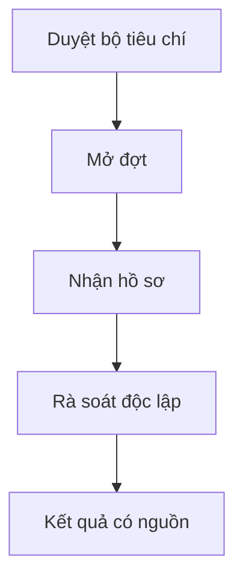

# M04 — KẾ HOẠCH TRIỂN KHAI CHI TIẾT DÀNH CHO TEAM AGENT

> **Module:** Văn hóa, gia đình, thể thao, du lịch và thông tin · **Baseline:** `dovandatym1-ship-it/pvh-demo` PR #12 @ `fa214999` · **Ngày:** 11/11/2026 · **Loại tài liệu:** PLAN / REVIEW REQUIRED, không phải xác nhận pháp lý hay code DONE.

## 0. Quy tắc sử dụng / bất biến của dự án

- 01 codebase dùng chung cho nhiều xã; tenant và quyền luôn suy từ phiên phía server. `main`, Phase 1–6, Supabase `Demo-pvh` không được tự merge/deploy/migrate/reset. Thiết kế mở rộng nhiều tenant cần ADR riêng vì schema hiện có ràng buộc singleton.
- **SOURCE** = đã nhìn thấy trong code/SQL nhánh tích hợp; **DESIGN** = trường/quy trình đề xuất cần BA-owner duyệt; **LIVE** = chỉ đánh khi có truy xuất cloud và chứng cứ checksum/DB, không tự suy từ migration file.
- UI luôn tiếng Việt; mã snake_case chỉ ở code/DB; không tạo văn bản quyết định pháp lý giả. Mọi biểu mẫu và quyền ký phải đối chiếu văn bản chuyên ngành đang hiệu lực trước implementation.
- Mỗi task chạy trên branch riêng từ SHA đã chốt, có owner file, commit, test receipt và PR audit; chỉ **Đỗ Văn Đạt** duyệt/merge. Không tự ý tăng phạm vi so với 128 OP nguồn và 5 chức năng M11 đã được đưa vào kiểm kê.
- Luồng **BA01 → DB01 → BE01 → FE01 → QA01 → INT01**. BA các OP có thể làm song song; DB migration được điều phối một owner/module để không xung đột timestamp, SQL và FK; FE chia component độc lập, không cùng sửa route/page khi chưa được lock.

## 1. Phạm vi, code hiện có và ranh giới

- **Mục tiêu module:** Văn hóa, gia đình, thể thao, du lịch và thông tin.
- **Tác nhân:** cán bộ văn hóa; đầu mối thôn; tổ rà soát; lãnh đạo; cơ quan có thẩm quyền.
- **Màn hình hiện có:** `/van-hoa/gia-dinh-van-hoa` (trạng thái chức năng cần đối chiếu).
- **Bảng SQL ứng viên:** `public.culture_rule_packs`, `public.campaigns`, `public.submissions`, `public.culture_submission_events`.
- **Số operation trong Function Map:** 21 (mã nguồn OP-Mxx).
- **Feature-level của spec hiện có:** M04-F01 — Thiết chế văn hóa, thể thao; M04-F02 — Phong trào và danh hiệu văn hóa / Gia đình văn hóa / Thôn, tổ dân phố văn hóa; M04-F03 — Hoạt động văn hóa, văn nghệ; M04-F04 — Hoạt động thể dục, thể thao; M04-F05 — Du lịch trên địa bàn; M04-F06 — Thông tin cơ sở và tuyên truyền; M04-F07 — Công tác gia đình.

**Một số file code neo để agent tìm đúng nơi:**

- `src/features/m04-culture-family/components/ph03-culture-workspace.tsx`
- `src/features/m04-culture-family/server/actions.ts`
- `src/features/m04-culture-family/server/ph03-actions.ts`
- `src/features/m04-culture-family/server/ph03-queries.ts`

**Nguồn bắt buộc:** `docs/business/FUNCTION_MAP_PVH_v0.1.md`; `docs/plans/PVH_MASTER_INTEGRATION_2026-11-09/OP_FUNCTION_SCREEN_CODE_DB_CROSSWALK.csv`; `docs/specs/PVH_FULL_MODULE_SPEC_2026-11-09/M04.md`; SQL migration của PR #12. Không được coi `SOURCE_ONLY` là nghiệm thu runtime.

## 2. Flow E2E cấp module



Xác nhận bộ tiêu chí → mở đợt → tiếp nhận hồ sơ/minh chứng → rà soát → trình/ghi nhận kết quả nguồn. Với lỗi/thiếu thẩm quyền, trả hồ sơ về bước phù hợp kèm lý do và sự kiện audit; không sửa hồi tố dữ liệu đã chốt.

**Ma trận hành vi mặc định cho từng màn:** Danh sách (server paging/count), tìm kiếm/lọc/sort, xem chi tiết, thêm/sửa/ẩn hoặc ngừng hiệu lực theo quyền, đính kèm/chứng cứ nếu có, tra cứu lịch sử, xuất có kiểm quyền. Tính năng không áp dụng như nhật ký bất biến hoặc dữ liệu nguồn read-only phải ghi rõ N/A; không ép CRUD xóa đối với dữ liệu pháp lý.

## 3. Trường chuẩn dùng chung (DESIGN, áp dụng khi phù hợp)

| Field | Kiểu PostgreSQL | Quy tắc | Hiển thị / bảo vệ |
|---|---|---|---|
| `id` | `uuid` | PK server-generated | Định danh; mã kỹ thuật ẩn khỏi UI |
| `tenant_id` | `uuid` | FK, lấy từ session/membership | Đơn vị cấp xã; mã kỹ thuật ẩn khỏi UI |
| `org_unit_id` | `uuid` | FK đơn vị, kiểm scope | Đơn vị quản lý; mã kỹ thuật ẩn khỏi UI |
| `status` | `text` | Enum versioned theo đối tượng | Trạng thái; mã kỹ thuật ẩn khỏi UI |
| `version` | `integer` | OCC, tăng sau ghi | Phiên bản; mã kỹ thuật ẩn khỏi UI |
| `created_at` | `timestamptz` | UTC server | Thời điểm tạo; mã kỹ thuật ẩn khỏi UI |
| `created_by` | `uuid` | auth.uid server | Người tạo; mã kỹ thuật ẩn khỏi UI |
| `updated_at` | `timestamptz` | UTC server | Thời điểm cập nhật; mã kỹ thuật ẩn khỏi UI |
| `updated_by` | `uuid` | auth.uid server | Người cập nhật; mã kỹ thuật ẩn khỏi UI |
| `source_ref` | `text` | Nguồn hồ sơ/giấy tờ/đầu mối | Tài liệu nguồn; mã kỹ thuật ẩn khỏi UI |
| `is_active` | `boolean` | Soft retire nếu có phụ thuộc | Còn hiệu lực; mã kỹ thuật ẩn khỏi UI |

### Hợp đồng dữ liệu toàn module

- Mỗi record phải có owner, purpose, effective period khi phù hợp, nguồn gốc, mức nhạy cảm và retention theo policy được duyệt. Không lấy `tenant_id`, `created_by` hoặc `role_code` từ body client để quyết quyền.
- Mọi bảng mới có PK/FK, unique theo scope/kỳ, CHECK cho số/ngày/enum, index trên filter/FK/tenant, RLS (kể cả `FORCE RLS` theo rủi ro), hạn chế `SECURITY DEFINER`, quyền EXECUTE được revoke/grant có chủ đích.
- Cấm bỏ qua `SELECT` policy cần thiết cho UPDATE; kiểm `USING` và `WITH CHECK`; không dùng claims user-editable. Audit immutable, event/outbox idempotency; file private Storage + signed download theo từng user.
- Quy tắc `NULL` ≠ `0` ≠ `N/A` ≠ chưa xác nhận; dashboard và báo cáo giữ lineage và thời điểm chốt; export không được lộ PII ngoài quyền.

## 4. Data Dictionary SOURCE của nhánh tích hợp (không đồng nghĩa đã có trên cloud)

### `public.culture_rule_packs` — SOURCE trong nhánh tích hợp

| Cột | Kiểu trong SQL | Bắt buộc trong SQL | Ghi chú rà soát |
|---|---|---|---|
| `id` | `uuid` | Không hoặc theo constraint | Phải đối chiếu UI/API, RLS và migration history |
| `tenant_id` | `uuid` | Có | Phải đối chiếu UI/API, RLS và migration history |
| `title_type` | `text` | Có | Phải đối chiếu UI/API, RLS và migration history |
| `version` | `integer` | Có | Phải đối chiếu UI/API, RLS và migration history |
| `status` | `text` | Có | Phải đối chiếu UI/API, RLS và migration history |
| `jurisdiction` | `text` | Có | Phải đối chiếu UI/API, RLS và migration history |
| `effective_from` | `date` | Không hoặc theo constraint | Phải đối chiếu UI/API, RLS và migration history |
| `criteria` | `jsonb` | Có | Phải đối chiếu UI/API, RLS và migration history |
| `min_score` | `numeric(7,2)` | Không hoặc theo constraint | Phải đối chiếu UI/API, RLS và migration history |
| `created_by` | `uuid` | Có | Phải đối chiếu UI/API, RLS và migration history |
| `created_at` | `timestamptz` | Có | Phải đối chiếu UI/API, RLS và migration history |

### `public.campaigns` — SOURCE trong nhánh tích hợp

| Cột | Kiểu trong SQL | Bắt buộc trong SQL | Ghi chú rà soát |
|---|---|---|---|
| `id` | `uuid` | Không hoặc theo constraint | Phải đối chiếu UI/API, RLS và migration history |
| `tenant_id` | `uuid` | Có | Phải đối chiếu UI/API, RLS và migration history |
| `rule_pack_id` | `uuid` | Có | Phải đối chiếu UI/API, RLS và migration history |
| `title_type` | `text` | Có | Phải đối chiếu UI/API, RLS và migration history |
| `year` | `integer` | Có | Phải đối chiếu UI/API, RLS và migration history |
| `title` | `text` | Có | Phải đối chiếu UI/API, RLS và migration history |
| `status` | `text` | Có | Phải đối chiếu UI/API, RLS và migration history |
| `opens_at` | `timestamptz` | Có | Phải đối chiếu UI/API, RLS và migration history |
| `closes_at` | `timestamptz` | Có | Phải đối chiếu UI/API, RLS và migration history |
| `created_by` | `uuid` | Có | Phải đối chiếu UI/API, RLS và migration history |
| `created_at` | `timestamptz` | Có | Phải đối chiếu UI/API, RLS và migration history |

### `public.submissions` — SOURCE trong nhánh tích hợp

| Cột | Kiểu trong SQL | Bắt buộc trong SQL | Ghi chú rà soát |
|---|---|---|---|
| `id` | `uuid` | Không hoặc theo constraint | Phải đối chiếu UI/API, RLS và migration history |
| `tenant_id` | `uuid` | Có | Phải đối chiếu UI/API, RLS và migration history |
| `campaign_id` | `uuid` | Có | Phải đối chiếu UI/API, RLS và migration history |
| `rule_pack_id` | `uuid` | Có | Phải đối chiếu UI/API, RLS và migration history |
| `rule_pack_version` | `integer` | Có | Phải đối chiếu UI/API, RLS và migration history |
| `subject_ref` | `text` | Có | Phải đối chiếu UI/API, RLS và migration history |
| `household_head_name` | `text` | Có | Phải đối chiếu UI/API, RLS và migration history |
| `hamlet_id` | `uuid` | Có | Phải đối chiếu UI/API, RLS và migration history |
| `submission_type` | `text` | Có | Phải đối chiếu UI/API, RLS và migration history |
| `status` | `text` | Có | Phải đối chiếu UI/API, RLS và migration history |
| `score` | `numeric(7,2)` | Có | Phải đối chiếu UI/API, RLS và migration history |
| `work_item_id` | `uuid` | Có | Phải đối chiếu UI/API, RLS và migration history |
| `idempotency_key` | `text` | Có | Phải đối chiếu UI/API, RLS và migration history |
| `request_hash` | `text` | Có | Phải đối chiếu UI/API, RLS và migration history |
| `version` | `integer` | Có | Phải đối chiếu UI/API, RLS và migration history |
| `created_by` | `uuid` | Có | Phải đối chiếu UI/API, RLS và migration history |
| `updated_by` | `uuid` | Không hoặc theo constraint | Phải đối chiếu UI/API, RLS và migration history |
| `created_at` | `timestamptz` | Có | Phải đối chiếu UI/API, RLS và migration history |

### `public.culture_submission_events` — SOURCE trong nhánh tích hợp

| Cột | Kiểu trong SQL | Bắt buộc trong SQL | Ghi chú rà soát |
|---|---|---|---|
| `id` | `uuid` | Không hoặc theo constraint | Phải đối chiếu UI/API, RLS và migration history |
| `tenant_id` | `uuid` | Có | Phải đối chiếu UI/API, RLS và migration history |
| `actor_id` | `uuid` | Có | Phải đối chiếu UI/API, RLS và migration history |
| `from_status` | `text` | Có | Phải đối chiếu UI/API, RLS và migration history |
| `created_at` | `timestamptz` | Có | Phải đối chiếu UI/API, RLS và migration history |

### 4.1. Ánh xạ tên trường thiết kế ↔ cột đã có (không tạo cột trùng)

| Trường tại biểu mẫu/đặc tả | Cột chuẩn ứng viên trong SQL | Quy tắc |
|---|---|---|
| `subject_ref` | `public.submissions.subject_ref` | Agent DB/BA phải kiểm tra semantics và không tạo thêm cột trước khi chốt mapping |
| `submission_status` | `public.submissions.status` | Agent DB/BA phải kiểm tra semantics và không tạo thêm cột trước khi chốt mapping |
| `rule_pack_id` | `public.culture_rule_packs.id` | Agent DB/BA phải kiểm tra semantics và không tạo thêm cột trước khi chốt mapping |

## 5. WBS chi tiết cho từng operation/feature

Mỗi task dưới đây có mã duy nhất, phụ thuộc và DoD; nhóm BA/DB/BE/FE/QA/INT dùng làm work packages. Cột trường là cấu trúc đề xuất/đối chiếu source, **không phải danh sách pháp lý bắt buộc đã duyệt**.

### OP-M04-001 — Bình xét danh hiệu Gia đình văn hóa: mở đợt, nhập hộ, checklist, họp/ý kiến, nộp, rà soát, trình, kết quả mô phỏng, chốt DEM-R02

- **Mức độ code:** Đã thấy điểm vào/code liên quan; chưa đủ điều kiện kết luận khép kín.
- **Nhóm luồng:** `CASE` · **Source status:** `SPECIFYING` · **Screen Map:** `SCR-VH-01` · **Mức nhạy cảm nguồn:** `HC`.
- **Nguồn yêu cầu:** BL-056; REQ-M04-06; DEM-VH (VH1–VH9); DEM-R02.
- **Code API/DB ứng viên (chỉ để rà soát):** openIllustrativeCultureCampaignAction→app.open_illustrative_culture_campaign; submitCultureDossierAction→app.submit_culture_dossier; reviewCultureDossierAction→app.review_culture_dossier / public.culture_rule_packs; public.campaigns; public.submissions(subject_ref, household_head_name, hamlet_id, status, score, criteria_scores, source_ref, rule_pack_version); public.culture_submission_events. No canonical household/member model, meeting/opinion checklist, or official decision/signatur.
- **Đầu ra nghiệp vụ:** biên nhận có mã và phiên bản (nếu ghi), danh sách/chi tiết theo quyền, trạng thái, lịch sử, nguồn đối soát, thông báo và báo cáo chỉ khi có nguồn thật.

#### Luồng chính và các bước kiểm soát

1. Cán bộ mở nghiệp vụ **Bình xét danh hiệu Gia đình văn hóa: mở đợt, nhập hộ, checklist, họp/ý kiến, nộp, rà soát, trình, kết quả mô phỏng, chốt DEM-R02**, chọn đúng xã/địa bàn và ghi `title_type`, `year`, `subject_ref`, `submission_status`; hệ thống dẫn chiếu nguồn và kỳ hiệu lực.
2. Server xác thực phiên, membership còn hiệu lực, permission cấp tác vụ, phạm vi bản ghi và mức nhạy cảm; tenant lấy từ server, không nhận từ form.
3. Kiểm tra schema, ràng buộc trường, mã nguồn, khóa trùng, phiên bản, liên kết FK và tình trạng đối tượng; lỗi trả từng trường bằng tiếng Việt.
4. Tạo hồ sơ tiếp nhận có mã, nguồn và phiên bản biểu mẫu; kiểm trùng chủ thể/kỳ trước khi cấp biên nhận.
5. Cán bộ có quyền bổ sung minh chứng, lưu nháp; người rà soát khác người nhập kiểm điều kiện/chủ thể và ghi lý do yêu cầu bổ sung.
6. Nếu vượt thẩm quyền, tạo phiếu chuyển/đề xuất và chờ mã quyết định nguồn; không tự sinh kết quả pháp lý hoặc coi bản demo là quyết định.
7. Ghi sự kiện bất biến, actor/time/version, tạo thông báo nếu hợp đồng sự kiện quy định; cập nhật dashboard/report theo nguồn phát sinh có truy vết.
8. Người dùng thấy biên nhận/chi tiết, trạng thái và lỗi rõ ràng; hỗ trợ tra cứu, lọc, phân trang và truy xuất lịch sử theo quyền.

**Luồng ngoại lệ:** (E1) sai quyền/sai xã→403 và audit deny, không trả bản ghi; (E2) sai trường/thiếu nguồn→422 theo trường; (E3) trùng/đổi phiên bản→409 và refresh; (E4) nguồn ngoài không xác nhận→PENDING/UNAVAILABLE, không ghi “thành công”; (E5) hồ sơ chốt/đã tham chiếu→không xóa vật lý; (E6) thiếu chứng cứ→CHƯA ĐỦ THÔNG TIN, không tự kết luận không đủ điều kiện.

#### Trường đầu vào/đầu ra bắt buộc đặc tả

| Field snake_case | Nhãn tiếng Việt dự kiến | PostgreSQL | Bắt buộc (đề xuất) | Validation / business rule | Nhạy cảm | Nguồn |
|---|---|---|---|---|---|---|
| `id` | Định danh | `uuid` | Server | PK sinh trên server, không nhận ID tùy ý từ client khi tạo | Nội bộ | SOURCE (cùng tên cột trong module; cần xác minh entity) |
| `tenant_id` | Đơn vị cấp xã | `uuid` | Server | FK đúng tenant, tồn tại, còn hiệu lực, scope | Nội bộ | SOURCE (cùng tên cột trong module; cần xác minh entity) |
| `campaign_id` | Đợt thực hiện | `uuid` | BA xác nhận bắt buộc | FK đúng tenant, tồn tại, còn hiệu lực, scope | Nội bộ | SOURCE (cùng tên cột trong module; cần xác minh entity) |
| `title_type` | Loại tiêu đề | `text` | BA xác nhận bắt buộc | Trim; giới hạn độ dài theo Data Dictionary; không nhận HTML/script | Nội bộ | SOURCE (cùng tên cột trong module; cần xác minh entity) |
| `year` | Năm | `integer` | BA xác nhận bắt buộc | Số nguyên ≥0, giới hạn tối đa và ngữ nghĩa từng kỳ do BA xác nhận | Nội bộ | SOURCE (cùng tên cột trong module; cần xác minh entity) |
| `rule_pack_id` | Bộ tiêu chí | `uuid` | Theo loại hồ sơ | FK đúng tenant, tồn tại, còn hiệu lực, scope | Nội bộ | SOURCE (cùng tên cột trong module; cần xác minh entity) |
| `subject_ref` | Mã chủ thể | `text` | Theo loại hồ sơ | Trim; giới hạn độ dài theo Data Dictionary; không nhận HTML/script | Hạn chế | SOURCE (cùng tên cột trong module; cần xác minh entity) |
| `hamlet_id` | Thôn/xóm | `uuid` | Theo loại hồ sơ | FK đúng tenant, tồn tại, còn hiệu lực, scope | Nội bộ | SOURCE (cùng tên cột trong module; cần xác minh entity) |
| `submission_status` | Trạng thái hồ sơ nộp | `text` | Theo loại hồ sơ | Enum versioned; cấm tự thêm trạng thái ở client | Nội bộ | DESIGN |
| `source_ref` | Tài liệu nguồn | `text` | Theo loại hồ sơ | Trim; giới hạn độ dài theo Data Dictionary; không nhận HTML/script | Nội bộ | DESIGN |
| `status` | Trạng thái | `text` | Server | Enum versioned; cấm tự thêm trạng thái ở client | Nội bộ | SOURCE (cùng tên cột trong module; cần xác minh entity) |
| `version` | Phiên bản | `integer` | Server | Số nguyên không âm trừ trường đã duyệt cho phép âm | Nội bộ | SOURCE (cùng tên cột trong module; cần xác minh entity) |
| `created_at` | Thời điểm tạo | `timestamptz` | Server | UTC trong DB, hiển thị giờ Việt Nam; ngày hợp lệ | Nội bộ | SOURCE (cùng tên cột trong module; cần xác minh entity) |
| `created_by` | Người tạo | `uuid` | Server | FK đúng tenant, tồn tại, còn hiệu lực, scope | Nội bộ | SOURCE (cùng tên cột trong module; cần xác minh entity) |

**Quy tắc giao diện:** ẩn mã kỹ thuật; form field-level errors; read-only nguồn ngoài; phân biệt bản nháp/kết quả đã xác nhận; modal xác nhận với lý do khi hủy/ẩn/chuyển; danh sách có tổng số thực và link chi tiết; export chỉ những cột được phép. **KPI:** chỉ bổ sung sau khi ghi rõ bảng+cột+trạng thái+điều kiện lọc+ngày dữ liệu+RLS+link drill-down.

#### Task giao cho agent (mỗi task là 1 work package có thể kiểm thử)

| Task ID | Agent | Đầu vào | Việc phải làm / đầu ra | Phụ thuộc | Definition of Done |
|---|---|---|---|---|---|
| M04-001-BA01 | BA nghiệp vụ | Function Map, quyền/pháp lý, mẫu nguồn | Đặc tả actor, biến thể, trường bắt buộc, trạng thái, ngoại lệ, ownership và rule register đã dẫn nguồn | — | Biên bản duyệt phạm vi OP-M04-001; không còn trường 'cần xác minh' chưa gán owner |
| M04-001-DB01 | DB/RLS | BA01 + schema thực/migration đang có | Migration cho entity/constraint/FK/index theo tenant; RLS và pgTAP; không sửa migration đã áp cloud | M04-001-BA01 | Replay clean trên staging; thử 2 ngữ cảnh xã theo ADR (không vượt ràng buộc singleton), 3 vai trò, scope deny, concurrency và rollback |
| M04-001-BE01 | Backend | BA01 + DB01 | Server Action/query/RPC/DTO tại `src/features/m04-culture-family/server/`; kiểm quyền server, idempotency, audit, error mapping | M04-001-DB01 | Unit+contract test: thành công, sai schema, sai tenant, thiếu quyền, stale version, retry không nhân đôi |
| M04-001-FE01 | Frontend | BA01 + hợp đồng API từ BE01 | Form tiếng Việt, danh sách/chi tiết, lọc/tìm/sort/page, CRUD có điều kiện tại `src/features/m04-culture-family/components/`; loading/empty/error/mobile | M04-001-BE01 | Browser 375/768/1440px; focus/keyboard; mỗi trường có nhãn, mô tả lỗi; không cho sửa khi không có quyền |
| M04-001-QA01 | QA/Automation | BA01 + DB01/BE01/FE01 | Bộ ca kiểm thử OP-M04-001: happy/negative/boundary/role/tenant/PII/export/audit; fixture và receipt SHA | M04-001-FE01 | Có test IDs gắn OP-M04-001, chạy đúng HEAD, không chỉ snapshot UI; fail case có log che dữ liệu |
| M04-001-INT01 | Tích hợp | QA01 + mã nguồn nhánh dự kiến | Liên kết M00 quyền/M01 việc/M09 chỉ tiêu/M10 nguồn nếu áp dụng; evidence route→action→DB→test; PR chỉ đổi phạm vi task | M04-001-QA01 | Không thiếu phép C/R/U/D áp dụng; không có false-success; reviewer Đỗ Văn Đạt ký nhận |

#### Acceptance scenarios

- **AC-OP-M04-001-01 (hợp lệ):** Given phiên có quyền và nguồn `campaign_id` và `title_type` hợp lệ; When thực hiện theo luồng CASE; Then lưu/tra cứu đúng kết quả, trả ID hoặc biên nhận, audit và version.
- **AC-OP-M04-001-02 (bị chặn):** Given sai địa bàn, không có permission hoặc dữ liệu thiếu; When gọi trực tiếp API/RPC; Then trả lỗi không rò dữ liệu và không tạo bản ghi/event thành công.
- **AC-OP-M04-001-03 (đồng thời/nguồn):** Given cập nhật trùng hoặc source/version cũ; When gửi lặp hoặc hai người chỉnh cùng bản ghi; Then idempotent/reject conflict, không ghi đè phiên bản mới.
- **AC-OP-M04-001-04 (giao diện):** Given vai trò chỉ xem; When mở bằng điện thoại hoặc đường dẫn trực tiếp; Then các tác vụ sửa/xuất không đúng quyền bị ẩn *và* server từ chối.

**Evidence tối thiểu:** commit SHA; đường dẫn file liên quan; migration history/checksum (nếu thay DB); link CI thực thi; pgTAP/RLS test ID; ảnh/trace 375/768/1440; dữ liệu test và người ký duyệt. Trạng thái OP chỉ được đổi `UNVERIFIED` → `STATIC_CHECKED` → `INTEGRATED_TESTED` → `OWNER_ACCEPTED` khi có biên nhận tương ứng.

### OP-M04-002 — Bình xét danh hiệu Thôn/Tổ dân phố văn hóa: chủ thể là thôn, bộ form/checklist riêng

- **Mức độ code:** Đã thấy điểm vào/code liên quan; chưa đủ điều kiện kết luận khép kín.
- **Nhóm luồng:** `CASE` · **Source status:** `SPECIFYING` · **Screen Map:** `SCR-VH-02` · **Mức nhạy cảm nguồn:** `—`.
- **Nguồn yêu cầu:** BL-056; REQ-M04-06; DEM-VH-THON.
- **Code API/DB ứng viên (chỉ để rà soát):** openIllustrativeCultureCampaignAction→app.open_illustrative_culture_campaign(title_type=THON); submitCultureDossierAction→app.submit_culture_dossier; reviewCultureDossierAction→app.review_culture_dossier / Same public.culture_rule_packs/campaigns/submissions/culture_submission_events as OP-M04-001. submissions requires household_head_name for every submission_type, so the subject model/form is not a distinct hamlet/town dossier; no official decision fields..
- **Đầu ra nghiệp vụ:** biên nhận có mã và phiên bản (nếu ghi), danh sách/chi tiết theo quyền, trạng thái, lịch sử, nguồn đối soát, thông báo và báo cáo chỉ khi có nguồn thật.

#### Luồng chính và các bước kiểm soát

1. Cán bộ mở nghiệp vụ **Bình xét danh hiệu Thôn/Tổ dân phố văn hóa: chủ thể là thôn, bộ form/checklist riêng**, chọn đúng xã/địa bàn và ghi `hamlet_name`, `checklist_version`, `meeting_minutes_ref`, `review_status`; hệ thống dẫn chiếu nguồn và kỳ hiệu lực.
2. Server xác thực phiên, membership còn hiệu lực, permission cấp tác vụ, phạm vi bản ghi và mức nhạy cảm; tenant lấy từ server, không nhận từ form.
3. Kiểm tra schema, ràng buộc trường, mã nguồn, khóa trùng, phiên bản, liên kết FK và tình trạng đối tượng; lỗi trả từng trường bằng tiếng Việt.
4. Tạo hồ sơ tiếp nhận có mã, nguồn và phiên bản biểu mẫu; kiểm trùng chủ thể/kỳ trước khi cấp biên nhận.
5. Cán bộ có quyền bổ sung minh chứng, lưu nháp; người rà soát khác người nhập kiểm điều kiện/chủ thể và ghi lý do yêu cầu bổ sung.
6. Nếu vượt thẩm quyền, tạo phiếu chuyển/đề xuất và chờ mã quyết định nguồn; không tự sinh kết quả pháp lý hoặc coi bản demo là quyết định.
7. Ghi sự kiện bất biến, actor/time/version, tạo thông báo nếu hợp đồng sự kiện quy định; cập nhật dashboard/report theo nguồn phát sinh có truy vết.
8. Người dùng thấy biên nhận/chi tiết, trạng thái và lỗi rõ ràng; hỗ trợ tra cứu, lọc, phân trang và truy xuất lịch sử theo quyền.

**Luồng ngoại lệ:** (E1) sai quyền/sai xã→403 và audit deny, không trả bản ghi; (E2) sai trường/thiếu nguồn→422 theo trường; (E3) trùng/đổi phiên bản→409 và refresh; (E4) nguồn ngoài không xác nhận→PENDING/UNAVAILABLE, không ghi “thành công”; (E5) hồ sơ chốt/đã tham chiếu→không xóa vật lý; (E6) thiếu chứng cứ→CHƯA ĐỦ THÔNG TIN, không tự kết luận không đủ điều kiện.

#### Trường đầu vào/đầu ra bắt buộc đặc tả

| Field snake_case | Nhãn tiếng Việt dự kiến | PostgreSQL | Bắt buộc (đề xuất) | Validation / business rule | Nhạy cảm | Nguồn |
|---|---|---|---|---|---|---|
| `id` | Định danh | `uuid` | Server | PK sinh trên server, không nhận ID tùy ý từ client khi tạo | Nội bộ | SOURCE (cùng tên cột trong module; cần xác minh entity) |
| `tenant_id` | Đơn vị cấp xã | `uuid` | Server | FK đúng tenant, tồn tại, còn hiệu lực, scope | Nội bộ | SOURCE (cùng tên cột trong module; cần xác minh entity) |
| `campaign_id` | Đợt thực hiện | `uuid` | BA xác nhận bắt buộc | FK đúng tenant, tồn tại, còn hiệu lực, scope | Nội bộ | SOURCE (cùng tên cột trong module; cần xác minh entity) |
| `hamlet_id` | Thôn/xóm | `uuid` | BA xác nhận bắt buộc | FK đúng tenant, tồn tại, còn hiệu lực, scope | Nội bộ | SOURCE (cùng tên cột trong module; cần xác minh entity) |
| `hamlet_name` | Tên thôn/xóm | `text` | BA xác nhận bắt buộc | Trim; giới hạn độ dài theo Data Dictionary; không nhận HTML/script | Nội bộ | DESIGN |
| `checklist_version` | Phiên bản bảng kiểm | `integer` | Theo loại hồ sơ | Số nguyên không âm trừ trường đã duyệt cho phép âm | Nội bộ | DESIGN |
| `meeting_minutes_ref` | Tham chiếu cuộc họp biên bản | `text` | Theo loại hồ sơ | Trim; giới hạn độ dài theo Data Dictionary; không nhận HTML/script | Nội bộ | DESIGN |
| `review_status` | Trạng thái rà soát | `text` | Theo loại hồ sơ | Enum versioned; cấm tự thêm trạng thái ở client | Nội bộ | DESIGN |
| `status` | Trạng thái | `text` | Server | Enum versioned; cấm tự thêm trạng thái ở client | Nội bộ | SOURCE (cùng tên cột trong module; cần xác minh entity) |
| `version` | Phiên bản | `integer` | Server | Số nguyên không âm trừ trường đã duyệt cho phép âm | Nội bộ | SOURCE (cùng tên cột trong module; cần xác minh entity) |
| `created_at` | Thời điểm tạo | `timestamptz` | Server | UTC trong DB, hiển thị giờ Việt Nam; ngày hợp lệ | Nội bộ | SOURCE (cùng tên cột trong module; cần xác minh entity) |
| `created_by` | Người tạo | `uuid` | Server | FK đúng tenant, tồn tại, còn hiệu lực, scope | Nội bộ | SOURCE (cùng tên cột trong module; cần xác minh entity) |

**Quy tắc giao diện:** ẩn mã kỹ thuật; form field-level errors; read-only nguồn ngoài; phân biệt bản nháp/kết quả đã xác nhận; modal xác nhận với lý do khi hủy/ẩn/chuyển; danh sách có tổng số thực và link chi tiết; export chỉ những cột được phép. **KPI:** chỉ bổ sung sau khi ghi rõ bảng+cột+trạng thái+điều kiện lọc+ngày dữ liệu+RLS+link drill-down.

#### Task giao cho agent (mỗi task là 1 work package có thể kiểm thử)

| Task ID | Agent | Đầu vào | Việc phải làm / đầu ra | Phụ thuộc | Definition of Done |
|---|---|---|---|---|---|
| M04-002-BA01 | BA nghiệp vụ | Function Map, quyền/pháp lý, mẫu nguồn | Đặc tả actor, biến thể, trường bắt buộc, trạng thái, ngoại lệ, ownership và rule register đã dẫn nguồn | — | Biên bản duyệt phạm vi OP-M04-002; không còn trường 'cần xác minh' chưa gán owner |
| M04-002-DB01 | DB/RLS | BA01 + schema thực/migration đang có | Migration cho entity/constraint/FK/index theo tenant; RLS và pgTAP; không sửa migration đã áp cloud | M04-002-BA01 | Replay clean trên staging; thử 2 ngữ cảnh xã theo ADR (không vượt ràng buộc singleton), 3 vai trò, scope deny, concurrency và rollback |
| M04-002-BE01 | Backend | BA01 + DB01 | Server Action/query/RPC/DTO tại `src/features/m04-culture-family/server/`; kiểm quyền server, idempotency, audit, error mapping | M04-002-DB01 | Unit+contract test: thành công, sai schema, sai tenant, thiếu quyền, stale version, retry không nhân đôi |
| M04-002-FE01 | Frontend | BA01 + hợp đồng API từ BE01 | Form tiếng Việt, danh sách/chi tiết, lọc/tìm/sort/page, CRUD có điều kiện tại `src/features/m04-culture-family/components/`; loading/empty/error/mobile | M04-002-BE01 | Browser 375/768/1440px; focus/keyboard; mỗi trường có nhãn, mô tả lỗi; không cho sửa khi không có quyền |
| M04-002-QA01 | QA/Automation | BA01 + DB01/BE01/FE01 | Bộ ca kiểm thử OP-M04-002: happy/negative/boundary/role/tenant/PII/export/audit; fixture và receipt SHA | M04-002-FE01 | Có test IDs gắn OP-M04-002, chạy đúng HEAD, không chỉ snapshot UI; fail case có log che dữ liệu |
| M04-002-INT01 | Tích hợp | QA01 + mã nguồn nhánh dự kiến | Liên kết M00 quyền/M01 việc/M09 chỉ tiêu/M10 nguồn nếu áp dụng; evidence route→action→DB→test; PR chỉ đổi phạm vi task | M04-002-QA01 | Không thiếu phép C/R/U/D áp dụng; không có false-success; reviewer Đỗ Văn Đạt ký nhận |

#### Acceptance scenarios

- **AC-OP-M04-002-01 (hợp lệ):** Given phiên có quyền và nguồn `campaign_id` và `hamlet_id` hợp lệ; When thực hiện theo luồng CASE; Then lưu/tra cứu đúng kết quả, trả ID hoặc biên nhận, audit và version.
- **AC-OP-M04-002-02 (bị chặn):** Given sai địa bàn, không có permission hoặc dữ liệu thiếu; When gọi trực tiếp API/RPC; Then trả lỗi không rò dữ liệu và không tạo bản ghi/event thành công.
- **AC-OP-M04-002-03 (đồng thời/nguồn):** Given cập nhật trùng hoặc source/version cũ; When gửi lặp hoặc hai người chỉnh cùng bản ghi; Then idempotent/reject conflict, không ghi đè phiên bản mới.
- **AC-OP-M04-002-04 (giao diện):** Given vai trò chỉ xem; When mở bằng điện thoại hoặc đường dẫn trực tiếp; Then các tác vụ sửa/xuất không đúng quyền bị ẩn *và* server từ chối.

**Evidence tối thiểu:** commit SHA; đường dẫn file liên quan; migration history/checksum (nếu thay DB); link CI thực thi; pgTAP/RLS test ID; ảnh/trace 375/768/1440; dữ liệu test và người ký duyệt. Trạng thái OP chỉ được đổi `UNVERIFIED` → `STATIC_CHECKED` → `INTEGRATED_TESTED` → `OWNER_ACCEPTED` khi có biên nhận tương ứng.

### OP-M04-003 — Hướng dẫn, theo dõi phong trào xây dựng đời sống văn hóa

- **Mức độ code:** Đã thấy điểm vào/code liên quan; chưa đủ điều kiện kết luận khép kín.
- **Nhóm luồng:** `QUERY` · **Source status:** `DISCOVERED` · **Screen Map:** `SCR-CV-03 ⟨OP-M04-003⟩` · **Mức nhạy cảm nguồn:** `—`.
- **Nguồn yêu cầu:** BL-055; REQ-M04-06.
- **Code API/DB ứng viên (chỉ để rà soát):** CreateWorkItemSchema.category→createWorkItemAction→app.create_work_item_v2 (generic M01 work item only) / public.work_items.category (free text); no culture movement plan, campaign, participant, result or indicator entity found.
- **Đầu ra nghiệp vụ:** biên nhận có mã và phiên bản (nếu ghi), danh sách/chi tiết theo quyền, trạng thái, lịch sử, nguồn đối soát, thông báo và báo cáo chỉ khi có nguồn thật.

#### Luồng chính và các bước kiểm soát

1. Cán bộ mở nghiệp vụ **Hướng dẫn, theo dõi phong trào xây dựng đời sống văn hóa**, chọn đúng xã/địa bàn và ghi `movement_code`, `activity_type`, `target_group`, `held_date`; hệ thống dẫn chiếu nguồn và kỳ hiệu lực.
2. Server xác thực phiên, membership còn hiệu lực, permission cấp tác vụ, phạm vi bản ghi và mức nhạy cảm; tenant lấy từ server, không nhận từ form.
3. Kiểm tra schema, ràng buộc trường, mã nguồn, khóa trùng, phiên bản, liên kết FK và tình trạng đối tượng; lỗi trả từng trường bằng tiếng Việt.
4. Server lập truy vấn theo tenant, vai trò, địa bàn, thời điểm hiệu lực; lọc/đếm/phân trang tại CSDL.
5. Tính chỉ tiêu từ bản ghi nguồn thực với chính sách NULL, 0 và chưa báo cáo riêng; không đưa dữ liệu ngoài quyền lên client.
6. Hiển thị danh sách/chi tiết và nguồn gốc; xuất tệp chỉ khi có quyền, ghi lịch sử xuất và kiểm lại quyền từng dòng.
7. Ghi sự kiện bất biến, actor/time/version, tạo thông báo nếu hợp đồng sự kiện quy định; cập nhật dashboard/report theo nguồn phát sinh có truy vết.
8. Người dùng thấy biên nhận/chi tiết, trạng thái và lỗi rõ ràng; hỗ trợ tra cứu, lọc, phân trang và truy xuất lịch sử theo quyền.

**Luồng ngoại lệ:** (E1) sai quyền/sai xã→403 và audit deny, không trả bản ghi; (E2) sai trường/thiếu nguồn→422 theo trường; (E3) trùng/đổi phiên bản→409 và refresh; (E4) nguồn ngoài không xác nhận→PENDING/UNAVAILABLE, không ghi “thành công”; (E5) hồ sơ chốt/đã tham chiếu→không xóa vật lý; (E6) thiếu chứng cứ→CHƯA ĐỦ THÔNG TIN, không tự kết luận không đủ điều kiện.

#### Trường đầu vào/đầu ra bắt buộc đặc tả

| Field snake_case | Nhãn tiếng Việt dự kiến | PostgreSQL | Bắt buộc (đề xuất) | Validation / business rule | Nhạy cảm | Nguồn |
|---|---|---|---|---|---|---|
| `id` | Định danh | `uuid` | Server | PK sinh trên server, không nhận ID tùy ý từ client khi tạo | Nội bộ | SOURCE (cùng tên cột trong module; cần xác minh entity) |
| `tenant_id` | Đơn vị cấp xã | `uuid` | Server | FK đúng tenant, tồn tại, còn hiệu lực, scope | Nội bộ | SOURCE (cùng tên cột trong module; cần xác minh entity) |
| `movement_code` | Mã phong trào | `text` | BA xác nhận bắt buộc | Chuẩn hóa trim, giới hạn 1–80 ký tự, unique theo owner/kỳ nếu áp dụng | Nội bộ | DESIGN |
| `activity_type` | Loại hoạt động | `text` | BA xác nhận bắt buộc | Trim; giới hạn độ dài theo Data Dictionary; không nhận HTML/script | Nội bộ | DESIGN |
| `target_group` | Mục tiêu nhóm | `text` | BA xác nhận bắt buộc | Trim; giới hạn độ dài theo Data Dictionary; không nhận HTML/script | Nội bộ | DESIGN |
| `held_date` | Ngày tổ chức | `date` | Theo loại hồ sơ | ISO 8601; ngày bắt đầu ≤ ngày kết thúc khi có cặp | Nội bộ | DESIGN |
| `participants_count` | Số lượng người tham gia | `integer` | Theo loại hồ sơ | Số nguyên không âm trừ trường đã duyệt cho phép âm | Nội bộ | DESIGN |
| `performance_ref` | Tham chiếu biểu diễn | `text` | Theo loại hồ sơ | Trim; giới hạn độ dài theo Data Dictionary; không nhận HTML/script | Nội bộ | DESIGN |
| `status` | Trạng thái | `text` | Server | Enum versioned; cấm tự thêm trạng thái ở client | Nội bộ | SOURCE (cùng tên cột trong module; cần xác minh entity) |
| `version` | Phiên bản | `integer` | Server | Số nguyên không âm trừ trường đã duyệt cho phép âm | Nội bộ | SOURCE (cùng tên cột trong module; cần xác minh entity) |
| `created_at` | Thời điểm tạo | `timestamptz` | Server | UTC trong DB, hiển thị giờ Việt Nam; ngày hợp lệ | Nội bộ | SOURCE (cùng tên cột trong module; cần xác minh entity) |
| `created_by` | Người tạo | `uuid` | Server | FK đúng tenant, tồn tại, còn hiệu lực, scope | Nội bộ | SOURCE (cùng tên cột trong module; cần xác minh entity) |

**Quy tắc giao diện:** ẩn mã kỹ thuật; form field-level errors; read-only nguồn ngoài; phân biệt bản nháp/kết quả đã xác nhận; modal xác nhận với lý do khi hủy/ẩn/chuyển; danh sách có tổng số thực và link chi tiết; export chỉ những cột được phép. **KPI:** chỉ bổ sung sau khi ghi rõ bảng+cột+trạng thái+điều kiện lọc+ngày dữ liệu+RLS+link drill-down.

#### Task giao cho agent (mỗi task là 1 work package có thể kiểm thử)

| Task ID | Agent | Đầu vào | Việc phải làm / đầu ra | Phụ thuộc | Definition of Done |
|---|---|---|---|---|---|
| M04-003-BA01 | BA nghiệp vụ | Function Map, quyền/pháp lý, mẫu nguồn | Đặc tả actor, biến thể, trường bắt buộc, trạng thái, ngoại lệ, ownership và rule register đã dẫn nguồn | — | Biên bản duyệt phạm vi OP-M04-003; không còn trường 'cần xác minh' chưa gán owner |
| M04-003-DB01 | DB/RLS | BA01 + schema thực/migration đang có | Migration cho entity/constraint/FK/index theo tenant; RLS và pgTAP; không sửa migration đã áp cloud; tối ưu read-side count/filter | M04-003-BA01 | Replay clean trên staging; thử 2 ngữ cảnh xã theo ADR (không vượt ràng buộc singleton), 3 vai trò, scope deny, concurrency và rollback |
| M04-003-BE01 | Backend | BA01 + DB01 | Server Action/query/RPC/DTO tại `src/features/m04-culture-family/server/`; kiểm quyền server, idempotency, audit, error mapping; truy vấn chỉ đọc, không tự sinh tác vụ ghi | M04-003-DB01 | Unit+contract test: thành công, sai schema, sai tenant, thiếu quyền, stale version, retry không nhân đôi |
| M04-003-FE01 | Frontend | BA01 + hợp đồng API từ BE01 | Form tiếng Việt, danh sách/chi tiết, lọc/tìm/sort/page, CRUD có điều kiện tại `src/features/m04-culture-family/components/`; loading/empty/error/mobile; export kiểm lại quyền | M04-003-BE01 | Browser 375/768/1440px; focus/keyboard; mỗi trường có nhãn, mô tả lỗi; không cho sửa khi không có quyền |
| M04-003-QA01 | QA/Automation | BA01 + DB01/BE01/FE01 | Bộ ca kiểm thử OP-M04-003: happy/negative/boundary/role/tenant/PII/export/audit; fixture và receipt SHA | M04-003-FE01 | Có test IDs gắn OP-M04-003, chạy đúng HEAD, không chỉ snapshot UI; fail case có log che dữ liệu |
| M04-003-INT01 | Tích hợp | QA01 + mã nguồn nhánh dự kiến | Liên kết M00 quyền/M01 việc/M09 chỉ tiêu/M10 nguồn nếu áp dụng; evidence route→action→DB→test; PR chỉ đổi phạm vi task | M04-003-QA01 | Không thiếu phép C/R/U/D áp dụng; không có false-success; reviewer Đỗ Văn Đạt ký nhận |

#### Acceptance scenarios

- **AC-OP-M04-003-01 (hợp lệ):** Given phiên có quyền và nguồn `movement_code` và `activity_type` hợp lệ; When thực hiện theo luồng QUERY; Then lưu/tra cứu đúng kết quả, trả ID hoặc biên nhận, audit và version.
- **AC-OP-M04-003-02 (bị chặn):** Given sai địa bàn, không có permission hoặc dữ liệu thiếu; When gọi trực tiếp API/RPC; Then trả lỗi không rò dữ liệu và không tạo bản ghi/event thành công.
- **AC-OP-M04-003-03 (đồng thời/nguồn):** Given cập nhật trùng hoặc source/version cũ; When gửi lặp hoặc hai người chỉnh cùng bản ghi; Then idempotent/reject conflict, không ghi đè phiên bản mới.
- **AC-OP-M04-003-04 (giao diện):** Given vai trò chỉ xem; When mở bằng điện thoại hoặc đường dẫn trực tiếp; Then các tác vụ sửa/xuất không đúng quyền bị ẩn *và* server từ chối.

**Evidence tối thiểu:** commit SHA; đường dẫn file liên quan; migration history/checksum (nếu thay DB); link CI thực thi; pgTAP/RLS test ID; ảnh/trace 375/768/1440; dữ liệu test và người ký duyệt. Trạng thái OP chỉ được đổi `UNVERIFIED` → `STATIC_CHECKED` → `INTEGRATED_TESTED` → `OWNER_ACCEPTED` khi có biên nhận tương ứng.

### OP-M04-004 — Thiết chế văn hóa, thể thao công cộng: hiện trạng, hoạt động, lịch sử kiểm tra (không cấp phép)

- **Mức độ code:** Chưa tìm thấy hành vi tương ứng trong đối chiếu tĩnh.
- **Nhóm luồng:** `QUERY` · **Source status:** `SPECIFYING` · **Screen Map:** `SCR-VH-03` · **Mức nhạy cảm nguồn:** `—`.
- **Nguồn yêu cầu:** BL-057; REQ-M04-01; REQ-M01-04.
- **Code API/DB ứng viên (chỉ để rà soát):** NOT_FOUND_STATIC: no facility create/update/history action or RPC found / NOT_FOUND_STATIC: no M04 facility/venue/activity/history entity; org_units are administrative units and do not model facilities.
- **Đầu ra nghiệp vụ:** biên nhận có mã và phiên bản (nếu ghi), danh sách/chi tiết theo quyền, trạng thái, lịch sử, nguồn đối soát, thông báo và báo cáo chỉ khi có nguồn thật.

#### Luồng chính và các bước kiểm soát

1. Cán bộ mở nghiệp vụ **Thiết chế văn hóa, thể thao công cộng: hiện trạng, hoạt động, lịch sử kiểm tra (không cấp phép)**, chọn đúng xã/địa bàn và ghi `facility_code`, `facility_type`, `facility_name`, `address`; hệ thống dẫn chiếu nguồn và kỳ hiệu lực.
2. Server xác thực phiên, membership còn hiệu lực, permission cấp tác vụ, phạm vi bản ghi và mức nhạy cảm; tenant lấy từ server, không nhận từ form.
3. Kiểm tra schema, ràng buộc trường, mã nguồn, khóa trùng, phiên bản, liên kết FK và tình trạng đối tượng; lỗi trả từng trường bằng tiếng Việt.
4. Server lập truy vấn theo tenant, vai trò, địa bàn, thời điểm hiệu lực; lọc/đếm/phân trang tại CSDL.
5. Tính chỉ tiêu từ bản ghi nguồn thực với chính sách NULL, 0 và chưa báo cáo riêng; không đưa dữ liệu ngoài quyền lên client.
6. Hiển thị danh sách/chi tiết và nguồn gốc; xuất tệp chỉ khi có quyền, ghi lịch sử xuất và kiểm lại quyền từng dòng.
7. Ghi sự kiện bất biến, actor/time/version, tạo thông báo nếu hợp đồng sự kiện quy định; cập nhật dashboard/report theo nguồn phát sinh có truy vết.
8. Người dùng thấy biên nhận/chi tiết, trạng thái và lỗi rõ ràng; hỗ trợ tra cứu, lọc, phân trang và truy xuất lịch sử theo quyền.

**Luồng ngoại lệ:** (E1) sai quyền/sai xã→403 và audit deny, không trả bản ghi; (E2) sai trường/thiếu nguồn→422 theo trường; (E3) trùng/đổi phiên bản→409 và refresh; (E4) nguồn ngoài không xác nhận→PENDING/UNAVAILABLE, không ghi “thành công”; (E5) hồ sơ chốt/đã tham chiếu→không xóa vật lý; (E6) thiếu chứng cứ→CHƯA ĐỦ THÔNG TIN, không tự kết luận không đủ điều kiện.

#### Trường đầu vào/đầu ra bắt buộc đặc tả

| Field snake_case | Nhãn tiếng Việt dự kiến | PostgreSQL | Bắt buộc (đề xuất) | Validation / business rule | Nhạy cảm | Nguồn |
|---|---|---|---|---|---|---|
| `id` | Định danh | `uuid` | Server | PK sinh trên server, không nhận ID tùy ý từ client khi tạo | Nội bộ | SOURCE (cùng tên cột trong module; cần xác minh entity) |
| `tenant_id` | Đơn vị cấp xã | `uuid` | Server | FK đúng tenant, tồn tại, còn hiệu lực, scope | Nội bộ | SOURCE (cùng tên cột trong module; cần xác minh entity) |
| `facility_code` | Mã cơ sở | `text` | BA xác nhận bắt buộc | Chuẩn hóa trim, giới hạn 1–80 ký tự, unique theo owner/kỳ nếu áp dụng | Nội bộ | DESIGN |
| `facility_type` | Loại cơ sở | `text` | BA xác nhận bắt buộc | Trim; giới hạn độ dài theo Data Dictionary; không nhận HTML/script | Nội bộ | DESIGN |
| `facility_name` | Tên cơ sở | `text` | BA xác nhận bắt buộc | Trim; giới hạn độ dài theo Data Dictionary; không nhận HTML/script | Nội bộ | DESIGN |
| `address` | Địa chỉ | `text` | Theo loại hồ sơ | Trim; giới hạn độ dài theo Data Dictionary; không nhận HTML/script | Nội bộ | DESIGN |
| `hamlet_id` | Thôn/xóm | `uuid` | Theo loại hồ sơ | FK đúng tenant, tồn tại, còn hiệu lực, scope | Nội bộ | SOURCE (cùng tên cột trong module; cần xác minh entity) |
| `condition_status` | Trạng thái điều kiện | `text` | Theo loại hồ sơ | Enum versioned; cấm tự thêm trạng thái ở client | Nội bộ | DESIGN |
| `last_checked_at` | Thời điểm gần nhất kiểm tra | `timestamptz` | Theo loại hồ sơ | UTC trong DB, hiển thị giờ Việt Nam; ngày hợp lệ | Nội bộ | DESIGN |
| `status` | Trạng thái | `text` | Server | Enum versioned; cấm tự thêm trạng thái ở client | Nội bộ | SOURCE (cùng tên cột trong module; cần xác minh entity) |
| `version` | Phiên bản | `integer` | Server | Số nguyên không âm trừ trường đã duyệt cho phép âm | Nội bộ | SOURCE (cùng tên cột trong module; cần xác minh entity) |
| `created_at` | Thời điểm tạo | `timestamptz` | Server | UTC trong DB, hiển thị giờ Việt Nam; ngày hợp lệ | Nội bộ | SOURCE (cùng tên cột trong module; cần xác minh entity) |
| `created_by` | Người tạo | `uuid` | Server | FK đúng tenant, tồn tại, còn hiệu lực, scope | Nội bộ | SOURCE (cùng tên cột trong module; cần xác minh entity) |

**Quy tắc giao diện:** ẩn mã kỹ thuật; form field-level errors; read-only nguồn ngoài; phân biệt bản nháp/kết quả đã xác nhận; modal xác nhận với lý do khi hủy/ẩn/chuyển; danh sách có tổng số thực và link chi tiết; export chỉ những cột được phép. **KPI:** chỉ bổ sung sau khi ghi rõ bảng+cột+trạng thái+điều kiện lọc+ngày dữ liệu+RLS+link drill-down.

#### Task giao cho agent (mỗi task là 1 work package có thể kiểm thử)

| Task ID | Agent | Đầu vào | Việc phải làm / đầu ra | Phụ thuộc | Definition of Done |
|---|---|---|---|---|---|
| M04-004-BA01 | BA nghiệp vụ | Function Map, quyền/pháp lý, mẫu nguồn | Đặc tả actor, biến thể, trường bắt buộc, trạng thái, ngoại lệ, ownership và rule register đã dẫn nguồn | — | Biên bản duyệt phạm vi OP-M04-004; không còn trường 'cần xác minh' chưa gán owner |
| M04-004-DB01 | DB/RLS | BA01 + schema thực/migration đang có | Migration cho entity/constraint/FK/index theo tenant; RLS và pgTAP; không sửa migration đã áp cloud; tối ưu read-side count/filter | M04-004-BA01 | Replay clean trên staging; thử 2 ngữ cảnh xã theo ADR (không vượt ràng buộc singleton), 3 vai trò, scope deny, concurrency và rollback |
| M04-004-BE01 | Backend | BA01 + DB01 | Server Action/query/RPC/DTO tại `src/features/m04-culture-family/server/`; kiểm quyền server, idempotency, audit, error mapping; truy vấn chỉ đọc, không tự sinh tác vụ ghi | M04-004-DB01 | Unit+contract test: thành công, sai schema, sai tenant, thiếu quyền, stale version, retry không nhân đôi |
| M04-004-FE01 | Frontend | BA01 + hợp đồng API từ BE01 | Form tiếng Việt, danh sách/chi tiết, lọc/tìm/sort/page, CRUD có điều kiện tại `src/features/m04-culture-family/components/`; loading/empty/error/mobile; export kiểm lại quyền | M04-004-BE01 | Browser 375/768/1440px; focus/keyboard; mỗi trường có nhãn, mô tả lỗi; không cho sửa khi không có quyền |
| M04-004-QA01 | QA/Automation | BA01 + DB01/BE01/FE01 | Bộ ca kiểm thử OP-M04-004: happy/negative/boundary/role/tenant/PII/export/audit; fixture và receipt SHA | M04-004-FE01 | Có test IDs gắn OP-M04-004, chạy đúng HEAD, không chỉ snapshot UI; fail case có log che dữ liệu |
| M04-004-INT01 | Tích hợp | QA01 + mã nguồn nhánh dự kiến | Liên kết M00 quyền/M01 việc/M09 chỉ tiêu/M10 nguồn nếu áp dụng; evidence route→action→DB→test; PR chỉ đổi phạm vi task | M04-004-QA01 | Không thiếu phép C/R/U/D áp dụng; không có false-success; reviewer Đỗ Văn Đạt ký nhận |

#### Acceptance scenarios

- **AC-OP-M04-004-01 (hợp lệ):** Given phiên có quyền và nguồn `facility_code` và `facility_type` hợp lệ; When thực hiện theo luồng QUERY; Then lưu/tra cứu đúng kết quả, trả ID hoặc biên nhận, audit và version.
- **AC-OP-M04-004-02 (bị chặn):** Given sai địa bàn, không có permission hoặc dữ liệu thiếu; When gọi trực tiếp API/RPC; Then trả lỗi không rò dữ liệu và không tạo bản ghi/event thành công.
- **AC-OP-M04-004-03 (đồng thời/nguồn):** Given cập nhật trùng hoặc source/version cũ; When gửi lặp hoặc hai người chỉnh cùng bản ghi; Then idempotent/reject conflict, không ghi đè phiên bản mới.
- **AC-OP-M04-004-04 (giao diện):** Given vai trò chỉ xem; When mở bằng điện thoại hoặc đường dẫn trực tiếp; Then các tác vụ sửa/xuất không đúng quyền bị ẩn *và* server từ chối.

**Evidence tối thiểu:** commit SHA; đường dẫn file liên quan; migration history/checksum (nếu thay DB); link CI thực thi; pgTAP/RLS test ID; ảnh/trace 375/768/1440; dữ liệu test và người ký duyệt. Trạng thái OP chỉ được đổi `UNVERIFIED` → `STATIC_CHECKED` → `INTEGRATED_TESTED` → `OWNER_ACCEPTED` khi có biên nhận tương ứng.

### OP-M04-005 — Cơ sở kinh doanh dịch vụ văn hóa, du lịch thuộc danh sách theo dõi

- **Mức độ code:** Chưa tìm thấy hành vi tương ứng trong đối chiếu tĩnh.
- **Nhóm luồng:** `QUERY` · **Source status:** `DISCOVERED` · **Screen Map:** `SCR-VH-04` · **Mức nhạy cảm nguồn:** `—`.
- **Nguồn yêu cầu:** BL-053, BL-059; REQ-M04-01.
- **Code API/DB ứng viên (chỉ để rà soát):** NOT_FOUND_STATIC: no business facility intake/update/verification action or RPC found / NOT_FOUND_STATIC: no M04 business facility entity or verified registry reference found.
- **Đầu ra nghiệp vụ:** biên nhận có mã và phiên bản (nếu ghi), danh sách/chi tiết theo quyền, trạng thái, lịch sử, nguồn đối soát, thông báo và báo cáo chỉ khi có nguồn thật.

#### Luồng chính và các bước kiểm soát

1. Cán bộ mở nghiệp vụ **Cơ sở kinh doanh dịch vụ văn hóa, du lịch thuộc danh sách theo dõi**, chọn đúng xã/địa bàn và ghi `business_code`, `business_type`, `business_name`, `address`; hệ thống dẫn chiếu nguồn và kỳ hiệu lực.
2. Server xác thực phiên, membership còn hiệu lực, permission cấp tác vụ, phạm vi bản ghi và mức nhạy cảm; tenant lấy từ server, không nhận từ form.
3. Kiểm tra schema, ràng buộc trường, mã nguồn, khóa trùng, phiên bản, liên kết FK và tình trạng đối tượng; lỗi trả từng trường bằng tiếng Việt.
4. Server lập truy vấn theo tenant, vai trò, địa bàn, thời điểm hiệu lực; lọc/đếm/phân trang tại CSDL.
5. Tính chỉ tiêu từ bản ghi nguồn thực với chính sách NULL, 0 và chưa báo cáo riêng; không đưa dữ liệu ngoài quyền lên client.
6. Hiển thị danh sách/chi tiết và nguồn gốc; xuất tệp chỉ khi có quyền, ghi lịch sử xuất và kiểm lại quyền từng dòng.
7. Ghi sự kiện bất biến, actor/time/version, tạo thông báo nếu hợp đồng sự kiện quy định; cập nhật dashboard/report theo nguồn phát sinh có truy vết.
8. Người dùng thấy biên nhận/chi tiết, trạng thái và lỗi rõ ràng; hỗ trợ tra cứu, lọc, phân trang và truy xuất lịch sử theo quyền.

**Luồng ngoại lệ:** (E1) sai quyền/sai xã→403 và audit deny, không trả bản ghi; (E2) sai trường/thiếu nguồn→422 theo trường; (E3) trùng/đổi phiên bản→409 và refresh; (E4) nguồn ngoài không xác nhận→PENDING/UNAVAILABLE, không ghi “thành công”; (E5) hồ sơ chốt/đã tham chiếu→không xóa vật lý; (E6) thiếu chứng cứ→CHƯA ĐỦ THÔNG TIN, không tự kết luận không đủ điều kiện.

#### Trường đầu vào/đầu ra bắt buộc đặc tả

| Field snake_case | Nhãn tiếng Việt dự kiến | PostgreSQL | Bắt buộc (đề xuất) | Validation / business rule | Nhạy cảm | Nguồn |
|---|---|---|---|---|---|---|
| `id` | Định danh | `uuid` | Server | PK sinh trên server, không nhận ID tùy ý từ client khi tạo | Nội bộ | SOURCE (cùng tên cột trong module; cần xác minh entity) |
| `tenant_id` | Đơn vị cấp xã | `uuid` | Server | FK đúng tenant, tồn tại, còn hiệu lực, scope | Nội bộ | SOURCE (cùng tên cột trong module; cần xác minh entity) |
| `business_code` | Mã cơ sở kinh doanh | `text` | BA xác nhận bắt buộc | Chuẩn hóa trim, giới hạn 1–80 ký tự, unique theo owner/kỳ nếu áp dụng | Nội bộ | DESIGN |
| `business_type` | Loại cơ sở kinh doanh | `text` | BA xác nhận bắt buộc | Trim; giới hạn độ dài theo Data Dictionary; không nhận HTML/script | Nội bộ | DESIGN |
| `business_name` | Tên cơ sở kinh doanh | `text` | BA xác nhận bắt buộc | Trim; giới hạn độ dài theo Data Dictionary; không nhận HTML/script | Nội bộ | DESIGN |
| `address` | Địa chỉ | `text` | Theo loại hồ sơ | Trim; giới hạn độ dài theo Data Dictionary; không nhận HTML/script | Nội bộ | DESIGN |
| `operator_name` | Tên đơn vị vận hành | `text` | Theo loại hồ sơ | Trim; giới hạn độ dài theo Data Dictionary; không nhận HTML/script | Nội bộ | DESIGN |
| `license_source_ref` | Tham chiếu giấy phép nguồn | `text` | Theo loại hồ sơ | Trim; giới hạn độ dài theo Data Dictionary; không nhận HTML/script | Nội bộ | DESIGN |
| `status` | Trạng thái | `text` | Server | Enum versioned; cấm tự thêm trạng thái ở client | Nội bộ | SOURCE (cùng tên cột trong module; cần xác minh entity) |
| `version` | Phiên bản | `integer` | Server | Số nguyên không âm trừ trường đã duyệt cho phép âm | Nội bộ | SOURCE (cùng tên cột trong module; cần xác minh entity) |
| `created_at` | Thời điểm tạo | `timestamptz` | Server | UTC trong DB, hiển thị giờ Việt Nam; ngày hợp lệ | Nội bộ | SOURCE (cùng tên cột trong module; cần xác minh entity) |
| `created_by` | Người tạo | `uuid` | Server | FK đúng tenant, tồn tại, còn hiệu lực, scope | Nội bộ | SOURCE (cùng tên cột trong module; cần xác minh entity) |

**Quy tắc giao diện:** ẩn mã kỹ thuật; form field-level errors; read-only nguồn ngoài; phân biệt bản nháp/kết quả đã xác nhận; modal xác nhận với lý do khi hủy/ẩn/chuyển; danh sách có tổng số thực và link chi tiết; export chỉ những cột được phép. **KPI:** chỉ bổ sung sau khi ghi rõ bảng+cột+trạng thái+điều kiện lọc+ngày dữ liệu+RLS+link drill-down.

#### Task giao cho agent (mỗi task là 1 work package có thể kiểm thử)

| Task ID | Agent | Đầu vào | Việc phải làm / đầu ra | Phụ thuộc | Definition of Done |
|---|---|---|---|---|---|
| M04-005-BA01 | BA nghiệp vụ | Function Map, quyền/pháp lý, mẫu nguồn | Đặc tả actor, biến thể, trường bắt buộc, trạng thái, ngoại lệ, ownership và rule register đã dẫn nguồn | — | Biên bản duyệt phạm vi OP-M04-005; không còn trường 'cần xác minh' chưa gán owner |
| M04-005-DB01 | DB/RLS | BA01 + schema thực/migration đang có | Migration cho entity/constraint/FK/index theo tenant; RLS và pgTAP; không sửa migration đã áp cloud; tối ưu read-side count/filter | M04-005-BA01 | Replay clean trên staging; thử 2 ngữ cảnh xã theo ADR (không vượt ràng buộc singleton), 3 vai trò, scope deny, concurrency và rollback |
| M04-005-BE01 | Backend | BA01 + DB01 | Server Action/query/RPC/DTO tại `src/features/m04-culture-family/server/`; kiểm quyền server, idempotency, audit, error mapping; truy vấn chỉ đọc, không tự sinh tác vụ ghi | M04-005-DB01 | Unit+contract test: thành công, sai schema, sai tenant, thiếu quyền, stale version, retry không nhân đôi |
| M04-005-FE01 | Frontend | BA01 + hợp đồng API từ BE01 | Form tiếng Việt, danh sách/chi tiết, lọc/tìm/sort/page, CRUD có điều kiện tại `src/features/m04-culture-family/components/`; loading/empty/error/mobile; export kiểm lại quyền | M04-005-BE01 | Browser 375/768/1440px; focus/keyboard; mỗi trường có nhãn, mô tả lỗi; không cho sửa khi không có quyền |
| M04-005-QA01 | QA/Automation | BA01 + DB01/BE01/FE01 | Bộ ca kiểm thử OP-M04-005: happy/negative/boundary/role/tenant/PII/export/audit; fixture và receipt SHA | M04-005-FE01 | Có test IDs gắn OP-M04-005, chạy đúng HEAD, không chỉ snapshot UI; fail case có log che dữ liệu |
| M04-005-INT01 | Tích hợp | QA01 + mã nguồn nhánh dự kiến | Liên kết M00 quyền/M01 việc/M09 chỉ tiêu/M10 nguồn nếu áp dụng; evidence route→action→DB→test; PR chỉ đổi phạm vi task | M04-005-QA01 | Không thiếu phép C/R/U/D áp dụng; không có false-success; reviewer Đỗ Văn Đạt ký nhận |

#### Acceptance scenarios

- **AC-OP-M04-005-01 (hợp lệ):** Given phiên có quyền và nguồn `business_code` và `business_type` hợp lệ; When thực hiện theo luồng QUERY; Then lưu/tra cứu đúng kết quả, trả ID hoặc biên nhận, audit và version.
- **AC-OP-M04-005-02 (bị chặn):** Given sai địa bàn, không có permission hoặc dữ liệu thiếu; When gọi trực tiếp API/RPC; Then trả lỗi không rò dữ liệu và không tạo bản ghi/event thành công.
- **AC-OP-M04-005-03 (đồng thời/nguồn):** Given cập nhật trùng hoặc source/version cũ; When gửi lặp hoặc hai người chỉnh cùng bản ghi; Then idempotent/reject conflict, không ghi đè phiên bản mới.
- **AC-OP-M04-005-04 (giao diện):** Given vai trò chỉ xem; When mở bằng điện thoại hoặc đường dẫn trực tiếp; Then các tác vụ sửa/xuất không đúng quyền bị ẩn *và* server từ chối.

**Evidence tối thiểu:** commit SHA; đường dẫn file liên quan; migration history/checksum (nếu thay DB); link CI thực thi; pgTAP/RLS test ID; ảnh/trace 375/768/1440; dữ liệu test và người ký duyệt. Trạng thái OP chỉ được đổi `UNVERIFIED` → `STATIC_CHECKED` → `INTEGRATED_TESTED` → `OWNER_ACCEPTED` khi có biên nhận tương ứng.

### OP-M04-006 — Hồ sơ trình cấp/sửa/thu hồi GCN điểm cung cấp dịch vụ trò chơi điện tử công cộng

- **Mức độ code:** Chưa tìm thấy hành vi tương ứng trong đối chiếu tĩnh.
- **Nhóm luồng:** `CASE` · **Source status:** `DISCOVERED` · **Screen Map:** `SCR-CV-02 ⟨OP-M04-006⟩` · **Mức nhạy cảm nguồn:** `—`.
- **Nguồn yêu cầu:** BL-045; REQ-M04-04; WF-05.
- **Code API/DB ứng viên (chỉ để rà soát):** NOT_FOUND_STATIC: no grant/amend/revoke certificate workflow or RPC found / NOT_FOUND_STATIC: no venue-license/certificate entity, authority decision or validity period found.
- **Đầu ra nghiệp vụ:** biên nhận có mã và phiên bản (nếu ghi), danh sách/chi tiết theo quyền, trạng thái, lịch sử, nguồn đối soát, thông báo và báo cáo chỉ khi có nguồn thật.

#### Luồng chính và các bước kiểm soát

1. Cán bộ mở nghiệp vụ **Hồ sơ trình cấp/sửa/thu hồi GCN điểm cung cấp dịch vụ trò chơi điện tử công cộng**, chọn đúng xã/địa bàn và ghi `application_code`, `action_type`, `license_number`, `authority_ref`; hệ thống dẫn chiếu nguồn và kỳ hiệu lực.
2. Server xác thực phiên, membership còn hiệu lực, permission cấp tác vụ, phạm vi bản ghi và mức nhạy cảm; tenant lấy từ server, không nhận từ form.
3. Kiểm tra schema, ràng buộc trường, mã nguồn, khóa trùng, phiên bản, liên kết FK và tình trạng đối tượng; lỗi trả từng trường bằng tiếng Việt.
4. Tạo hồ sơ tiếp nhận có mã, nguồn và phiên bản biểu mẫu; kiểm trùng chủ thể/kỳ trước khi cấp biên nhận.
5. Cán bộ có quyền bổ sung minh chứng, lưu nháp; người rà soát khác người nhập kiểm điều kiện/chủ thể và ghi lý do yêu cầu bổ sung.
6. Nếu vượt thẩm quyền, tạo phiếu chuyển/đề xuất và chờ mã quyết định nguồn; không tự sinh kết quả pháp lý hoặc coi bản demo là quyết định.
7. Ghi sự kiện bất biến, actor/time/version, tạo thông báo nếu hợp đồng sự kiện quy định; cập nhật dashboard/report theo nguồn phát sinh có truy vết.
8. Người dùng thấy biên nhận/chi tiết, trạng thái và lỗi rõ ràng; hỗ trợ tra cứu, lọc, phân trang và truy xuất lịch sử theo quyền.

**Luồng ngoại lệ:** (E1) sai quyền/sai xã→403 và audit deny, không trả bản ghi; (E2) sai trường/thiếu nguồn→422 theo trường; (E3) trùng/đổi phiên bản→409 và refresh; (E4) nguồn ngoài không xác nhận→PENDING/UNAVAILABLE, không ghi “thành công”; (E5) hồ sơ chốt/đã tham chiếu→không xóa vật lý; (E6) thiếu chứng cứ→CHƯA ĐỦ THÔNG TIN, không tự kết luận không đủ điều kiện.

#### Trường đầu vào/đầu ra bắt buộc đặc tả

| Field snake_case | Nhãn tiếng Việt dự kiến | PostgreSQL | Bắt buộc (đề xuất) | Validation / business rule | Nhạy cảm | Nguồn |
|---|---|---|---|---|---|---|
| `id` | Định danh | `uuid` | Server | PK sinh trên server, không nhận ID tùy ý từ client khi tạo | Nội bộ | SOURCE (cùng tên cột trong module; cần xác minh entity) |
| `tenant_id` | Đơn vị cấp xã | `uuid` | Server | FK đúng tenant, tồn tại, còn hiệu lực, scope | Nội bộ | SOURCE (cùng tên cột trong module; cần xác minh entity) |
| `application_code` | Mã đơn | `text` | BA xác nhận bắt buộc | Chuẩn hóa trim, giới hạn 1–80 ký tự, unique theo owner/kỳ nếu áp dụng | Nội bộ | DESIGN |
| `game_venue_id` | Định danh trò chơi địa điểm | `uuid` | BA xác nhận bắt buộc | FK đúng tenant, tồn tại, còn hiệu lực, scope | Nội bộ | DESIGN |
| `action_type` | Loại thao tác | `text` | BA xác nhận bắt buộc | Trim; giới hạn độ dài theo Data Dictionary; không nhận HTML/script | Nội bộ | DESIGN |
| `license_number` | Giấy phép số | `text` | Theo loại hồ sơ | Trim; giới hạn độ dài theo Data Dictionary; không nhận HTML/script | Nội bộ | DESIGN |
| `authority_ref` | Văn bản xác định thẩm quyền | `text` | Theo loại hồ sơ | Trim; giới hạn độ dài theo Data Dictionary; không nhận HTML/script | Nội bộ | DESIGN |
| `review_status` | Trạng thái rà soát | `text` | Theo loại hồ sơ | Enum versioned; cấm tự thêm trạng thái ở client | Nội bộ | DESIGN |
| `status` | Trạng thái | `text` | Server | Enum versioned; cấm tự thêm trạng thái ở client | Nội bộ | SOURCE (cùng tên cột trong module; cần xác minh entity) |
| `version` | Phiên bản | `integer` | Server | Số nguyên không âm trừ trường đã duyệt cho phép âm | Nội bộ | SOURCE (cùng tên cột trong module; cần xác minh entity) |
| `created_at` | Thời điểm tạo | `timestamptz` | Server | UTC trong DB, hiển thị giờ Việt Nam; ngày hợp lệ | Nội bộ | SOURCE (cùng tên cột trong module; cần xác minh entity) |
| `created_by` | Người tạo | `uuid` | Server | FK đúng tenant, tồn tại, còn hiệu lực, scope | Nội bộ | SOURCE (cùng tên cột trong module; cần xác minh entity) |

**Quy tắc giao diện:** ẩn mã kỹ thuật; form field-level errors; read-only nguồn ngoài; phân biệt bản nháp/kết quả đã xác nhận; modal xác nhận với lý do khi hủy/ẩn/chuyển; danh sách có tổng số thực và link chi tiết; export chỉ những cột được phép. **KPI:** chỉ bổ sung sau khi ghi rõ bảng+cột+trạng thái+điều kiện lọc+ngày dữ liệu+RLS+link drill-down.

#### Task giao cho agent (mỗi task là 1 work package có thể kiểm thử)

| Task ID | Agent | Đầu vào | Việc phải làm / đầu ra | Phụ thuộc | Definition of Done |
|---|---|---|---|---|---|
| M04-006-BA01 | BA nghiệp vụ | Function Map, quyền/pháp lý, mẫu nguồn | Đặc tả actor, biến thể, trường bắt buộc, trạng thái, ngoại lệ, ownership và rule register đã dẫn nguồn | — | Biên bản duyệt phạm vi OP-M04-006; không còn trường 'cần xác minh' chưa gán owner |
| M04-006-DB01 | DB/RLS | BA01 + schema thực/migration đang có | Migration cho entity/constraint/FK/index theo tenant; RLS và pgTAP; không sửa migration đã áp cloud | M04-006-BA01 | Replay clean trên staging; thử 2 ngữ cảnh xã theo ADR (không vượt ràng buộc singleton), 3 vai trò, scope deny, concurrency và rollback |
| M04-006-BE01 | Backend | BA01 + DB01 | Server Action/query/RPC/DTO tại `src/features/m04-culture-family/server/`; kiểm quyền server, idempotency, audit, error mapping | M04-006-DB01 | Unit+contract test: thành công, sai schema, sai tenant, thiếu quyền, stale version, retry không nhân đôi |
| M04-006-FE01 | Frontend | BA01 + hợp đồng API từ BE01 | Form tiếng Việt, danh sách/chi tiết, lọc/tìm/sort/page, CRUD có điều kiện tại `src/features/m04-culture-family/components/`; loading/empty/error/mobile | M04-006-BE01 | Browser 375/768/1440px; focus/keyboard; mỗi trường có nhãn, mô tả lỗi; không cho sửa khi không có quyền |
| M04-006-QA01 | QA/Automation | BA01 + DB01/BE01/FE01 | Bộ ca kiểm thử OP-M04-006: happy/negative/boundary/role/tenant/PII/export/audit; fixture và receipt SHA | M04-006-FE01 | Có test IDs gắn OP-M04-006, chạy đúng HEAD, không chỉ snapshot UI; fail case có log che dữ liệu |
| M04-006-INT01 | Tích hợp | QA01 + mã nguồn nhánh dự kiến | Liên kết M00 quyền/M01 việc/M09 chỉ tiêu/M10 nguồn nếu áp dụng; evidence route→action→DB→test; PR chỉ đổi phạm vi task | M04-006-QA01 | Không thiếu phép C/R/U/D áp dụng; không có false-success; reviewer Đỗ Văn Đạt ký nhận |

#### Acceptance scenarios

- **AC-OP-M04-006-01 (hợp lệ):** Given phiên có quyền và nguồn `application_code` và `game_venue_id` hợp lệ; When thực hiện theo luồng CASE; Then lưu/tra cứu đúng kết quả, trả ID hoặc biên nhận, audit và version.
- **AC-OP-M04-006-02 (bị chặn):** Given sai địa bàn, không có permission hoặc dữ liệu thiếu; When gọi trực tiếp API/RPC; Then trả lỗi không rò dữ liệu và không tạo bản ghi/event thành công.
- **AC-OP-M04-006-03 (đồng thời/nguồn):** Given cập nhật trùng hoặc source/version cũ; When gửi lặp hoặc hai người chỉnh cùng bản ghi; Then idempotent/reject conflict, không ghi đè phiên bản mới.
- **AC-OP-M04-006-04 (giao diện):** Given vai trò chỉ xem; When mở bằng điện thoại hoặc đường dẫn trực tiếp; Then các tác vụ sửa/xuất không đúng quyền bị ẩn *và* server từ chối.

**Evidence tối thiểu:** commit SHA; đường dẫn file liên quan; migration history/checksum (nếu thay DB); link CI thực thi; pgTAP/RLS test ID; ảnh/trace 375/768/1440; dữ liệu test và người ký duyệt. Trạng thái OP chỉ được đổi `UNVERIFIED` → `STATIC_CHECKED` → `INTEGRATED_TESTED` → `OWNER_ACCEPTED` khi có biên nhận tương ứng.

### OP-M04-007 — Tiếp nhận hồ sơ đăng ký tổ chức lễ hội theo thẩm quyền: thẩm tra, trình

- **Mức độ code:** Chưa tìm thấy hành vi tương ứng trong đối chiếu tĩnh.
- **Nhóm luồng:** `CASE` · **Source status:** `DISCOVERED` · **Screen Map:** `SCR-CV-02 ⟨OP-M04-007⟩` · **Mức nhạy cảm nguồn:** `—`.
- **Nguồn yêu cầu:** BL-046; REQ-M04-04; WF-05.
- **Code API/DB ứng viên (chỉ để rà soát):** NOT_FOUND_STATIC: no registration, appraisal or referral action/RPC found / NOT_FOUND_STATIC: no festival registration dossier, appraisal or competent-authority handoff entity found.
- **Đầu ra nghiệp vụ:** biên nhận có mã và phiên bản (nếu ghi), danh sách/chi tiết theo quyền, trạng thái, lịch sử, nguồn đối soát, thông báo và báo cáo chỉ khi có nguồn thật.

#### Luồng chính và các bước kiểm soát

1. Cán bộ mở nghiệp vụ **Tiếp nhận hồ sơ đăng ký tổ chức lễ hội theo thẩm quyền: thẩm tra, trình**, chọn đúng xã/địa bàn và ghi `festival_code`, `festival_type`, `organizer_name`, `start_date`; hệ thống dẫn chiếu nguồn và kỳ hiệu lực.
2. Server xác thực phiên, membership còn hiệu lực, permission cấp tác vụ, phạm vi bản ghi và mức nhạy cảm; tenant lấy từ server, không nhận từ form.
3. Kiểm tra schema, ràng buộc trường, mã nguồn, khóa trùng, phiên bản, liên kết FK và tình trạng đối tượng; lỗi trả từng trường bằng tiếng Việt.
4. Tạo hồ sơ tiếp nhận có mã, nguồn và phiên bản biểu mẫu; kiểm trùng chủ thể/kỳ trước khi cấp biên nhận.
5. Cán bộ có quyền bổ sung minh chứng, lưu nháp; người rà soát khác người nhập kiểm điều kiện/chủ thể và ghi lý do yêu cầu bổ sung.
6. Nếu vượt thẩm quyền, tạo phiếu chuyển/đề xuất và chờ mã quyết định nguồn; không tự sinh kết quả pháp lý hoặc coi bản demo là quyết định.
7. Ghi sự kiện bất biến, actor/time/version, tạo thông báo nếu hợp đồng sự kiện quy định; cập nhật dashboard/report theo nguồn phát sinh có truy vết.
8. Người dùng thấy biên nhận/chi tiết, trạng thái và lỗi rõ ràng; hỗ trợ tra cứu, lọc, phân trang và truy xuất lịch sử theo quyền.

**Luồng ngoại lệ:** (E1) sai quyền/sai xã→403 và audit deny, không trả bản ghi; (E2) sai trường/thiếu nguồn→422 theo trường; (E3) trùng/đổi phiên bản→409 và refresh; (E4) nguồn ngoài không xác nhận→PENDING/UNAVAILABLE, không ghi “thành công”; (E5) hồ sơ chốt/đã tham chiếu→không xóa vật lý; (E6) thiếu chứng cứ→CHƯA ĐỦ THÔNG TIN, không tự kết luận không đủ điều kiện.

#### Trường đầu vào/đầu ra bắt buộc đặc tả

| Field snake_case | Nhãn tiếng Việt dự kiến | PostgreSQL | Bắt buộc (đề xuất) | Validation / business rule | Nhạy cảm | Nguồn |
|---|---|---|---|---|---|---|
| `id` | Định danh | `uuid` | Server | PK sinh trên server, không nhận ID tùy ý từ client khi tạo | Nội bộ | SOURCE (cùng tên cột trong module; cần xác minh entity) |
| `tenant_id` | Đơn vị cấp xã | `uuid` | Server | FK đúng tenant, tồn tại, còn hiệu lực, scope | Nội bộ | SOURCE (cùng tên cột trong module; cần xác minh entity) |
| `festival_code` | Mã lễ hội | `text` | BA xác nhận bắt buộc | Chuẩn hóa trim, giới hạn 1–80 ký tự, unique theo owner/kỳ nếu áp dụng | Nội bộ | DESIGN |
| `festival_type` | Loại lễ hội | `text` | BA xác nhận bắt buộc | Trim; giới hạn độ dài theo Data Dictionary; không nhận HTML/script | Nội bộ | DESIGN |
| `organizer_name` | Tên đơn vị tổ chức | `text` | BA xác nhận bắt buộc | Trim; giới hạn độ dài theo Data Dictionary; không nhận HTML/script | Nội bộ | DESIGN |
| `start_date` | Ngày bắt đầu | `date` | Theo loại hồ sơ | ISO 8601; ngày bắt đầu ≤ ngày kết thúc khi có cặp | Nội bộ | DESIGN |
| `end_date` | Ngày kết thúc | `date` | Theo loại hồ sơ | ISO 8601; ngày bắt đầu ≤ ngày kết thúc khi có cặp | Nội bộ | DESIGN |
| `application_ref` | Tham chiếu đơn | `text` | Theo loại hồ sơ | Trim; giới hạn độ dài theo Data Dictionary; không nhận HTML/script | Nội bộ | DESIGN |
| `status` | Trạng thái | `text` | Server | Enum versioned; cấm tự thêm trạng thái ở client | Nội bộ | SOURCE (cùng tên cột trong module; cần xác minh entity) |
| `version` | Phiên bản | `integer` | Server | Số nguyên không âm trừ trường đã duyệt cho phép âm | Nội bộ | SOURCE (cùng tên cột trong module; cần xác minh entity) |
| `created_at` | Thời điểm tạo | `timestamptz` | Server | UTC trong DB, hiển thị giờ Việt Nam; ngày hợp lệ | Nội bộ | SOURCE (cùng tên cột trong module; cần xác minh entity) |
| `created_by` | Người tạo | `uuid` | Server | FK đúng tenant, tồn tại, còn hiệu lực, scope | Nội bộ | SOURCE (cùng tên cột trong module; cần xác minh entity) |

**Quy tắc giao diện:** ẩn mã kỹ thuật; form field-level errors; read-only nguồn ngoài; phân biệt bản nháp/kết quả đã xác nhận; modal xác nhận với lý do khi hủy/ẩn/chuyển; danh sách có tổng số thực và link chi tiết; export chỉ những cột được phép. **KPI:** chỉ bổ sung sau khi ghi rõ bảng+cột+trạng thái+điều kiện lọc+ngày dữ liệu+RLS+link drill-down.

#### Task giao cho agent (mỗi task là 1 work package có thể kiểm thử)

| Task ID | Agent | Đầu vào | Việc phải làm / đầu ra | Phụ thuộc | Definition of Done |
|---|---|---|---|---|---|
| M04-007-BA01 | BA nghiệp vụ | Function Map, quyền/pháp lý, mẫu nguồn | Đặc tả actor, biến thể, trường bắt buộc, trạng thái, ngoại lệ, ownership và rule register đã dẫn nguồn | — | Biên bản duyệt phạm vi OP-M04-007; không còn trường 'cần xác minh' chưa gán owner |
| M04-007-DB01 | DB/RLS | BA01 + schema thực/migration đang có | Migration cho entity/constraint/FK/index theo tenant; RLS và pgTAP; không sửa migration đã áp cloud | M04-007-BA01 | Replay clean trên staging; thử 2 ngữ cảnh xã theo ADR (không vượt ràng buộc singleton), 3 vai trò, scope deny, concurrency và rollback |
| M04-007-BE01 | Backend | BA01 + DB01 | Server Action/query/RPC/DTO tại `src/features/m04-culture-family/server/`; kiểm quyền server, idempotency, audit, error mapping | M04-007-DB01 | Unit+contract test: thành công, sai schema, sai tenant, thiếu quyền, stale version, retry không nhân đôi |
| M04-007-FE01 | Frontend | BA01 + hợp đồng API từ BE01 | Form tiếng Việt, danh sách/chi tiết, lọc/tìm/sort/page, CRUD có điều kiện tại `src/features/m04-culture-family/components/`; loading/empty/error/mobile | M04-007-BE01 | Browser 375/768/1440px; focus/keyboard; mỗi trường có nhãn, mô tả lỗi; không cho sửa khi không có quyền |
| M04-007-QA01 | QA/Automation | BA01 + DB01/BE01/FE01 | Bộ ca kiểm thử OP-M04-007: happy/negative/boundary/role/tenant/PII/export/audit; fixture và receipt SHA | M04-007-FE01 | Có test IDs gắn OP-M04-007, chạy đúng HEAD, không chỉ snapshot UI; fail case có log che dữ liệu |
| M04-007-INT01 | Tích hợp | QA01 + mã nguồn nhánh dự kiến | Liên kết M00 quyền/M01 việc/M09 chỉ tiêu/M10 nguồn nếu áp dụng; evidence route→action→DB→test; PR chỉ đổi phạm vi task | M04-007-QA01 | Không thiếu phép C/R/U/D áp dụng; không có false-success; reviewer Đỗ Văn Đạt ký nhận |

#### Acceptance scenarios

- **AC-OP-M04-007-01 (hợp lệ):** Given phiên có quyền và nguồn `festival_code` và `festival_type` hợp lệ; When thực hiện theo luồng CASE; Then lưu/tra cứu đúng kết quả, trả ID hoặc biên nhận, audit và version.
- **AC-OP-M04-007-02 (bị chặn):** Given sai địa bàn, không có permission hoặc dữ liệu thiếu; When gọi trực tiếp API/RPC; Then trả lỗi không rò dữ liệu và không tạo bản ghi/event thành công.
- **AC-OP-M04-007-03 (đồng thời/nguồn):** Given cập nhật trùng hoặc source/version cũ; When gửi lặp hoặc hai người chỉnh cùng bản ghi; Then idempotent/reject conflict, không ghi đè phiên bản mới.
- **AC-OP-M04-007-04 (giao diện):** Given vai trò chỉ xem; When mở bằng điện thoại hoặc đường dẫn trực tiếp; Then các tác vụ sửa/xuất không đúng quyền bị ẩn *và* server từ chối.

**Evidence tối thiểu:** commit SHA; đường dẫn file liên quan; migration history/checksum (nếu thay DB); link CI thực thi; pgTAP/RLS test ID; ảnh/trace 375/768/1440; dữ liệu test và người ký duyệt. Trạng thái OP chỉ được đổi `UNVERIFIED` → `STATIC_CHECKED` → `INTEGRATED_TESTED` → `OWNER_ACCEPTED` khi có biên nhận tương ứng.

### OP-M04-008 — Tiếp nhận thông báo tổ chức lễ hội truyền thống/văn hóa/ngành nghề

- **Mức độ code:** Chưa tìm thấy hành vi tương ứng trong đối chiếu tĩnh.
- **Nhóm luồng:** `NOTICE` · **Source status:** `DISCOVERED` · **Screen Map:** `SCR-VH-05` · **Mức nhạy cảm nguồn:** `—`.
- **Nguồn yêu cầu:** BL-047; REQ-M04-03; WF-04.
- **Code API/DB ứng viên (chỉ để rà soát):** NOT_FOUND_STATIC: no festival-notice intake/acknowledgment action or RPC found / NOT_FOUND_STATIC: no festival-notice entity, receipt, event date/location or organizer fields found.
- **Đầu ra nghiệp vụ:** biên nhận có mã và phiên bản (nếu ghi), danh sách/chi tiết theo quyền, trạng thái, lịch sử, nguồn đối soát, thông báo và báo cáo chỉ khi có nguồn thật.

#### Luồng chính và các bước kiểm soát

1. Cán bộ mở nghiệp vụ **Tiếp nhận thông báo tổ chức lễ hội truyền thống/văn hóa/ngành nghề**, chọn đúng xã/địa bàn và ghi `notice_code`, `festival_name`, `organizer_name`, `event_date`; hệ thống dẫn chiếu nguồn và kỳ hiệu lực.
2. Server xác thực phiên, membership còn hiệu lực, permission cấp tác vụ, phạm vi bản ghi và mức nhạy cảm; tenant lấy từ server, không nhận từ form.
3. Kiểm tra schema, ràng buộc trường, mã nguồn, khóa trùng, phiên bản, liên kết FK và tình trạng đối tượng; lỗi trả từng trường bằng tiếng Việt.
4. Ghi nhận thông tin thông báo có ngày đến, người gửi, tài liệu nguồn, loại và mức ưu tiên.
5. Phân loại đúng thẩm quyền; nếu ngoài phạm vi chỉ ghi biên nhận/chuyển tiếp, tuyệt đối không kết luận đã chấp thuận.
6. Phát event cho người nhận theo policy và dedupe key; lưu thời điểm xem/biên nhận/đầu mối tiếp nhận.
7. Ghi sự kiện bất biến, actor/time/version, tạo thông báo nếu hợp đồng sự kiện quy định; cập nhật dashboard/report theo nguồn phát sinh có truy vết.
8. Người dùng thấy biên nhận/chi tiết, trạng thái và lỗi rõ ràng; hỗ trợ tra cứu, lọc, phân trang và truy xuất lịch sử theo quyền.

**Luồng ngoại lệ:** (E1) sai quyền/sai xã→403 và audit deny, không trả bản ghi; (E2) sai trường/thiếu nguồn→422 theo trường; (E3) trùng/đổi phiên bản→409 và refresh; (E4) nguồn ngoài không xác nhận→PENDING/UNAVAILABLE, không ghi “thành công”; (E5) hồ sơ chốt/đã tham chiếu→không xóa vật lý; (E6) thiếu chứng cứ→CHƯA ĐỦ THÔNG TIN, không tự kết luận không đủ điều kiện.

#### Trường đầu vào/đầu ra bắt buộc đặc tả

| Field snake_case | Nhãn tiếng Việt dự kiến | PostgreSQL | Bắt buộc (đề xuất) | Validation / business rule | Nhạy cảm | Nguồn |
|---|---|---|---|---|---|---|
| `id` | Định danh | `uuid` | Server | PK sinh trên server, không nhận ID tùy ý từ client khi tạo | Nội bộ | SOURCE (cùng tên cột trong module; cần xác minh entity) |
| `tenant_id` | Đơn vị cấp xã | `uuid` | Server | FK đúng tenant, tồn tại, còn hiệu lực, scope | Nội bộ | SOURCE (cùng tên cột trong module; cần xác minh entity) |
| `notice_code` | Mã thông báo | `text` | BA xác nhận bắt buộc | Chuẩn hóa trim, giới hạn 1–80 ký tự, unique theo owner/kỳ nếu áp dụng | Nội bộ | DESIGN |
| `festival_name` | Tên lễ hội | `text` | BA xác nhận bắt buộc | Trim; giới hạn độ dài theo Data Dictionary; không nhận HTML/script | Nội bộ | DESIGN |
| `organizer_name` | Tên đơn vị tổ chức | `text` | BA xác nhận bắt buộc | Trim; giới hạn độ dài theo Data Dictionary; không nhận HTML/script | Nội bộ | DESIGN |
| `event_date` | Ngày hoạt động | `date` | Theo loại hồ sơ | ISO 8601; ngày bắt đầu ≤ ngày kết thúc khi có cặp | Nội bộ | DESIGN |
| `notice_received_at` | Thời điểm thông báo tiếp nhận | `timestamptz` | Theo loại hồ sơ | UTC trong DB, hiển thị giờ Việt Nam; ngày hợp lệ | Nội bộ | DESIGN |
| `acknowledgement_ref` | Tham chiếu biên nhận | `text` | Theo loại hồ sơ | Trim; giới hạn độ dài theo Data Dictionary; không nhận HTML/script | Nội bộ | DESIGN |
| `status` | Trạng thái | `text` | Server | Enum versioned; cấm tự thêm trạng thái ở client | Nội bộ | SOURCE (cùng tên cột trong module; cần xác minh entity) |
| `version` | Phiên bản | `integer` | Server | Số nguyên không âm trừ trường đã duyệt cho phép âm | Nội bộ | SOURCE (cùng tên cột trong module; cần xác minh entity) |
| `created_at` | Thời điểm tạo | `timestamptz` | Server | UTC trong DB, hiển thị giờ Việt Nam; ngày hợp lệ | Nội bộ | SOURCE (cùng tên cột trong module; cần xác minh entity) |
| `created_by` | Người tạo | `uuid` | Server | FK đúng tenant, tồn tại, còn hiệu lực, scope | Nội bộ | SOURCE (cùng tên cột trong module; cần xác minh entity) |

**Quy tắc giao diện:** ẩn mã kỹ thuật; form field-level errors; read-only nguồn ngoài; phân biệt bản nháp/kết quả đã xác nhận; modal xác nhận với lý do khi hủy/ẩn/chuyển; danh sách có tổng số thực và link chi tiết; export chỉ những cột được phép. **KPI:** chỉ bổ sung sau khi ghi rõ bảng+cột+trạng thái+điều kiện lọc+ngày dữ liệu+RLS+link drill-down.

#### Task giao cho agent (mỗi task là 1 work package có thể kiểm thử)

| Task ID | Agent | Đầu vào | Việc phải làm / đầu ra | Phụ thuộc | Definition of Done |
|---|---|---|---|---|---|
| M04-008-BA01 | BA nghiệp vụ | Function Map, quyền/pháp lý, mẫu nguồn | Đặc tả actor, biến thể, trường bắt buộc, trạng thái, ngoại lệ, ownership và rule register đã dẫn nguồn | — | Biên bản duyệt phạm vi OP-M04-008; không còn trường 'cần xác minh' chưa gán owner |
| M04-008-DB01 | DB/RLS | BA01 + schema thực/migration đang có | Migration cho entity/constraint/FK/index theo tenant; RLS và pgTAP; không sửa migration đã áp cloud | M04-008-BA01 | Replay clean trên staging; thử 2 ngữ cảnh xã theo ADR (không vượt ràng buộc singleton), 3 vai trò, scope deny, concurrency và rollback |
| M04-008-BE01 | Backend | BA01 + DB01 | Server Action/query/RPC/DTO tại `src/features/m04-culture-family/server/`; kiểm quyền server, idempotency, audit, error mapping | M04-008-DB01 | Unit+contract test: thành công, sai schema, sai tenant, thiếu quyền, stale version, retry không nhân đôi |
| M04-008-FE01 | Frontend | BA01 + hợp đồng API từ BE01 | Form tiếng Việt, danh sách/chi tiết, lọc/tìm/sort/page, CRUD có điều kiện tại `src/features/m04-culture-family/components/`; loading/empty/error/mobile | M04-008-BE01 | Browser 375/768/1440px; focus/keyboard; mỗi trường có nhãn, mô tả lỗi; không cho sửa khi không có quyền |
| M04-008-QA01 | QA/Automation | BA01 + DB01/BE01/FE01 | Bộ ca kiểm thử OP-M04-008: happy/negative/boundary/role/tenant/PII/export/audit; fixture và receipt SHA | M04-008-FE01 | Có test IDs gắn OP-M04-008, chạy đúng HEAD, không chỉ snapshot UI; fail case có log che dữ liệu |
| M04-008-INT01 | Tích hợp | QA01 + mã nguồn nhánh dự kiến | Liên kết M00 quyền/M01 việc/M09 chỉ tiêu/M10 nguồn nếu áp dụng; evidence route→action→DB→test; PR chỉ đổi phạm vi task | M04-008-QA01 | Không thiếu phép C/R/U/D áp dụng; không có false-success; reviewer Đỗ Văn Đạt ký nhận |

#### Acceptance scenarios

- **AC-OP-M04-008-01 (hợp lệ):** Given phiên có quyền và nguồn `notice_code` và `festival_name` hợp lệ; When thực hiện theo luồng NOTICE; Then lưu/tra cứu đúng kết quả, trả ID hoặc biên nhận, audit và version.
- **AC-OP-M04-008-02 (bị chặn):** Given sai địa bàn, không có permission hoặc dữ liệu thiếu; When gọi trực tiếp API/RPC; Then trả lỗi không rò dữ liệu và không tạo bản ghi/event thành công.
- **AC-OP-M04-008-03 (đồng thời/nguồn):** Given cập nhật trùng hoặc source/version cũ; When gửi lặp hoặc hai người chỉnh cùng bản ghi; Then idempotent/reject conflict, không ghi đè phiên bản mới.
- **AC-OP-M04-008-04 (giao diện):** Given vai trò chỉ xem; When mở bằng điện thoại hoặc đường dẫn trực tiếp; Then các tác vụ sửa/xuất không đúng quyền bị ẩn *và* server từ chối.

**Evidence tối thiểu:** commit SHA; đường dẫn file liên quan; migration history/checksum (nếu thay DB); link CI thực thi; pgTAP/RLS test ID; ảnh/trace 375/768/1440; dữ liệu test và người ký duyệt. Trạng thái OP chỉ được đổi `UNVERIFIED` → `STATIC_CHECKED` → `INTEGRATED_TESTED` → `OWNER_ACCEPTED` khi có biên nhận tương ứng.

### OP-M04-009 — Tiếp nhận thông báo tổ chức biểu diễn nghệ thuật

- **Mức độ code:** Chưa tìm thấy hành vi tương ứng trong đối chiếu tĩnh.
- **Nhóm luồng:** `NOTICE` · **Source status:** `DISCOVERED` · **Screen Map:** `SCR-VH-05` · **Mức nhạy cảm nguồn:** `—`.
- **Nguồn yêu cầu:** BL-048; REQ-M04-03; WF-04.
- **Code API/DB ứng viên (chỉ để rà soát):** NOT_FOUND_STATIC: no arts-performance notice intake action or RPC found / NOT_FOUND_STATIC: no performance notice, venue, date, organizer or receipt entity found.
- **Đầu ra nghiệp vụ:** biên nhận có mã và phiên bản (nếu ghi), danh sách/chi tiết theo quyền, trạng thái, lịch sử, nguồn đối soát, thông báo và báo cáo chỉ khi có nguồn thật.

#### Luồng chính và các bước kiểm soát

1. Cán bộ mở nghiệp vụ **Tiếp nhận thông báo tổ chức biểu diễn nghệ thuật**, chọn đúng xã/địa bàn và ghi `notice_code`, `performance_name`, `organizer_name`, `venue`; hệ thống dẫn chiếu nguồn và kỳ hiệu lực.
2. Server xác thực phiên, membership còn hiệu lực, permission cấp tác vụ, phạm vi bản ghi và mức nhạy cảm; tenant lấy từ server, không nhận từ form.
3. Kiểm tra schema, ràng buộc trường, mã nguồn, khóa trùng, phiên bản, liên kết FK và tình trạng đối tượng; lỗi trả từng trường bằng tiếng Việt.
4. Ghi nhận thông tin thông báo có ngày đến, người gửi, tài liệu nguồn, loại và mức ưu tiên.
5. Phân loại đúng thẩm quyền; nếu ngoài phạm vi chỉ ghi biên nhận/chuyển tiếp, tuyệt đối không kết luận đã chấp thuận.
6. Phát event cho người nhận theo policy và dedupe key; lưu thời điểm xem/biên nhận/đầu mối tiếp nhận.
7. Ghi sự kiện bất biến, actor/time/version, tạo thông báo nếu hợp đồng sự kiện quy định; cập nhật dashboard/report theo nguồn phát sinh có truy vết.
8. Người dùng thấy biên nhận/chi tiết, trạng thái và lỗi rõ ràng; hỗ trợ tra cứu, lọc, phân trang và truy xuất lịch sử theo quyền.

**Luồng ngoại lệ:** (E1) sai quyền/sai xã→403 và audit deny, không trả bản ghi; (E2) sai trường/thiếu nguồn→422 theo trường; (E3) trùng/đổi phiên bản→409 và refresh; (E4) nguồn ngoài không xác nhận→PENDING/UNAVAILABLE, không ghi “thành công”; (E5) hồ sơ chốt/đã tham chiếu→không xóa vật lý; (E6) thiếu chứng cứ→CHƯA ĐỦ THÔNG TIN, không tự kết luận không đủ điều kiện.

#### Trường đầu vào/đầu ra bắt buộc đặc tả

| Field snake_case | Nhãn tiếng Việt dự kiến | PostgreSQL | Bắt buộc (đề xuất) | Validation / business rule | Nhạy cảm | Nguồn |
|---|---|---|---|---|---|---|
| `id` | Định danh | `uuid` | Server | PK sinh trên server, không nhận ID tùy ý từ client khi tạo | Nội bộ | SOURCE (cùng tên cột trong module; cần xác minh entity) |
| `tenant_id` | Đơn vị cấp xã | `uuid` | Server | FK đúng tenant, tồn tại, còn hiệu lực, scope | Nội bộ | SOURCE (cùng tên cột trong module; cần xác minh entity) |
| `notice_code` | Mã thông báo | `text` | BA xác nhận bắt buộc | Chuẩn hóa trim, giới hạn 1–80 ký tự, unique theo owner/kỳ nếu áp dụng | Nội bộ | DESIGN |
| `performance_name` | Tên biểu diễn | `text` | BA xác nhận bắt buộc | Trim; giới hạn độ dài theo Data Dictionary; không nhận HTML/script | Nội bộ | DESIGN |
| `organizer_name` | Tên đơn vị tổ chức | `text` | BA xác nhận bắt buộc | Trim; giới hạn độ dài theo Data Dictionary; không nhận HTML/script | Nội bộ | DESIGN |
| `venue` | Địa điểm | `text` | Theo loại hồ sơ | Trim; giới hạn độ dài theo Data Dictionary; không nhận HTML/script | Nội bộ | DESIGN |
| `performance_date` | Ngày biểu diễn | `date` | Theo loại hồ sơ | ISO 8601; ngày bắt đầu ≤ ngày kết thúc khi có cặp | Nội bộ | DESIGN |
| `source_ref` | Tài liệu nguồn | `text` | Theo loại hồ sơ | Trim; giới hạn độ dài theo Data Dictionary; không nhận HTML/script | Nội bộ | DESIGN |
| `status` | Trạng thái | `text` | Server | Enum versioned; cấm tự thêm trạng thái ở client | Nội bộ | SOURCE (cùng tên cột trong module; cần xác minh entity) |
| `version` | Phiên bản | `integer` | Server | Số nguyên không âm trừ trường đã duyệt cho phép âm | Nội bộ | SOURCE (cùng tên cột trong module; cần xác minh entity) |
| `created_at` | Thời điểm tạo | `timestamptz` | Server | UTC trong DB, hiển thị giờ Việt Nam; ngày hợp lệ | Nội bộ | SOURCE (cùng tên cột trong module; cần xác minh entity) |
| `created_by` | Người tạo | `uuid` | Server | FK đúng tenant, tồn tại, còn hiệu lực, scope | Nội bộ | SOURCE (cùng tên cột trong module; cần xác minh entity) |

**Quy tắc giao diện:** ẩn mã kỹ thuật; form field-level errors; read-only nguồn ngoài; phân biệt bản nháp/kết quả đã xác nhận; modal xác nhận với lý do khi hủy/ẩn/chuyển; danh sách có tổng số thực và link chi tiết; export chỉ những cột được phép. **KPI:** chỉ bổ sung sau khi ghi rõ bảng+cột+trạng thái+điều kiện lọc+ngày dữ liệu+RLS+link drill-down.

#### Task giao cho agent (mỗi task là 1 work package có thể kiểm thử)

| Task ID | Agent | Đầu vào | Việc phải làm / đầu ra | Phụ thuộc | Definition of Done |
|---|---|---|---|---|---|
| M04-009-BA01 | BA nghiệp vụ | Function Map, quyền/pháp lý, mẫu nguồn | Đặc tả actor, biến thể, trường bắt buộc, trạng thái, ngoại lệ, ownership và rule register đã dẫn nguồn | — | Biên bản duyệt phạm vi OP-M04-009; không còn trường 'cần xác minh' chưa gán owner |
| M04-009-DB01 | DB/RLS | BA01 + schema thực/migration đang có | Migration cho entity/constraint/FK/index theo tenant; RLS và pgTAP; không sửa migration đã áp cloud | M04-009-BA01 | Replay clean trên staging; thử 2 ngữ cảnh xã theo ADR (không vượt ràng buộc singleton), 3 vai trò, scope deny, concurrency và rollback |
| M04-009-BE01 | Backend | BA01 + DB01 | Server Action/query/RPC/DTO tại `src/features/m04-culture-family/server/`; kiểm quyền server, idempotency, audit, error mapping | M04-009-DB01 | Unit+contract test: thành công, sai schema, sai tenant, thiếu quyền, stale version, retry không nhân đôi |
| M04-009-FE01 | Frontend | BA01 + hợp đồng API từ BE01 | Form tiếng Việt, danh sách/chi tiết, lọc/tìm/sort/page, CRUD có điều kiện tại `src/features/m04-culture-family/components/`; loading/empty/error/mobile | M04-009-BE01 | Browser 375/768/1440px; focus/keyboard; mỗi trường có nhãn, mô tả lỗi; không cho sửa khi không có quyền |
| M04-009-QA01 | QA/Automation | BA01 + DB01/BE01/FE01 | Bộ ca kiểm thử OP-M04-009: happy/negative/boundary/role/tenant/PII/export/audit; fixture và receipt SHA | M04-009-FE01 | Có test IDs gắn OP-M04-009, chạy đúng HEAD, không chỉ snapshot UI; fail case có log che dữ liệu |
| M04-009-INT01 | Tích hợp | QA01 + mã nguồn nhánh dự kiến | Liên kết M00 quyền/M01 việc/M09 chỉ tiêu/M10 nguồn nếu áp dụng; evidence route→action→DB→test; PR chỉ đổi phạm vi task | M04-009-QA01 | Không thiếu phép C/R/U/D áp dụng; không có false-success; reviewer Đỗ Văn Đạt ký nhận |

#### Acceptance scenarios

- **AC-OP-M04-009-01 (hợp lệ):** Given phiên có quyền và nguồn `notice_code` và `performance_name` hợp lệ; When thực hiện theo luồng NOTICE; Then lưu/tra cứu đúng kết quả, trả ID hoặc biên nhận, audit và version.
- **AC-OP-M04-009-02 (bị chặn):** Given sai địa bàn, không có permission hoặc dữ liệu thiếu; When gọi trực tiếp API/RPC; Then trả lỗi không rò dữ liệu và không tạo bản ghi/event thành công.
- **AC-OP-M04-009-03 (đồng thời/nguồn):** Given cập nhật trùng hoặc source/version cũ; When gửi lặp hoặc hai người chỉnh cùng bản ghi; Then idempotent/reject conflict, không ghi đè phiên bản mới.
- **AC-OP-M04-009-04 (giao diện):** Given vai trò chỉ xem; When mở bằng điện thoại hoặc đường dẫn trực tiếp; Then các tác vụ sửa/xuất không đúng quyền bị ẩn *và* server từ chối.

**Evidence tối thiểu:** commit SHA; đường dẫn file liên quan; migration history/checksum (nếu thay DB); link CI thực thi; pgTAP/RLS test ID; ảnh/trace 375/768/1440; dữ liệu test và người ký duyệt. Trạng thái OP chỉ được đổi `UNVERIFIED` → `STATIC_CHECKED` → `INTEGRATED_TESTED` → `OWNER_ACCEPTED` khi có biên nhận tương ứng.

### OP-M04-010 — Tiếp nhận thông báo cuộc thi, liên hoan nghệ thuật

- **Mức độ code:** Chưa tìm thấy hành vi tương ứng trong đối chiếu tĩnh.
- **Nhóm luồng:** `NOTICE` · **Source status:** `DISCOVERED` · **Screen Map:** `SCR-VH-05` · **Mức nhạy cảm nguồn:** `—`.
- **Nguồn yêu cầu:** BL-049; REQ-M04-03; WF-04.
- **Code API/DB ứng viên (chỉ để rà soát):** NOT_FOUND_STATIC: no competition/festival notice intake action or RPC found / NOT_FOUND_STATIC: no competition/festival notice, organizer, date/location or receipt entity found.
- **Đầu ra nghiệp vụ:** biên nhận có mã và phiên bản (nếu ghi), danh sách/chi tiết theo quyền, trạng thái, lịch sử, nguồn đối soát, thông báo và báo cáo chỉ khi có nguồn thật.

#### Luồng chính và các bước kiểm soát

1. Cán bộ mở nghiệp vụ **Tiếp nhận thông báo cuộc thi, liên hoan nghệ thuật**, chọn đúng xã/địa bàn và ghi `notice_code`, `competition_name`, `organizer_name`, `event_date`; hệ thống dẫn chiếu nguồn và kỳ hiệu lực.
2. Server xác thực phiên, membership còn hiệu lực, permission cấp tác vụ, phạm vi bản ghi và mức nhạy cảm; tenant lấy từ server, không nhận từ form.
3. Kiểm tra schema, ràng buộc trường, mã nguồn, khóa trùng, phiên bản, liên kết FK và tình trạng đối tượng; lỗi trả từng trường bằng tiếng Việt.
4. Ghi nhận thông tin thông báo có ngày đến, người gửi, tài liệu nguồn, loại và mức ưu tiên.
5. Phân loại đúng thẩm quyền; nếu ngoài phạm vi chỉ ghi biên nhận/chuyển tiếp, tuyệt đối không kết luận đã chấp thuận.
6. Phát event cho người nhận theo policy và dedupe key; lưu thời điểm xem/biên nhận/đầu mối tiếp nhận.
7. Ghi sự kiện bất biến, actor/time/version, tạo thông báo nếu hợp đồng sự kiện quy định; cập nhật dashboard/report theo nguồn phát sinh có truy vết.
8. Người dùng thấy biên nhận/chi tiết, trạng thái và lỗi rõ ràng; hỗ trợ tra cứu, lọc, phân trang và truy xuất lịch sử theo quyền.

**Luồng ngoại lệ:** (E1) sai quyền/sai xã→403 và audit deny, không trả bản ghi; (E2) sai trường/thiếu nguồn→422 theo trường; (E3) trùng/đổi phiên bản→409 và refresh; (E4) nguồn ngoài không xác nhận→PENDING/UNAVAILABLE, không ghi “thành công”; (E5) hồ sơ chốt/đã tham chiếu→không xóa vật lý; (E6) thiếu chứng cứ→CHƯA ĐỦ THÔNG TIN, không tự kết luận không đủ điều kiện.

#### Trường đầu vào/đầu ra bắt buộc đặc tả

| Field snake_case | Nhãn tiếng Việt dự kiến | PostgreSQL | Bắt buộc (đề xuất) | Validation / business rule | Nhạy cảm | Nguồn |
|---|---|---|---|---|---|---|
| `id` | Định danh | `uuid` | Server | PK sinh trên server, không nhận ID tùy ý từ client khi tạo | Nội bộ | SOURCE (cùng tên cột trong module; cần xác minh entity) |
| `tenant_id` | Đơn vị cấp xã | `uuid` | Server | FK đúng tenant, tồn tại, còn hiệu lực, scope | Nội bộ | SOURCE (cùng tên cột trong module; cần xác minh entity) |
| `notice_code` | Mã thông báo | `text` | BA xác nhận bắt buộc | Chuẩn hóa trim, giới hạn 1–80 ký tự, unique theo owner/kỳ nếu áp dụng | Nội bộ | DESIGN |
| `competition_name` | Tên cuộc thi | `text` | BA xác nhận bắt buộc | Trim; giới hạn độ dài theo Data Dictionary; không nhận HTML/script | Nội bộ | DESIGN |
| `organizer_name` | Tên đơn vị tổ chức | `text` | BA xác nhận bắt buộc | Trim; giới hạn độ dài theo Data Dictionary; không nhận HTML/script | Nội bộ | DESIGN |
| `event_date` | Ngày hoạt động | `date` | Theo loại hồ sơ | ISO 8601; ngày bắt đầu ≤ ngày kết thúc khi có cặp | Nội bộ | DESIGN |
| `venue` | Địa điểm | `text` | Theo loại hồ sơ | Trim; giới hạn độ dài theo Data Dictionary; không nhận HTML/script | Nội bộ | DESIGN |
| `source_ref` | Tài liệu nguồn | `text` | Theo loại hồ sơ | Trim; giới hạn độ dài theo Data Dictionary; không nhận HTML/script | Nội bộ | DESIGN |
| `status` | Trạng thái | `text` | Server | Enum versioned; cấm tự thêm trạng thái ở client | Nội bộ | SOURCE (cùng tên cột trong module; cần xác minh entity) |
| `version` | Phiên bản | `integer` | Server | Số nguyên không âm trừ trường đã duyệt cho phép âm | Nội bộ | SOURCE (cùng tên cột trong module; cần xác minh entity) |
| `created_at` | Thời điểm tạo | `timestamptz` | Server | UTC trong DB, hiển thị giờ Việt Nam; ngày hợp lệ | Nội bộ | SOURCE (cùng tên cột trong module; cần xác minh entity) |
| `created_by` | Người tạo | `uuid` | Server | FK đúng tenant, tồn tại, còn hiệu lực, scope | Nội bộ | SOURCE (cùng tên cột trong module; cần xác minh entity) |

**Quy tắc giao diện:** ẩn mã kỹ thuật; form field-level errors; read-only nguồn ngoài; phân biệt bản nháp/kết quả đã xác nhận; modal xác nhận với lý do khi hủy/ẩn/chuyển; danh sách có tổng số thực và link chi tiết; export chỉ những cột được phép. **KPI:** chỉ bổ sung sau khi ghi rõ bảng+cột+trạng thái+điều kiện lọc+ngày dữ liệu+RLS+link drill-down.

#### Task giao cho agent (mỗi task là 1 work package có thể kiểm thử)

| Task ID | Agent | Đầu vào | Việc phải làm / đầu ra | Phụ thuộc | Definition of Done |
|---|---|---|---|---|---|
| M04-010-BA01 | BA nghiệp vụ | Function Map, quyền/pháp lý, mẫu nguồn | Đặc tả actor, biến thể, trường bắt buộc, trạng thái, ngoại lệ, ownership và rule register đã dẫn nguồn | — | Biên bản duyệt phạm vi OP-M04-010; không còn trường 'cần xác minh' chưa gán owner |
| M04-010-DB01 | DB/RLS | BA01 + schema thực/migration đang có | Migration cho entity/constraint/FK/index theo tenant; RLS và pgTAP; không sửa migration đã áp cloud | M04-010-BA01 | Replay clean trên staging; thử 2 ngữ cảnh xã theo ADR (không vượt ràng buộc singleton), 3 vai trò, scope deny, concurrency và rollback |
| M04-010-BE01 | Backend | BA01 + DB01 | Server Action/query/RPC/DTO tại `src/features/m04-culture-family/server/`; kiểm quyền server, idempotency, audit, error mapping | M04-010-DB01 | Unit+contract test: thành công, sai schema, sai tenant, thiếu quyền, stale version, retry không nhân đôi |
| M04-010-FE01 | Frontend | BA01 + hợp đồng API từ BE01 | Form tiếng Việt, danh sách/chi tiết, lọc/tìm/sort/page, CRUD có điều kiện tại `src/features/m04-culture-family/components/`; loading/empty/error/mobile | M04-010-BE01 | Browser 375/768/1440px; focus/keyboard; mỗi trường có nhãn, mô tả lỗi; không cho sửa khi không có quyền |
| M04-010-QA01 | QA/Automation | BA01 + DB01/BE01/FE01 | Bộ ca kiểm thử OP-M04-010: happy/negative/boundary/role/tenant/PII/export/audit; fixture và receipt SHA | M04-010-FE01 | Có test IDs gắn OP-M04-010, chạy đúng HEAD, không chỉ snapshot UI; fail case có log che dữ liệu |
| M04-010-INT01 | Tích hợp | QA01 + mã nguồn nhánh dự kiến | Liên kết M00 quyền/M01 việc/M09 chỉ tiêu/M10 nguồn nếu áp dụng; evidence route→action→DB→test; PR chỉ đổi phạm vi task | M04-010-QA01 | Không thiếu phép C/R/U/D áp dụng; không có false-success; reviewer Đỗ Văn Đạt ký nhận |

#### Acceptance scenarios

- **AC-OP-M04-010-01 (hợp lệ):** Given phiên có quyền và nguồn `notice_code` và `competition_name` hợp lệ; When thực hiện theo luồng NOTICE; Then lưu/tra cứu đúng kết quả, trả ID hoặc biên nhận, audit và version.
- **AC-OP-M04-010-02 (bị chặn):** Given sai địa bàn, không có permission hoặc dữ liệu thiếu; When gọi trực tiếp API/RPC; Then trả lỗi không rò dữ liệu và không tạo bản ghi/event thành công.
- **AC-OP-M04-010-03 (đồng thời/nguồn):** Given cập nhật trùng hoặc source/version cũ; When gửi lặp hoặc hai người chỉnh cùng bản ghi; Then idempotent/reject conflict, không ghi đè phiên bản mới.
- **AC-OP-M04-010-04 (giao diện):** Given vai trò chỉ xem; When mở bằng điện thoại hoặc đường dẫn trực tiếp; Then các tác vụ sửa/xuất không đúng quyền bị ẩn *và* server từ chối.

**Evidence tối thiểu:** commit SHA; đường dẫn file liên quan; migration history/checksum (nếu thay DB); link CI thực thi; pgTAP/RLS test ID; ảnh/trace 375/768/1440; dữ liệu test và người ký duyệt. Trạng thái OP chỉ được đổi `UNVERIFIED` → `STATIC_CHECKED` → `INTEGRATED_TESTED` → `OWNER_ACCEPTED` khi có biên nhận tương ứng.

### OP-M04-011 — Tiếp nhận thông báo chiếu phim tại địa điểm công cộng

- **Mức độ code:** Chưa tìm thấy hành vi tương ứng trong đối chiếu tĩnh.
- **Nhóm luồng:** `NOTICE` · **Source status:** `DISCOVERED` · **Screen Map:** `SCR-VH-05` · **Mức nhạy cảm nguồn:** `—`.
- **Nguồn yêu cầu:** BL-050; REQ-M04-03; WF-04.
- **Code API/DB ứng viên (chỉ để rà soát):** NOT_FOUND_STATIC: no screening notice intake action or RPC found / NOT_FOUND_STATIC: no screening notice, venue, content classification or receipt entity found.
- **Đầu ra nghiệp vụ:** biên nhận có mã và phiên bản (nếu ghi), danh sách/chi tiết theo quyền, trạng thái, lịch sử, nguồn đối soát, thông báo và báo cáo chỉ khi có nguồn thật.

#### Luồng chính và các bước kiểm soát

1. Cán bộ mở nghiệp vụ **Tiếp nhận thông báo chiếu phim tại địa điểm công cộng**, chọn đúng xã/địa bàn và ghi `notice_code`, `screening_title`, `venue`, `screening_date`; hệ thống dẫn chiếu nguồn và kỳ hiệu lực.
2. Server xác thực phiên, membership còn hiệu lực, permission cấp tác vụ, phạm vi bản ghi và mức nhạy cảm; tenant lấy từ server, không nhận từ form.
3. Kiểm tra schema, ràng buộc trường, mã nguồn, khóa trùng, phiên bản, liên kết FK và tình trạng đối tượng; lỗi trả từng trường bằng tiếng Việt.
4. Ghi nhận thông tin thông báo có ngày đến, người gửi, tài liệu nguồn, loại và mức ưu tiên.
5. Phân loại đúng thẩm quyền; nếu ngoài phạm vi chỉ ghi biên nhận/chuyển tiếp, tuyệt đối không kết luận đã chấp thuận.
6. Phát event cho người nhận theo policy và dedupe key; lưu thời điểm xem/biên nhận/đầu mối tiếp nhận.
7. Ghi sự kiện bất biến, actor/time/version, tạo thông báo nếu hợp đồng sự kiện quy định; cập nhật dashboard/report theo nguồn phát sinh có truy vết.
8. Người dùng thấy biên nhận/chi tiết, trạng thái và lỗi rõ ràng; hỗ trợ tra cứu, lọc, phân trang và truy xuất lịch sử theo quyền.

**Luồng ngoại lệ:** (E1) sai quyền/sai xã→403 và audit deny, không trả bản ghi; (E2) sai trường/thiếu nguồn→422 theo trường; (E3) trùng/đổi phiên bản→409 và refresh; (E4) nguồn ngoài không xác nhận→PENDING/UNAVAILABLE, không ghi “thành công”; (E5) hồ sơ chốt/đã tham chiếu→không xóa vật lý; (E6) thiếu chứng cứ→CHƯA ĐỦ THÔNG TIN, không tự kết luận không đủ điều kiện.

#### Trường đầu vào/đầu ra bắt buộc đặc tả

| Field snake_case | Nhãn tiếng Việt dự kiến | PostgreSQL | Bắt buộc (đề xuất) | Validation / business rule | Nhạy cảm | Nguồn |
|---|---|---|---|---|---|---|
| `id` | Định danh | `uuid` | Server | PK sinh trên server, không nhận ID tùy ý từ client khi tạo | Nội bộ | SOURCE (cùng tên cột trong module; cần xác minh entity) |
| `tenant_id` | Đơn vị cấp xã | `uuid` | Server | FK đúng tenant, tồn tại, còn hiệu lực, scope | Nội bộ | SOURCE (cùng tên cột trong module; cần xác minh entity) |
| `notice_code` | Mã thông báo | `text` | BA xác nhận bắt buộc | Chuẩn hóa trim, giới hạn 1–80 ký tự, unique theo owner/kỳ nếu áp dụng | Nội bộ | DESIGN |
| `screening_title` | Tiêu đề chiếu phim | `text` | BA xác nhận bắt buộc | Trim; giới hạn độ dài theo Data Dictionary; không nhận HTML/script | Nội bộ | DESIGN |
| `venue` | Địa điểm | `text` | BA xác nhận bắt buộc | Trim; giới hạn độ dài theo Data Dictionary; không nhận HTML/script | Nội bộ | DESIGN |
| `screening_date` | Ngày chiếu phim | `date` | Theo loại hồ sơ | ISO 8601; ngày bắt đầu ≤ ngày kết thúc khi có cặp | Nội bộ | DESIGN |
| `organizer_name` | Tên đơn vị tổ chức | `text` | Theo loại hồ sơ | Trim; giới hạn độ dài theo Data Dictionary; không nhận HTML/script | Nội bộ | DESIGN |
| `source_ref` | Tài liệu nguồn | `text` | Theo loại hồ sơ | Trim; giới hạn độ dài theo Data Dictionary; không nhận HTML/script | Nội bộ | DESIGN |
| `status` | Trạng thái | `text` | Server | Enum versioned; cấm tự thêm trạng thái ở client | Nội bộ | SOURCE (cùng tên cột trong module; cần xác minh entity) |
| `version` | Phiên bản | `integer` | Server | Số nguyên không âm trừ trường đã duyệt cho phép âm | Nội bộ | SOURCE (cùng tên cột trong module; cần xác minh entity) |
| `created_at` | Thời điểm tạo | `timestamptz` | Server | UTC trong DB, hiển thị giờ Việt Nam; ngày hợp lệ | Nội bộ | SOURCE (cùng tên cột trong module; cần xác minh entity) |
| `created_by` | Người tạo | `uuid` | Server | FK đúng tenant, tồn tại, còn hiệu lực, scope | Nội bộ | SOURCE (cùng tên cột trong module; cần xác minh entity) |

**Quy tắc giao diện:** ẩn mã kỹ thuật; form field-level errors; read-only nguồn ngoài; phân biệt bản nháp/kết quả đã xác nhận; modal xác nhận với lý do khi hủy/ẩn/chuyển; danh sách có tổng số thực và link chi tiết; export chỉ những cột được phép. **KPI:** chỉ bổ sung sau khi ghi rõ bảng+cột+trạng thái+điều kiện lọc+ngày dữ liệu+RLS+link drill-down.

#### Task giao cho agent (mỗi task là 1 work package có thể kiểm thử)

| Task ID | Agent | Đầu vào | Việc phải làm / đầu ra | Phụ thuộc | Definition of Done |
|---|---|---|---|---|---|
| M04-011-BA01 | BA nghiệp vụ | Function Map, quyền/pháp lý, mẫu nguồn | Đặc tả actor, biến thể, trường bắt buộc, trạng thái, ngoại lệ, ownership và rule register đã dẫn nguồn | — | Biên bản duyệt phạm vi OP-M04-011; không còn trường 'cần xác minh' chưa gán owner |
| M04-011-DB01 | DB/RLS | BA01 + schema thực/migration đang có | Migration cho entity/constraint/FK/index theo tenant; RLS và pgTAP; không sửa migration đã áp cloud | M04-011-BA01 | Replay clean trên staging; thử 2 ngữ cảnh xã theo ADR (không vượt ràng buộc singleton), 3 vai trò, scope deny, concurrency và rollback |
| M04-011-BE01 | Backend | BA01 + DB01 | Server Action/query/RPC/DTO tại `src/features/m04-culture-family/server/`; kiểm quyền server, idempotency, audit, error mapping | M04-011-DB01 | Unit+contract test: thành công, sai schema, sai tenant, thiếu quyền, stale version, retry không nhân đôi |
| M04-011-FE01 | Frontend | BA01 + hợp đồng API từ BE01 | Form tiếng Việt, danh sách/chi tiết, lọc/tìm/sort/page, CRUD có điều kiện tại `src/features/m04-culture-family/components/`; loading/empty/error/mobile | M04-011-BE01 | Browser 375/768/1440px; focus/keyboard; mỗi trường có nhãn, mô tả lỗi; không cho sửa khi không có quyền |
| M04-011-QA01 | QA/Automation | BA01 + DB01/BE01/FE01 | Bộ ca kiểm thử OP-M04-011: happy/negative/boundary/role/tenant/PII/export/audit; fixture và receipt SHA | M04-011-FE01 | Có test IDs gắn OP-M04-011, chạy đúng HEAD, không chỉ snapshot UI; fail case có log che dữ liệu |
| M04-011-INT01 | Tích hợp | QA01 + mã nguồn nhánh dự kiến | Liên kết M00 quyền/M01 việc/M09 chỉ tiêu/M10 nguồn nếu áp dụng; evidence route→action→DB→test; PR chỉ đổi phạm vi task | M04-011-QA01 | Không thiếu phép C/R/U/D áp dụng; không có false-success; reviewer Đỗ Văn Đạt ký nhận |

#### Acceptance scenarios

- **AC-OP-M04-011-01 (hợp lệ):** Given phiên có quyền và nguồn `notice_code` và `screening_title` hợp lệ; When thực hiện theo luồng NOTICE; Then lưu/tra cứu đúng kết quả, trả ID hoặc biên nhận, audit và version.
- **AC-OP-M04-011-02 (bị chặn):** Given sai địa bàn, không có permission hoặc dữ liệu thiếu; When gọi trực tiếp API/RPC; Then trả lỗi không rò dữ liệu và không tạo bản ghi/event thành công.
- **AC-OP-M04-011-03 (đồng thời/nguồn):** Given cập nhật trùng hoặc source/version cũ; When gửi lặp hoặc hai người chỉnh cùng bản ghi; Then idempotent/reject conflict, không ghi đè phiên bản mới.
- **AC-OP-M04-011-04 (giao diện):** Given vai trò chỉ xem; When mở bằng điện thoại hoặc đường dẫn trực tiếp; Then các tác vụ sửa/xuất không đúng quyền bị ẩn *và* server từ chối.

**Evidence tối thiểu:** commit SHA; đường dẫn file liên quan; migration history/checksum (nếu thay DB); link CI thực thi; pgTAP/RLS test ID; ảnh/trace 375/768/1440; dữ liệu test và người ký duyệt. Trạng thái OP chỉ được đổi `UNVERIFIED` → `STATIC_CHECKED` → `INTEGRATED_TESTED` → `OWNER_ACCEPTED` khi có biên nhận tương ứng.

### OP-M04-012 — Tiếp nhận báo cáo tổ chức giải thi đấu thể thao quần chúng

- **Mức độ code:** Chưa tìm thấy hành vi tương ứng trong đối chiếu tĩnh.
- **Nhóm luồng:** `QUERY` · **Source status:** `DISCOVERED` · **Screen Map:** `SCR-VH-05` · **Mức nhạy cảm nguồn:** `—`.
- **Nguồn yêu cầu:** BL-051; REQ-M04-03; WF-04.
- **Code API/DB ứng viên (chỉ để rà soát):** NOT_FOUND_STATIC: no sports event report intake action or RPC found / NOT_FOUND_STATIC: no sports event, participation, result or report entity found.
- **Đầu ra nghiệp vụ:** biên nhận có mã và phiên bản (nếu ghi), danh sách/chi tiết theo quyền, trạng thái, lịch sử, nguồn đối soát, thông báo và báo cáo chỉ khi có nguồn thật.

#### Luồng chính và các bước kiểm soát

1. Cán bộ mở nghiệp vụ **Tiếp nhận báo cáo tổ chức giải thi đấu thể thao quần chúng**, chọn đúng xã/địa bàn và ghi `event_code`, `sport_type`, `organizer_name`, `event_date`; hệ thống dẫn chiếu nguồn và kỳ hiệu lực.
2. Server xác thực phiên, membership còn hiệu lực, permission cấp tác vụ, phạm vi bản ghi và mức nhạy cảm; tenant lấy từ server, không nhận từ form.
3. Kiểm tra schema, ràng buộc trường, mã nguồn, khóa trùng, phiên bản, liên kết FK và tình trạng đối tượng; lỗi trả từng trường bằng tiếng Việt.
4. Server lập truy vấn theo tenant, vai trò, địa bàn, thời điểm hiệu lực; lọc/đếm/phân trang tại CSDL.
5. Tính chỉ tiêu từ bản ghi nguồn thực với chính sách NULL, 0 và chưa báo cáo riêng; không đưa dữ liệu ngoài quyền lên client.
6. Hiển thị danh sách/chi tiết và nguồn gốc; xuất tệp chỉ khi có quyền, ghi lịch sử xuất và kiểm lại quyền từng dòng.
7. Ghi sự kiện bất biến, actor/time/version, tạo thông báo nếu hợp đồng sự kiện quy định; cập nhật dashboard/report theo nguồn phát sinh có truy vết.
8. Người dùng thấy biên nhận/chi tiết, trạng thái và lỗi rõ ràng; hỗ trợ tra cứu, lọc, phân trang và truy xuất lịch sử theo quyền.

**Luồng ngoại lệ:** (E1) sai quyền/sai xã→403 và audit deny, không trả bản ghi; (E2) sai trường/thiếu nguồn→422 theo trường; (E3) trùng/đổi phiên bản→409 và refresh; (E4) nguồn ngoài không xác nhận→PENDING/UNAVAILABLE, không ghi “thành công”; (E5) hồ sơ chốt/đã tham chiếu→không xóa vật lý; (E6) thiếu chứng cứ→CHƯA ĐỦ THÔNG TIN, không tự kết luận không đủ điều kiện.

#### Trường đầu vào/đầu ra bắt buộc đặc tả

| Field snake_case | Nhãn tiếng Việt dự kiến | PostgreSQL | Bắt buộc (đề xuất) | Validation / business rule | Nhạy cảm | Nguồn |
|---|---|---|---|---|---|---|
| `id` | Định danh | `uuid` | Server | PK sinh trên server, không nhận ID tùy ý từ client khi tạo | Nội bộ | SOURCE (cùng tên cột trong module; cần xác minh entity) |
| `tenant_id` | Đơn vị cấp xã | `uuid` | Server | FK đúng tenant, tồn tại, còn hiệu lực, scope | Nội bộ | SOURCE (cùng tên cột trong module; cần xác minh entity) |
| `event_code` | Mã sự kiện | `text` | BA xác nhận bắt buộc | Chuẩn hóa trim, giới hạn 1–80 ký tự, unique theo owner/kỳ nếu áp dụng | Nội bộ | DESIGN |
| `sport_type` | Loại thể thao | `text` | BA xác nhận bắt buộc | Trim; giới hạn độ dài theo Data Dictionary; không nhận HTML/script | Nội bộ | DESIGN |
| `organizer_name` | Tên đơn vị tổ chức | `text` | BA xác nhận bắt buộc | Trim; giới hạn độ dài theo Data Dictionary; không nhận HTML/script | Nội bộ | DESIGN |
| `event_date` | Ngày hoạt động | `date` | Theo loại hồ sơ | ISO 8601; ngày bắt đầu ≤ ngày kết thúc khi có cặp | Nội bộ | DESIGN |
| `participant_count` | Số lượng người tham gia | `integer` | Theo loại hồ sơ | Số nguyên không âm trừ trường đã duyệt cho phép âm | Nội bộ | DESIGN |
| `report_ref` | Tham chiếu báo cáo | `text` | Theo loại hồ sơ | Trim; giới hạn độ dài theo Data Dictionary; không nhận HTML/script | Nội bộ | DESIGN |
| `status` | Trạng thái | `text` | Server | Enum versioned; cấm tự thêm trạng thái ở client | Nội bộ | SOURCE (cùng tên cột trong module; cần xác minh entity) |
| `version` | Phiên bản | `integer` | Server | Số nguyên không âm trừ trường đã duyệt cho phép âm | Nội bộ | SOURCE (cùng tên cột trong module; cần xác minh entity) |
| `created_at` | Thời điểm tạo | `timestamptz` | Server | UTC trong DB, hiển thị giờ Việt Nam; ngày hợp lệ | Nội bộ | SOURCE (cùng tên cột trong module; cần xác minh entity) |
| `created_by` | Người tạo | `uuid` | Server | FK đúng tenant, tồn tại, còn hiệu lực, scope | Nội bộ | SOURCE (cùng tên cột trong module; cần xác minh entity) |

**Quy tắc giao diện:** ẩn mã kỹ thuật; form field-level errors; read-only nguồn ngoài; phân biệt bản nháp/kết quả đã xác nhận; modal xác nhận với lý do khi hủy/ẩn/chuyển; danh sách có tổng số thực và link chi tiết; export chỉ những cột được phép. **KPI:** chỉ bổ sung sau khi ghi rõ bảng+cột+trạng thái+điều kiện lọc+ngày dữ liệu+RLS+link drill-down.

#### Task giao cho agent (mỗi task là 1 work package có thể kiểm thử)

| Task ID | Agent | Đầu vào | Việc phải làm / đầu ra | Phụ thuộc | Definition of Done |
|---|---|---|---|---|---|
| M04-012-BA01 | BA nghiệp vụ | Function Map, quyền/pháp lý, mẫu nguồn | Đặc tả actor, biến thể, trường bắt buộc, trạng thái, ngoại lệ, ownership và rule register đã dẫn nguồn | — | Biên bản duyệt phạm vi OP-M04-012; không còn trường 'cần xác minh' chưa gán owner |
| M04-012-DB01 | DB/RLS | BA01 + schema thực/migration đang có | Migration cho entity/constraint/FK/index theo tenant; RLS và pgTAP; không sửa migration đã áp cloud; tối ưu read-side count/filter | M04-012-BA01 | Replay clean trên staging; thử 2 ngữ cảnh xã theo ADR (không vượt ràng buộc singleton), 3 vai trò, scope deny, concurrency và rollback |
| M04-012-BE01 | Backend | BA01 + DB01 | Server Action/query/RPC/DTO tại `src/features/m04-culture-family/server/`; kiểm quyền server, idempotency, audit, error mapping; truy vấn chỉ đọc, không tự sinh tác vụ ghi | M04-012-DB01 | Unit+contract test: thành công, sai schema, sai tenant, thiếu quyền, stale version, retry không nhân đôi |
| M04-012-FE01 | Frontend | BA01 + hợp đồng API từ BE01 | Form tiếng Việt, danh sách/chi tiết, lọc/tìm/sort/page, CRUD có điều kiện tại `src/features/m04-culture-family/components/`; loading/empty/error/mobile; export kiểm lại quyền | M04-012-BE01 | Browser 375/768/1440px; focus/keyboard; mỗi trường có nhãn, mô tả lỗi; không cho sửa khi không có quyền |
| M04-012-QA01 | QA/Automation | BA01 + DB01/BE01/FE01 | Bộ ca kiểm thử OP-M04-012: happy/negative/boundary/role/tenant/PII/export/audit; fixture và receipt SHA | M04-012-FE01 | Có test IDs gắn OP-M04-012, chạy đúng HEAD, không chỉ snapshot UI; fail case có log che dữ liệu |
| M04-012-INT01 | Tích hợp | QA01 + mã nguồn nhánh dự kiến | Liên kết M00 quyền/M01 việc/M09 chỉ tiêu/M10 nguồn nếu áp dụng; evidence route→action→DB→test; PR chỉ đổi phạm vi task | M04-012-QA01 | Không thiếu phép C/R/U/D áp dụng; không có false-success; reviewer Đỗ Văn Đạt ký nhận |

#### Acceptance scenarios

- **AC-OP-M04-012-01 (hợp lệ):** Given phiên có quyền và nguồn `event_code` và `sport_type` hợp lệ; When thực hiện theo luồng QUERY; Then lưu/tra cứu đúng kết quả, trả ID hoặc biên nhận, audit và version.
- **AC-OP-M04-012-02 (bị chặn):** Given sai địa bàn, không có permission hoặc dữ liệu thiếu; When gọi trực tiếp API/RPC; Then trả lỗi không rò dữ liệu và không tạo bản ghi/event thành công.
- **AC-OP-M04-012-03 (đồng thời/nguồn):** Given cập nhật trùng hoặc source/version cũ; When gửi lặp hoặc hai người chỉnh cùng bản ghi; Then idempotent/reject conflict, không ghi đè phiên bản mới.
- **AC-OP-M04-012-04 (giao diện):** Given vai trò chỉ xem; When mở bằng điện thoại hoặc đường dẫn trực tiếp; Then các tác vụ sửa/xuất không đúng quyền bị ẩn *và* server từ chối.

**Evidence tối thiểu:** commit SHA; đường dẫn file liên quan; migration history/checksum (nếu thay DB); link CI thực thi; pgTAP/RLS test ID; ảnh/trace 375/768/1440; dữ liệu test và người ký duyệt. Trạng thái OP chỉ được đổi `UNVERIFIED` → `STATIC_CHECKED` → `INTEGRATED_TESTED` → `OWNER_ACCEPTED` khi có biên nhận tương ứng.

### OP-M04-013 — Lịch/sổ hoạt động văn hóa, thể thao có phiên bản thay đổi thời gian/nội dung

- **Mức độ code:** Chưa tìm thấy hành vi tương ứng trong đối chiếu tĩnh.
- **Nhóm luồng:** `TRACK` · **Source status:** `DISCOVERED` · **Screen Map:** `SCR-VH-05` · **Mức nhạy cảm nguồn:** `—`.
- **Nguồn yêu cầu:** BL-046, BL-047, BL-048, BL-049, BL-050, BL-051; REQ-M04-02.
- **Code API/DB ứng viên (chỉ để rà soát):** NOT_FOUND_STATIC: no activity create/update/reschedule/cancel action or RPC found / NOT_FOUND_STATIC: no activity calendar, versioned schedule or change-event entity found; campaigns are title-assessment windows, not event schedules.
- **Đầu ra nghiệp vụ:** biên nhận có mã và phiên bản (nếu ghi), danh sách/chi tiết theo quyền, trạng thái, lịch sử, nguồn đối soát, thông báo và báo cáo chỉ khi có nguồn thật.

#### Luồng chính và các bước kiểm soát

1. Cán bộ mở nghiệp vụ **Lịch/sổ hoạt động văn hóa, thể thao có phiên bản thay đổi thời gian/nội dung**, chọn đúng xã/địa bàn và ghi `activity_code`, `activity_type`, `venue`, `version`; hệ thống dẫn chiếu nguồn và kỳ hiệu lực.
2. Server xác thực phiên, membership còn hiệu lực, permission cấp tác vụ, phạm vi bản ghi và mức nhạy cảm; tenant lấy từ server, không nhận từ form.
3. Kiểm tra schema, ràng buộc trường, mã nguồn, khóa trùng, phiên bản, liên kết FK và tình trạng đối tượng; lỗi trả từng trường bằng tiếng Việt.
4. Tạo bản theo dõi/kế hoạch cùng người phụ trách, mốc thời gian và nguồn chỉ tiêu/kết quả.
5. Giao đầu việc liên quan M01 nếu có; cập nhật theo phiên bản và ghi lý do sửa dữ liệu đã được xác nhận.
6. Người xác nhận độc lập đối soát mục tiêu–thực tế–minh chứng; đóng kỳ khi đủ điều kiện hoặc nêu thiếu nguồn.
7. Ghi sự kiện bất biến, actor/time/version, tạo thông báo nếu hợp đồng sự kiện quy định; cập nhật dashboard/report theo nguồn phát sinh có truy vết.
8. Người dùng thấy biên nhận/chi tiết, trạng thái và lỗi rõ ràng; hỗ trợ tra cứu, lọc, phân trang và truy xuất lịch sử theo quyền.

**Luồng ngoại lệ:** (E1) sai quyền/sai xã→403 và audit deny, không trả bản ghi; (E2) sai trường/thiếu nguồn→422 theo trường; (E3) trùng/đổi phiên bản→409 và refresh; (E4) nguồn ngoài không xác nhận→PENDING/UNAVAILABLE, không ghi “thành công”; (E5) hồ sơ chốt/đã tham chiếu→không xóa vật lý; (E6) thiếu chứng cứ→CHƯA ĐỦ THÔNG TIN, không tự kết luận không đủ điều kiện.

#### Trường đầu vào/đầu ra bắt buộc đặc tả

| Field snake_case | Nhãn tiếng Việt dự kiến | PostgreSQL | Bắt buộc (đề xuất) | Validation / business rule | Nhạy cảm | Nguồn |
|---|---|---|---|---|---|---|
| `id` | Định danh | `uuid` | Server | PK sinh trên server, không nhận ID tùy ý từ client khi tạo | Nội bộ | SOURCE (cùng tên cột trong module; cần xác minh entity) |
| `tenant_id` | Đơn vị cấp xã | `uuid` | Server | FK đúng tenant, tồn tại, còn hiệu lực, scope | Nội bộ | SOURCE (cùng tên cột trong module; cần xác minh entity) |
| `activity_code` | Mã hoạt động | `text` | BA xác nhận bắt buộc | Chuẩn hóa trim, giới hạn 1–80 ký tự, unique theo owner/kỳ nếu áp dụng | Nội bộ | DESIGN |
| `activity_type` | Loại hoạt động | `text` | BA xác nhận bắt buộc | Trim; giới hạn độ dài theo Data Dictionary; không nhận HTML/script | Nội bộ | DESIGN |
| `venue` | Địa điểm | `text` | BA xác nhận bắt buộc | Trim; giới hạn độ dài theo Data Dictionary; không nhận HTML/script | Nội bộ | DESIGN |
| `start_at` | Thời điểm bắt đầu | `timestamptz` | Theo loại hồ sơ | UTC trong DB, hiển thị giờ Việt Nam; ngày hợp lệ | Nội bộ | DESIGN |
| `end_at` | Thời điểm kết thúc | `timestamptz` | Theo loại hồ sơ | UTC trong DB, hiển thị giờ Việt Nam; ngày hợp lệ | Nội bộ | DESIGN |
| `version` | Phiên bản | `integer` | Server | Số nguyên không âm trừ trường đã duyệt cho phép âm | Nội bộ | SOURCE (cùng tên cột trong module; cần xác minh entity) |
| `change_reason` | Lý do thay đổi | `text` | Theo loại hồ sơ | Trim; giới hạn độ dài theo Data Dictionary; không nhận HTML/script | Nội bộ | DESIGN |
| `status` | Trạng thái | `text` | Server | Enum versioned; cấm tự thêm trạng thái ở client | Nội bộ | SOURCE (cùng tên cột trong module; cần xác minh entity) |
| `created_at` | Thời điểm tạo | `timestamptz` | Server | UTC trong DB, hiển thị giờ Việt Nam; ngày hợp lệ | Nội bộ | SOURCE (cùng tên cột trong module; cần xác minh entity) |
| `created_by` | Người tạo | `uuid` | Server | FK đúng tenant, tồn tại, còn hiệu lực, scope | Nội bộ | SOURCE (cùng tên cột trong module; cần xác minh entity) |

**Quy tắc giao diện:** ẩn mã kỹ thuật; form field-level errors; read-only nguồn ngoài; phân biệt bản nháp/kết quả đã xác nhận; modal xác nhận với lý do khi hủy/ẩn/chuyển; danh sách có tổng số thực và link chi tiết; export chỉ những cột được phép. **KPI:** chỉ bổ sung sau khi ghi rõ bảng+cột+trạng thái+điều kiện lọc+ngày dữ liệu+RLS+link drill-down.

#### Task giao cho agent (mỗi task là 1 work package có thể kiểm thử)

| Task ID | Agent | Đầu vào | Việc phải làm / đầu ra | Phụ thuộc | Definition of Done |
|---|---|---|---|---|---|
| M04-013-BA01 | BA nghiệp vụ | Function Map, quyền/pháp lý, mẫu nguồn | Đặc tả actor, biến thể, trường bắt buộc, trạng thái, ngoại lệ, ownership và rule register đã dẫn nguồn | — | Biên bản duyệt phạm vi OP-M04-013; không còn trường 'cần xác minh' chưa gán owner |
| M04-013-DB01 | DB/RLS | BA01 + schema thực/migration đang có | Migration cho entity/constraint/FK/index theo tenant; RLS và pgTAP; không sửa migration đã áp cloud | M04-013-BA01 | Replay clean trên staging; thử 2 ngữ cảnh xã theo ADR (không vượt ràng buộc singleton), 3 vai trò, scope deny, concurrency và rollback |
| M04-013-BE01 | Backend | BA01 + DB01 | Server Action/query/RPC/DTO tại `src/features/m04-culture-family/server/`; kiểm quyền server, idempotency, audit, error mapping | M04-013-DB01 | Unit+contract test: thành công, sai schema, sai tenant, thiếu quyền, stale version, retry không nhân đôi |
| M04-013-FE01 | Frontend | BA01 + hợp đồng API từ BE01 | Form tiếng Việt, danh sách/chi tiết, lọc/tìm/sort/page, CRUD có điều kiện tại `src/features/m04-culture-family/components/`; loading/empty/error/mobile | M04-013-BE01 | Browser 375/768/1440px; focus/keyboard; mỗi trường có nhãn, mô tả lỗi; không cho sửa khi không có quyền |
| M04-013-QA01 | QA/Automation | BA01 + DB01/BE01/FE01 | Bộ ca kiểm thử OP-M04-013: happy/negative/boundary/role/tenant/PII/export/audit; fixture và receipt SHA | M04-013-FE01 | Có test IDs gắn OP-M04-013, chạy đúng HEAD, không chỉ snapshot UI; fail case có log che dữ liệu |
| M04-013-INT01 | Tích hợp | QA01 + mã nguồn nhánh dự kiến | Liên kết M00 quyền/M01 việc/M09 chỉ tiêu/M10 nguồn nếu áp dụng; evidence route→action→DB→test; PR chỉ đổi phạm vi task | M04-013-QA01 | Không thiếu phép C/R/U/D áp dụng; không có false-success; reviewer Đỗ Văn Đạt ký nhận |

#### Acceptance scenarios

- **AC-OP-M04-013-01 (hợp lệ):** Given phiên có quyền và nguồn `activity_code` và `activity_type` hợp lệ; When thực hiện theo luồng TRACK; Then lưu/tra cứu đúng kết quả, trả ID hoặc biên nhận, audit và version.
- **AC-OP-M04-013-02 (bị chặn):** Given sai địa bàn, không có permission hoặc dữ liệu thiếu; When gọi trực tiếp API/RPC; Then trả lỗi không rò dữ liệu và không tạo bản ghi/event thành công.
- **AC-OP-M04-013-03 (đồng thời/nguồn):** Given cập nhật trùng hoặc source/version cũ; When gửi lặp hoặc hai người chỉnh cùng bản ghi; Then idempotent/reject conflict, không ghi đè phiên bản mới.
- **AC-OP-M04-013-04 (giao diện):** Given vai trò chỉ xem; When mở bằng điện thoại hoặc đường dẫn trực tiếp; Then các tác vụ sửa/xuất không đúng quyền bị ẩn *và* server từ chối.

**Evidence tối thiểu:** commit SHA; đường dẫn file liên quan; migration history/checksum (nếu thay DB); link CI thực thi; pgTAP/RLS test ID; ảnh/trace 375/768/1440; dữ liệu test và người ký duyệt. Trạng thái OP chỉ được đổi `UNVERIFIED` → `STATIC_CHECKED` → `INTEGRATED_TESTED` → `OWNER_ACCEPTED` khi có biên nhận tương ứng.

### OP-M04-014 — Tiếp nhận thông báo thành lập/biến động thư viện; cập nhật hồ sơ cơ sở sau xác minh

- **Mức độ code:** Chưa tìm thấy hành vi tương ứng trong đối chiếu tĩnh.
- **Nhóm luồng:** `NOTICE` · **Source status:** `DISCOVERED` · **Screen Map:** `SCR-VH-05` · **Mức nhạy cảm nguồn:** `—`.
- **Nguồn yêu cầu:** BL-052; REQ-M04-05; WF-04.
- **Code API/DB ứng viên (chỉ để rà soát):** NOT_FOUND_STATIC: no library notice intake or verified facility update action/RPC found / NOT_FOUND_STATIC: no library/facility profile, notice history or verification entity found.
- **Đầu ra nghiệp vụ:** biên nhận có mã và phiên bản (nếu ghi), danh sách/chi tiết theo quyền, trạng thái, lịch sử, nguồn đối soát, thông báo và báo cáo chỉ khi có nguồn thật.

#### Luồng chính và các bước kiểm soát

1. Cán bộ mở nghiệp vụ **Tiếp nhận thông báo thành lập/biến động thư viện; cập nhật hồ sơ cơ sở sau xác minh**, chọn đúng xã/địa bàn và ghi `library_code`, `library_name`, `establishment_date`, `change_type`; hệ thống dẫn chiếu nguồn và kỳ hiệu lực.
2. Server xác thực phiên, membership còn hiệu lực, permission cấp tác vụ, phạm vi bản ghi và mức nhạy cảm; tenant lấy từ server, không nhận từ form.
3. Kiểm tra schema, ràng buộc trường, mã nguồn, khóa trùng, phiên bản, liên kết FK và tình trạng đối tượng; lỗi trả từng trường bằng tiếng Việt.
4. Ghi nhận thông tin thông báo có ngày đến, người gửi, tài liệu nguồn, loại và mức ưu tiên.
5. Phân loại đúng thẩm quyền; nếu ngoài phạm vi chỉ ghi biên nhận/chuyển tiếp, tuyệt đối không kết luận đã chấp thuận.
6. Phát event cho người nhận theo policy và dedupe key; lưu thời điểm xem/biên nhận/đầu mối tiếp nhận.
7. Ghi sự kiện bất biến, actor/time/version, tạo thông báo nếu hợp đồng sự kiện quy định; cập nhật dashboard/report theo nguồn phát sinh có truy vết.
8. Người dùng thấy biên nhận/chi tiết, trạng thái và lỗi rõ ràng; hỗ trợ tra cứu, lọc, phân trang và truy xuất lịch sử theo quyền.

**Luồng ngoại lệ:** (E1) sai quyền/sai xã→403 và audit deny, không trả bản ghi; (E2) sai trường/thiếu nguồn→422 theo trường; (E3) trùng/đổi phiên bản→409 và refresh; (E4) nguồn ngoài không xác nhận→PENDING/UNAVAILABLE, không ghi “thành công”; (E5) hồ sơ chốt/đã tham chiếu→không xóa vật lý; (E6) thiếu chứng cứ→CHƯA ĐỦ THÔNG TIN, không tự kết luận không đủ điều kiện.

#### Trường đầu vào/đầu ra bắt buộc đặc tả

| Field snake_case | Nhãn tiếng Việt dự kiến | PostgreSQL | Bắt buộc (đề xuất) | Validation / business rule | Nhạy cảm | Nguồn |
|---|---|---|---|---|---|---|
| `id` | Định danh | `uuid` | Server | PK sinh trên server, không nhận ID tùy ý từ client khi tạo | Nội bộ | SOURCE (cùng tên cột trong module; cần xác minh entity) |
| `tenant_id` | Đơn vị cấp xã | `uuid` | Server | FK đúng tenant, tồn tại, còn hiệu lực, scope | Nội bộ | SOURCE (cùng tên cột trong module; cần xác minh entity) |
| `library_code` | Mã thư viện | `text` | BA xác nhận bắt buộc | Chuẩn hóa trim, giới hạn 1–80 ký tự, unique theo owner/kỳ nếu áp dụng | Nội bộ | DESIGN |
| `library_name` | Tên thư viện | `text` | BA xác nhận bắt buộc | Trim; giới hạn độ dài theo Data Dictionary; không nhận HTML/script | Nội bộ | DESIGN |
| `establishment_date` | Ngày cơ sở | `date` | BA xác nhận bắt buộc | ISO 8601; ngày bắt đầu ≤ ngày kết thúc khi có cặp | Nội bộ | DESIGN |
| `change_type` | Loại thay đổi | `text` | Theo loại hồ sơ | Trim; giới hạn độ dài theo Data Dictionary; không nhận HTML/script | Nội bộ | DESIGN |
| `notice_ref` | Tham chiếu thông báo | `text` | Theo loại hồ sơ | Trim; giới hạn độ dài theo Data Dictionary; không nhận HTML/script | Nội bộ | DESIGN |
| `verified_at` | Thời điểm xác minh | `timestamptz` | Theo loại hồ sơ | UTC trong DB, hiển thị giờ Việt Nam; ngày hợp lệ | Nội bộ | DESIGN |
| `status` | Trạng thái | `text` | Server | Enum versioned; cấm tự thêm trạng thái ở client | Nội bộ | SOURCE (cùng tên cột trong module; cần xác minh entity) |
| `version` | Phiên bản | `integer` | Server | Số nguyên không âm trừ trường đã duyệt cho phép âm | Nội bộ | SOURCE (cùng tên cột trong module; cần xác minh entity) |
| `created_at` | Thời điểm tạo | `timestamptz` | Server | UTC trong DB, hiển thị giờ Việt Nam; ngày hợp lệ | Nội bộ | SOURCE (cùng tên cột trong module; cần xác minh entity) |
| `created_by` | Người tạo | `uuid` | Server | FK đúng tenant, tồn tại, còn hiệu lực, scope | Nội bộ | SOURCE (cùng tên cột trong module; cần xác minh entity) |

**Quy tắc giao diện:** ẩn mã kỹ thuật; form field-level errors; read-only nguồn ngoài; phân biệt bản nháp/kết quả đã xác nhận; modal xác nhận với lý do khi hủy/ẩn/chuyển; danh sách có tổng số thực và link chi tiết; export chỉ những cột được phép. **KPI:** chỉ bổ sung sau khi ghi rõ bảng+cột+trạng thái+điều kiện lọc+ngày dữ liệu+RLS+link drill-down.

#### Task giao cho agent (mỗi task là 1 work package có thể kiểm thử)

| Task ID | Agent | Đầu vào | Việc phải làm / đầu ra | Phụ thuộc | Definition of Done |
|---|---|---|---|---|---|
| M04-014-BA01 | BA nghiệp vụ | Function Map, quyền/pháp lý, mẫu nguồn | Đặc tả actor, biến thể, trường bắt buộc, trạng thái, ngoại lệ, ownership và rule register đã dẫn nguồn | — | Biên bản duyệt phạm vi OP-M04-014; không còn trường 'cần xác minh' chưa gán owner |
| M04-014-DB01 | DB/RLS | BA01 + schema thực/migration đang có | Migration cho entity/constraint/FK/index theo tenant; RLS và pgTAP; không sửa migration đã áp cloud | M04-014-BA01 | Replay clean trên staging; thử 2 ngữ cảnh xã theo ADR (không vượt ràng buộc singleton), 3 vai trò, scope deny, concurrency và rollback |
| M04-014-BE01 | Backend | BA01 + DB01 | Server Action/query/RPC/DTO tại `src/features/m04-culture-family/server/`; kiểm quyền server, idempotency, audit, error mapping | M04-014-DB01 | Unit+contract test: thành công, sai schema, sai tenant, thiếu quyền, stale version, retry không nhân đôi |
| M04-014-FE01 | Frontend | BA01 + hợp đồng API từ BE01 | Form tiếng Việt, danh sách/chi tiết, lọc/tìm/sort/page, CRUD có điều kiện tại `src/features/m04-culture-family/components/`; loading/empty/error/mobile | M04-014-BE01 | Browser 375/768/1440px; focus/keyboard; mỗi trường có nhãn, mô tả lỗi; không cho sửa khi không có quyền |
| M04-014-QA01 | QA/Automation | BA01 + DB01/BE01/FE01 | Bộ ca kiểm thử OP-M04-014: happy/negative/boundary/role/tenant/PII/export/audit; fixture và receipt SHA | M04-014-FE01 | Có test IDs gắn OP-M04-014, chạy đúng HEAD, không chỉ snapshot UI; fail case có log che dữ liệu |
| M04-014-INT01 | Tích hợp | QA01 + mã nguồn nhánh dự kiến | Liên kết M00 quyền/M01 việc/M09 chỉ tiêu/M10 nguồn nếu áp dụng; evidence route→action→DB→test; PR chỉ đổi phạm vi task | M04-014-QA01 | Không thiếu phép C/R/U/D áp dụng; không có false-success; reviewer Đỗ Văn Đạt ký nhận |

#### Acceptance scenarios

- **AC-OP-M04-014-01 (hợp lệ):** Given phiên có quyền và nguồn `library_code` và `library_name` hợp lệ; When thực hiện theo luồng NOTICE; Then lưu/tra cứu đúng kết quả, trả ID hoặc biên nhận, audit và version.
- **AC-OP-M04-014-02 (bị chặn):** Given sai địa bàn, không có permission hoặc dữ liệu thiếu; When gọi trực tiếp API/RPC; Then trả lỗi không rò dữ liệu và không tạo bản ghi/event thành công.
- **AC-OP-M04-014-03 (đồng thời/nguồn):** Given cập nhật trùng hoặc source/version cũ; When gửi lặp hoặc hai người chỉnh cùng bản ghi; Then idempotent/reject conflict, không ghi đè phiên bản mới.
- **AC-OP-M04-014-04 (giao diện):** Given vai trò chỉ xem; When mở bằng điện thoại hoặc đường dẫn trực tiếp; Then các tác vụ sửa/xuất không đúng quyền bị ẩn *và* server từ chối.

**Evidence tối thiểu:** commit SHA; đường dẫn file liên quan; migration history/checksum (nếu thay DB); link CI thực thi; pgTAP/RLS test ID; ảnh/trace 375/768/1440; dữ liệu test và người ký duyệt. Trạng thái OP chỉ được đổi `UNVERIFIED` → `STATIC_CHECKED` → `INTEGRATED_TESTED` → `OWNER_ACCEPTED` khi có biên nhận tương ứng.

### OP-M04-015 — Khai báo, theo dõi hoạt động dịch vụ photocopy

- **Mức độ code:** Chưa tìm thấy hành vi tương ứng trong đối chiếu tĩnh.
- **Nhóm luồng:** `QUERY` · **Source status:** `DISCOVERED` · **Screen Map:** `SCR-VH-05` · **Mức nhạy cảm nguồn:** `—`.
- **Nguồn yêu cầu:** BL-053; REQ-M04-05; WF-04.
- **Code API/DB ứng viên (chỉ để rà soát):** NOT_FOUND_STATIC: no photocopy-service declaration or monitoring action/RPC found / NOT_FOUND_STATIC: no photocopy service operator/location/activity entity found.
- **Đầu ra nghiệp vụ:** biên nhận có mã và phiên bản (nếu ghi), danh sách/chi tiết theo quyền, trạng thái, lịch sử, nguồn đối soát, thông báo và báo cáo chỉ khi có nguồn thật.

#### Luồng chính và các bước kiểm soát

1. Cán bộ mở nghiệp vụ **Khai báo, theo dõi hoạt động dịch vụ photocopy**, chọn đúng xã/địa bàn và ghi `business_name`, `address`, `registration_date`, `activity_status`; hệ thống dẫn chiếu nguồn và kỳ hiệu lực.
2. Server xác thực phiên, membership còn hiệu lực, permission cấp tác vụ, phạm vi bản ghi và mức nhạy cảm; tenant lấy từ server, không nhận từ form.
3. Kiểm tra schema, ràng buộc trường, mã nguồn, khóa trùng, phiên bản, liên kết FK và tình trạng đối tượng; lỗi trả từng trường bằng tiếng Việt.
4. Server lập truy vấn theo tenant, vai trò, địa bàn, thời điểm hiệu lực; lọc/đếm/phân trang tại CSDL.
5. Tính chỉ tiêu từ bản ghi nguồn thực với chính sách NULL, 0 và chưa báo cáo riêng; không đưa dữ liệu ngoài quyền lên client.
6. Hiển thị danh sách/chi tiết và nguồn gốc; xuất tệp chỉ khi có quyền, ghi lịch sử xuất và kiểm lại quyền từng dòng.
7. Ghi sự kiện bất biến, actor/time/version, tạo thông báo nếu hợp đồng sự kiện quy định; cập nhật dashboard/report theo nguồn phát sinh có truy vết.
8. Người dùng thấy biên nhận/chi tiết, trạng thái và lỗi rõ ràng; hỗ trợ tra cứu, lọc, phân trang và truy xuất lịch sử theo quyền.

**Luồng ngoại lệ:** (E1) sai quyền/sai xã→403 và audit deny, không trả bản ghi; (E2) sai trường/thiếu nguồn→422 theo trường; (E3) trùng/đổi phiên bản→409 và refresh; (E4) nguồn ngoài không xác nhận→PENDING/UNAVAILABLE, không ghi “thành công”; (E5) hồ sơ chốt/đã tham chiếu→không xóa vật lý; (E6) thiếu chứng cứ→CHƯA ĐỦ THÔNG TIN, không tự kết luận không đủ điều kiện.

#### Trường đầu vào/đầu ra bắt buộc đặc tả

| Field snake_case | Nhãn tiếng Việt dự kiến | PostgreSQL | Bắt buộc (đề xuất) | Validation / business rule | Nhạy cảm | Nguồn |
|---|---|---|---|---|---|---|
| `id` | Định danh | `uuid` | Server | PK sinh trên server, không nhận ID tùy ý từ client khi tạo | Nội bộ | SOURCE (cùng tên cột trong module; cần xác minh entity) |
| `tenant_id` | Đơn vị cấp xã | `uuid` | Server | FK đúng tenant, tồn tại, còn hiệu lực, scope | Nội bộ | SOURCE (cùng tên cột trong module; cần xác minh entity) |
| `photocopy_business_id` | Định danh sao chụp cơ sở kinh doanh | `uuid` | BA xác nhận bắt buộc | FK đúng tenant, tồn tại, còn hiệu lực, scope | Nội bộ | DESIGN |
| `business_name` | Tên cơ sở kinh doanh | `text` | BA xác nhận bắt buộc | Trim; giới hạn độ dài theo Data Dictionary; không nhận HTML/script | Nội bộ | DESIGN |
| `address` | Địa chỉ | `text` | BA xác nhận bắt buộc | Trim; giới hạn độ dài theo Data Dictionary; không nhận HTML/script | Nội bộ | DESIGN |
| `registration_date` | Ngày đăng ký | `date` | Theo loại hồ sơ | ISO 8601; ngày bắt đầu ≤ ngày kết thúc khi có cặp | Nội bộ | DESIGN |
| `activity_status` | Trạng thái hoạt động | `text` | Theo loại hồ sơ | Enum versioned; cấm tự thêm trạng thái ở client | Nội bộ | DESIGN |
| `source_ref` | Tài liệu nguồn | `text` | Theo loại hồ sơ | Trim; giới hạn độ dài theo Data Dictionary; không nhận HTML/script | Nội bộ | DESIGN |
| `status` | Trạng thái | `text` | Server | Enum versioned; cấm tự thêm trạng thái ở client | Nội bộ | SOURCE (cùng tên cột trong module; cần xác minh entity) |
| `version` | Phiên bản | `integer` | Server | Số nguyên không âm trừ trường đã duyệt cho phép âm | Nội bộ | SOURCE (cùng tên cột trong module; cần xác minh entity) |
| `created_at` | Thời điểm tạo | `timestamptz` | Server | UTC trong DB, hiển thị giờ Việt Nam; ngày hợp lệ | Nội bộ | SOURCE (cùng tên cột trong module; cần xác minh entity) |
| `created_by` | Người tạo | `uuid` | Server | FK đúng tenant, tồn tại, còn hiệu lực, scope | Nội bộ | SOURCE (cùng tên cột trong module; cần xác minh entity) |

**Quy tắc giao diện:** ẩn mã kỹ thuật; form field-level errors; read-only nguồn ngoài; phân biệt bản nháp/kết quả đã xác nhận; modal xác nhận với lý do khi hủy/ẩn/chuyển; danh sách có tổng số thực và link chi tiết; export chỉ những cột được phép. **KPI:** chỉ bổ sung sau khi ghi rõ bảng+cột+trạng thái+điều kiện lọc+ngày dữ liệu+RLS+link drill-down.

#### Task giao cho agent (mỗi task là 1 work package có thể kiểm thử)

| Task ID | Agent | Đầu vào | Việc phải làm / đầu ra | Phụ thuộc | Definition of Done |
|---|---|---|---|---|---|
| M04-015-BA01 | BA nghiệp vụ | Function Map, quyền/pháp lý, mẫu nguồn | Đặc tả actor, biến thể, trường bắt buộc, trạng thái, ngoại lệ, ownership và rule register đã dẫn nguồn | — | Biên bản duyệt phạm vi OP-M04-015; không còn trường 'cần xác minh' chưa gán owner |
| M04-015-DB01 | DB/RLS | BA01 + schema thực/migration đang có | Migration cho entity/constraint/FK/index theo tenant; RLS và pgTAP; không sửa migration đã áp cloud; tối ưu read-side count/filter | M04-015-BA01 | Replay clean trên staging; thử 2 ngữ cảnh xã theo ADR (không vượt ràng buộc singleton), 3 vai trò, scope deny, concurrency và rollback |
| M04-015-BE01 | Backend | BA01 + DB01 | Server Action/query/RPC/DTO tại `src/features/m04-culture-family/server/`; kiểm quyền server, idempotency, audit, error mapping; truy vấn chỉ đọc, không tự sinh tác vụ ghi | M04-015-DB01 | Unit+contract test: thành công, sai schema, sai tenant, thiếu quyền, stale version, retry không nhân đôi |
| M04-015-FE01 | Frontend | BA01 + hợp đồng API từ BE01 | Form tiếng Việt, danh sách/chi tiết, lọc/tìm/sort/page, CRUD có điều kiện tại `src/features/m04-culture-family/components/`; loading/empty/error/mobile; export kiểm lại quyền | M04-015-BE01 | Browser 375/768/1440px; focus/keyboard; mỗi trường có nhãn, mô tả lỗi; không cho sửa khi không có quyền |
| M04-015-QA01 | QA/Automation | BA01 + DB01/BE01/FE01 | Bộ ca kiểm thử OP-M04-015: happy/negative/boundary/role/tenant/PII/export/audit; fixture và receipt SHA | M04-015-FE01 | Có test IDs gắn OP-M04-015, chạy đúng HEAD, không chỉ snapshot UI; fail case có log che dữ liệu |
| M04-015-INT01 | Tích hợp | QA01 + mã nguồn nhánh dự kiến | Liên kết M00 quyền/M01 việc/M09 chỉ tiêu/M10 nguồn nếu áp dụng; evidence route→action→DB→test; PR chỉ đổi phạm vi task | M04-015-QA01 | Không thiếu phép C/R/U/D áp dụng; không có false-success; reviewer Đỗ Văn Đạt ký nhận |

#### Acceptance scenarios

- **AC-OP-M04-015-01 (hợp lệ):** Given phiên có quyền và nguồn `photocopy_business_id` và `business_name` hợp lệ; When thực hiện theo luồng QUERY; Then lưu/tra cứu đúng kết quả, trả ID hoặc biên nhận, audit và version.
- **AC-OP-M04-015-02 (bị chặn):** Given sai địa bàn, không có permission hoặc dữ liệu thiếu; When gọi trực tiếp API/RPC; Then trả lỗi không rò dữ liệu và không tạo bản ghi/event thành công.
- **AC-OP-M04-015-03 (đồng thời/nguồn):** Given cập nhật trùng hoặc source/version cũ; When gửi lặp hoặc hai người chỉnh cùng bản ghi; Then idempotent/reject conflict, không ghi đè phiên bản mới.
- **AC-OP-M04-015-04 (giao diện):** Given vai trò chỉ xem; When mở bằng điện thoại hoặc đường dẫn trực tiếp; Then các tác vụ sửa/xuất không đúng quyền bị ẩn *và* server từ chối.

**Evidence tối thiểu:** commit SHA; đường dẫn file liên quan; migration history/checksum (nếu thay DB); link CI thực thi; pgTAP/RLS test ID; ảnh/trace 375/768/1440; dữ liệu test và người ký duyệt. Trạng thái OP chỉ được đổi `UNVERIFIED` → `STATIC_CHECKED` → `INTEGRATED_TESTED` → `OWNER_ACCEPTED` khi có biên nhận tương ứng.

### OP-M04-016 — Tư liệu, đặc điểm di sản, di tích, tài nguyên văn hóa gắn cơ sở; tài liệu không mặc định công khai

- **Mức độ code:** Chưa tìm thấy hành vi tương ứng trong đối chiếu tĩnh.
- **Nhóm luồng:** `TRACK` · **Source status:** `DISCOVERED` · **Screen Map:** `SCR-VH-06` · **Mức nhạy cảm nguồn:** `HC`.
- **Nguồn yêu cầu:** BL-057; REQ-M04-07.
- **Code API/DB ứng viên (chỉ để rà soát):** NOT_FOUND_STATIC: no heritage resource intake/update/access-classification action/RPC found / NOT_FOUND_STATIC: no heritage/site/resource registry, source citation, access classification or document sensitivity entity found.
- **Đầu ra nghiệp vụ:** biên nhận có mã và phiên bản (nếu ghi), danh sách/chi tiết theo quyền, trạng thái, lịch sử, nguồn đối soát, thông báo và báo cáo chỉ khi có nguồn thật.

#### Luồng chính và các bước kiểm soát

1. Cán bộ mở nghiệp vụ **Tư liệu, đặc điểm di sản, di tích, tài nguyên văn hóa gắn cơ sở; tài liệu không mặc định công khai**, chọn đúng xã/địa bàn và ghi `heritage_code`, `heritage_name`, `heritage_type`, `location`; hệ thống dẫn chiếu nguồn và kỳ hiệu lực.
2. Server xác thực phiên, membership còn hiệu lực, permission cấp tác vụ, phạm vi bản ghi và mức nhạy cảm; tenant lấy từ server, không nhận từ form.
3. Kiểm tra schema, ràng buộc trường, mã nguồn, khóa trùng, phiên bản, liên kết FK và tình trạng đối tượng; lỗi trả từng trường bằng tiếng Việt.
4. Tạo bản theo dõi/kế hoạch cùng người phụ trách, mốc thời gian và nguồn chỉ tiêu/kết quả.
5. Giao đầu việc liên quan M01 nếu có; cập nhật theo phiên bản và ghi lý do sửa dữ liệu đã được xác nhận.
6. Người xác nhận độc lập đối soát mục tiêu–thực tế–minh chứng; đóng kỳ khi đủ điều kiện hoặc nêu thiếu nguồn.
7. Ghi sự kiện bất biến, actor/time/version, tạo thông báo nếu hợp đồng sự kiện quy định; cập nhật dashboard/report theo nguồn phát sinh có truy vết.
8. Người dùng thấy biên nhận/chi tiết, trạng thái và lỗi rõ ràng; hỗ trợ tra cứu, lọc, phân trang và truy xuất lịch sử theo quyền.

**Luồng ngoại lệ:** (E1) sai quyền/sai xã→403 và audit deny, không trả bản ghi; (E2) sai trường/thiếu nguồn→422 theo trường; (E3) trùng/đổi phiên bản→409 và refresh; (E4) nguồn ngoài không xác nhận→PENDING/UNAVAILABLE, không ghi “thành công”; (E5) hồ sơ chốt/đã tham chiếu→không xóa vật lý; (E6) thiếu chứng cứ→CHƯA ĐỦ THÔNG TIN, không tự kết luận không đủ điều kiện.

#### Trường đầu vào/đầu ra bắt buộc đặc tả

| Field snake_case | Nhãn tiếng Việt dự kiến | PostgreSQL | Bắt buộc (đề xuất) | Validation / business rule | Nhạy cảm | Nguồn |
|---|---|---|---|---|---|---|
| `id` | Định danh | `uuid` | Server | PK sinh trên server, không nhận ID tùy ý từ client khi tạo | Nội bộ | SOURCE (cùng tên cột trong module; cần xác minh entity) |
| `tenant_id` | Đơn vị cấp xã | `uuid` | Server | FK đúng tenant, tồn tại, còn hiệu lực, scope | Nội bộ | SOURCE (cùng tên cột trong module; cần xác minh entity) |
| `heritage_code` | Mã di sản | `text` | BA xác nhận bắt buộc | Chuẩn hóa trim, giới hạn 1–80 ký tự, unique theo owner/kỳ nếu áp dụng | Nội bộ | DESIGN |
| `heritage_name` | Tên di sản | `text` | BA xác nhận bắt buộc | Trim; giới hạn độ dài theo Data Dictionary; không nhận HTML/script | Nội bộ | DESIGN |
| `heritage_type` | Loại di sản | `text` | BA xác nhận bắt buộc | Trim; giới hạn độ dài theo Data Dictionary; không nhận HTML/script | Nội bộ | DESIGN |
| `location` | Vị trí | `text` | Theo loại hồ sơ | Trim; giới hạn độ dài theo Data Dictionary; không nhận HTML/script | Nội bộ | DESIGN |
| `protection_level` | Bảo vệ cấp | `text` | Theo loại hồ sơ | Trim; giới hạn độ dài theo Data Dictionary; không nhận HTML/script | Nội bộ | DESIGN |
| `access_class` | Truy cập loại lưu trữ | `text` | Theo loại hồ sơ | Trim; giới hạn độ dài theo Data Dictionary; không nhận HTML/script | Nội bộ | DESIGN |
| `status` | Trạng thái | `text` | Server | Enum versioned; cấm tự thêm trạng thái ở client | Nội bộ | SOURCE (cùng tên cột trong module; cần xác minh entity) |
| `version` | Phiên bản | `integer` | Server | Số nguyên không âm trừ trường đã duyệt cho phép âm | Nội bộ | SOURCE (cùng tên cột trong module; cần xác minh entity) |
| `created_at` | Thời điểm tạo | `timestamptz` | Server | UTC trong DB, hiển thị giờ Việt Nam; ngày hợp lệ | Nội bộ | SOURCE (cùng tên cột trong module; cần xác minh entity) |
| `created_by` | Người tạo | `uuid` | Server | FK đúng tenant, tồn tại, còn hiệu lực, scope | Nội bộ | SOURCE (cùng tên cột trong module; cần xác minh entity) |

**Quy tắc giao diện:** ẩn mã kỹ thuật; form field-level errors; read-only nguồn ngoài; phân biệt bản nháp/kết quả đã xác nhận; modal xác nhận với lý do khi hủy/ẩn/chuyển; danh sách có tổng số thực và link chi tiết; export chỉ những cột được phép. **KPI:** chỉ bổ sung sau khi ghi rõ bảng+cột+trạng thái+điều kiện lọc+ngày dữ liệu+RLS+link drill-down.

#### Task giao cho agent (mỗi task là 1 work package có thể kiểm thử)

| Task ID | Agent | Đầu vào | Việc phải làm / đầu ra | Phụ thuộc | Definition of Done |
|---|---|---|---|---|---|
| M04-016-BA01 | BA nghiệp vụ | Function Map, quyền/pháp lý, mẫu nguồn | Đặc tả actor, biến thể, trường bắt buộc, trạng thái, ngoại lệ, ownership và rule register đã dẫn nguồn | — | Biên bản duyệt phạm vi OP-M04-016; không còn trường 'cần xác minh' chưa gán owner |
| M04-016-DB01 | DB/RLS | BA01 + schema thực/migration đang có | Migration cho entity/constraint/FK/index theo tenant; RLS và pgTAP; không sửa migration đã áp cloud | M04-016-BA01 | Replay clean trên staging; thử 2 ngữ cảnh xã theo ADR (không vượt ràng buộc singleton), 3 vai trò, scope deny, concurrency và rollback |
| M04-016-BE01 | Backend | BA01 + DB01 | Server Action/query/RPC/DTO tại `src/features/m04-culture-family/server/`; kiểm quyền server, idempotency, audit, error mapping | M04-016-DB01 | Unit+contract test: thành công, sai schema, sai tenant, thiếu quyền, stale version, retry không nhân đôi |
| M04-016-FE01 | Frontend | BA01 + hợp đồng API từ BE01 | Form tiếng Việt, danh sách/chi tiết, lọc/tìm/sort/page, CRUD có điều kiện tại `src/features/m04-culture-family/components/`; loading/empty/error/mobile | M04-016-BE01 | Browser 375/768/1440px; focus/keyboard; mỗi trường có nhãn, mô tả lỗi; không cho sửa khi không có quyền |
| M04-016-QA01 | QA/Automation | BA01 + DB01/BE01/FE01 | Bộ ca kiểm thử OP-M04-016: happy/negative/boundary/role/tenant/PII/export/audit; fixture và receipt SHA | M04-016-FE01 | Có test IDs gắn OP-M04-016, chạy đúng HEAD, không chỉ snapshot UI; fail case có log che dữ liệu |
| M04-016-INT01 | Tích hợp | QA01 + mã nguồn nhánh dự kiến | Liên kết M00 quyền/M01 việc/M09 chỉ tiêu/M10 nguồn nếu áp dụng; evidence route→action→DB→test; PR chỉ đổi phạm vi task | M04-016-QA01 | Không thiếu phép C/R/U/D áp dụng; không có false-success; reviewer Đỗ Văn Đạt ký nhận |

#### Acceptance scenarios

- **AC-OP-M04-016-01 (hợp lệ):** Given phiên có quyền và nguồn `heritage_code` và `heritage_name` hợp lệ; When thực hiện theo luồng TRACK; Then lưu/tra cứu đúng kết quả, trả ID hoặc biên nhận, audit và version.
- **AC-OP-M04-016-02 (bị chặn):** Given sai địa bàn, không có permission hoặc dữ liệu thiếu; When gọi trực tiếp API/RPC; Then trả lỗi không rò dữ liệu và không tạo bản ghi/event thành công.
- **AC-OP-M04-016-03 (đồng thời/nguồn):** Given cập nhật trùng hoặc source/version cũ; When gửi lặp hoặc hai người chỉnh cùng bản ghi; Then idempotent/reject conflict, không ghi đè phiên bản mới.
- **AC-OP-M04-016-04 (giao diện):** Given vai trò chỉ xem; When mở bằng điện thoại hoặc đường dẫn trực tiếp; Then các tác vụ sửa/xuất không đúng quyền bị ẩn *và* server từ chối.

**Evidence tối thiểu:** commit SHA; đường dẫn file liên quan; migration history/checksum (nếu thay DB); link CI thực thi; pgTAP/RLS test ID; ảnh/trace 375/768/1440; dữ liệu test và người ký duyệt. Trạng thái OP chỉ được đổi `UNVERIFIED` → `STATIC_CHECKED` → `INTEGRATED_TESTED` → `OWNER_ACCEPTED` khi có biên nhận tương ứng.

### OP-M04-017 — Kế hoạch, nội dung, đợt tuyên truyền thông tin cơ sở và kết quả

- **Mức độ code:** Đã thấy điểm vào/code liên quan; chưa đủ điều kiện kết luận khép kín.
- **Nhóm luồng:** `TRACK` · **Source status:** `DISCOVERED` · **Screen Map:** `SCR-CV-03 ⟨OP-M04-017⟩` · **Mức nhạy cảm nguồn:** `—`.
- **Nguồn yêu cầu:** BL-058, BL-005; REQ-M04-08.
- **Code API/DB ứng viên (chỉ để rà soát):** Generic M01 app.create_work_item_v2 only; no M04 outreach campaign/result action or RPC found / public.work_items.category only; no outreach plan, content, audience/channel, execution period or result entity found.
- **Đầu ra nghiệp vụ:** biên nhận có mã và phiên bản (nếu ghi), danh sách/chi tiết theo quyền, trạng thái, lịch sử, nguồn đối soát, thông báo và báo cáo chỉ khi có nguồn thật.

#### Luồng chính và các bước kiểm soát

1. Cán bộ mở nghiệp vụ **Kế hoạch, nội dung, đợt tuyên truyền thông tin cơ sở và kết quả**, chọn đúng xã/địa bàn và ghi `campaign_code`, `communication_topic`, `target_group`, `channel`; hệ thống dẫn chiếu nguồn và kỳ hiệu lực.
2. Server xác thực phiên, membership còn hiệu lực, permission cấp tác vụ, phạm vi bản ghi và mức nhạy cảm; tenant lấy từ server, không nhận từ form.
3. Kiểm tra schema, ràng buộc trường, mã nguồn, khóa trùng, phiên bản, liên kết FK và tình trạng đối tượng; lỗi trả từng trường bằng tiếng Việt.
4. Tạo bản theo dõi/kế hoạch cùng người phụ trách, mốc thời gian và nguồn chỉ tiêu/kết quả.
5. Giao đầu việc liên quan M01 nếu có; cập nhật theo phiên bản và ghi lý do sửa dữ liệu đã được xác nhận.
6. Người xác nhận độc lập đối soát mục tiêu–thực tế–minh chứng; đóng kỳ khi đủ điều kiện hoặc nêu thiếu nguồn.
7. Ghi sự kiện bất biến, actor/time/version, tạo thông báo nếu hợp đồng sự kiện quy định; cập nhật dashboard/report theo nguồn phát sinh có truy vết.
8. Người dùng thấy biên nhận/chi tiết, trạng thái và lỗi rõ ràng; hỗ trợ tra cứu, lọc, phân trang và truy xuất lịch sử theo quyền.

**Luồng ngoại lệ:** (E1) sai quyền/sai xã→403 và audit deny, không trả bản ghi; (E2) sai trường/thiếu nguồn→422 theo trường; (E3) trùng/đổi phiên bản→409 và refresh; (E4) nguồn ngoài không xác nhận→PENDING/UNAVAILABLE, không ghi “thành công”; (E5) hồ sơ chốt/đã tham chiếu→không xóa vật lý; (E6) thiếu chứng cứ→CHƯA ĐỦ THÔNG TIN, không tự kết luận không đủ điều kiện.

#### Trường đầu vào/đầu ra bắt buộc đặc tả

| Field snake_case | Nhãn tiếng Việt dự kiến | PostgreSQL | Bắt buộc (đề xuất) | Validation / business rule | Nhạy cảm | Nguồn |
|---|---|---|---|---|---|---|
| `id` | Định danh | `uuid` | Server | PK sinh trên server, không nhận ID tùy ý từ client khi tạo | Nội bộ | SOURCE (cùng tên cột trong module; cần xác minh entity) |
| `tenant_id` | Đơn vị cấp xã | `uuid` | Server | FK đúng tenant, tồn tại, còn hiệu lực, scope | Nội bộ | SOURCE (cùng tên cột trong module; cần xác minh entity) |
| `campaign_code` | Mã đợt | `text` | BA xác nhận bắt buộc | Chuẩn hóa trim, giới hạn 1–80 ký tự, unique theo owner/kỳ nếu áp dụng | Nội bộ | DESIGN |
| `communication_topic` | Truyền thông chủ đề | `text` | BA xác nhận bắt buộc | Trim; giới hạn độ dài theo Data Dictionary; không nhận HTML/script | Nội bộ | DESIGN |
| `target_group` | Mục tiêu nhóm | `text` | BA xác nhận bắt buộc | Trim; giới hạn độ dài theo Data Dictionary; không nhận HTML/script | Nội bộ | DESIGN |
| `channel` | Kênh | `text` | Theo loại hồ sơ | Trim; giới hạn độ dài theo Data Dictionary; không nhận HTML/script | Nội bộ | DESIGN |
| `start_date` | Ngày bắt đầu | `date` | Theo loại hồ sơ | ISO 8601; ngày bắt đầu ≤ ngày kết thúc khi có cặp | Nội bộ | DESIGN |
| `result_summary` | Tóm tắt kết quả | `text` | Theo loại hồ sơ | Trim; giới hạn độ dài theo Data Dictionary; không nhận HTML/script | Nội bộ | DESIGN |
| `status` | Trạng thái | `text` | Server | Enum versioned; cấm tự thêm trạng thái ở client | Nội bộ | SOURCE (cùng tên cột trong module; cần xác minh entity) |
| `version` | Phiên bản | `integer` | Server | Số nguyên không âm trừ trường đã duyệt cho phép âm | Nội bộ | SOURCE (cùng tên cột trong module; cần xác minh entity) |
| `created_at` | Thời điểm tạo | `timestamptz` | Server | UTC trong DB, hiển thị giờ Việt Nam; ngày hợp lệ | Nội bộ | SOURCE (cùng tên cột trong module; cần xác minh entity) |
| `created_by` | Người tạo | `uuid` | Server | FK đúng tenant, tồn tại, còn hiệu lực, scope | Nội bộ | SOURCE (cùng tên cột trong module; cần xác minh entity) |

**Quy tắc giao diện:** ẩn mã kỹ thuật; form field-level errors; read-only nguồn ngoài; phân biệt bản nháp/kết quả đã xác nhận; modal xác nhận với lý do khi hủy/ẩn/chuyển; danh sách có tổng số thực và link chi tiết; export chỉ những cột được phép. **KPI:** chỉ bổ sung sau khi ghi rõ bảng+cột+trạng thái+điều kiện lọc+ngày dữ liệu+RLS+link drill-down.

#### Task giao cho agent (mỗi task là 1 work package có thể kiểm thử)

| Task ID | Agent | Đầu vào | Việc phải làm / đầu ra | Phụ thuộc | Definition of Done |
|---|---|---|---|---|---|
| M04-017-BA01 | BA nghiệp vụ | Function Map, quyền/pháp lý, mẫu nguồn | Đặc tả actor, biến thể, trường bắt buộc, trạng thái, ngoại lệ, ownership và rule register đã dẫn nguồn | — | Biên bản duyệt phạm vi OP-M04-017; không còn trường 'cần xác minh' chưa gán owner |
| M04-017-DB01 | DB/RLS | BA01 + schema thực/migration đang có | Migration cho entity/constraint/FK/index theo tenant; RLS và pgTAP; không sửa migration đã áp cloud | M04-017-BA01 | Replay clean trên staging; thử 2 ngữ cảnh xã theo ADR (không vượt ràng buộc singleton), 3 vai trò, scope deny, concurrency và rollback |
| M04-017-BE01 | Backend | BA01 + DB01 | Server Action/query/RPC/DTO tại `src/features/m04-culture-family/server/`; kiểm quyền server, idempotency, audit, error mapping | M04-017-DB01 | Unit+contract test: thành công, sai schema, sai tenant, thiếu quyền, stale version, retry không nhân đôi |
| M04-017-FE01 | Frontend | BA01 + hợp đồng API từ BE01 | Form tiếng Việt, danh sách/chi tiết, lọc/tìm/sort/page, CRUD có điều kiện tại `src/features/m04-culture-family/components/`; loading/empty/error/mobile | M04-017-BE01 | Browser 375/768/1440px; focus/keyboard; mỗi trường có nhãn, mô tả lỗi; không cho sửa khi không có quyền |
| M04-017-QA01 | QA/Automation | BA01 + DB01/BE01/FE01 | Bộ ca kiểm thử OP-M04-017: happy/negative/boundary/role/tenant/PII/export/audit; fixture và receipt SHA | M04-017-FE01 | Có test IDs gắn OP-M04-017, chạy đúng HEAD, không chỉ snapshot UI; fail case có log che dữ liệu |
| M04-017-INT01 | Tích hợp | QA01 + mã nguồn nhánh dự kiến | Liên kết M00 quyền/M01 việc/M09 chỉ tiêu/M10 nguồn nếu áp dụng; evidence route→action→DB→test; PR chỉ đổi phạm vi task | M04-017-QA01 | Không thiếu phép C/R/U/D áp dụng; không có false-success; reviewer Đỗ Văn Đạt ký nhận |

#### Acceptance scenarios

- **AC-OP-M04-017-01 (hợp lệ):** Given phiên có quyền và nguồn `campaign_code` và `communication_topic` hợp lệ; When thực hiện theo luồng TRACK; Then lưu/tra cứu đúng kết quả, trả ID hoặc biên nhận, audit và version.
- **AC-OP-M04-017-02 (bị chặn):** Given sai địa bàn, không có permission hoặc dữ liệu thiếu; When gọi trực tiếp API/RPC; Then trả lỗi không rò dữ liệu và không tạo bản ghi/event thành công.
- **AC-OP-M04-017-03 (đồng thời/nguồn):** Given cập nhật trùng hoặc source/version cũ; When gửi lặp hoặc hai người chỉnh cùng bản ghi; Then idempotent/reject conflict, không ghi đè phiên bản mới.
- **AC-OP-M04-017-04 (giao diện):** Given vai trò chỉ xem; When mở bằng điện thoại hoặc đường dẫn trực tiếp; Then các tác vụ sửa/xuất không đúng quyền bị ẩn *và* server từ chối.

**Evidence tối thiểu:** commit SHA; đường dẫn file liên quan; migration history/checksum (nếu thay DB); link CI thực thi; pgTAP/RLS test ID; ảnh/trace 375/768/1440; dữ liệu test và người ký duyệt. Trạng thái OP chỉ được đổi `UNVERIFIED` → `STATIC_CHECKED` → `INTEGRATED_TESTED` → `OWNER_ACCEPTED` khi có biên nhận tương ứng.

### OP-M04-018 — Quản lý thông tin đối ngoại tại địa bàn

- **Mức độ code:** Chưa tìm thấy hành vi tương ứng trong đối chiếu tĩnh.
- **Nhóm luồng:** `TRACK` · **Source status:** `DISCOVERED` · **Screen Map:** `SCR-CV-03 ⟨OP-M04-018⟩` · **Mức nhạy cảm nguồn:** `—`.
- **Nguồn yêu cầu:** BL-058; REQ-M04-08.
- **Code API/DB ứng viên (chỉ để rà soát):** NOT_FOUND_STATIC: no foreign-information plan/content/approval action or RPC found / NOT_FOUND_STATIC: no external-information content, audience, approval, distribution or archive entity found.
- **Đầu ra nghiệp vụ:** biên nhận có mã và phiên bản (nếu ghi), danh sách/chi tiết theo quyền, trạng thái, lịch sử, nguồn đối soát, thông báo và báo cáo chỉ khi có nguồn thật.

#### Luồng chính và các bước kiểm soát

1. Cán bộ mở nghiệp vụ **Quản lý thông tin đối ngoại tại địa bàn**, chọn đúng xã/địa bàn và ghi `external_information_code`, `topic`, `source_agency`, `review_status`; hệ thống dẫn chiếu nguồn và kỳ hiệu lực.
2. Server xác thực phiên, membership còn hiệu lực, permission cấp tác vụ, phạm vi bản ghi và mức nhạy cảm; tenant lấy từ server, không nhận từ form.
3. Kiểm tra schema, ràng buộc trường, mã nguồn, khóa trùng, phiên bản, liên kết FK và tình trạng đối tượng; lỗi trả từng trường bằng tiếng Việt.
4. Tạo bản theo dõi/kế hoạch cùng người phụ trách, mốc thời gian và nguồn chỉ tiêu/kết quả.
5. Giao đầu việc liên quan M01 nếu có; cập nhật theo phiên bản và ghi lý do sửa dữ liệu đã được xác nhận.
6. Người xác nhận độc lập đối soát mục tiêu–thực tế–minh chứng; đóng kỳ khi đủ điều kiện hoặc nêu thiếu nguồn.
7. Ghi sự kiện bất biến, actor/time/version, tạo thông báo nếu hợp đồng sự kiện quy định; cập nhật dashboard/report theo nguồn phát sinh có truy vết.
8. Người dùng thấy biên nhận/chi tiết, trạng thái và lỗi rõ ràng; hỗ trợ tra cứu, lọc, phân trang và truy xuất lịch sử theo quyền.

**Luồng ngoại lệ:** (E1) sai quyền/sai xã→403 và audit deny, không trả bản ghi; (E2) sai trường/thiếu nguồn→422 theo trường; (E3) trùng/đổi phiên bản→409 và refresh; (E4) nguồn ngoài không xác nhận→PENDING/UNAVAILABLE, không ghi “thành công”; (E5) hồ sơ chốt/đã tham chiếu→không xóa vật lý; (E6) thiếu chứng cứ→CHƯA ĐỦ THÔNG TIN, không tự kết luận không đủ điều kiện.

#### Trường đầu vào/đầu ra bắt buộc đặc tả

| Field snake_case | Nhãn tiếng Việt dự kiến | PostgreSQL | Bắt buộc (đề xuất) | Validation / business rule | Nhạy cảm | Nguồn |
|---|---|---|---|---|---|---|
| `id` | Định danh | `uuid` | Server | PK sinh trên server, không nhận ID tùy ý từ client khi tạo | Nội bộ | SOURCE (cùng tên cột trong module; cần xác minh entity) |
| `tenant_id` | Đơn vị cấp xã | `uuid` | Server | FK đúng tenant, tồn tại, còn hiệu lực, scope | Nội bộ | SOURCE (cùng tên cột trong module; cần xác minh entity) |
| `external_information_code` | Mã bên ngoài thông tin | `text` | BA xác nhận bắt buộc | Chuẩn hóa trim, giới hạn 1–80 ký tự, unique theo owner/kỳ nếu áp dụng | Nội bộ | DESIGN |
| `topic` | Chủ đề | `text` | BA xác nhận bắt buộc | Trim; giới hạn độ dài theo Data Dictionary; không nhận HTML/script | Nội bộ | DESIGN |
| `source_agency` | Cơ quan nguồn | `text` | BA xác nhận bắt buộc | Trim; giới hạn độ dài theo Data Dictionary; không nhận HTML/script | Nội bộ | DESIGN |
| `published_at` | Thời điểm phát hành | `timestamptz` | Theo loại hồ sơ | UTC trong DB, hiển thị giờ Việt Nam; ngày hợp lệ | Nội bộ | DESIGN |
| `review_status` | Trạng thái rà soát | `text` | Theo loại hồ sơ | Enum versioned; cấm tự thêm trạng thái ở client | Nội bộ | DESIGN |
| `source_ref` | Tài liệu nguồn | `text` | Theo loại hồ sơ | Trim; giới hạn độ dài theo Data Dictionary; không nhận HTML/script | Nội bộ | DESIGN |
| `status` | Trạng thái | `text` | Server | Enum versioned; cấm tự thêm trạng thái ở client | Nội bộ | SOURCE (cùng tên cột trong module; cần xác minh entity) |
| `version` | Phiên bản | `integer` | Server | Số nguyên không âm trừ trường đã duyệt cho phép âm | Nội bộ | SOURCE (cùng tên cột trong module; cần xác minh entity) |
| `created_at` | Thời điểm tạo | `timestamptz` | Server | UTC trong DB, hiển thị giờ Việt Nam; ngày hợp lệ | Nội bộ | SOURCE (cùng tên cột trong module; cần xác minh entity) |
| `created_by` | Người tạo | `uuid` | Server | FK đúng tenant, tồn tại, còn hiệu lực, scope | Nội bộ | SOURCE (cùng tên cột trong module; cần xác minh entity) |

**Quy tắc giao diện:** ẩn mã kỹ thuật; form field-level errors; read-only nguồn ngoài; phân biệt bản nháp/kết quả đã xác nhận; modal xác nhận với lý do khi hủy/ẩn/chuyển; danh sách có tổng số thực và link chi tiết; export chỉ những cột được phép. **KPI:** chỉ bổ sung sau khi ghi rõ bảng+cột+trạng thái+điều kiện lọc+ngày dữ liệu+RLS+link drill-down.

#### Task giao cho agent (mỗi task là 1 work package có thể kiểm thử)

| Task ID | Agent | Đầu vào | Việc phải làm / đầu ra | Phụ thuộc | Definition of Done |
|---|---|---|---|---|---|
| M04-018-BA01 | BA nghiệp vụ | Function Map, quyền/pháp lý, mẫu nguồn | Đặc tả actor, biến thể, trường bắt buộc, trạng thái, ngoại lệ, ownership và rule register đã dẫn nguồn | — | Biên bản duyệt phạm vi OP-M04-018; không còn trường 'cần xác minh' chưa gán owner |
| M04-018-DB01 | DB/RLS | BA01 + schema thực/migration đang có | Migration cho entity/constraint/FK/index theo tenant; RLS và pgTAP; không sửa migration đã áp cloud | M04-018-BA01 | Replay clean trên staging; thử 2 ngữ cảnh xã theo ADR (không vượt ràng buộc singleton), 3 vai trò, scope deny, concurrency và rollback |
| M04-018-BE01 | Backend | BA01 + DB01 | Server Action/query/RPC/DTO tại `src/features/m04-culture-family/server/`; kiểm quyền server, idempotency, audit, error mapping | M04-018-DB01 | Unit+contract test: thành công, sai schema, sai tenant, thiếu quyền, stale version, retry không nhân đôi |
| M04-018-FE01 | Frontend | BA01 + hợp đồng API từ BE01 | Form tiếng Việt, danh sách/chi tiết, lọc/tìm/sort/page, CRUD có điều kiện tại `src/features/m04-culture-family/components/`; loading/empty/error/mobile | M04-018-BE01 | Browser 375/768/1440px; focus/keyboard; mỗi trường có nhãn, mô tả lỗi; không cho sửa khi không có quyền |
| M04-018-QA01 | QA/Automation | BA01 + DB01/BE01/FE01 | Bộ ca kiểm thử OP-M04-018: happy/negative/boundary/role/tenant/PII/export/audit; fixture và receipt SHA | M04-018-FE01 | Có test IDs gắn OP-M04-018, chạy đúng HEAD, không chỉ snapshot UI; fail case có log che dữ liệu |
| M04-018-INT01 | Tích hợp | QA01 + mã nguồn nhánh dự kiến | Liên kết M00 quyền/M01 việc/M09 chỉ tiêu/M10 nguồn nếu áp dụng; evidence route→action→DB→test; PR chỉ đổi phạm vi task | M04-018-QA01 | Không thiếu phép C/R/U/D áp dụng; không có false-success; reviewer Đỗ Văn Đạt ký nhận |

#### Acceptance scenarios

- **AC-OP-M04-018-01 (hợp lệ):** Given phiên có quyền và nguồn `external_information_code` và `topic` hợp lệ; When thực hiện theo luồng TRACK; Then lưu/tra cứu đúng kết quả, trả ID hoặc biên nhận, audit và version.
- **AC-OP-M04-018-02 (bị chặn):** Given sai địa bàn, không có permission hoặc dữ liệu thiếu; When gọi trực tiếp API/RPC; Then trả lỗi không rò dữ liệu và không tạo bản ghi/event thành công.
- **AC-OP-M04-018-03 (đồng thời/nguồn):** Given cập nhật trùng hoặc source/version cũ; When gửi lặp hoặc hai người chỉnh cùng bản ghi; Then idempotent/reject conflict, không ghi đè phiên bản mới.
- **AC-OP-M04-018-04 (giao diện):** Given vai trò chỉ xem; When mở bằng điện thoại hoặc đường dẫn trực tiếp; Then các tác vụ sửa/xuất không đúng quyền bị ẩn *và* server từ chối.

**Evidence tối thiểu:** commit SHA; đường dẫn file liên quan; migration history/checksum (nếu thay DB); link CI thực thi; pgTAP/RLS test ID; ảnh/trace 375/768/1440; dữ liệu test và người ký duyệt. Trạng thái OP chỉ được đổi `UNVERIFIED` → `STATIC_CHECKED` → `INTEGRATED_TESTED` → `OWNER_ACCEPTED` khi có biên nhận tương ứng.

### OP-M04-019 — Thu thập thông tin về gia đình và công tác phòng, chống bạo lực gia đình (số tổng hợp)

- **Mức độ code:** Đã thấy điểm vào/code liên quan; chưa đủ điều kiện kết luận khép kín.
- **Nhóm luồng:** `TRACK` · **Source status:** `DISCOVERED` · **Screen Map:** `SCR-BC-01 ⟨OP-M04-019⟩` · **Mức nhạy cảm nguồn:** `HC`.
- **Nguồn yêu cầu:** BL-054; REQ-M04-09; RPT-08.
- **Code API/DB ứng viên (chỉ để rà soát):** M09 createDraftSnapshotAction→app.create_report_snapshot; no family-violence intake/aggregation RPC found / M09 report_catalog/report_snapshots/report_snapshot_lineage; RPT-CULTURE and RPT-SUMMARY count submissions only. No family/violence case or protected aggregate source; RPT-08 not present in the catalog..
- **Đầu ra nghiệp vụ:** biên nhận có mã và phiên bản (nếu ghi), danh sách/chi tiết theo quyền, trạng thái, lịch sử, nguồn đối soát, thông báo và báo cáo chỉ khi có nguồn thật.

#### Luồng chính và các bước kiểm soát

1. Cán bộ mở nghiệp vụ **Thu thập thông tin về gia đình và công tác phòng, chống bạo lực gia đình (số tổng hợp)**, chọn đúng xã/địa bàn và ghi `period`, `household_count`, `family_violence_cases`, `reporting_unit`; hệ thống dẫn chiếu nguồn và kỳ hiệu lực.
2. Server xác thực phiên, membership còn hiệu lực, permission cấp tác vụ, phạm vi bản ghi và mức nhạy cảm; tenant lấy từ server, không nhận từ form.
3. Kiểm tra schema, ràng buộc trường, mã nguồn, khóa trùng, phiên bản, liên kết FK và tình trạng đối tượng; lỗi trả từng trường bằng tiếng Việt.
4. Tạo bản theo dõi/kế hoạch cùng người phụ trách, mốc thời gian và nguồn chỉ tiêu/kết quả.
5. Giao đầu việc liên quan M01 nếu có; cập nhật theo phiên bản và ghi lý do sửa dữ liệu đã được xác nhận.
6. Người xác nhận độc lập đối soát mục tiêu–thực tế–minh chứng; đóng kỳ khi đủ điều kiện hoặc nêu thiếu nguồn.
7. Ghi sự kiện bất biến, actor/time/version, tạo thông báo nếu hợp đồng sự kiện quy định; cập nhật dashboard/report theo nguồn phát sinh có truy vết.
8. Người dùng thấy biên nhận/chi tiết, trạng thái và lỗi rõ ràng; hỗ trợ tra cứu, lọc, phân trang và truy xuất lịch sử theo quyền.

**Luồng ngoại lệ:** (E1) sai quyền/sai xã→403 và audit deny, không trả bản ghi; (E2) sai trường/thiếu nguồn→422 theo trường; (E3) trùng/đổi phiên bản→409 và refresh; (E4) nguồn ngoài không xác nhận→PENDING/UNAVAILABLE, không ghi “thành công”; (E5) hồ sơ chốt/đã tham chiếu→không xóa vật lý; (E6) thiếu chứng cứ→CHƯA ĐỦ THÔNG TIN, không tự kết luận không đủ điều kiện.

#### Trường đầu vào/đầu ra bắt buộc đặc tả

| Field snake_case | Nhãn tiếng Việt dự kiến | PostgreSQL | Bắt buộc (đề xuất) | Validation / business rule | Nhạy cảm | Nguồn |
|---|---|---|---|---|---|---|
| `id` | Định danh | `uuid` | Server | PK sinh trên server, không nhận ID tùy ý từ client khi tạo | Nội bộ | SOURCE (cùng tên cột trong module; cần xác minh entity) |
| `tenant_id` | Đơn vị cấp xã | `uuid` | Server | FK đúng tenant, tồn tại, còn hiệu lực, scope | Nội bộ | SOURCE (cùng tên cột trong module; cần xác minh entity) |
| `period` | Kỳ | `text` | BA xác nhận bắt buộc | Trim; giới hạn độ dài theo Data Dictionary; không nhận HTML/script | Nội bộ | DESIGN |
| `household_count` | Số lượng hộ gia đình | `integer` | BA xác nhận bắt buộc | Số nguyên không âm trừ trường đã duyệt cho phép âm | Nội bộ | DESIGN |
| `family_violence_cases` | Gia đình bạo lực vụ việc | `text` | BA xác nhận bắt buộc | Trim; giới hạn độ dài theo Data Dictionary; không nhận HTML/script | Nội bộ | DESIGN |
| `reporting_unit` | Báo cáo đơn vị | `text` | Theo loại hồ sơ | Trim; giới hạn độ dài theo Data Dictionary; không nhận HTML/script | Nội bộ | DESIGN |
| `source_ref` | Tài liệu nguồn | `text` | Theo loại hồ sơ | Trim; giới hạn độ dài theo Data Dictionary; không nhận HTML/script | Nội bộ | DESIGN |
| `verified_by` | Xác minh bởi | `uuid` | Theo loại hồ sơ | FK đúng tenant, tồn tại, còn hiệu lực, scope | Nội bộ | DESIGN |
| `status` | Trạng thái | `text` | Server | Enum versioned; cấm tự thêm trạng thái ở client | Nội bộ | SOURCE (cùng tên cột trong module; cần xác minh entity) |
| `version` | Phiên bản | `integer` | Server | Số nguyên không âm trừ trường đã duyệt cho phép âm | Nội bộ | SOURCE (cùng tên cột trong module; cần xác minh entity) |
| `created_at` | Thời điểm tạo | `timestamptz` | Server | UTC trong DB, hiển thị giờ Việt Nam; ngày hợp lệ | Nội bộ | SOURCE (cùng tên cột trong module; cần xác minh entity) |
| `created_by` | Người tạo | `uuid` | Server | FK đúng tenant, tồn tại, còn hiệu lực, scope | Nội bộ | SOURCE (cùng tên cột trong module; cần xác minh entity) |

**Quy tắc giao diện:** ẩn mã kỹ thuật; form field-level errors; read-only nguồn ngoài; phân biệt bản nháp/kết quả đã xác nhận; modal xác nhận với lý do khi hủy/ẩn/chuyển; danh sách có tổng số thực và link chi tiết; export chỉ những cột được phép. **KPI:** chỉ bổ sung sau khi ghi rõ bảng+cột+trạng thái+điều kiện lọc+ngày dữ liệu+RLS+link drill-down.

#### Task giao cho agent (mỗi task là 1 work package có thể kiểm thử)

| Task ID | Agent | Đầu vào | Việc phải làm / đầu ra | Phụ thuộc | Definition of Done |
|---|---|---|---|---|---|
| M04-019-BA01 | BA nghiệp vụ | Function Map, quyền/pháp lý, mẫu nguồn | Đặc tả actor, biến thể, trường bắt buộc, trạng thái, ngoại lệ, ownership và rule register đã dẫn nguồn | — | Biên bản duyệt phạm vi OP-M04-019; không còn trường 'cần xác minh' chưa gán owner |
| M04-019-DB01 | DB/RLS | BA01 + schema thực/migration đang có | Migration cho entity/constraint/FK/index theo tenant; RLS và pgTAP; không sửa migration đã áp cloud | M04-019-BA01 | Replay clean trên staging; thử 2 ngữ cảnh xã theo ADR (không vượt ràng buộc singleton), 3 vai trò, scope deny, concurrency và rollback |
| M04-019-BE01 | Backend | BA01 + DB01 | Server Action/query/RPC/DTO tại `src/features/m04-culture-family/server/`; kiểm quyền server, idempotency, audit, error mapping | M04-019-DB01 | Unit+contract test: thành công, sai schema, sai tenant, thiếu quyền, stale version, retry không nhân đôi |
| M04-019-FE01 | Frontend | BA01 + hợp đồng API từ BE01 | Form tiếng Việt, danh sách/chi tiết, lọc/tìm/sort/page, CRUD có điều kiện tại `src/features/m04-culture-family/components/`; loading/empty/error/mobile | M04-019-BE01 | Browser 375/768/1440px; focus/keyboard; mỗi trường có nhãn, mô tả lỗi; không cho sửa khi không có quyền |
| M04-019-QA01 | QA/Automation | BA01 + DB01/BE01/FE01 | Bộ ca kiểm thử OP-M04-019: happy/negative/boundary/role/tenant/PII/export/audit; fixture và receipt SHA | M04-019-FE01 | Có test IDs gắn OP-M04-019, chạy đúng HEAD, không chỉ snapshot UI; fail case có log che dữ liệu |
| M04-019-INT01 | Tích hợp | QA01 + mã nguồn nhánh dự kiến | Liên kết M00 quyền/M01 việc/M09 chỉ tiêu/M10 nguồn nếu áp dụng; evidence route→action→DB→test; PR chỉ đổi phạm vi task | M04-019-QA01 | Không thiếu phép C/R/U/D áp dụng; không có false-success; reviewer Đỗ Văn Đạt ký nhận |

#### Acceptance scenarios

- **AC-OP-M04-019-01 (hợp lệ):** Given phiên có quyền và nguồn `period` và `household_count` hợp lệ; When thực hiện theo luồng TRACK; Then lưu/tra cứu đúng kết quả, trả ID hoặc biên nhận, audit và version.
- **AC-OP-M04-019-02 (bị chặn):** Given sai địa bàn, không có permission hoặc dữ liệu thiếu; When gọi trực tiếp API/RPC; Then trả lỗi không rò dữ liệu và không tạo bản ghi/event thành công.
- **AC-OP-M04-019-03 (đồng thời/nguồn):** Given cập nhật trùng hoặc source/version cũ; When gửi lặp hoặc hai người chỉnh cùng bản ghi; Then idempotent/reject conflict, không ghi đè phiên bản mới.
- **AC-OP-M04-019-04 (giao diện):** Given vai trò chỉ xem; When mở bằng điện thoại hoặc đường dẫn trực tiếp; Then các tác vụ sửa/xuất không đúng quyền bị ẩn *và* server từ chối.

**Evidence tối thiểu:** commit SHA; đường dẫn file liên quan; migration history/checksum (nếu thay DB); link CI thực thi; pgTAP/RLS test ID; ảnh/trace 375/768/1440; dữ liệu test và người ký duyệt. Trạng thái OP chỉ được đổi `UNVERIFIED` → `STATIC_CHECKED` → `INTEGRATED_TESTED` → `OWNER_ACCEPTED` khi có biên nhận tương ứng.

### OP-M04-020 — Vụ việc gia đình/bạo lực gia đình: tiếp nhận, đánh giá, phối hợp hỗ trợ, chuyển, theo dõi, kết thúc

- **Mức độ code:** Chưa tìm thấy hành vi tương ứng trong đối chiếu tĩnh.
- **Nhóm luồng:** `QUERY` · **Source status:** `DISCOVERED` · **Screen Map:** `SCR-VH-07` · **Mức nhạy cảm nguồn:** `CAO`.
- **Nguồn yêu cầu:** BL-054; REQ-M04-09.
- **Code API/DB ứng viên (chỉ để rà soát):** NOT_FOUND_STATIC: no intake/assessment/support/referral/follow-up/closure case actions or RPCs found / NOT_FOUND_STATIC: no confidential case/person/incident/intervention/referral/closure entity; M04 submissions are title-assessment dossiers, not family-violence cases.
- **Đầu ra nghiệp vụ:** biên nhận có mã và phiên bản (nếu ghi), danh sách/chi tiết theo quyền, trạng thái, lịch sử, nguồn đối soát, thông báo và báo cáo chỉ khi có nguồn thật.

#### Luồng chính và các bước kiểm soát

1. Cán bộ mở nghiệp vụ **Vụ việc gia đình/bạo lực gia đình: tiếp nhận, đánh giá, phối hợp hỗ trợ, chuyển, theo dõi, kết thúc**, chọn đúng xã/địa bàn và ghi `case_code`, `incident_date`, `risk_level`, `intervention_type`; hệ thống dẫn chiếu nguồn và kỳ hiệu lực.
2. Server xác thực phiên, membership còn hiệu lực, permission cấp tác vụ, phạm vi bản ghi và mức nhạy cảm; tenant lấy từ server, không nhận từ form.
3. Kiểm tra schema, ràng buộc trường, mã nguồn, khóa trùng, phiên bản, liên kết FK và tình trạng đối tượng; lỗi trả từng trường bằng tiếng Việt.
4. Server lập truy vấn theo tenant, vai trò, địa bàn, thời điểm hiệu lực; lọc/đếm/phân trang tại CSDL.
5. Tính chỉ tiêu từ bản ghi nguồn thực với chính sách NULL, 0 và chưa báo cáo riêng; không đưa dữ liệu ngoài quyền lên client.
6. Hiển thị danh sách/chi tiết và nguồn gốc; xuất tệp chỉ khi có quyền, ghi lịch sử xuất và kiểm lại quyền từng dòng.
7. Ghi sự kiện bất biến, actor/time/version, tạo thông báo nếu hợp đồng sự kiện quy định; cập nhật dashboard/report theo nguồn phát sinh có truy vết.
8. Người dùng thấy biên nhận/chi tiết, trạng thái và lỗi rõ ràng; hỗ trợ tra cứu, lọc, phân trang và truy xuất lịch sử theo quyền.

**Luồng ngoại lệ:** (E1) sai quyền/sai xã→403 và audit deny, không trả bản ghi; (E2) sai trường/thiếu nguồn→422 theo trường; (E3) trùng/đổi phiên bản→409 và refresh; (E4) nguồn ngoài không xác nhận→PENDING/UNAVAILABLE, không ghi “thành công”; (E5) hồ sơ chốt/đã tham chiếu→không xóa vật lý; (E6) thiếu chứng cứ→CHƯA ĐỦ THÔNG TIN, không tự kết luận không đủ điều kiện.

#### Trường đầu vào/đầu ra bắt buộc đặc tả

| Field snake_case | Nhãn tiếng Việt dự kiến | PostgreSQL | Bắt buộc (đề xuất) | Validation / business rule | Nhạy cảm | Nguồn |
|---|---|---|---|---|---|---|
| `id` | Định danh | `uuid` | Server | PK sinh trên server, không nhận ID tùy ý từ client khi tạo | Nội bộ | SOURCE (cùng tên cột trong module; cần xác minh entity) |
| `tenant_id` | Đơn vị cấp xã | `uuid` | Server | FK đúng tenant, tồn tại, còn hiệu lực, scope | Nội bộ | SOURCE (cùng tên cột trong module; cần xác minh entity) |
| `case_code` | Mã hồ sơ | `text` | BA xác nhận bắt buộc | Chuẩn hóa trim, giới hạn 1–80 ký tự, unique theo owner/kỳ nếu áp dụng | Nội bộ | DESIGN |
| `affected_person_id` | Định danh bị ảnh hưởng người | `uuid` | BA xác nhận bắt buộc | FK đúng tenant, tồn tại, còn hiệu lực, scope | Hạn chế | DESIGN |
| `incident_date` | Ngày sự việc | `date` | BA xác nhận bắt buộc | ISO 8601; ngày bắt đầu ≤ ngày kết thúc khi có cặp | Nội bộ | DESIGN |
| `risk_level` | Rủi ro cấp | `text` | Theo loại hồ sơ | Trim; giới hạn độ dài theo Data Dictionary; không nhận HTML/script | Nội bộ | DESIGN |
| `intervention_type` | Loại can thiệp | `text` | Theo loại hồ sơ | Trim; giới hạn độ dài theo Data Dictionary; không nhận HTML/script | Nội bộ | DESIGN |
| `referral_ref` | Tham chiếu chuyển tiếp | `text` | Theo loại hồ sơ | Trim; giới hạn độ dài theo Data Dictionary; không nhận HTML/script | Nội bộ | DESIGN |
| `confidentiality_level` | Mức độ hạn chế | `text` | Theo loại hồ sơ | Trim; giới hạn độ dài theo Data Dictionary; không nhận HTML/script | Nội bộ | DESIGN |
| `status` | Trạng thái | `text` | Server | Enum versioned; cấm tự thêm trạng thái ở client | Nội bộ | SOURCE (cùng tên cột trong module; cần xác minh entity) |
| `version` | Phiên bản | `integer` | Server | Số nguyên không âm trừ trường đã duyệt cho phép âm | Nội bộ | SOURCE (cùng tên cột trong module; cần xác minh entity) |
| `created_at` | Thời điểm tạo | `timestamptz` | Server | UTC trong DB, hiển thị giờ Việt Nam; ngày hợp lệ | Nội bộ | SOURCE (cùng tên cột trong module; cần xác minh entity) |
| `created_by` | Người tạo | `uuid` | Server | FK đúng tenant, tồn tại, còn hiệu lực, scope | Nội bộ | SOURCE (cùng tên cột trong module; cần xác minh entity) |

**Quy tắc giao diện:** ẩn mã kỹ thuật; form field-level errors; read-only nguồn ngoài; phân biệt bản nháp/kết quả đã xác nhận; modal xác nhận với lý do khi hủy/ẩn/chuyển; danh sách có tổng số thực và link chi tiết; export chỉ những cột được phép. **KPI:** chỉ bổ sung sau khi ghi rõ bảng+cột+trạng thái+điều kiện lọc+ngày dữ liệu+RLS+link drill-down.

#### Task giao cho agent (mỗi task là 1 work package có thể kiểm thử)

| Task ID | Agent | Đầu vào | Việc phải làm / đầu ra | Phụ thuộc | Definition of Done |
|---|---|---|---|---|---|
| M04-020-BA01 | BA nghiệp vụ | Function Map, quyền/pháp lý, mẫu nguồn | Đặc tả actor, biến thể, trường bắt buộc, trạng thái, ngoại lệ, ownership và rule register đã dẫn nguồn | — | Biên bản duyệt phạm vi OP-M04-020; không còn trường 'cần xác minh' chưa gán owner |
| M04-020-DB01 | DB/RLS | BA01 + schema thực/migration đang có | Migration cho entity/constraint/FK/index theo tenant; RLS và pgTAP; không sửa migration đã áp cloud; tối ưu read-side count/filter | M04-020-BA01 | Replay clean trên staging; thử 2 ngữ cảnh xã theo ADR (không vượt ràng buộc singleton), 3 vai trò, scope deny, concurrency và rollback |
| M04-020-BE01 | Backend | BA01 + DB01 | Server Action/query/RPC/DTO tại `src/features/m04-culture-family/server/`; kiểm quyền server, idempotency, audit, error mapping; truy vấn chỉ đọc, không tự sinh tác vụ ghi | M04-020-DB01 | Unit+contract test: thành công, sai schema, sai tenant, thiếu quyền, stale version, retry không nhân đôi |
| M04-020-FE01 | Frontend | BA01 + hợp đồng API từ BE01 | Form tiếng Việt, danh sách/chi tiết, lọc/tìm/sort/page, CRUD có điều kiện tại `src/features/m04-culture-family/components/`; loading/empty/error/mobile; export kiểm lại quyền | M04-020-BE01 | Browser 375/768/1440px; focus/keyboard; mỗi trường có nhãn, mô tả lỗi; không cho sửa khi không có quyền |
| M04-020-QA01 | QA/Automation | BA01 + DB01/BE01/FE01 | Bộ ca kiểm thử OP-M04-020: happy/negative/boundary/role/tenant/PII/export/audit; fixture và receipt SHA | M04-020-FE01 | Có test IDs gắn OP-M04-020, chạy đúng HEAD, không chỉ snapshot UI; fail case có log che dữ liệu |
| M04-020-INT01 | Tích hợp | QA01 + mã nguồn nhánh dự kiến | Liên kết M00 quyền/M01 việc/M09 chỉ tiêu/M10 nguồn nếu áp dụng; evidence route→action→DB→test; PR chỉ đổi phạm vi task | M04-020-QA01 | Không thiếu phép C/R/U/D áp dụng; không có false-success; reviewer Đỗ Văn Đạt ký nhận |

#### Acceptance scenarios

- **AC-OP-M04-020-01 (hợp lệ):** Given phiên có quyền và nguồn `case_code` và `affected_person_id` hợp lệ; When thực hiện theo luồng QUERY; Then lưu/tra cứu đúng kết quả, trả ID hoặc biên nhận, audit và version.
- **AC-OP-M04-020-02 (bị chặn):** Given sai địa bàn, không có permission hoặc dữ liệu thiếu; When gọi trực tiếp API/RPC; Then trả lỗi không rò dữ liệu và không tạo bản ghi/event thành công.
- **AC-OP-M04-020-03 (đồng thời/nguồn):** Given cập nhật trùng hoặc source/version cũ; When gửi lặp hoặc hai người chỉnh cùng bản ghi; Then idempotent/reject conflict, không ghi đè phiên bản mới.
- **AC-OP-M04-020-04 (giao diện):** Given vai trò chỉ xem; When mở bằng điện thoại hoặc đường dẫn trực tiếp; Then các tác vụ sửa/xuất không đúng quyền bị ẩn *và* server từ chối.

**Evidence tối thiểu:** commit SHA; đường dẫn file liên quan; migration history/checksum (nếu thay DB); link CI thực thi; pgTAP/RLS test ID; ảnh/trace 375/768/1440; dữ liệu test và người ký duyệt. Trạng thái OP chỉ được đổi `UNVERIFIED` → `STATIC_CHECKED` → `INTEGRATED_TESTED` → `OWNER_ACCEPTED` khi có biên nhận tương ứng.

### OP-M04-021 — Thống kê, báo cáo văn hóa, du lịch, thể thao và thông tin

- **Mức độ code:** Đã thấy điểm vào/code liên quan; chưa đủ điều kiện kết luận khép kín.
- **Nhóm luồng:** `QUERY` · **Source status:** `DISCOVERED` · **Screen Map:** `SCR-BC-02 ⟨OP-M04-021⟩` · **Mức nhạy cảm nguồn:** `—`.
- **Nguồn yêu cầu:** BL-060; REQ-M04-02; RPT-06; RPT-07.
- **Code API/DB ứng viên (chỉ để rà soát):** createDraftSnapshotAction→app.create_report_snapshot; report_contributors includes submissions for RPT-CULTURE/RPT-SUMMARY only / public.report_catalog; public.report_periods; public.report_snapshots; public.report_snapshot_lineage; culture source is public.submissions only. No facility, festival, sports, tourism or information metrics..
- **Đầu ra nghiệp vụ:** biên nhận có mã và phiên bản (nếu ghi), danh sách/chi tiết theo quyền, trạng thái, lịch sử, nguồn đối soát, thông báo và báo cáo chỉ khi có nguồn thật.

#### Luồng chính và các bước kiểm soát

1. Cán bộ mở nghiệp vụ **Thống kê, báo cáo văn hóa, du lịch, thể thao và thông tin**, chọn đúng xã/địa bàn và ghi `report_code`, `period`, `culture_metric`, `sport_metric`; hệ thống dẫn chiếu nguồn và kỳ hiệu lực.
2. Server xác thực phiên, membership còn hiệu lực, permission cấp tác vụ, phạm vi bản ghi và mức nhạy cảm; tenant lấy từ server, không nhận từ form.
3. Kiểm tra schema, ràng buộc trường, mã nguồn, khóa trùng, phiên bản, liên kết FK và tình trạng đối tượng; lỗi trả từng trường bằng tiếng Việt.
4. Server lập truy vấn theo tenant, vai trò, địa bàn, thời điểm hiệu lực; lọc/đếm/phân trang tại CSDL.
5. Tính chỉ tiêu từ bản ghi nguồn thực với chính sách NULL, 0 và chưa báo cáo riêng; không đưa dữ liệu ngoài quyền lên client.
6. Hiển thị danh sách/chi tiết và nguồn gốc; xuất tệp chỉ khi có quyền, ghi lịch sử xuất và kiểm lại quyền từng dòng.
7. Ghi sự kiện bất biến, actor/time/version, tạo thông báo nếu hợp đồng sự kiện quy định; cập nhật dashboard/report theo nguồn phát sinh có truy vết.
8. Người dùng thấy biên nhận/chi tiết, trạng thái và lỗi rõ ràng; hỗ trợ tra cứu, lọc, phân trang và truy xuất lịch sử theo quyền.

**Luồng ngoại lệ:** (E1) sai quyền/sai xã→403 và audit deny, không trả bản ghi; (E2) sai trường/thiếu nguồn→422 theo trường; (E3) trùng/đổi phiên bản→409 và refresh; (E4) nguồn ngoài không xác nhận→PENDING/UNAVAILABLE, không ghi “thành công”; (E5) hồ sơ chốt/đã tham chiếu→không xóa vật lý; (E6) thiếu chứng cứ→CHƯA ĐỦ THÔNG TIN, không tự kết luận không đủ điều kiện.

#### Trường đầu vào/đầu ra bắt buộc đặc tả

| Field snake_case | Nhãn tiếng Việt dự kiến | PostgreSQL | Bắt buộc (đề xuất) | Validation / business rule | Nhạy cảm | Nguồn |
|---|---|---|---|---|---|---|
| `id` | Định danh | `uuid` | Server | PK sinh trên server, không nhận ID tùy ý từ client khi tạo | Nội bộ | SOURCE (cùng tên cột trong module; cần xác minh entity) |
| `tenant_id` | Đơn vị cấp xã | `uuid` | Server | FK đúng tenant, tồn tại, còn hiệu lực, scope | Nội bộ | SOURCE (cùng tên cột trong module; cần xác minh entity) |
| `report_code` | Mã báo cáo | `text` | BA xác nhận bắt buộc | Chuẩn hóa trim, giới hạn 1–80 ký tự, unique theo owner/kỳ nếu áp dụng | Nội bộ | DESIGN |
| `period` | Kỳ | `text` | BA xác nhận bắt buộc | Trim; giới hạn độ dài theo Data Dictionary; không nhận HTML/script | Nội bộ | DESIGN |
| `culture_metric` | Văn hóa chỉ tiêu | `text` | BA xác nhận bắt buộc | Trim; giới hạn độ dài theo Data Dictionary; không nhận HTML/script | Nội bộ | DESIGN |
| `sport_metric` | Thể thao chỉ tiêu | `text` | Theo loại hồ sơ | Trim; giới hạn độ dài theo Data Dictionary; không nhận HTML/script | Nội bộ | DESIGN |
| `tourism_metric` | Du lịch chỉ tiêu | `text` | Theo loại hồ sơ | Trim; giới hạn độ dài theo Data Dictionary; không nhận HTML/script | Nội bộ | DESIGN |
| `source_ref` | Tài liệu nguồn | `text` | Theo loại hồ sơ | Trim; giới hạn độ dài theo Data Dictionary; không nhận HTML/script | Nội bộ | DESIGN |
| `verified_at` | Thời điểm xác minh | `timestamptz` | Theo loại hồ sơ | UTC trong DB, hiển thị giờ Việt Nam; ngày hợp lệ | Nội bộ | DESIGN |
| `status` | Trạng thái | `text` | Server | Enum versioned; cấm tự thêm trạng thái ở client | Nội bộ | SOURCE (cùng tên cột trong module; cần xác minh entity) |
| `version` | Phiên bản | `integer` | Server | Số nguyên không âm trừ trường đã duyệt cho phép âm | Nội bộ | SOURCE (cùng tên cột trong module; cần xác minh entity) |
| `created_at` | Thời điểm tạo | `timestamptz` | Server | UTC trong DB, hiển thị giờ Việt Nam; ngày hợp lệ | Nội bộ | SOURCE (cùng tên cột trong module; cần xác minh entity) |
| `created_by` | Người tạo | `uuid` | Server | FK đúng tenant, tồn tại, còn hiệu lực, scope | Nội bộ | SOURCE (cùng tên cột trong module; cần xác minh entity) |

**Quy tắc giao diện:** ẩn mã kỹ thuật; form field-level errors; read-only nguồn ngoài; phân biệt bản nháp/kết quả đã xác nhận; modal xác nhận với lý do khi hủy/ẩn/chuyển; danh sách có tổng số thực và link chi tiết; export chỉ những cột được phép. **KPI:** chỉ bổ sung sau khi ghi rõ bảng+cột+trạng thái+điều kiện lọc+ngày dữ liệu+RLS+link drill-down.

#### Task giao cho agent (mỗi task là 1 work package có thể kiểm thử)

| Task ID | Agent | Đầu vào | Việc phải làm / đầu ra | Phụ thuộc | Definition of Done |
|---|---|---|---|---|---|
| M04-021-BA01 | BA nghiệp vụ | Function Map, quyền/pháp lý, mẫu nguồn | Đặc tả actor, biến thể, trường bắt buộc, trạng thái, ngoại lệ, ownership và rule register đã dẫn nguồn | — | Biên bản duyệt phạm vi OP-M04-021; không còn trường 'cần xác minh' chưa gán owner |
| M04-021-DB01 | DB/RLS | BA01 + schema thực/migration đang có | Migration cho entity/constraint/FK/index theo tenant; RLS và pgTAP; không sửa migration đã áp cloud; tối ưu read-side count/filter | M04-021-BA01 | Replay clean trên staging; thử 2 ngữ cảnh xã theo ADR (không vượt ràng buộc singleton), 3 vai trò, scope deny, concurrency và rollback |
| M04-021-BE01 | Backend | BA01 + DB01 | Server Action/query/RPC/DTO tại `src/features/m04-culture-family/server/`; kiểm quyền server, idempotency, audit, error mapping; truy vấn chỉ đọc, không tự sinh tác vụ ghi | M04-021-DB01 | Unit+contract test: thành công, sai schema, sai tenant, thiếu quyền, stale version, retry không nhân đôi |
| M04-021-FE01 | Frontend | BA01 + hợp đồng API từ BE01 | Form tiếng Việt, danh sách/chi tiết, lọc/tìm/sort/page, CRUD có điều kiện tại `src/features/m04-culture-family/components/`; loading/empty/error/mobile; export kiểm lại quyền | M04-021-BE01 | Browser 375/768/1440px; focus/keyboard; mỗi trường có nhãn, mô tả lỗi; không cho sửa khi không có quyền |
| M04-021-QA01 | QA/Automation | BA01 + DB01/BE01/FE01 | Bộ ca kiểm thử OP-M04-021: happy/negative/boundary/role/tenant/PII/export/audit; fixture và receipt SHA | M04-021-FE01 | Có test IDs gắn OP-M04-021, chạy đúng HEAD, không chỉ snapshot UI; fail case có log che dữ liệu |
| M04-021-INT01 | Tích hợp | QA01 + mã nguồn nhánh dự kiến | Liên kết M00 quyền/M01 việc/M09 chỉ tiêu/M10 nguồn nếu áp dụng; evidence route→action→DB→test; PR chỉ đổi phạm vi task | M04-021-QA01 | Không thiếu phép C/R/U/D áp dụng; không có false-success; reviewer Đỗ Văn Đạt ký nhận |

#### Acceptance scenarios

- **AC-OP-M04-021-01 (hợp lệ):** Given phiên có quyền và nguồn `report_code` và `period` hợp lệ; When thực hiện theo luồng QUERY; Then lưu/tra cứu đúng kết quả, trả ID hoặc biên nhận, audit và version.
- **AC-OP-M04-021-02 (bị chặn):** Given sai địa bàn, không có permission hoặc dữ liệu thiếu; When gọi trực tiếp API/RPC; Then trả lỗi không rò dữ liệu và không tạo bản ghi/event thành công.
- **AC-OP-M04-021-03 (đồng thời/nguồn):** Given cập nhật trùng hoặc source/version cũ; When gửi lặp hoặc hai người chỉnh cùng bản ghi; Then idempotent/reject conflict, không ghi đè phiên bản mới.
- **AC-OP-M04-021-04 (giao diện):** Given vai trò chỉ xem; When mở bằng điện thoại hoặc đường dẫn trực tiếp; Then các tác vụ sửa/xuất không đúng quyền bị ẩn *và* server từ chối.

**Evidence tối thiểu:** commit SHA; đường dẫn file liên quan; migration history/checksum (nếu thay DB); link CI thực thi; pgTAP/RLS test ID; ảnh/trace 375/768/1440; dữ liệu test và người ký duyệt. Trạng thái OP chỉ được đổi `UNVERIFIED` → `STATIC_CHECKED` → `INTEGRATED_TESTED` → `OWNER_ACCEPTED` khi có biên nhận tương ứng.

## 6. Kế hoạch giao team, file ownership và waves

| Wave | Agent chịu trách nhiệm | Phạm vi file bị khóa | Điều kiện mở wave kế tiếp |
|---|---|---|---|
| W0 — Baseline | BA lead + Architect | Tài liệu M04, decision ledger | OP/actor/nguồn pháp lý/field/version/điều kiện đã được Đạt duyệt |
| W1 — Schema | DB lead | `supabase/migrations/*m04*`, `supabase/tests/*` | Replay sạch, FK/tenant/permission/RLS negative + advisors |
| W2 — API | BE agents chia theo OP; không cùng sửa service file | `src/features/m04-culture-family/server/`, `schemas/`, `types/` | Route/action/DTO tách biệt, idempotency/authorization test pass |
| W3 — UI | FE agents chia form, table, modal và page owner | `src/features/m04-culture-family/components/`; 01 page owner `/van-hoa/gia-dinh-van-hoa` | CRUD/flow/empty/error/keyboard/mobile và nhãn Việt pass |
| W4 — End-to-end | QA + Security + Integration | `tests/`, `supabase/tests/`, docs receipts | Browser→API→DB/Storage, 3 vai trò, 2 ngữ cảnh xã theo ADR, 101+ record |
| W5 — Owner sign-off | Đỗ Văn Đạt | PR review, RTM, gate receipt | Không P0, không false success, không thiếu luồng đang trong MVP |

**Thứ tự module ưu tiên tổng thể:** M00 → M11 → M01 → M04 → M05 → M08 → M02 → M03 → M06 → M07 → M09 → M10. Các nghiệp vụ cùng module được làm BA song song; merge DB theo thứ tự FK trước rồi backend, UI, test. Khóa tránh xung đột: 1 agent sở hữu 1 file tại một thời điểm; branch không rebase/force-push nhánh phase gốc; PR nhỏ theo OP/feature.

## 7. Gate kiểm thử và chất lượng bắt buộc

- **G-BA:** mỗi OP có variant, căn cứ/thẩm quyền, 100% trường có nhãn VN/type/nullable/default/source/retention/PII/validation; chưa xác nhận phải có owner và blocker, không để TBD vô chủ.
- **G-DB:** clean replay local/staging; `supabase migration list` + checksum; pgTAP kiểm RLS deny/allow, index/FK, idempotency, concurrent update, cross-tenant, inactive membership; không đụng Demo-pvh production.
- **G-BE:** client không tự cấp quyền, actions fail-closed, không gửi raw PII đến dashboard, error mapping đồng nhất, audit đúng actor và source.
- **G-UI:** tất cả màn có điều hướng theo role, list/search/filter/page/detail/add/edit/archive/import/export theo tính chất; không có English labels; 375/768/1440px, WCAG cơ bản, loading/error/empty.
- **G-E2E:** ít nhất 1 happy + 4 negative + 1 concurrency + 1 retry + 1 import/export (nếu có) trên mỗi OP; đối chiếu response với hàng DB và quyền tải tệp.
- **G-OPERATE:** backup/restore staging, observability, phân loại sự kiện và tài liệu vận hành, kiểm hiệu năng query thực bằng EXPLAIN; chưa ghi nhận chỉ số “100%” nếu gate chưa đóng.

## 8. Các quyết định cần duyệt trước khi coding luật/DB mới

1. Thẩm quyền thực hiện và văn bản/mẫu theo loại hồ sơ: BA chỉ mô tả, không giả định xã có quyền ký/phê duyệt.
2. Entity owner: dùng chung M00/M11/M01 hay module chuyên ngành; không tạo nhiều bản sao người/cơ sở/trạng thái nguồn.
3. Tenant: 01 DB nhiều xã hay mỗi xã một project riêng; ràng buộc `singleton` của schema hiện hữu cần ADR trước khi nâng cấp.
4. Quy tắc công khai, che trường, dữ liệu trẻ em/y tế/tôn giáo khi áp dụng; thời gian lưu, quyền xuất và xóa dữ liệu.
5. Cut-off, biểu mẫu và nguồn xác nhận KPI/báo cáo; không có nguồn thì hiển thị “Chưa có dữ liệu”, không tính số 0 giả.

## 9. Hướng dẫn giao task trực tiếp cho agent

```text
Bạn là agent triển khai PVH M04. Nhận DUY NHẤT task <TASK_ID> từ tài liệu này.
1. Đọc baseline PR #12 @ fa214999, Function Map, spec module và phần M04 tương ứng.
2. Kiểm tra git status/branch mới; KHÔNG merge main, KHÔNG sửa Supabase Demo-pvh.
3. Liệt kê exact files bạn sẽ sở hữu; báo xung đột, điểm chưa duyệt trước khi code.
4. Thực hiện chỉ output/DoD của task và không tự mở rộng quyền/pháp lý/migration cloud.
5. Viết test dương/âm, chạy test cần thiết, đính kèm receipt (SHA, lệnh, log tóm tắt, bảng/route/field).
6. Mở PR Draft, cập nhật OP traceability; chuyển agent kế tiếp khi dependency PASS.
7. Không dùng '100% hoàn thiện' trước DB+E2E+UAT+Owner acceptance.
```

**Tài liệu tiêu chuẩn Supabase kiểm chứng tại thời điểm lập plan:** [RLS](https://supabase.com/docs/guides/database/postgres/row-level-security), [Database functions](https://supabase.com/docs/guides/database/functions), [CLI v3 breaking change](https://supabase.com/changelog/supabase-cli-v3). Trước khi thực thi migration, agent bắt buộc kiểm tra phiên bản CLI và tài liệu hiện hành.
